<!-- Edited by hand. The README template in scripts/build_profile.py is older: do not regenerate this file from it. -->

  <a href="https://leon1111-wgl.github.io/leon1111-wgl/"><strong>Website ↗</strong></a> &nbsp;·&nbsp;
  <a href="#background">Background</a> &nbsp;·&nbsp;
  <a href="#projects">Projects</a> &nbsp;·&nbsp;
  <a href="mailto:zetongw6@gmail.com">Contact</a>

## Background

**Education** · The University of Hong Kong, MSc (2026 –) · The University of Sydney, Finance and Computer Science (Dalyell Scholar) · Zhejiang University, short-term exchange

**研究领域** · 空间智能 · 多模态长视频理解与定位 · 具身智能（未来） · 企业级 Agent 应用与开发

## Publication

**[Seeing Is Believing: Grounding Long-Video Understanding in Spatio-Temporal Visual Evidence](https://ojs.aaai.org/index.php/AAAI/article/view/38031)** · `AAAI 2026` · `Co-first author` — benchmark construction, evidence annotation and evaluation for EV²-Bench.

## Projects

| | | |
| :--- | :--- | :--- |
| **LoopDesk** | 企业客服 Agent：工具调用、人工审批、证据校验、Agent 评测、语音 | [Demo](https://leon1111-wgl.github.io/loopdesk/) · [Code](https://github.com/leon1111-wgl/loopdesk) |
| **ProofBI** | 可核对的 ChatBI：Text-to-SQL、行级权限、数字溯源 | [Code](https://github.com/leon1111-wgl/proofbi) |
| **AdProof** | 广告合规审核 Multi-Agent：双通道审核、证据定位、改写复审 | [Code](https://github.com/leon1111-wgl/adproof) |
| **CreditLens** | 多模态金融证据工作台：财报核查与原文定位 | [Code](https://github.com/leon1111-wgl/creditlens) |
| **EstateGuard** | 社区巡检：浏览器端视觉推理与人工复核 | [Demo](https://leon1111-wgl.github.io/estateguard/) · [Code](https://github.com/leon1111-wgl/estateguard) |
| **FinScope** | Earnings quality review on SEC filings | [Demo](https://leon1111-wgl.github.io/finscope/) · [Code](https://github.com/leon1111-wgl/finscope) |

`Python` `Java` `C` `LLM Agents` `RAG` `Multimodal Evaluation` `Distillation` `Quantization` · Mandarin, English (IELTS 7.5)

<strong>Learning resources</strong>

[Python — Zero to Practice](https://leon1111-wgl.github.io/leon1111-wgl/python-zero-to-practice/index.html) · [Course library](https://leon1111-wgl.github.io/leon1111-wgl/#learning) · [AI field guides](https://leon1111-wgl.github.io/leon1111-wgl/#ai) · [Cheatsheets (PDF)](https://leon1111-wgl.github.io/leon1111-wgl/downloads/guoliang-cheatsheet-collection.pdf)

<a href="mailto:zetongw6@gmail.com">zetongw6@gmail.com</a> · <a href="https://leon1111-wgl.github.io/leon1111-wgl/">leon1111-wgl.github.io</a>

