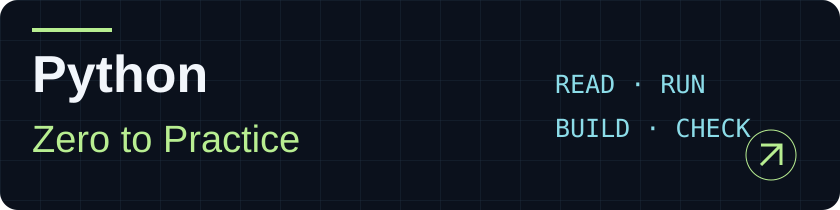
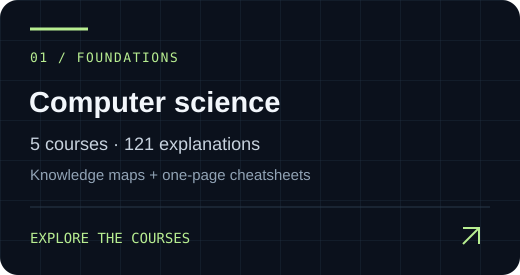
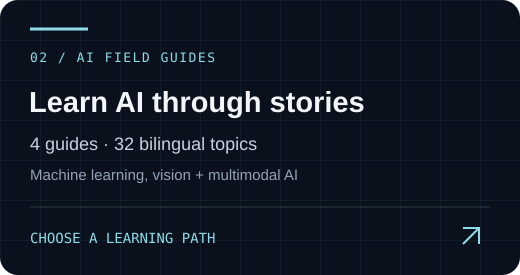

  <a href="https://leon1111-wgl.github.io/leon1111-wgl/"><strong>ENTER MY WEBSITE ↗</strong></a> &nbsp; / &nbsp;
  <a href="#about-me">About me</a> &nbsp; / &nbsp;
  <a href="#featured-project">Project</a> &nbsp; / &nbsp;
  <a href="#selected-research">Research</a> &nbsp; / &nbsp;
  <a href="#learning-portals">Courses</a> &nbsp; / &nbsp;
  <a href="mailto:zetongw6@gmail.com">Contact</a>

## About me

I am an MSc student at the University of Hong Kong, working on AI. My interests include multimodal models, LLM agents, long-video understanding and generation, and efficient video inference. I enjoy turning complex ideas into clear, practical learning resources.

| Currently exploring | How I work |
| :--- | :--- |
| Multimodal models and LLM agents | Connect model outputs to verifiable evidence |
| Long-video understanding and generation | Build datasets and evaluate models carefully |
| Efficient video inference | Explain ideas through stories, formulas and examples |

**Tools & interests** · Python · Java · C · Multimodal evaluation · lmms-eval · Instruction tuning · Knowledge distillation · Model quantization

## Featured project

### [CreditLens · 多模态金融证据工作台](https://github.com/leon1111-wgl/creditlens)

给投研和风险团队做三件事：查到财务指标并定位原文，确认口径后比较数字，把经营变化的依据与尚未证实的解释分开。先把每一步做成可检查、可交接的工作，再逐步扩展时序、因子和风险研究。

**已经能用：** 把微软和苹果的官方现金流材料放到一项研究中，逐项确认采用哪些数字、查看各公司自身的年度变化、拆开现金流与利润之间的调节项目、记录还没查清的解释，再固定底稿交给同事复核。退回修订会保留旧版，口径不同时说明原因。原有工作台还能计算财务指标、按历史日期看季度变化；让识别模型读取财报图片，对照数字、年份和单位，定位看错或看不清的地方，并比较不同识别方式的结果。目前可在本机运行。

**任务检查：** 每项材料和计算都能查看依据与缺口。数字可查不代表原因成立，底稿已复核也不会自动填补经营解释；修改后要按新版本重新检查。[三类任务怎样验收](https://github.com/leon1111-wgl/creditlens/blob/main/docs/24-research-task-acceptance.md)

**正在推进：** 为现金流变化补齐附注与公司原文解释，建立人工独立确认的测试题，扩充口径可对齐的同行与多季度材料；继续完善跨页表格、图表、公告修订和失败恢复，再提供在线演示。

**研究方向：** 联合数字、文字和图表，研究现金流时序预测、金融因子、企业关系和风险变化，再探索计入交易成本的投资组合。先建立简单基线，再用未参与调参的数据检验 AI 方法的增量价值；论文依据、实验设计和失败结果持续公开。

当前使用历史披露样例，图像识别已在本机 CPU 实际运行；通用多模态问答、自动公告更新、实时行情和模型预测仍在建设或研究中。现有功能不需要租训练服务器。

[源码与复现](https://github.com/leon1111-wgl/creditlens) · [通俗制作报告](https://github.com/leon1111-wgl/creditlens/tree/main/docs/iterations) · [平台设计与论文分析](https://github.com/leon1111-wgl/creditlens/blob/main/docs/11-financial-research-platform.md)

[企业需求与技术实现：通俗版](https://github.com/leon1111-wgl/creditlens/blob/main/docs/12-project-story-and-technology.md) · [完整项目与技术描述](https://github.com/leon1111-wgl/creditlens/blob/main/docs/14-resume-and-interview.md) · [新公司文档诊断](https://github.com/leon1111-wgl/creditlens/blob/main/docs/17-new-issuer-transfer.md) · [日期关联与原始证据核验](https://github.com/leon1111-wgl/creditlens/blob/main/docs/18-date-association.md) · [固定规则后的AMD检查](https://github.com/leon1111-wgl/creditlens/blob/main/docs/19-issuer-evaluation.md) · [并行迭代](https://github.com/leon1111-wgl/creditlens/blob/main/docs/15-parallel-iteration.md)

[港大公开项目与产业合作参照](https://github.com/leon1111-wgl/creditlens/blob/main/docs/research/2026-10-25-hku-industry-projects.md) · [研究任务与版本交接](https://github.com/leon1111-wgl/creditlens/blob/main/docs/20-research-tasks.md)

[现金流变化逐行拆解](https://github.com/leon1111-wgl/creditlens/blob/main/docs/21-cash-flow-bridge.md)

### [LoopDesk · 证据优先的企业客服 Agent](https://leon1111-wgl.github.io/loopdesk/)

把客服大模型做成能上线的系统：回答逐句对照知识库和业务数据校验，超额退款暂停等人工审批，模型故障时转人工或引用政策原文，坐席的每一次纠错都会变成知识补丁和回归测试。

`Agent 工具调用` · `RAG` · `人工审批` · `证据校验` · `回归评测` · `FastAPI + React`

在线演示是控制台的静态构建，数据录制自真实后端的离线运行（虚构数据），可以切换顾客、坐席、管理员浏览。完整版本在本地运行，可接入豆包、混元、DeepSeek 等模型。

**[打开在线演示 ↗](https://leon1111-wgl.github.io/loopdesk/)** · [源码与运行说明](https://github.com/leon1111-wgl/loopdesk) · [案例：一位顾客的退款](https://github.com/leon1111-wgl/loopdesk/blob/main/docs/CASE_STUDY.md)

### [EstateGuard · 社区智能巡检](https://leon1111-wgl.github.io/estateguard/)

将电梯搬运、通道占用和停车线索整理成可复核的物业事件。浏览器运行真实轻量视觉模型，分析本地图片或短视频，通过区域与时间规则形成候选，再记录人工判断并导出交接单。

`浏览器端视觉推理` · `场景规则` · `事件复核` · `中文工作台`

素材在本地处理，无需账户或 API key。当前是通用物体模型与规则基线；专门的违规行为识别仍需领域数据验证。

**[打开中文工作台 ↗](https://leon1111-wgl.github.io/estateguard/)** · [源码与运行说明](https://github.com/leon1111-wgl/estateguard) · [场景与实现案例](https://github.com/leon1111-wgl/estateguard/blob/main/docs/CASE_STUDY.md)

### [FinScope — Earnings Quality & Financial Resilience](https://leon1111-wgl.github.io/finscope/)

Does reported profit have cash-flow support? Review real SEC accounts, compare six companies, inspect AI anomaly cues and test a downside scenario. Export a research brief with formulas, assumptions and source evidence.

`Python` · `Machine learning` · `SEC financial evidence` · `Browser scenarios`

Use it online without an account or Python installation. Official annual filings and Treasury rates carry explicit source dates. The original synthetic forecasting lab remains a separate research track.

**[START A COMPANY REVIEW ↗](https://leon1111-wgl.github.io/finscope/)** · [Source code and setup](https://github.com/leon1111-wgl/finscope) · [Worked case](https://github.com/leon1111-wgl/finscope/blob/main/docs/CASE_STUDY.md)

## Selected research

**[Seeing Is Believing: Grounding Long-Video Understanding in Spatio-Temporal Visual Evidence](https://ojs.aaai.org/index.php/AAAI/article/view/38031)**

`AAAI 2026` · `Co-first author` · Long-video understanding

Long videos require answers that can be checked against visual evidence. This work introduces EV²-Bench and DynamicSelect to study evidence-grounded understanding and efficient video processing.

My contributions included benchmark construction, temporal and visual evidence annotation, model evaluation, and evidence scoring using temporal IoU, text similarity, and bipartite matching.

[Read the paper ↗](https://ojs.aaai.org/index.php/AAAI/article/view/38031) · [Research on my website ↗](https://leon1111-wgl.github.io/leon1111-wgl/#research)

## Background & experience

- **The University of Hong Kong** · MSc · 2026 - Present. Working on AI. Enrolled September 2026.
- **The University of Sydney** · Studied Finance and Computer Science · 2023–2026. Dalyell Scholar.
- **Zhejiang University** · Exchange study · Dec 2024 - Jan 2025. Short-term exchange experience.

- **Long-video research**, EV²-Bench & model evaluation · 2025 - 2026. Contributed to dataset construction and reproducible evaluation with lmms-eval, structured model outputs, and evidence precision, recall, and F1.
- **AI Algorithm Intern**, Shenzhen Beidou Applied Technology Research Institute · 2025. Worked on video data preparation, annotation consistency checks, and model fine-tuning, distillation, quantization, and deployment validation for safety monitoring.

**Languages** · Mandarin Chinese and English (IELTS 7.5)

## Learning portals

Choose a card to enter the teaching website. Follow **story → concept → formula → worked example**. All five courses have English and Chinese editions. Follow algorithms in Python, objects in Java and systems in C. Trace the output, work through the mathematics and compare alternatives.

**Python — Zero to Practice** · Chinese handbook · 19 learning units · 105 runnable examples · 114 self-study exercises · 4 complete projects.

[Read online ↗](https://leon1111-wgl.github.io/leon1111-wgl/python-zero-to-practice/index.html) · [Download the complete learning kit ↓](https://leon1111-wgl.github.io/leon1111-wgl/downloads/Python-Zero-to-Practice.zip) · [Browse the source](site/python-zero-to-practice/)

**New to Python or AI?** [Start here in English](https://leon1111-wgl.github.io/leon1111-wgl/ai/start.en.html) · [Start here in Chinese](https://leon1111-wgl.github.io/leon1111-wgl/ai/start.zh.html) · [Python examples](https://leon1111-wgl.github.io/leon1111-wgl/downloads/guoliang-python-examples.zip) · [All Python, Java and C examples](https://leon1111-wgl.github.io/leon1111-wgl/downloads/guoliang-code-examples.zip)

**Build with C:** [COMP2017 guided path](https://leon1111-wgl.github.io/leon1111-wgl/courses/comp2017.html#study-plan) · [Three complete engineering projects](https://leon1111-wgl.github.io/leon1111-wgl/courses/comp2017.html#projects) · [Download project source](https://leon1111-wgl.github.io/leon1111-wgl/downloads/COMP2017-projects.zip)

**Keep learning:** [Explore the guided extensions](https://leon1111-wgl.github.io/leon1111-wgl/#extensions-library). Follow complete bilingual cases on memory ownership, algorithm choices, logic, model evaluation, vision and multimodal retrieval. Predict the output, run the program and check each step.

<table>
<tr>
<td width="50%" align="center"> <a href="https://leon1111-wgl.github.io/leon1111-wgl/#learning"><strong>Open the course library ↗</strong></a>
5 courses · 121 topics
</td>
<td width="50%" align="center"> <a href="https://leon1111-wgl.github.io/leon1111-wgl/#ai"><strong>Open the bilingual AI guides ↗</strong></a>
4 guides · 64 bilingual topics
</td>
</tr>
</table>

<strong>Go straight to a course</strong>

### Computer science foundations

| Course | English | Chinese | Reference |
| :--- | :--- | :--- | :--- |
| INFO1113 | [Object-Oriented Programming in Java](https://leon1111-wgl.github.io/leon1111-wgl/courses/info1113.html) | [Read ZH](https://leon1111-wgl.github.io/leon1111-wgl/courses/info1113.zh.html) | [One-page PDF](https://leon1111-wgl.github.io/leon1111-wgl/downloads/INFO1113-cheatsheet.pdf) |
| COMP2017 | [Systems Programming: C, Processes & Concurrency](https://leon1111-wgl.github.io/leon1111-wgl/courses/comp2017.html) | [Read ZH](https://leon1111-wgl.github.io/leon1111-wgl/courses/comp2017.zh.html) | [One-page PDF](https://leon1111-wgl.github.io/leon1111-wgl/downloads/COMP2017-cheatsheet.pdf) |
| COMP2123 | [Algorithm Design and Analysis](https://leon1111-wgl.github.io/leon1111-wgl/courses/comp2123.html) | [Read ZH](https://leon1111-wgl.github.io/leon1111-wgl/courses/comp2123.zh.html) | [One-page PDF](https://leon1111-wgl.github.io/leon1111-wgl/downloads/COMP2123-cheatsheet.pdf) |
| COMP2022 | [Models of Computation: Languages, Machines & Logic](https://leon1111-wgl.github.io/leon1111-wgl/courses/comp2022.html) | [Read ZH](https://leon1111-wgl.github.io/leon1111-wgl/courses/comp2022.zh.html) | [One-page PDF](https://leon1111-wgl.github.io/leon1111-wgl/downloads/COMP2022-cheatsheet.pdf) |
| COMP3308 | [Artificial Intelligence: Search, Reasoning & Learning](https://leon1111-wgl.github.io/leon1111-wgl/courses/comp3308.html) | [Read ZH](https://leon1111-wgl.github.io/leon1111-wgl/courses/comp3308.zh.html) | [One-page PDF](https://leon1111-wgl.github.io/leon1111-wgl/downloads/COMP3308-cheatsheet.pdf) |

### AI field guides

| Guide | English | Chinese |
| :--- | :--- | :--- |
| Machine Learning | [Read EN](https://leon1111-wgl.github.io/leon1111-wgl/ai/ml.en.html) | [Read ZH](https://leon1111-wgl.github.io/leon1111-wgl/ai/ml.zh.html) |
| Deep Learning | [Read EN](https://leon1111-wgl.github.io/leon1111-wgl/ai/dl.en.html) | [Read ZH](https://leon1111-wgl.github.io/leon1111-wgl/ai/dl.zh.html) |
| Computer Vision: From Pixels to Perception | [Read EN](https://leon1111-wgl.github.io/leon1111-wgl/ai/vision.en.html) | [Read ZH](https://leon1111-wgl.github.io/leon1111-wgl/ai/vision.zh.html) |
| Multimodal AI | [Read EN](https://leon1111-wgl.github.io/leon1111-wgl/ai/multimodal.en.html) | [Read ZH](https://leon1111-wgl.github.io/leon1111-wgl/ai/multimodal.zh.html) |

[Download the complete cheatsheet collection](https://leon1111-wgl.github.io/leon1111-wgl/downloads/guoliang-cheatsheet-collection.pdf)

Leon · Research, ideas & learning in public. <a href="https://leon1111-wgl.github.io/leon1111-wgl/"><strong>Explore my personal website ↗</strong></a>

