<!-- Edited by hand. The README template in scripts/build_profile.py is older: do not regenerate this file from it. -->

  <a href="https://leon1111-wgl.github.io/leon1111-wgl/"><strong>Website ↗</strong></a> &nbsp;·&nbsp;
  <a href="#background">Background</a> &nbsp;·&nbsp;
  <a href="#projects">Projects</a> &nbsp;·&nbsp;
  <a href="mailto:zetongw6@gmail.com">Contact</a>

## Background

## 学术会议 · Conference

[Paper ↗](https://ojs.aaai.org/index.php/AAAI/article/view/38031)

## Projects

| &nbsp;&nbsp;&nbsp;&nbsp;&nbsp;&nbsp;&nbsp;&nbsp;&nbsp;&nbsp; | | | |
| :---: | :--- | :--- | :--- |
|  | **LoopDesk** | 企业客服助手：能查订单、办退款，关键操作先等人工确认，每句回答都有依据 | [Demo](https://leon1111-wgl.github.io/loopdesk/)&nbsp;·&nbsp;[Code](https://github.com/leon1111-wgl/loopdesk) |
|  | **ProofBI** | 用大白话问数据，自动查数出表，每个数字都能追到来源 | [Code](https://github.com/leon1111-wgl/proofbi) |
|  | **AdProof** | 检查广告文案是否违规，标出问题句和对应法规，并给出改写建议 | [Code](https://github.com/leon1111-wgl/adproof) |
|  | **CreditLens** | 读财报和图表，核对关键数字，点一下就跳回原文出处 | [Code](https://github.com/leon1111-wgl/creditlens) |
|  | **EstateGuard** | 在浏览器里看小区巡检画面，找出违停、堆物等问题，再交给人工确认 | [Demo](https://leon1111-wgl.github.io/estateguard/)&nbsp;·&nbsp;[Code](https://github.com/leon1111-wgl/estateguard) |
|  | **FinScope** | 读美股公司的财报（SEC 文件），看利润有没有水分 | [Demo](https://leon1111-wgl.github.io/finscope/)&nbsp;·&nbsp;[Code](https://github.com/leon1111-wgl/finscope) |

#### &nbsp;&nbsp;教程 · Tutorials

| | | |
| :--- | :--- | :--- |
| `INFO1110` | **Python 零基础实操** 19 个单元、105 个可运行示例、114 道练习、4 个小项目 | [阅读](https://leon1111-wgl.github.io/leon1111-wgl/python-zero-to-practice/index.html) |
| `INFO1113` | **Java 面向对象编程** 23 章：对象、集合、泛型、异常、测试与应用设计 | [教程](https://leon1111-wgl.github.io/leon1111-wgl/courses/info1113.zh.html)&nbsp;·&nbsp;[速查表](https://leon1111-wgl.github.io/leon1111-wgl/downloads/INFO1113-cheatsheet.pdf) |
| `COMP2017` | **系统编程：C、进程与并发** 24 章、57 个独立程序，外加 3 个完整工程项目 | [教程](https://leon1111-wgl.github.io/leon1111-wgl/courses/comp2017.zh.html)&nbsp;·&nbsp;[速查表](https://leon1111-wgl.github.io/leon1111-wgl/downloads/COMP2017-cheatsheet.pdf) |
| `COMP2022` | **计算模型：语言、机器与逻辑** 24 章：自动机、文法、可计算性与逻辑 | [教程](https://leon1111-wgl.github.io/leon1111-wgl/courses/comp2022.zh.html)&nbsp;·&nbsp;[速查表](https://leon1111-wgl.github.io/leon1111-wgl/downloads/COMP2022-cheatsheet.pdf) |
| `COMP2123` | **算法设计与分析** 26 章：图算法、贪心、分治与随机化 | [教程](https://leon1111-wgl.github.io/leon1111-wgl/courses/comp2123.zh.html)&nbsp;·&nbsp;[速查表](https://leon1111-wgl.github.io/leon1111-wgl/downloads/COMP2123-cheatsheet.pdf) |
| `COMP3308` | **人工智能：搜索、推理与学习** 24 章：搜索、博弈、神经网络、概率推理与聚类 | [教程](https://leon1111-wgl.github.io/leon1111-wgl/courses/comp3308.zh.html)&nbsp;·&nbsp;[速查表](https://leon1111-wgl.github.io/leon1111-wgl/downloads/COMP3308-cheatsheet.pdf) |
| `AI` | **AI 学习路线** 入门 8 讲；机器学习、深度学习、计算机视觉、多模态各 16 讲 | [入门](https://leon1111-wgl.github.io/leon1111-wgl/ai/start.zh.html) · [ML](https://leon1111-wgl.github.io/leon1111-wgl/ai/ml.zh.html) · [DL](https://leon1111-wgl.github.io/leon1111-wgl/ai/dl.zh.html) · [CV](https://leon1111-wgl.github.io/leon1111-wgl/ai/vision.zh.html) · [多模态](https://leon1111-wgl.github.io/leon1111-wgl/ai/multimodal.zh.html) |

[全部课程](https://leon1111-wgl.github.io/leon1111-wgl/#learning)&nbsp;·&nbsp;[速查表合集 PDF](https://leon1111-wgl.github.io/leon1111-wgl/downloads/guoliang-cheatsheet-collection.pdf)

`Python` `Java` `C` `LLM Agents` `RAG` `Multimodal Evaluation` `Distillation` `Quantization` · Mandarin, English (IELTS 7.5)

<a href="mailto:zetongw6@gmail.com">zetongw6@gmail.com</a> · <a href="https://leon1111-wgl.github.io/leon1111-wgl/">leon1111-wgl.github.io</a>

