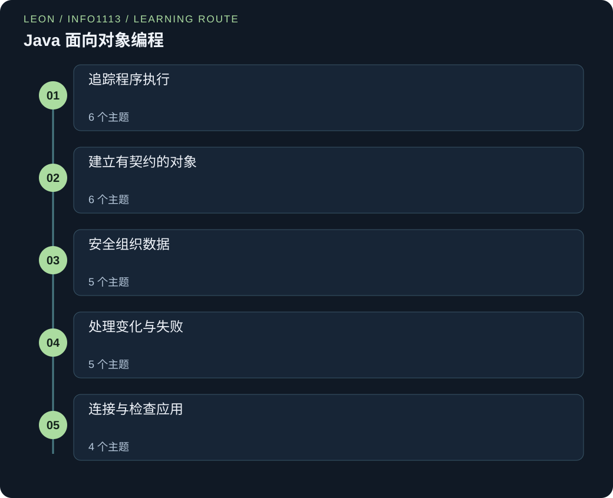

# INFO1113 — Java 面向对象编程

> Leon | Original study notes

[English](INFO1113.md) · [中文](INFO1113.zh.md)



<a id="extensions"></a>

## 继续深入：完整案例

先读对应章节，再跟着故事预测输出、运行完整程序、核对解释。每个案例都在原有概念上增加一个实际问题。

1. [保护成绩快照，隔离外部修改](#lab-classes-invariants-defensive-snapshot) — 沿构造器和 getter 跟踪数据所有权。

2. [用值对象作为 Map 的键](#lab-equality-hashing-immutable-grid-key) — 区分引用身份、值相等与哈希冲突。

3. [做一个可以撤销的小编辑器](#lab-application-design-undoable-notebook) — 把对象模型变成可测试的小功能。

通过原创情景、逐步跟踪和设计判断，建立精确的 Java 心智模型。每章把语法与运行行为联系起来，并用迁移问题检查理解。

完整的 Java 8 学习路径涵盖执行、对象契约、输入输出、集合、泛型、异常、测试、递归、回调与应用设计。26 章各含两个独立可运行程序、行为跟踪、引导问答与工程分析。

## 把知识连接起来

### 追踪程序执行
- [从源代码到有类型的值](#java-execution-types)
- [条件、循环与不变式](#control-flow)
- [方法、栈帧与复制的引用](#methods-references)
- [数组、不规则网格与浅复制](#arrays)
- [内存图：栈、堆、引用与垃圾回收](#memory-diagrams)
- [文本值、相等性与构建器](#strings)

### 建立有契约的对象
- [类、构造器与受保护状态](#classes-invariants)
- [输入、文件与资源生命周期](#text-io)
- [二进制流与匹配的数据布局](#binary-io)
- [继承、组合与可替换性](#inheritance-composition)
- [重载选择签名，重写选择行为](#overload-override)
- [抽象类、接口与默认行为](#abstractions)

### 安全组织数据
- [选择列表、集合、映射与链式结构](#collections)
- [身份、值相等与哈希契约](#equality-hashing)
- [泛型类、类型上界与类型安全](#generics)
- [通配符与数据流方向](#wildcards)
- [迭代器、别名与可达性](#iteration-memory)

### 处理变化与失败
- [把异常作为明确的失败路径](#exceptions)
- [自定义异常：受检查还是非受检查](#custom-exceptions)
- [枚举与有限状态模型](#enums-state)
- [断言、测试与有用边界](#testing-contracts)
- [递归、调用树与结果复用](#recursion-memoization)

### 连接与检查应用
- [匿名类、lambda 与捕获上下文](#lambdas)
- [依据证据调试，记录明确承诺](#debugging-documentation)
- [包、访问控制与类图](#packages-uml)
- [从对象模型到小型事件驱动应用](#application-design)

<a id="java-execution-types"></a>

## 从源代码到有类型的值

### 01 / 从一个故事开始

想象一家工坊收到一套模型铁路的图纸。图纸检查员先把不可能实现的连接挑出来拒绝，再制作一份标准化的装配说明，让不同的工坊都能看懂。不过每家工坊仍然需要自己的工具，才能照着说明把铁路造出来。Java 的编译器就像这位检查员，字节码就像那份标准化的说明，而兼容的虚拟机则提供各地用来执行的设备。

这个比喻有它的局限：通过检查并不能证明造好的铁路运行正确。列车仍然可能被送到错误的目的地，就像一个类型完全正确的程序也可能算出错误的答案。

### 02 / 理解原理

常规的 Java 程序写在 .java 源文件中，由 javac 编译成 .class 字节码，再交给兼容的 JVM 执行。编译期检查能发现语法错误和许多类型错误；其他类型的失败则要靠运行时检查和你自己的测试来处理。变量声明的类型限定了它可以存放哪些值，以及可以对它做哪些操作。

基本类型的值包括 int、double 和 boolean；引用值则指向某个对象，或者是 null。int 是 32 位有符号整数，而 double 表示的是二进制浮点的近似值。整数运算可能溢出，整数除法会向零截断。从小类型到大类型的扩宽转换往往自动发生，而缩小类型的强制转换可能丢失信息。

局部变量在使用之前必须已经确定被赋过值。作用域决定的是一个名字在哪些地方可以访问，并不决定每个值在内存中实际存放的位置。在常规的 main(String[] args) 中，命令行参数是以 String 的形式传入的；访问下标之前要先检查数组长度，数字文本也要有意识地去解析。

### 03 / 逐项读懂公式

```text
源代码 → javac → 字节码 → JVM 执行
int 范围：−2³¹ ≤ x ≤ 2³¹ − 1
7 / 2 = 3；7 / 2.0 = 3.5
```

箭头表示的是常规的编译再运行的流程，并不是说每一次启动 Java 都必须分成单独的命令。x 是存放在 int 中的某个值。两个除法的例子，区分的是两个操作数都是整数的情形，与表达式中含有 double 操作数的情形。整数除法已经丢掉了小数部分，之后再对结果做强制转换，也无法把丢弃的小数找回来。

这些规则描述的是 Java 的算术，而具体的处理器指令和对象在内存中的布局属于实现细节，本模型有意不对它们作任何假设。

### 04 / 先看一个完整例子

一个自行车租赁程序记录了 7 次已完成的行程和 2 个活跃日。表达式 double average = 7 / 2 赋给 average 的是 3.0，因为整数除法在转换之前就已经完成。写成 double average = 7 / 2.0 则得到 3.5。接着，int whole = (int) 3.9 得到 3，这是截断，不是四舍五入。把一个公开类 TripStats 保存在 TripStats.java 中，编译它，然后启动 TripStats。

如果编译器拒绝了一个未初始化的局部变量，就去补上缺少的赋值。如果程序能运行，却报告 3.0，说明编译已经成功，需要修改的是那个数值表达式。

### 先认识这些词

- **基本类型值:** 直接表示数值或布尔值，而非对象引用。

- **强制类型转换:** 显式请求转换数值，可能丢失信息。

- **溢出:** 数学结果超出类型可表示的范围。

### 一步步想清楚

**为什么把整数除法结果赋给 double 不能恢复小数？**

除法已经完成，Java 之后才转换截断后的整数结果。应在相除前转换一个操作数。

**为什么 50000 乘 50000 要使用 long？**

结果 2500000000 超过 Integer.MAX_VALUE。乘法前先让至少一个操作数为 long，运算才使用更宽类型。

**能解析成功是否代表所有整数都可接受？**

不代表。解析检查表示方式；计数仍可能要求非负或不超过上限。

<a id="lab-java-execution-types-java-numeric-conversions"></a>

### 观察转换发生的时点

比较整数除法、浮点除法，以及在乘法之前先扩宽类型的做法。

```java
public class Main {

    public static void main(String[] args) {
        int trips = 7, days = 2;
        double late = trips / days;
        double early = (double)trips / days;
        int width = 50000;
        long area = (long)width * width;
        System.out.println("late=" + late);
        System.out.println("early=" + early);
        System.out.println("area=" + area);
        System.out.println("truncate=" + (int)-3.9);
    }
}
```

**在本地运行**

```sh
javac -encoding UTF-8 Main.java
java -ea Main
```

**预期输出**

```text
late=3.0
early=3.5
area=2500000000
truncate=-3
```

**读懂这里的语法**

- `public class Main`: 声明名为 Main 的公开类。把这个完整的程序保存为 Main.java。花括号包围类的主体。

- `public static void main(String[] args)`: 这是 JVM 的入口方法，可以被公开调用。static 表示不需要 Main 的实例；void 表示不返回值；args 是命令行字符串组成的数组。

- `System.out.println(value)`: 把一个值发送到标准输出流，然后结束这一行。点号用来选择成员，圆括号提供实参，分号结束这条语句。

- `(double) trips / days`: 这个强制转换先把 trips 转换，然后才做除法。类型外面的圆括号表示这是强制转换，而不是方法调用。

**按执行顺序理解**

1. 把 trips 和 days 声明为 int，所以第一次除法使用的是整数运算。

2. 在除法之前转换 trips，在乘法之前转换 width，以此改变运算的类型。

3. 打印带有名字的结果，让信息是在哪一步丢失的清楚地显示出来。

**跟踪状态的变化**

| 表达式 | 结果 |
| --- | --- |
| 7 / 2 | 3 |
| (double) 7 / 2 | 3.5 |
| (long) 50000 * 50000 | 2500000000 |

**逐步读懂代码**

赋值之前，操作数就已经决定了除法的类型。late 得到的是 3.0，因为 7/2 已经先变成了 3。early 则先转换 trips，所以除法保留了小数部分。

乘法之前的强制转换使乘积成为 long。最后一次强制转换向零截断，得到的是 −3，而不是 −4。这些都是语言的规则，而不是对处理器如何存储的猜测。

<a id="lab-java-execution-types-java-parse-and-range"></a>

### 分开解析与有效范围

处理固定的文本输入，不需要交互式的提示。

```java
public class Main {

    public static void main(String[] args) {
        for (String text : new String[] {"12", "-2", "twelve", "2147483648"}) {
            try {
                int value = Integer.parseInt(text);
                if (value < 0)
                    System.out.println(text + ": negative count");
                else
                    System.out.println(text + ": accepted " + value);
            } catch (NumberFormatException ex) {
                System.out.println(text + ": invalid int text");
            }
        }
    }
}
```

**在本地运行**

```sh
javac -encoding UTF-8 Main.java
java -ea Main
```

**预期输出**

```text
12: accepted 12
-2: negative count
twelve: invalid int text
2147483648: invalid int text
```

**按执行顺序理解**

1. 数组按固定的顺序提供了四个互相对照的输入。

2. 在符号规则运行之前，parseInt 先验证它是不是合法的十进制 int 表示。

3. catch 报告转换失败，并让下一次迭代继续进行。

**逐步读懂代码**

每段文本都在它自己的 try 块里解析。一个语法上合法的负整数会走到领域检查那一步。非数字的文本，以及超出 int 范围的整数，都会在解析时失败。

某一项失败之后循环依然继续，因为处理异常的代码就在循环内部。没有任何无效的值被悄悄改成零。

### Leon 的进一步思考

**移动转换位置，而不是只换接收类型**

long result = a*b 可能先在 int 运算中溢出，再赋值。写成 (long)a*b 才会扩宽运算本身。这也解释整数除法示例。

**表示检查与领域检查**

Integer.parseInt 能拒绝格式错误或超范围文本。另一个范围检查落实任务含义。区分两类失败有助于提供有效错误信息。

**注意这个边界:** 不要说所有基本类型的值都存放在栈上，也不要说编译成功就证明程序正确。存储位置取决于具体的上下文和实现；类型正确只是正确性的其中一层。

<details>
<summary>检查自己的理解</summary>

(double) (9 / 4) 得到什么？怎样得到 2.25？

得到 2.0。整数除法先发生。使用 9 / 4.0 或 ((double) 9) / 4，在除法前引入浮点运算。

</details>

<a id="control-flow"></a>

## 条件、循环与不变式

### 01 / 从一个故事开始

图书管理员先检查完推车上的一层书架，再去下一层。规则并不是简单地一直往前走：每检查完一层，所有更早的书架都必须已经检查过。正是这个被记住的事实，让前进有了意义。while 循环就像开始之前先确认还有没有下一层书架；do-while 则像先检查一层，再决定要不要继续。

增强 for 循环把走哪条路线交给了推车自身的遍历机制。这个比喻的用处在于：循环既需要一个停止的规则，也需要一个始终保持为真的事实，而不只是一个不断变化的计数器。

### 02 / 理解原理

if 语句根据 boolean 条件选择一个分支。&& 和 || 采用短路求值，只有在必要的时候才会计算右边的操作数；这对 x != null && x.isReady() 这样的保护条件很有用。while 循环在执行循环体之前检查条件，而 do-while 则在循环体之后检查。for 循环把初始化、条件和更新放在一起，一眼就能看到。

增强 for 会依次访问每个元素，但不会自动提供下标。要分析一个循环，先说明它的不变式，证明初始化建立了这个不变式，再证明循环体保持了它，最后利用退出条件得出结果。同时还要找出一个朝着终止方向变化的量。break 会退出整个循环；continue 则跳过当前这一轮剩下的部分，进入下一轮的更新步骤。

### 03 / 逐项读懂公式

```text
第 i 轮开始前：total = a[0] + … + a[i−1]
0 ≤ i ≤ n；remaining = n − i
退出时 i = n：total 等于全部 n 个元素之和
```

a 是含有 n 个数的数组，i 是下一个要处理的下标，total 是已经累加的和。i = 0 时的空和是零。remaining 是一个非负的进度量，每一轮减少一。这样的推理假设每一轮都会推进 i，数组的长度保持不变，并且算术运算不会溢出。它描述的是一种证明的结构，同样适用于搜索、计数和验证类的循环。

### 04 / 先看一个完整例子

要累加每日的租借次数 [4, 0, 7]，先初始化 total = 0 和 i = 0。不变式说的是：还没处理的元素都还没有被计入。第一轮之后，total = 4，i = 1。第二轮之后，total 仍然是 4，i = 2。第三轮之后，total = 11，i = 3。这时 i < a.length 为假，所以答案是 11。如果把条件改成 i <= a.length，就会去访问下标 3，程序随即失败。

如果数组是空的，原来的循环一轮也不会执行，正确地返回零。

### 先认识这些词

- **循环不变式:** 每次完整迭代前后都成立的事实。

- **短路求值:** 第一个布尔操作数已决定结果时，不求第二个。

- **进展度量:** 朝终止方向变化、且有界的量。

### 一步步想清楚

**为什么零是正确的初始总和？**

此时还没有处理任何值。这个空前缀的和就是零，因此不变式得以建立。

**是什么让这个循环能够结束？**

i 每一轮增加一，不可能永远小于一个固定的长度。剩余数量 length−i 会一路减小到零。

**为什么要把 text != null 放在 text.length() 之前？**

如果 text 是 null，&& 会在调用 length 之前就停下来。把两个操作数颠倒过来，就会先执行那个不安全的调用。

<a id="lab-control-flow-java-prefix-sum-trace"></a>

### 追踪已处理前缀

每次更新之后，打印出不变式的状态。

```java
public class Main {

    public static void main(String[] args) {
        int[] values = {4, 0, 7};
        int total = 0;
        for (int i = 0; i < values.length; i++) {
            total += values[i];
            System.out.println("processed=" + (i + 1) + ", total=" + total);
        }
        int emptyTotal = 0;
        for (int value : new int[0])
            emptyTotal += value;
        System.out.println("empty total=" + emptyTotal);
    }
}
```

**在本地运行**

```sh
javac -encoding UTF-8 Main.java
java -ea Main
```

**预期输出**

```text
processed=1, total=4
processed=2, total=4
processed=3, total=11
empty total=0
```

**读懂这里的语法**

- `for (int i = 0; i < values.length; i++)`: 初始化只做一次，每次执行循环体之前先测试条件，每一轮完成之后再递增。i++ 把 i 增加一。

- `values[i]`: 方括号选取从零开始的下标 i 处的元素。length 是一个字段，给出数组的元素个数。

- `total += values[i]`: 把当前元素加到 total 上，并保存新的总和。这里选用的小数值输入不会超出数值类型的范围。

**按执行顺序理解**

1. 初始化 total，以建立空前缀的不变式。

2. 使用 i<length，使每一次按下标读取都在边界之内。

3. 加法之后再打印，然后在空输入上单独运行同样的累加思路。

**跟踪状态的变化**

| 已处理项 | 总和 |
| --- | --- |
| 0 | 0 |
| 1 | 4 |
| 2 | 4 |
| 3 | 11 |

**逐步读懂代码**

在第 i 轮迭代之前，total 恰好包含前 i 个元素。加上 values[i] 之后，这个前缀就多了一项。打印出来的已处理数量是 i+1，因为打印是在加法之后进行的。

空数组上的增强 for 循环不会执行循环体，它的 total 保持为零。这个对照检查了边界情况，而不需要引入一个特殊情形的 return。

<a id="lab-control-flow-java-guard-and-search"></a>

### 保护空引用并在首个匹配处停止

把短路保护与有界的搜索结合起来。

```java
public class Main {

    public static void main(String[] args) {
        String[] names = {null, "", "oak", "pine", "elm"};
        int found = -1;
        for (int i = 0; i < names.length; i++) {
            String name = names[i];
            if (name == null || name.isEmpty())
                continue;
            if (name.length() == 4) {
                found = i;
                break;
            }
        }
        System.out.println("first length-four index=" + found);
        System.out.println("matched=" + names[found]);
    }
}
```

**在本地运行**

```sh
javac -encoding UTF-8 Main.java
java -ea Main
```

**预期输出**

```text
first length-four index=3
matched=pine
```

**按执行顺序理解**

1. 用 −1 作为有文档说明的「没有匹配」标记。

2. 在调用其他 String 方法之前，先用 continue 跳过无效的条目。

3. 保存第一个匹配的下标，并用 break 退出循环。

**逐步读懂代码**

保护条件会跳过缺失的或为空的名字。如果 name 是 null，|| 就不会调用 isEmpty。留下来的名字可以安全地检查。

第一个长度为四个字母的名字是下标三处的 pine。break 保留了「第一个匹配」这个含义。这个例子事先知道一定有匹配；一般的调用者在按下标访问之前，必须先检查 found。

### Leon 的进一步思考

**把安全性与进展分开**

即使循环永远不会结束，不变式也可能成立。例如，如果循环什么都不做，前缀和依然是正确的。因此要同时说明被保持的事实，以及一个不断减少的剩余工作量。

**空的情况也是设计的一部分**

用 i<length 写的求和循环，对空数组自然返回零。而 do-while 会先进入一次循环体，需要另外加一道保护。要根据零次迭代是否合法，来选择合适的控制流。

**注意这个边界:** 对从零开始编号的数组使用 <= length，是典型的差一错误。把 null 检查写在方法调用之后，也会让短路求值的保护作用落空。

<details>
<summary>检查自己的理解</summary>

为什么一个循环能保持它的不变式，却仍然可能无法结束？

不变式描述的是安全性，而不是进展。如果 i 始终不增加，不变式可能永远保持为真；要论证循环会终止，还需要一个不断减小并且有界的进度量。

</details>

<a id="methods-references"></a>

## 方法、栈帧与复制的引用

### 01 / 从一个故事开始

两位协调员各有一张一模一样的卡片，上面写着同一块社区公告板的位置。任何一位协调员都可以修改这块公告板，而且两个人都会看到修改的结果。但如果其中一位协调员把自己手里的卡片换成另一块公告板的位置，另一个人的卡片并不会跟着变。这个画面正好说明了把引用传给 Java 方法时发生的事：引用的值被复制了一份，而被引用的对象则可以被共享。

每个方法还有属于自己的一张工作台，用来放局部变量。方法返回时，这张工作台在概念上被清空，但这并不会自动销毁仍然可以从别处到达的对象。

### 02 / 理解原理

调用方法会创建一次新的调用，调用中的形参变量用实参的值来初始化。Java 始终是按值传递的。对于基本类型的实参，复制的值就是那个基本类型的值；对于对象类型的实参，复制的值是一个引用。给形参重新赋值，绝不会改变调用者的变量。但如果修改了共享对象的字段或数组元素，调用者仍然可以观察到这些改变。

每一次调用都有自己的局部变量，递归调用也不例外。static 方法属于类这一层，没有隐含的 this；实例方法则会收到一个具体的接收者对象。return 结束这次调用，并在声明的返回类型不是 void 时提供一个返回值。当输入、输出和副作用都写得明确的时候，方法的边界才最好用。

### 03 / 逐项读懂公式

```text
形参值 ← 实参值的副本
调用者 r ─┐
          ├→ 共享对象 O
被调用者 p ─┘
p = anotherObject 改变 p，不改变 r
```

r 是调用者的引用变量，p 是方法的形参变量，O 是它们最初都指向的那个对象。箭头表示引用，而不是暴露出来的数字内存地址。赋值箭头表示把一个值复制到另一个变量中。这个模型对数组和普通对象同样适用。

返回值可以有意地把一个新的引用交给调用者，但调用者必须把这个返回值赋给变量，才能让自己的变量发生变化。

### 04 / 先看一个完整例子

假设有 int[] scores = {6, 8}。一个方法把 scores 接收为形参 x，先执行 x[0] = 10，再执行 x = new int[]{1, 2}。第一条语句把共享的原数组改成了 [10, 8]。第二条语句只是把局部形参 x 改为指向一个新数组。调用结束之后，scores 仍然指向 [10, 8]。如果这个方法改为返回 x，而调用者写成 scores = replace(scores)，那么调用者就是明确地采用了返回的 [1, 2] 数组。

区分修改与重新赋值，就能解释这两种结果，而不必把 Java 说成是按引用传递。

```java
import java.util.Arrays;

public class ReferenceDemo {
    static void change(int[] x) {
        x[0] = 10;
        x = new int[]{1, 2};
    }
    public static void main(String[] args) {
        int[] scores = {6, 8};
        change(scores);
        System.out.println(Arrays.toString(scores)); // [10, 8]
    }
}
```

将这个短例子另存为 ReferenceDemo.java，放在单独文件夹中。运行：

```sh
javac -encoding UTF-8 ReferenceDemo.java
java -ea ReferenceDemo
```

### 先认识这些词

- **实参:** 调用方法时提供的值。

- **形参:** 用实参值的副本初始化的新变量。

- **别名:** 指向同一对象的另一个引用。

### 一步步想清楚

**哪一种赋值能穿过方法的边界？**

写入 x[0] 会改变共享的数组。把一个新数组赋给 x，则只改变形参变量本身。

**调用者怎样才能采用新的数组？**

返回它的引用，并把结果赋给调用者自己的变量。这样调用者才是明确地改变了它自己的引用。

**为什么对 Integer 做自增不会改变调用者的变量？**

Integer 是不可变的。拆箱、相加、再装箱，会为局部形参生成一个替代的值。

<a id="lab-methods-references-java-mutation-reassignment"></a>

### 比较修改与重新赋值

让调用者的原数组在调用结束后依然可以看到。

```java
import java.util.Arrays;

public class Main {
    static void change(int[] x) {
        x[0] = 10;
        System.out.println("after mutation=" + Arrays.toString(x));
        x = new int[] {1, 2};
        System.out.println("local replacement=" + Arrays.toString(x));
    }
    public static void main(String[] args) {
        int[] scores = {6, 8};
        change(scores);
        System.out.println("caller=" + Arrays.toString(scores));
    }
}
```

**在本地运行**

```sh
javac -encoding UTF-8 Main.java
java -ea Main
```

**预期输出**

```text
after mutation=[10, 8]
local replacement=[1, 2]
caller=[10, 8]
```

**读懂这里的语法**

- `static void change(int[] x)`: 声明一个类方法，它接收一个被复制的数组引用。void 表示它不返回值。

- `x[0] = 10`: 修改 x 所指对象中的第零个元素。这与给 x 本身赋值是不同的。

- `x = new int[] {1, 2}`: 创建一个数组，并且只替换局部形参的值。new 会分配一个新的对象。

**按执行顺序理解**

1. 把 scores 的引用值传入一个新的形参 x。

2. 先修改共享的元素，再让形参重新绑定到别处。

3. 返回之后检查 scores，看看哪一个改动保留了下来。

**跟踪状态的变化**

| 时点 | 调用者数组 | 局部数组 |
| --- | --- | --- |
| 进入方法 | [6,8] | [6,8] |
| 写入元素 | [10,8] | [10,8] |
| 形参重新赋值 | [10,8] | [1,2] |

**逐步读懂代码**

两个引用最初指向同一个数组。给元素赋值会改变这个数组。而对 x 重新赋值，只是为被调用的方法单独开出了一条不同的路径。

调用者看到的仍然是 [10,8]。在方法内部和返回之后各打印一次，就把两种状态都展示了出来，而不必假装引用是数字地址。

<a id="lab-methods-references-java-return-new-reference"></a>

### 明确返回替代引用

对比复制一个基本类型的包装类，与接受一个返回的数组。

```java
import java.util.Arrays;

public class Main {
    static void increment(Integer x) {
        x++;
        System.out.println("local count=" + x);
    }
    static int[] doubled(int[] input) {
        int[] result = input.clone();
        for (int i = 0; i < result.length; i++)
            result[i] *= 2;
        return result;
    }
    public static void main(String[] args) {
        Integer count = 4;
        increment(count);
        System.out.println("caller count=" + count);
        int[] values = {2, 5};
        int[] replacement = doubled(values);
        System.out.println("original=" + Arrays.toString(values));
        values = replacement;
        System.out.println("adopted=" + Arrays.toString(values));
    }
}
```

**在本地运行**

```sh
javac -encoding UTF-8 Main.java
java -ea Main
```

**预期输出**

```text
local count=5
caller count=4
original=[2, 5]
adopted=[4, 10]
```

**按执行顺序理解**

1. 把局部包装类的替换，与调用者的 count 分开来观察。

2. 先克隆再翻倍，使输入的约定中没有修改。

3. 在调用者一侧明确地把返回的引用赋给变量。

**逐步读懂代码**

对包装类做自增，只是给局部形参重新赋值。doubled 创建了一个独立的基本类型数组，并修改这份副本。

原数组始终保持为 [2,5]；在调用者把返回的引用赋给 `values` 之前，`values` 一直指向它。指向旧数组的其他别名，仍然会指向旧的数组。

### Leon 的进一步思考

**是否修改参数是 API 的决定**

一个会修改其实参的方法，必须把这一点说清楚。返回一份复制结果的方法，可以避免让其他别名感到意外，代价是要分配内存并复制数据。选定一种约定，并为它写测试。

**final 形参仍然允许修改对象**

声明 final int[] x 只能防止把另一个数组赋给 x，并不能阻止 x[0]=10。不可变性针对的是可达的对象，而不仅仅是局部引用能不能移动。

**注意这个边界:** 把 Java 称为按引用传递，会掩盖一个关键的区别。Java 传递的是一个按值复制的引用值；对象的修改可以穿过方法的边界，而形参的重新赋值则不能。

<details>
<summary>检查自己的理解</summary>

如果一个方法用 x++ 对 Integer 形参做自增，调用者的 Integer 变量会看到变化吗？

不会。Integer 是不可变的；拆箱、自增再装箱，最终是给局部形参重新赋了值。调用者保留的仍然是原来的引用。

</details>

<a id="arrays"></a>

## 数组、不规则网格与浅复制

### 01 / 从一个故事开始

一个储物柜有一排从零开始编号的抽屉。订购一个有五个抽屉的柜子，只是确定了它的大小，并不会在里面凭空造出五件东西。一个本来打算放工具的抽屉，一开始可以是空的。一个由柜子组成的柜子，里面的小柜子可以大小不一，也可以在某个小柜子还没送到的位置上留着空位。

把外层柜子上的标签抄一份，并不会把里面小柜子的内容也复制一遍。这个比喻说明了为什么 Java 数组的长度是固定的，为什么引用类型的元素默认是 null，为什么多维数组可以是不规则的，以及为什么复制时需要明确地决定复制多深。

### 02 / 理解原理

数组是一个对象，它有固定的长度，并且所有元素属于同一种元素类型。合法的下标从零一直到长度减一。基本类型数组的元素会得到各自类型的默认值；引用类型的元素一开始是 null。Java 的二维数组其实是由数组引用组成的数组，所以各行的长度可以不同，也可以是 null。

遍历每一个已经分配的行时，要使用这一行自己的长度。把一个数组变量赋给另一个数组变量，会让两者成为同一个数组的别名。克隆一个数组会创建一个新的外层数组，但只是复制它的元素；如果这些元素是引用，它们所指的对象仍然是共享的。引用类型的数组是协变的，这使得某些赋值可以通过编译，但需要在运行时做存储检查。

泛型有意采用了不同的规则，以避免这种特定的隐患。

### 03 / 逐项读懂公式

```text
有效下标：0 ≤ i < a.length
不规则网格格数 = 对所有非 null 行求 Σ row.length
outerCopy = original.clone()：outerCopy ≠ original；行仍可能共享
```

i 是一个整数下标，a 是一个非 null 的数组。Σ 表示把每个已分配的行的长度加起来；矩形的网格只是各行长度都相同的特殊情形。外层数组之间的不等号表示它们是不同的身份，而不是内容不同。对外层数组做克隆，并不会递归地复制里面嵌套的数组。

合适的复制深度，取决于后面的代码是否需要独立地修改那些共享的元素。

### 04 / 先看一个完整例子

创建 int[][] rack = {{2, 5}, {9}}。里面存放了三个数，而不是四个，因为第二行的长度是一。把外层数组克隆为 copy。设置 copy[0][1] = 7 时，rack[0][1] 也会随之改变，因为两个外层数组仍然指向同一个第一行。接着设置 copy[1] = new int[]{4, 6, 8}。这时只有 copy 的第二行引用改变了；rack 的第二行仍然是 [9]。

要把所有的整数格子都隔离开，还需要把每个非 null 的行也克隆一遍。如果行里装的是可变对象，那么还有另一个复制深度的决定要做。

### 先认识这些词

- **不规则数组:** 各行长度不必相同的数组。

- **浅复制:** 新外层容器仍共享其引用的内部对象。

- **元素类型:** 数组允许存入的元素类型。

### 一步步想清楚

**{{2,5},{9}} 一共包含多少个格子？**

三个：第一行两个，第二行一个。只有在证明了数组是矩形之后，才能用行数乘以列数。

**outer.clone 会把某一行的元素隔离开吗？**

不会。它复制的是各行的引用。如果需要独立地修改格子，就要把每个基本类型的行分别克隆。

**为什么 Object[] 的别名不能让 String[] 接受任意的值？**

实际的数组仍然保留着它的 String 元素类型。运行时的存储检查会拒绝不兼容的对象。

<a id="lab-arrays-java-ragged-copy"></a>

### 追踪浅复制与逐行复制

观察每一次修改分别越过了哪一道复制的边界。

```java
import java.util.Arrays;

public class Main {

    public static void main(String[] args) {
        int[][] original = {{2, 5}, {9}};
        int[][] shallow = original.clone();
        shallow[0][1] = 7;
        shallow[1] = new int[] {4, 6, 8};
        System.out.println("original=" + Arrays.deepToString(original));
        System.out.println("shallow=" + Arrays.deepToString(shallow));
        int[][] isolated = new int[original.length][];
        for (int i = 0; i < original.length; i++)
            isolated[i] = original[i].clone();
        isolated[0][0] = 99;
        System.out.println("original after isolated edit=" +
                           Arrays.deepToString(original));
    }
}
```

**在本地运行**

```sh
javac -encoding UTF-8 Main.java
java -ea Main
```

**预期输出**

```text
original=[[2, 7], [9]]
shallow=[[2, 7], [4, 6, 8]]
original after isolated edit=[[2, 7], [9]]
```

**读懂这里的语法**

- `int[][] rack`: 声明一个数组，它的元素是指向 int 数组的引用。两对方括号并不要求形状是矩形。

- `rack.clone()`: 调用 clone 来创建一个新的外层数组。每个元素的值，包括每个行的引用，都会被复制。

- `copy[0][1]`: 先选取第零行，再选取这一行里的第一个元素。引用和下标范围都必须合法。

**按执行顺序理解**

1. 克隆外层数组，并修改一个共享的行。

2. 替换一个行的引用，把改动槽位与改动格子区分开来。

3. 先克隆各个单独的行，再做一次被隔离的修改。

**跟踪状态的变化**

| 操作 | 原第一行 |
| --- | --- |
| start | [2,5] |
| shallow[0][1]=7 | [2,7] |
| isolated[0][0]=99 | [2,7] |

**逐步读懂代码**

对外层数组的克隆，共享了原来的两个行。修改一个格子，通过 original 也能看到。替换 shallow[1]，则只会改变外层的那个槽位。

第二个副本克隆了每一个基本类型的行。它之后对格子的修改，不会改变 original。这个例子里没有 null 行；一般的复制代码必须检查这种情况。

<a id="lab-arrays-java-array-store-and-null-rows"></a>

### 处理 null 行与受检查的存储

展示两个数组的边界，同时不让程序崩溃。

```java
public class Main {

    public static void main(String[] args) {
        int[][] rows = {{1, 2}, null, {}, {3}};
        int cells = 0;
        for (int[] row : rows)
            if (row != null)
                cells += row.length;
        System.out.println("cells=" + cells);
        Object[] values = new String[2];
        values[0] = "safe";
        try {
            values[1] = Integer.valueOf(5);
        } catch (ArrayStoreException ex) {
            System.out.println("incompatible store rejected");
        }
        System.out.println("second slot=" + values[1]);
    }
}
```

**在本地运行**

```sh
javac -encoding UTF-8 Main.java
java -ea Main
```

**预期输出**

```text
cells=3
incompatible store rejected
second slot=null
```

**按执行顺序理解**

1. 在读取 length 之前，先用 row!=null 做保护。

2. 把一个 String 数组赋给更宽的引用类型，同时保留它实际的元素类型。

3. 捕获这个有意触发的存储失败，并检查未发生变化的状态。

**逐步读懂代码**

计数时使用的是每个已存在的行自己的长度。null 行不计入任何数量，因为那里并不存在数组。

Object[] 变量是一个实际的 String 数组的别名。存入 Integer 时会在改变槽位之前就抛出异常，所以最后一个槽位仍然是 null。这说明了为什么泛型集合选择了不变的类型规则。

### Leon 的进一步思考

**复制的深度取决于归属**

克隆各行可以隔离基本类型的格子。如果格子里是可变对象，克隆行之后这些对象依然是共享的。要说明调用者可以修改哪些部分，而不是把每一种复制都称为「深复制」。

**null 行与空行是两回事**

空行是一个已分配的、长度为零的数组。null 行则没有数组可供查询。不规则数组的遍历也许可以同时跳过这两种情况，但它们所存储的含义和合法的操作并不相同。

**注意这个边界:** 除非已经确立了矩形形状这一不变式，否则不要对每一行都使用 a[0].length。也不要以为 clone 会递归地复制整个对象图。

<details>
<summary>检查自己的理解</summary>

为什么 Object[] values = new String[2] 能通过编译，而 values[0] = 5 却会在运行时失败？

数组是协变的，所以这个赋值是允许的。但实际的数组仍然只接受 String 引用；存入装箱后的 Integer 会触发 ArrayStoreException。

</details>

<a id="memory-diagrams"></a>

## 内存图：栈、堆、引用与垃圾回收

### 01 / 从一个故事开始

想象酒店前台。每位客人带着一张小房卡，上面写着房间号。房间本身很大，留在大楼里。如果两位客人拿着同一个房间的房卡，其中任何一位挪动家具，两个人都看得到。复制一张房卡得到的是第二张卡，不是第二个房间。房卡也可以是空白的，没有对应任何房间。而一个没有人持卡、走廊里也没有任何指示牌指向的房间，酒店可以把它清空重新使用。

内存图就是把房卡和房间画出来。房卡放在左边的方框里，因为它们是正在运行的方法的变量。房间放在右边，因为它们是对象和数组。从每张卡到它的房间画一个箭头。动手画图，是弄清“为什么一处改了、另一处没变”的最快办法。

### 02 / 理解原理

运行中的 Java 程序有两块和画图有关的区域。栈为每个已经开始、尚未返回的方法调用保存一个帧，帧里放着这次调用的参数和局部变量。方法被调用时压入一个帧，返回时弹出。堆保存所有用 new 创建的对象和数组，只要程序还能到达它们，它们就一直留在那里。

变量画成一个带标签的方框。基本类型变量（int、double、boolean、char 等）的值就放在方框里面。引用变量里放的是一个引用，画成指向对象的箭头，或者写 null 表示没有对象。复制变量就是复制方框里的内容。对引用来说，就是复制箭头，所以现在有两个变量指向同一个对象，这叫别名（alias）。对引用使用 == 是在问两个方框里是不是同一个箭头；对基本类型则比较值。equals 方法比较内容，但前提是这个类这样定义了它。

数组是堆上的一个对象。把它画成一排单元格，每个单元格上方标出下标，旁边写出长度。int[] 的单元格里放数字。Box[] 的单元格里放箭头，开始时都是 null。二维数组是指向数组的箭头组成的数组。String 也是对象，而且创建之后不能修改。

画法约定如下。栈画在左边，每个方法调用一个方框，最新的调用放在最下面。每个变量画一个带标签的小方块。堆画在右边，每个对象是一个方框，写出它的类和字段。每个箭头从变量方框的内部出发，终止在对象的边缘。每执行一条会产生改变的语句，就重新画一幅图，这样就能对比前后的图。静态字段可以放进一个标着 static 的单独方框。

如果从某个根出发有一串箭头能到达一个对象，这个对象就是可达的。根是仍在运行的方法的局部变量，以及静态字段。不可达的对象就是垃圾。程序再也用不到它，Java 系统可能在你无法预测的某个时刻回收它的内存。System.gc() 只是一个请求。一种简单的回收方法是标记清除。标记阶段：从每个根出发，顺着箭头走，给遇到的每个对象做标记。清除阶段：访问每个对象，释放没有标记的对象，并清除标记。因为可达性是从根开始算的，所以两个互相引用的垃圾对象也会被回收。Java 里的“内存泄漏”则是另一种问题：对象仍然可达，例如被一个静态列表保存着，但程序其实已经不需要它们。真正的回收器更复杂，有分代和并发工作，但遵循的都是可达性这个思想。

### 03 / 逐项读懂公式

```text
栈（左）                         堆（右）
main
  n  [ 5 ]
  p  [ * ]------------------->  #1  Box { value = 7 }
  q  [ * ]------------------->  #1  （箭头指向同一个目标）
  x  [ * ]------------------->  int[2]  [0]=1  [1]=20
  r  [ null ]

可达(o)  ：从某个根出发有一串箭头到达 o
垃圾     = 全部对象 - 可达对象
标记     ：从每个根出发，标记到达的所有对象
清除     ：释放每个未标记的对象，然后清除标记
```

带星号的方框是引用变量。箭头从方框出发，终止在某个对象上。方框里的数字，如 5，是直接存放的基本类型值。“根”是可达性的起点，即仍然有效的局部变量和静态字段。“全部对象减去可达对象”是集合的差：留下的恰好是没有任何根能到达的对象。

这幅图只是一个模型。它省略了对象头、字符串池以及静态字段真正的存放位置等细节，因为这些细节不会改变关于共享和可达性的那些问题的答案。

### 04 / 先看一个完整例子

先看 int[] a = {4, 6}; 和 int[] b = a;。只有一个数组、两个箭头。执行 b[0] = 9; 之后，a[0] 和 b[0] 都是 9，因为数组是共享的。现在执行 b = new int[]{1};。只有 b 的箭头移到了新数组。旧数组仍然是 {9, 6}，a 依旧能到达它。接着执行 a = null;。现在没有任何变量能到达 {9, 6}，它就成了垃圾，可以被回收。数组 {1} 继续存活，因为 b 能到达它。

再看标记清除模型：共有 9 个对象和两个根。第 1 次回收标记了 6 个对象，即 A、B、D、C、E 和 F，清除了其余 3 个：G、H 和 I。e = null 之后，根只能到达 A、B、D 和 C，所以第 2 次回收清除 E 和 F，堆里还剩 4 个对象。a.right = null 之后，第 3 次回收清除 C，剩下 3 个对象。

### 先认识这些词

- **栈帧:** 栈中保存一次方法调用的参数和局部变量的部分。

- **堆:** 存放对象和数组的区域，它们一直存在到再也无法到达为止。

- **引用:** 标识某个对象的值，画成箭头；它也可以是 null。

- **别名:** 持有同一个引用的第二个变量，这样两个变量到达同一个对象。

- **可达:** 某个根能通过一串引用到达的对象。

- **标记清除:** 一种回收方法：先标记从根可达的所有对象，再释放其余对象。

### 一步步想清楚

**基本类型变量的方框里放什么？引用变量的方框里放什么？**

基本类型的方框里放值本身，例如 5。引用变量的方框里放指向对象的箭头，或者 null。

**为什么方法里的 b.value = 1 会改变调用者的对象，而 b = new Box(1) 不会？**

前者顺着箭头去修改共享的对象。后者只移动方法自己的箭头。参数是箭头的副本，不是调用者的变量本身。

**互相引用的两个垃圾对象能被回收吗？**

能。可达性从根开始计算。如果没有根能到达其中任何一个，两者都是垃圾，不管它们引用了什么。

**对于值相同的两个盒子，p == r 和 p.equals(r) 有什么区别？**

p == r 问的是两个箭头是否相同，所以对两个不同的盒子为假。p.equals(r) 只有在类重写了 equals 时才比较内容；默认情况下它也比较身份。

<a id="lab-memory-diagrams-java-reference-diagram-states"></a>

### 把图打印出来：基本类型、引用和数组

每个对象都有一个像 #1 这样的标签，所以输出的每一行都对应一幅图。

```java
public class Main {
    static int nextId = 1;

    /** A tiny object: it lives on the heap and has a label like an address. */
    static final class Box {
        final int id = nextId++;
        int value;

        Box(int value) {
            this.value = value;
        }

        String show() {
            return "#" + id + "{value=" + value + "}";
        }
    }

    static void change(int n, Box b, int[] a) {
        n = n + 1;
        b.value = b.value + 1;
        a[0] = 99;
        b = new Box(-1);
        System.out.println("inside change: n=" + n + " b=" + b.show() + " a[0]=" + a[0]);
    }

    public static void main(String[] args) {
        int n = 5;
        int m = n;
        m = 9;
        System.out.println("primitives: n=" + n + " m=" + m);

        Box p = new Box(3);
        Box q = p;
        Box r = new Box(3);
        System.out.println("p -> " + p.show() + ", q -> " + q.show() + ", r -> " + r.show());
        System.out.println("p == q: " + (p == q) + ", p == r: " + (p == r));

        q.value = 7;
        System.out.println("after q.value = 7: p -> " + p.show() + ", r -> " + r.show());
        q = new Box(1);
        System.out.println("after q = new Box(1): p -> " + p.show() + ", q -> " + q.show());

        int[] x = {1, 2};
        int[] y = x;
        y[1] = 20;
        System.out.println("x[1]=" + x[1] + " y[1]=" + y[1] + " same array: " + (x == y));

        Box[] row = new Box[3];
        row[0] = p;
        row[1] = r;
        System.out.println("row[0] -> " + row[0].show() + ", row[1] -> " + row[1].show()
                + ", row[2] -> " + row[2]);

        change(n, p, x);
        System.out.println("after change: n=" + n + " p -> " + p.show() + " x[0]=" + x[0]);
        System.out.println("row[0] sees it too: " + row[0].show());
    }
}
```

**在本地运行**

```sh
javac -encoding UTF-8 Main.java
java -ea Main
```

**预期输出**

```text
primitives: n=5 m=9
p -> #1{value=3}, q -> #1{value=3}, r -> #2{value=3}
p == q: true, p == r: false
after q.value = 7: p -> #1{value=7}, r -> #2{value=3}
after q = new Box(1): p -> #1{value=7}, q -> #3{value=1}
x[1]=20 y[1]=20 same array: true
row[0] -> #1{value=7}, row[1] -> #2{value=3}, row[2] -> null
inside change: n=6 b=#4{value=-1} a[0]=99
after change: n=5 p -> #1{value=8} x[0]=99
row[0] sees it too: #1{value=8}
```

**读懂这里的语法**

- `static int nextId = 1;`: static 字段是整个类共用的一个变量，而不是每个对象一个。

- `final int id = nextId++;`: 字段初始化器对每个新对象运行一次；nextId++ 先使用旧值，再加 1。

- `static final class Box { ... }`: 写在 Main 里面的类，这样所有内容仍在一个文件里。它的实例放在堆上。

- `Box[] row = new Box[3];`: 创建一个有三个引用槽位的数组，开始时全为 null。

- `p == q`: 对引用来说，== 问的是两个变量是否持有同一个箭头。

**按执行顺序理解**

1. 创建对象时给每个对象编号，让输出能指明它。

2. 复制一个基本类型，说明两个方框相互独立。

3. 复制一个引用，说明两个变量现在指向同一个对象。

4. 用 == 比较引用，再单独比较它们的内容。

5. 把基本类型、对象和数组传给方法，看看调用者能观察到什么。

**跟踪状态的变化**

| 语句 | 栈上的变量 | 堆上的对象 |
| --- | --- | --- |
| int n = 5; int m = n; m = 9; | n = 5, m = 9 | - |
| Box p = new Box(3); Box q = p; Box r = new Box(3); | p -> #1, q -> #1, r -> #2 | #1{3}, #2{3} |
| q.value = 7; | p -> #1, q -> #1, r -> #2 | #1{7}, #2{3} |
| q = new Box(1); | p -> #1, q -> #3, r -> #2 | #1{7}, #2{3}, #3{1} |
| int[] y = x; y[1] = 20; | x -> array, y -> array | 一个数组 {1, 20} |

**逐步读懂代码**

Java 不显示地址，所以程序在创建每个 Box 时给它编一个号：#1、#2 等等。这个编号只是画图用的辅助，相当于你在图中堆里每个方框上的标签。

第一行复制了一个基本类型。m 是一个独立的方框，里面有自己的 5，所以把 m 改成 9 不影响 n。然后 p、q、r 是三个引用变量。p 和 q 持有指向 #1 的同一个箭头，而 r 指向另一个只是值相同的 Box。所以 p == q 为真，p == r 为假。q.value = 7 顺着箭头修改了 #1，所以 p 也看到 7。q = new Box(1) 只把 q 的箭头移到新方框 #3。

数组的道理一样。x 和 y 指向同一个数组，所以 y[1] = 20 通过 x 也看得到。Box[] 的槽位里放的是箭头，从未填写的槽位是 null。最后一部分调用 change。方法里的副本 n 变成 6，调用者的 n 仍是 5。方法顺着 b 里的箭头给 #1 加 1，又顺着 a 里的箭头设置 a[0]，所以调用者两样都看得到。随后 b = new Box(-1) 只改变方法自己的 b，调用者的 p 仍然指向 #1，它的值现在是 8。

<a id="lab-memory-diagrams-java-mark-and-sweep-model"></a>

### 在一个小堆上运行标记清除

一个模型堆回收共享对象、可达的环和不可达的环。

```java
import java.util.ArrayList;
import java.util.List;

public class Main {
    /** One heap object with up to two outgoing references. */
    static final class Obj {
        final String name;
        Obj left;
        Obj right;
        boolean marked;

        Obj(String name) {
            this.name = name;
        }
    }

    /** A model of the heap: it knows every object, so it can sweep. */
    static final class Heap {
        final List<Obj> all = new ArrayList<Obj>();

        Obj alloc(String name) {
            Obj o = new Obj(name);
            all.add(o);
            return o;
        }

        /** Mark: follow references from a root, flagging everything reached. */
        void mark(Obj o, StringBuilder order) {
            if (o == null || o.marked) {
                return;
            }
            o.marked = true;
            order.append(o.name).append(' ');
            mark(o.left, order);
            mark(o.right, order);
        }

        /** Sweep: drop every unmarked object, then clear the marks for next time. */
        String sweep() {
            StringBuilder freed = new StringBuilder();
            List<Obj> kept = new ArrayList<Obj>();
            for (Obj o : all) {
                if (o.marked) {
                    o.marked = false;
                    kept.add(o);
                } else {
                    freed.append(o.name).append(' ');
                }
            }
            all.clear();
            all.addAll(kept);
            return freed.toString().trim();
        }

        void collect(String title, Obj... roots) {
            StringBuilder order = new StringBuilder();
            for (Obj root : roots) {
                mark(root, order);
            }
            String freed = sweep();
            System.out.println(title);
            System.out.println("  marked in order: " + order.toString().trim());
            System.out.println("  freed: " + (freed.isEmpty() ? "nothing" : freed));
            System.out.println("  heap now has " + all.size() + " objects");
        }
    }

    /** A diamond: A refers to B and C, and both refer to D. Only A is returned. */
    static Obj buildDiamond(Heap heap) {
        Obj a = heap.alloc("A");
        Obj b = heap.alloc("B");
        Obj c = heap.alloc("C");
        Obj d = heap.alloc("D");
        a.left = b;
        a.right = c;
        b.left = d;
        c.left = d;
        return a;
    }

    /** A cycle: E and F refer to each other. */
    static Obj buildCycle(Heap heap) {
        Obj e = heap.alloc("E");
        Obj f = heap.alloc("F");
        e.left = f;
        f.left = e;
        return e;
    }

    /** Its local variables vanish on return, so nothing can reach these objects. */
    static void leaveGarbage(Heap heap) {
        heap.alloc("G");
        Obj h = heap.alloc("H");
        Obj i = heap.alloc("I");
        h.left = i;
        i.left = h;
    }

    public static void main(String[] args) {
        Heap heap = new Heap();
        Obj a = buildDiamond(heap);
        Obj e = buildCycle(heap);
        leaveGarbage(heap);
        System.out.println("heap starts with " + heap.all.size() + " objects");
        System.out.println("roots are variables a and e; G and the H-I pair are unreachable");

        heap.collect("collection 1", a, e);

        e = null;
        heap.collect("collection 2 after e = null", a);

        a.right = null;
        heap.collect("collection 3 after a.right = null", a);
    }
}
```

**在本地运行**

```sh
javac -encoding UTF-8 Main.java
java -ea Main
```

**预期输出**

```text
heap starts with 9 objects
roots are variables a and e; G and the H-I pair are unreachable
collection 1
  marked in order: A B D C E F
  freed: G H I
  heap now has 6 objects
collection 2 after e = null
  marked in order: A B D C
  freed: E F
  heap now has 4 objects
collection 3 after a.right = null
  marked in order: A B D
  freed: C
  heap now has 3 objects
```

**读懂这里的语法**

- `List<Obj> all = new ArrayList<Obj>();`: 可增长的列表。类型参数 <Obj> 表示每个元素都是 Obj。

- `void collect(String title, Obj... roots)`: 可变参数：调用者可以列出任意多个根，方法里把它们当数组使用。

- `if (o == null || o.marked) return;`: 守卫语句：遇到空链接和已访问的对象就停止递归，这也使环不会无限循环。

- `StringBuilder order = new StringBuilder();`: 一段一段地拼接文本，不必每次都创建新的 String。

- `for (Obj o : all) { ... }`: 增强 for 循环按顺序访问列表的每个元素。

**按执行顺序理解**

1. 通过堆分配对象，让它之后能列出这些对象。

2. 在辅助方法里制造垃圾，让它们的局部变量在返回时消失。

3. 标记：从每个根出发顺着引用走，给到达的每个对象标记一次。

4. 清除：移除未标记的对象，并为下一次回收清除标记。

5. 去掉引用后再次回收，观察环和共享对象的表现。

**跟踪状态的变化**

| 回收 | 根 | 被标记 | 被清除 |
| --- | --- | --- | --- |
| 1 | a, e | A B D C E F | G H I |
| 2（e = null 之后） | a | A B D C | E F |
| 3（a.right = null 之后） | a | A B D | C |

**逐步读懂代码**

这是算法的模型，不是真正的 Java 垃圾回收器。Heap 类保存了它创建的每个对象的列表，这样清除阶段才能访问所有对象。真正的回收器则是通过扫描内存区域来找到对象。

三个辅助方法构建出这张图。buildDiamond 创建 A，它引用 B 和 C，而 B 和 C 都引用 D。buildCycle 创建 E 和 F，它们互相引用。leaveGarbage 创建单独的 G，以及互相引用的 H 和 I。辅助方法返回时，它的局部变量随栈帧一起消失，所以再没有东西能到达 G、H 或 I。唯一的根是 main 里的变量 a 和 e。

第 1 次回收从根出发，顺着引用走。标记顺序是 A、B、D、C、E、F。D 只被访问一次，虽然有两个对象引用它。所有没被标记的对象都被清除：G、H 和 I。H 和 I 虽然还互相引用，但没有任何根能到达它们，所以环并不能让它们存活。执行 e = null 之后，第 2 次回收只有根 a，于是 E 和 F 被清除，尽管它们各自还引用着对方。执行 a.right = null 之后，从 A 已经到不了 C，所以第 3 次回收清除 C；但 D 留下来，因为 B 仍能到达它。

### Leon 的进一步思考

**每条语句画一幅图**

别名造成的错误，表现为第一幅出现两个箭头指向同一个方框的图。如果一个列表像是自己变了，就找出这幅图。它前面的那条语句，通常就是复制了引用而不是复制对象的那一行。每一步都画图只要几分钟，却能省下几小时的猜测。

**有垃圾回收的语言里，泄漏就是可达性错误**

一个保存每个请求对象的静态列表，会让它们全部保持可达，所以没有一个能被回收。把根画出来，就能看出静态列表是罪魁祸首。解决办法是删掉不再需要的条目，或者放弃这个静态引用，而不是调用 System.gc()。

**模型可以比真实机器更简单**

标记清除模型保存了每个对象的列表，真实的 Java 系统并不需要这样做。真实的回收器还会按对象的年龄分区，因为大多数对象很快就会死去。但是从模型得到的结论依然成立：只有可达的对象才能存活，环不会让垃圾存活。这也是简单的引用计数在环上会失败，而从根开始追踪不会的原因。

**注意这个边界:** 代码复制引用时，不要多画一个对象：Box q = p; 增加的是一个箭头，不是一个方框。把变量设为 null 并不会删除对象，它只是去掉一个箭头；只要还有别的箭头能到达这个对象，它就一直存在。也不要依赖 System.gc() 或终结器去关闭文件、释放资源，应当自己关闭。

<details>
<summary>检查自己的理解</summary>

执行 int[] a = {4, 6}; int[] b = a; b = new int[]{1}; a = null; 之后，数组 {4, 6} 还可达吗？

不可达。起初 a 和 b 都能到达它。后来 b 被改指新数组，a 又变成 null，没有任何变量能到达 {4, 6}。它是垃圾，可以被回收。数组 {1} 通过 b 仍然可达。

</details>

<a id="strings"></a>

## 文本值、相等性与构建器

### 01 / 从一个故事开始

印好的一张票，不能靠在另一张说明单上写字来修改上面的文字。要求一张大写的票，得到的是另一张不同的票；原来的那张保持不变，除非你把自己手里保存的引用替换掉。两张分别印出来的票，可以印着完全相同的字，却不是同一张实物票。

StringBuilder 则更像白板上的草稿：每次添加内容，改变的都是同一个正在编辑的对象，直到你把最终的文字打印出来。这个比喻把内容和身份区分开来，也说明了为什么对文本做变换，要么必须返回一个新的值，要么必须使用一个可变的编辑对象。

### 02 / 理解原理

String 是不可变的引用类型。substring、replace 和 toUpperCase 这样的操作会产生一个结果，而不会改变原来那个 String 的值。== 运算符比较的是引用的身份，而 equals 比较的是 String 的内容。字符串驻留可以让某些相等的字面量共享同一个身份，但这并不是比较一般文本的可靠依据。

StringBuilder 支持可变的追加，在循环里拼装许多段文本时很有用。它的 toString 会生成一个 String 值。Java 的字符串使用 UTF-16 编码单元：length 和 charAt 都是按这些单元来工作的，所以一个显示出来的符号可能需要不止一个 char。选择文本操作时，要根据应用里什么才算是一个字符来决定，对增补字符尤其如此。

### 03 / 逐项读懂公式

```text
a == b：是否为同一引用？
a.equals(b)：String 内容是否相同？
builder.append(piece) 修改构建器
s.length() 统计 UTF-16 代码单元
```

a 和 b 是 String 引用；调用 a.equals 要求 a 不是 null。可以用一个已知的字面量作为接收者，比如 "ready".equals(status)，也可以用 Objects.equals 来比较可能为 null 的引用。builder 是一个 StringBuilder，piece 是要追加的文本。这四行描述的是彼此不同的操作，而不是比较或编辑文本时可以互换的几种方式。

按编码单元计算的长度适合用于 Java 的下标，但可能与码点的数量，或用户感知到的字符数量不同。

### 04 / 先看一个完整例子

一个程序收到 new String("harbor") 作为输入，并把它与字面量 "harbor" 比较。它们的内容相同，所以 equals 返回 true，但 == 不一定返回 true，对于这两个不同的对象，结果是 false。调用 input.toUpperCase() 却忽略它的结果，input 里仍然是 "harbor"。赋值 input = input.toUpperCase() 才会保留大写的结果。

要构建 "Day 1, Day 2, Day 3"，先从一个空的 builder 开始，只有当序号大于一的时候才追加分隔符，再追加每一个标签。最后只转换一次，就得到了完整的文本，而且开头没有多余的逗号。

### 先认识这些词

- **不可变:** 对象构造后，其逻辑值不能改变。

- **UTF-16 编码单元:** Java 字符串索引使用的一个 16 位单元。

- **可变字符串构建器:** 创建 String 前用于组合文本的可变缓冲区。

### 一步步想清楚

**为什么两个 new 出来的字符串，equals 为 true 而 == 为 false？**

它们的字符相同，但是两个不同的对象。值相等与引用身份，回答的是两个不同的问题。

**忽略 toUpperCase 的结果会失去什么？**

计算出来的新值没有被使用。原来的 String 和变量所持有的引用都保持不变。

**一个可见的符号可以占用两个 char 值吗？**

可以。一个增补的 Unicode 码点使用的是 UTF-16 的代理对。用户感知到的字符还可能更复杂。

<a id="lab-strings-java-string-value-identity"></a>

### 区分文本值与对象身份

使用不同的对象，让字面量驻留无法掩盖一个错误的比较。

```java
public class Main {

    public static void main(String[] args) {
        String a = new String("harbor");
        String b = new String("harbor");
        System.out.println("identity=" + (a == b));
        System.out.println("content=" + a.equals(b));
        a.toUpperCase(java.util.Locale.ROOT);
        System.out.println("ignored result=" + a);
        a = a.toUpperCase(java.util.Locale.ROOT);
        System.out.println("assigned result=" + a);
    }
}
```

**在本地运行**

```sh
javac -encoding UTF-8 Main.java
java -ea Main
```

**预期输出**

```text
identity=false
content=true
ignored result=harbor
assigned result=HARBOR
```

**读懂这里的语法**

- `new String("harbor")`: 构造一个包含该字面量文本的、不同的 String 对象。在这里，它的作用是把身份暴露出来。

- `left.equals(right)`: 在一个非 null 的接收者上调用内容比较。这与 == 所测试的引用身份不同。

- `toUpperCase(Locale.ROOT)`: 使用与语言无关的地区设置，返回一个大写的结果。原来那个不可变的字符串并不会改变。

**按执行顺序理解**

1. 在不同的对象里创建相等的文本，并打印两种比较规则的结果。

2. 调用一次变换，但不把结果赋给变量。

3. 把返回的 String 赋给变量，并检查变量发生的变化。

**跟踪状态的变化**

| 时点 | a 的值 |
| --- | --- |
| initial | harbor |
| ignored conversion | harbor |
| assigned conversion | HARBOR |

**逐步读懂代码**

new 保证了这次比较所用的是不同的 String 对象。equals 检查的是它们的内容。Locale.ROOT 让大小写转换不依赖于机器默认的地区设置。

第一次转换的结果被丢弃了。第二次转换的结果被赋给了 a，这改变的是变量所持有的引用，而不是修改旧的 String。

<a id="lab-strings-java-builder-and-unicode"></a>

### 构建标签并统计 Unicode 单位

对比文本的拼装，与用于下标的单位。

```java
public class Main {

    public static void main(String[] args) {
        StringBuilder builder = new StringBuilder();
        for (int day = 1; day <= 3; day++) {
            if (day > 1)
                builder.append(", ");
            builder.append("Day ").append(day);
        }
        System.out.println(builder.toString());
        String symbol = new String(Character.toChars(0x1F680));
        System.out.println("code units=" + symbol.length());
        System.out.println("code points=" + symbol.codePointCount(0, symbol.length()));
    }
}
```

**在本地运行**

```sh
javac -encoding UTF-8 Main.java
java -ea Main
```

**预期输出**

```text
Day 1, Day 2, Day 3
code units=2
code points=1
```

**按执行顺序理解**

1. 在循环生成标签的同时，有条件地追加分隔符。

2. 用 Character.toChars 创建一个增补码点。

3. 用同一个完整的 String 范围，比较 length 与 codePointCount。

**逐步读懂代码**

分隔符只在第一个标签之后才添加，避免开头出现逗号。连续的追加操作作用在同一个 builder 上。

火箭这个码点位于基本多文种平面之外。Java 用两个编码单元来表示它，而 codePointCount 报告的是一个码点。这并不是说码点总是等于用户感知到的字符。

### Leon 的进一步思考

**选择你要计数的单位**

String.length 数的是编码单元，而不是屏幕上的宽度。按码点计数可以处理增补码点，但仍然无法数清每一个字素簇。在选择 API 之前，先明确应用所用的单位。

**构建器改变了归属问题**

局部的 StringBuilder 方便做反复的追加。但如果把这个可变的构建器传给其他代码，那些代码就可以修改同一份草稿。发布一个稳定的结果时，要把它转换成 String。

**注意这个边界:** 由于字符串驻留，字面量的例子可能掩盖一个错误的 == 比较。要用运行时创建的文本来测试。还要记住 StringBuilder 本身是可变的，不应该随意共享。

<details>
<summary>检查自己的理解</summary>

为什么 s.replace("a", "b") 看起来可能没有任何效果？

它返回的是一个新的 String 结果。如果这个结果被忽略，变量 s 仍然指向它之前的值；要把结果赋给变量，或者直接使用它。

</details>

<a id="classes-invariants"></a>

## 类、构造器与受保护状态

### 01 / 从一个故事开始

一台可重复使用的饮水机有一个容量，还有一个当前的水位。使用者按下加水或倒水的按钮；他们不会拆下面板去改写水位表。构造器就像安装时的检查，它建立起一个合法的初始状态。封装之所以有价值，是因为之后的每一个操作都可以依赖同样的规则。

如果只是在水位表上盖一层私有的外壳，而公开的按钮却接受任何不可能的数值，那还不够。这个模型同样也说明了这一点：按钮必须作用在正在使用的那一台饮水机上，而不是作用在所有按同一份设计造出来的饮水机上。

### 02 / 理解原理

类定义了字段和行为；每个实例都有自己的实例字段。构造器负责初始化一个新的实例，并且可以在一个无效的对象流出去之前，拒绝无效的实参。this 引用表示当前的接收者，可以把字段与同名的形参区分开。私有字段通过让所有改动都经过带有检查的操作，来帮助维护不变式。

getter 和 setter 并不会自动带来良好的封装：如果一个 setter 允许出现不可能的状态，设计就被破坏了。只有当类没有声明任何构造器时，编译器才会为它提供一个无参构造器。static 字段属于类，是共享的，所以它们应该表示共享的事实，而不是无意中形成的全局状态。

final 引用不能被重新赋值，但它仍然可能指向一个可变的对象。

### 03 / 逐项读懂公式

```text
不变式：0 ≤ level ≤ capacity
fill(q)：要求 q ≥ 0 且 q ≤ capacity − level
加水后：level′ = level + q
```

level 和 capacity 描述的是同一台饮水机，使用相同的单位；q 是请求增加的量，level′ 是操作之后的状态。不变式必须在构造之后、并且在每一个完成的公开操作之后都成立。在使用有界整数时，在保护条件中使用 capacity − level，可以避免加法溢出，前提是不变式本来就成立。

这些条件属于对象的约定，而不属于调用者可能绕过的图形界面。

### 04 / 先看一个完整例子

构造一台容量为 12、水位为 4 的饮水机。加水 5 是合法的，因为 5 ≤ 12 − 4；新的水位是 9。之后再加 4 会被拒绝，因为只剩下 3 个单位的空间，水位仍然是 9。第二台容量为 8、水位为 0 的饮水机，则始终是空的。如果把 level 做成 static 字段，就会错误地把这两台饮水机耦合在一起。

在构造器里，this.capacity = capacity 把形参存入实例字段。如果写成 capacity = capacity，那只是把形参赋给它自己，而字段除了默认值之外就没有被初始化。

### 先认识这些词

- **对象不变式:** 每个可用对象状态都必须满足的规则。

- **构造器:** 建立新实例初始状态的代码。

- **防御性复制:** 为防止外部别名改变受保护状态而创建的副本。

### 一步步想清楚

**为什么要在改变 level 之前先验证？**

如果验证失败，原来合法的状态仍然完好。如果先改动再检查，可能会暴露出一个无效的状态，或者需要把它撤销。

**为什么要拿 q 与 capacity−level 比较？**

在 0≤level≤capacity 成立的前提下，计算剩余容量是安全的。如果先算 level+q，对很大的整数可能会溢出。

**final int[] 是否意味着元素不可变？**

不是。它固定的是所存储的引用。除非控制了访问，否则数组的元素仍然是可写的。

**为什么 private final 的数组仍然不够？**

private 隐藏了字段的名字，final 防止了重新赋值。但 getter 返回的引用依然可以修改这个数组。应该返回一份副本，或者改为设计一个只读的操作。

<a id="lab-classes-invariants-java-dispenser-contract"></a>

### 保护容量不变式

测试成功、拒绝，以及相互独立的实例状态。

```java
public class Main {
    static final class Dispenser {
        private final int capacity;
        private int level;
        Dispenser(int capacity, int level) {
            if (capacity < 0 || level < 0 || level > capacity)
                throw new IllegalArgumentException("invalid state");
            this.capacity = capacity;
            this.level = level;
        }
        void fill(int amount) {
            if (amount < 0 || amount > capacity - level)
                throw new IllegalArgumentException("does not fit");
            level += amount;
        }
        int level() {
            return level;
        }
    }
    public static void main(String[] args) {
        Dispenser a = new Dispenser(12, 4);
        Dispenser b = new Dispenser(8, 0);
        a.fill(5);
        System.out.println("after fill=" + a.level());
        try {
            a.fill(4);
        } catch (IllegalArgumentException ex) {
            System.out.println("rejected");
        }
        System.out.println("after rejection=" + a.level());
        System.out.println("other instance=" + b.level());
    }
}
```

**在本地运行**

```sh
javac -encoding UTF-8 Main.java
java -ea Main
```

**预期输出**

```text
after fill=9
rejected
after rejection=9
other instance=0
```

**读懂这里的语法**

- `private int level`: 把每个对象各自的可变状态存放在类的访问边界之后。private 阻止外部直接访问。

- `this.capacity = capacity`: 左边的名字是接收者的字段，右边的名字是构造器的形参。

- `throw new IllegalArgumentException(...)`: 当输入违反了方法的约定时，创建并抛出一个异常。后面的普通语句会被跳过。

**按执行顺序理解**

1. 构造两个合法的实例，它们各自拥有独立的字段。

2. 接受五个单位，然后拒绝四个单位，并且不留下任何修改。

3. 读取两个实例的水位，来检验拒绝与隔离。

**跟踪状态的变化**

| 请求 | a.level | b.level |
| --- | --- | --- |
| construct | 4 | 0 |
| fill(5) | 9 | 0 |
| fill(4) rejected | 9 | 0 |

**逐步读懂代码**

构造器把不变式一次性地建立起来。每一次 fill 都在做加法之前先检查剩余容量，从而保持这个不变式。私有字段让未经检查的写入无法绕过公开的操作。

被拒绝的请求使 level 仍然是九。第二个实例保持为空，因为 level 是实例字段，而不是共享的 static 状态。

<a id="lab-classes-invariants-java-defensive-array-copies"></a>

### 保护内部数组

用有意的修改，同时攻击输入和输出两条别名路径。

```java
import java.util.Arrays;

public class Main {
    static final class Snapshot {
        private final int[] values;
        Snapshot(int[] values) {
            this.values = values.clone();
        }
        int[] values() {
            return values.clone();
        }
    }
    public static void main(String[] args) {
        int[] supplied = {2, 5};
        Snapshot snapshot = new Snapshot(supplied);
        supplied[0] = 99;
        int[] exported = snapshot.values();
        exported[1] = 77;
        System.out.println("supplied=" + Arrays.toString(supplied));
        System.out.println("exported=" + Arrays.toString(exported));
        System.out.println("protected=" + Arrays.toString(snapshot.values()));
    }
}
```

**在本地运行**

```sh
javac -encoding UTF-8 Main.java
java -ea Main
```

**预期输出**

```text
supplied=[99, 5]
exported=[2, 77]
protected=[2, 5]
```

**按执行顺序理解**

1. 在构造时复制数组，而不是保留调用者手里的别名。

2. 在暴露这些值的时候返回一份副本。

3. 在两次外部修改之后，打印一份新取得的 getter 结果。

**逐步读懂代码**

构造器存储的是一份克隆，所以修改 supplied 不会改变这份快照。getter 返回的是另一份克隆，所以修改 exported 同样不会改变它。

对基本类型的整数格子来说，这样就足够了。可变对象的数组则需要更深一层的归属策略。仅靠 final 字段，这两种保护一个也提供不了。

<a id="lab-classes-invariants-defensive-snapshot"></a>

### 保护成绩快照，隔离外部修改

米娜记录了三次测验的成绩。她把这个数组交给一个报告对象，随后修正了自己手里的工作数组，结果打印出来的报告却意外地变了。把字段改成 private 并没有阻止这件事：两个变量仍然指向同一个数组。她把构造器改成复制输入。然后她又注意到，getter 可能再一次把同一个数组泄露出去。在输出这一侧的边界再复制一次，报告才成为一份稳定的快照。

```java
import java.util.Arrays;
public class Main {
    static final class ScoreSnapshot {
        private final int[] scores;
        ScoreSnapshot(int[] source) {
            if (source == null) throw new IllegalArgumentException("missing scores");
            int[] copy = source.clone();
            for (int score : copy) {
                if (score < 0 || score > 100)
                    throw new IllegalArgumentException("score out of range");
            }
            scores = copy;
        }
        int[] values() { return scores.clone(); }
        int total() {
            int sum = 0;
            for (int score : scores) sum = Math.addExact(sum, score);
            return sum;
        }
    }
    public static void main(String[] args) {
        int[] input = {70, 80, 90};
        ScoreSnapshot report = new ScoreSnapshot(input);
        input[0] = 0;
        int[] exported = report.values();
        exported[1] = 0;
        assert report.total() == 240;
        System.out.println("snapshot: " + Arrays.toString(report.values()));
        System.out.println("total: " + report.total());
        try { new ScoreSnapshot(new int[]{101}); }
        catch (IllegalArgumentException error) { System.out.println("invalid score rejected"); }
        assert new ScoreSnapshot(new int[0]).total() == 0;
    }
}
```

**在本地运行**

```sh
javac -encoding UTF-8 Main.java
java -ea Main
```

**预期输出**

```text
snapshot: [70, 80, 90]
total: 240
invalid score rejected
```

**读懂这里的语法**

- `source.clone()`: 创建一个独立的基本类型数组，里面的值与原数组相同。

- `private final int[]`: 隐藏这个字段，并防止给它赋一个不同的引用。

- `Math.addExact`: 对整数做加法，如果结果溢出就抛出异常。

**按执行顺序理解**

1. 先复制，再存储。验证检查的是对象将会拥有的那份实际的副本。

2. getter 返回的是另一个数组。修改这个返回值，不会改变对象所拥有的数组。

3. 修改外部的两个数组，然后检查报告。这样测试的是边界，而不仅仅是最初的总和。

4. 拒绝 101。接受总和为零的空数组。addExact 把整数溢出变成一个明确的错误。

**逐步读懂代码**

不变式是：每个被存储的元素都满足 0 <= scores[i] <= 100。由于调用者无法接触到对象所拥有的数组，普通的外部写入就不可能破坏它。final 防止的是字段被重新赋值；它并不会冻结数组。真正起保护作用的是那两次复制。

对于 n 个成绩，构造以及每一次调用 values() 都需要 O(n) 的时间和 O(n) 的新存储。total() 需要 O(n) 的时间和 O(1) 的额外空间。这是为了获得稳定的接口而有意付出的代价。基本类型的 int[] 只需要复制一层。可变对象的数组，则需要另外决定如何复制那些对象。

工程上的路线是：先写出不变式，再选定一个所有者，然后测试每一个接受或返回可变数据的边界。这个例子是单线程的；当数据源正在被并发地修改时，复制不能替代同步。

### Leon 的进一步思考

**拒绝时不要留下部分修改**

在修改之前先验证，可以给出一个简单的异常状态保证：拒绝之后，对象保持不变。测试应该检查捕获异常之后的状态，而不只是异常的类型。

**在两处归属边界都要复制**

复制构造器的输入，能防止调用者通过它手里的旧数组来修改已存储的数据。复制 getter 的输出，则能防止一个新的别名流出去。只复制其中一处，另一条路径依然是敞开的。

**注意这个边界:** 如果调用者不应该修改内部的列表，就不要通过 getter 把可变的内部列表暴露出去。应当返回防御性复制，或者返回一个合适的不可修改视图，并清楚地写明共享的行为。

<details>
<summary>检查自己的理解</summary>

final 的 List 字段还能继续添加元素吗？

能。final 只是防止替换这个字段的引用，并不会让被引用的 List 变得不可变，也不会阻止它的修改方法。

</details>

<a id="text-io"></a>

## 输入、文件与资源生命周期

### 01 / 从一个故事开始

一位职员通过服务窗口读取一叠送货单。按词读取的读取器每次取一个条目，而按行读取的读取器则取到下一个行边界为止的全部内容。在这两种习惯之间来回切换，可能会留下一段出乎意料的空白剩余。工作结束的时候，这个窗口也需要关上，即使某张破损的单据中断了处理，也是一样。

Java 的输入也有同样的两个关注点：一致地解释数据流，以及释放提供数据的那个资源。垃圾回收并不是那个负责按时、可靠地关上服务窗口的职员。

### 02 / 理解原理

Scanner 可以从标准输入或文件中读取词，并把它们转换成基本类型的值。像 nextInt 这样基于词的调用，并不会消耗掉后面整行的内容，所以随后的 nextLine 可能只读到剩下的换行边界。要选定一种明确的解析策略，并且在合适的时候，先验证再转换。

文件路径标识的是一个位置，但这个文件可能不存在、无法读取，或者格式有误。因此，读和写既包含数据的逻辑，也包含对失败的处理。try-with-resources 会在代码块退出时关闭实现了 AutoCloseable 的资源，包括因异常而退出的情况。对于要在不同环境间通用的文本文件，应当使用明确指定的字符编码。

要关闭你自己拥有的资源；关闭一个包装着 System.in 的 Scanner，同时也会关闭被共享的底层流。

### 03 / 逐项读懂公式

```text
打开 → 读取或写入 → 关闭
try (资源声明) { 使用资源; }
行文本 → 验证结构 → 解析字段 → 领域对象
```

第一行描述的是资源的生命周期。try-with-resources 这种写法，让关闭这一步成为由语言管理的控制流的一部分，而不必依赖每一条返回路径都记得去关闭。一行是一个原始文本的单位；解析把其中的各个字段转换成有类型的值，而领域验证则判断这些值是否合理。

这是几项彼此独立的检查。像 −8 这样语法上合法的整数，作为送达的箱子数量，仍然可能是无效的。

### 04 / 先看一个完整例子

一个小型的库存文件里，分别在不同的行上有 "lamp,3" 和 "chair,5"。读取一整行，把它恰好拆成两个字段，去掉计数两端的空白，把它解析为整数，并且在创建物品之前拒绝负数的计数。重复这个过程，得到两个物品，总数量是 8。第三行 "desk,many" 在数字解析时失败；应该报告它的行号，而不是悄悄地记录为零。

"shelf,-2" 这一行能够成功解析，但违反了领域规则。要让读取器一直处在 try-with-resources 之内，这样无论哪一种失败，文件句柄仍然会被关闭。

### 先认识这些词

- **词法项:** 按读取器分隔规则划分的一个输入单位。

- **行边界:** 逻辑输入行的结尾，其处理方式与数字词法项不同。

- **资源所有权:** 使用后负责关闭资源的责任。

### 一步步想清楚

**为什么 nextLine 返回的是一个空的剩余部分？**

nextInt 消耗了数字，却没有消耗行结束符。下一次读取行的调用，消耗的就是这个边界之前那段空的剩余部分。

**为什么要区分解析错误与负数的计数？**

前者意味着这段文本不是合法的整数。后者是一个合法的整数，但违反了数据的约定。它们需要不同的解释。

**为什么这里使用对字符串的读取器？**

它把解析与文件系统是否可用分隔开了。之后，同样的行解析器可以改为接收一个所有权明确的文件读取器。

<a id="lab-text-io-java-scanner-line-boundary"></a>

### 观察数字项之后的行

所有的输入都在内存中提供。

```java
import java.util.Scanner;

public class Main {

    public static void main(String[] args) {
        try (Scanner scanner = new Scanner("12\nlamp\n")) {
            int count = scanner.nextInt();
            String remainder = scanner.nextLine();
            String name = scanner.nextLine();
            System.out.println("count=" + count);
            System.out.println("remainder length=" + remainder.length());
            System.out.println("name=" + name);
        }
    }
}
```

**在本地运行**

```sh
javac -encoding UTF-8 Main.java
java -ea Main
```

**预期输出**

```text
count=12
remainder length=0
name=lamp
```

**读懂这里的语法**

- `try (Scanner scanner = new Scanner(text))`: 为这个代码块创建一个自己拥有的资源，并在退出时自动关闭它。

- `scanner.nextInt()`: 读取并解析下一个整数词。它不会消耗整个剩余的行。

- `scanner.nextLine()`: 读取直到下一个行边界为止的剩余文本，其中不包含行结束符。

**按执行顺序理解**

1. 提供一行数字，后面跟着一行名字。

2. 读取那个词，并明确地检查剩下的那一行。

3. 读取下一整行，并关闭自己拥有的 scanner。

**跟踪状态的变化**

| 调用 | 返回值 |
| --- | --- |
| nextInt() | 12 |
| nextLine() | empty string |
| nextLine() | lamp |

**逐步读懂代码**

nextInt 在读完数字之后就停了下来。第一次 nextLine 读到的，是同一行里剩下的那段空内容。接下来的 nextLine 读到的才是 lamp。

try-with-resources 会关闭这个局部拥有的 scanner。这个程序有意展示了混合使用按词读取和按行读取；一致的、基于行的格式，往往可以避免这个边界上的意外。

<a id="lab-text-io-java-validated-line-records"></a>

### 验证完整设备记录

拒绝格式有误和为负的数量，同时不丢失那些良好的记录。

```java
import java.io.BufferedReader;
import java.io.StringReader;

public class Main {

    public static void main(String[] args) throws Exception {
        String data = "lamp,3\nchair,5\ndesk,many\nshelf,-2\n";
        int total = 0, lineNumber = 0;
        try (BufferedReader reader = new BufferedReader(new StringReader(data))) {
            String line;
            while ((line = reader.readLine()) != null) {
                lineNumber++;
                String[] fields = line.split(",", -1);
                if (fields.length != 2 || fields[0].trim().isEmpty()) {
                    System.out.println("line " + lineNumber + ": bad structure");
                    continue;
                }
                try {
                    int count = Integer.parseInt(fields[1].trim());
                    if (count < 0) {
                        System.out.println("line " + lineNumber + ": negative count");
                        continue;
                    }
                    total += count;
                } catch (NumberFormatException ex) {
                    System.out.println("line " + lineNumber + ": bad integer");
                }
            }
        }
        System.out.println("accepted total=" + total);
    }
}
```

**在本地运行**

```sh
javac -encoding UTF-8 Main.java
java -ea Main
```

**预期输出**

```text
line 3: bad integer
line 4: negative count
accepted total=8
```

**读懂这里的语法**

- `throws Exception`: 这个演示让受检的资源失败从 main 向外传播。规模更大的应用应该在一个能够有意义地报告或恢复的边界上捕获它们。

**按执行顺序理解**

1. 读取整行，并维护一个从一开始的行号。

2. 在做数字转换和领域验证之前，先检查记录的结构。

3. 只累加被接受的记录，并报告一个稳定的最终总数。

**逐步读懂代码**

readLine 只有在输入结束时才返回 null。使用 −1 的 split 会保留末尾的空字段，这样就可以检查结构，而不会不小心把缺失的计数掩盖起来。

只有结构合法、解析成功且非负的记录，才会计入 total。所提供的这些小数量不会让这个演示溢出；较大的一般数据集则需要更宽的累加器，或者带检查的加法。

### Leon 的进一步思考

**先解析完整的一条记录，再接受它**

在累加之前，先检查字段数量、数字的语法和领域的范围，可以避免记录被部分接受。行号让被拒绝的记录能够被识别出来，而不必猜测到底是哪个词失败了。

**关闭包装对象可能会关闭共享的流**

Scanner 通常会关闭它底层的数据源。这里局部创建的 StringReader 属于这个例子自己。包装着 System.in 的对象，则可能共享整个进程范围的输入，所以所有权必须由调用方的设计来决定。

**注意这个边界:** 不要把所有的输入错误都当作文件结束，也不要悄悄地用默认值来代替。要区分缺失的数据、格式有误的数据，以及合法但违反领域规则的数据。

<details>
<summary>检查自己的理解</summary>

nextInt 读取了 12 之后，为什么 nextLine 可能返回一个空字符串？

数字这个词已经被消耗了，但行结束符还留着。nextLine 消耗的是那一行剩下的部分。应该使用一致的、基于行的解析方式，或者有意地把剩余部分消耗掉。

</details>

<a id="binary-io"></a>

## 二进制流与匹配的数据布局

### 01 / 从一个故事开始

仓库可以在箱子上贴一个印着字符 "258" 的标签，也可以把数量存进一组固定的电子开关里。两种方式编码的是同一个数，但读取的一方必须知道自己收到的是哪一种表示。把开关的图案当作印刷的字母去读，是恢复不出那个标签的。二进制文件同样需要一个约定好的布局：如果第一个字段是数量，第二个字段是重量，写入的一方和读取的一方都必须遵守这个顺序。

这种约定并不是由文件的扩展名提供的，而是由程序的格式约定提供的。

### 02 / 理解原理

文本输入输出是使用某种编码，在字符和字节之间互相转换；二进制输入输出则是按照明确的布局，读写字节序列。DataOutputStream 可以用规定好的表示方式写出 Java 的基本类型值，DataInputStream 则可以读取与之匹配的值。例如，writeInt 会按最高有效字节在前的顺序写出四个字节，而 readInt 期待的正是这四个字节。

写入方和读取方必须在字段的顺序、宽度和表示方式上达成一致。被截断的字段应当被视为格式错误，而不是悄悄地用零来代替。对于打算不断演进的格式，应当定义版本号和验证规则，而不是假定所有的文件都是由当前这个程序生成的。二进制流同样需要资源管理和输入输出的错误处理。

### 03 / 逐项读懂公式

```text
writeInt(258) → 00 00 01 02（十六进制字节）
258 = 1 × 256 + 2
全部字段定宽时：记录字节数 = 各字段宽度之和
```

像 01 这样的每一对字符，是一个以十六进制写出的字节，其中数字 0 到 F 表示从零到十五的值。四对字节合起来，表示 DataOutput 格式中的一个 32 位 int。最高有效字节在前，意思是高位的字节排在最前面。记录大小的规则只适用于所述的这种定宽布局；字符串以及其他变长的字段，还需要额外的长度或分隔符的约定。

这种字节顺序是 API 所保证的，与机器本身的整数布局无关。

### 04 / 先看一个完整例子

一条传感器记录里，stationId 是一个 int，后面跟着 double 类型的 temperature。写入 stationId 为 258、temperature 为 18.5 的记录，这两个字段用了 4 + 8 = 12 个字节。与之匹配的读取方，先调用 readInt 得到 258，再调用 readDouble 得到 18.5。如果先调用 readDouble，就会把错误的八个字节解释出来，并破坏原本设想的字段边界。

如果文件里只有十个字节，最后那个 double 就是不完整的，必须引发读取失败。先在内存中测试一次往返读写，再引入文件系统的行为，然后分别测试文件缺失和被截断的情形。

```java
import java.io.ByteArrayInputStream;
import java.io.ByteArrayOutputStream;
import java.io.DataInputStream;
import java.io.DataOutputStream;
import java.io.IOException;

public class BinaryDemo {
    public static void main(String[] args) throws IOException {
        ByteArrayOutputStream bytes = new ByteArrayOutputStream();
        try (DataOutputStream out = new DataOutputStream(bytes)) {
            out.writeInt(258);
            out.writeDouble(18.5);
        }
        byte[] record = bytes.toByteArray();
        System.out.println(record.length); // 12
        try (DataInputStream in = new DataInputStream(
                new ByteArrayInputStream(record))) {
            System.out.println(in.readInt());    // 258
            System.out.println(in.readDouble()); // 18.5
        }
    }
}
```

将这个短例子另存为 BinaryDemo.java，放在单独文件夹中。运行：

```sh
javac -encoding UTF-8 BinaryDemo.java
java -ea BinaryDemo
```

### 先认识这些词

- **二进制布局:** 存储字段约定的顺序、宽度与表示方式。

- **字节序:** 高位与低位字节写出的顺序。

- **截断记录:** 所需字段字节尚未完整到达就结束的记录。

### 一步步想清楚

**为什么这条传感器记录是十二个字节？**

DataOutput 用四个字节写出 int，用八个字节写出 double。这里所说的记录没有额外的文件头，也没有字符串。

**机器本身的字节序会改变 writeInt 吗？**

不会。DataOutput 的约定规定了最高有效字节在前的顺序。文件的表示方式是由 API 来定义的。

**缺少的字节应该被解释为零吗？**

不应该。那样会凭空捏造出另一条记录。如果 readInt 或 readDouble 缺少字节，就会抛出 EOFException。

<a id="lab-binary-io-java-binary-round-trip"></a>

### 写入再读取传感器记录

使用字节数组流，这样程序就不需要文件。

```java
import java.io.*;

public class Main {

    public static void main(String[] args) throws Exception {
        ByteArrayOutputStream bytes = new ByteArrayOutputStream();
        try (DataOutputStream out = new DataOutputStream(bytes)) {
            out.writeInt(258);
            out.writeDouble(18.5);
        }
        byte[] record = bytes.toByteArray();
        System.out.println("bytes=" + record.length);
        try (DataInputStream in =
                 new DataInputStream(new ByteArrayInputStream(record))) {
            System.out.println("station=" + in.readInt());
            System.out.println("temperature=" + in.readDouble());
            System.out.println("at end=" + (in.read() == -1));
        }
    }
}
```

**在本地运行**

```sh
javac -encoding UTF-8 Main.java
java -ea Main
```

**预期输出**

```text
bytes=12
station=258
temperature=18.5
at end=true
```

**读懂这里的语法**

- `new DataOutputStream(bytes)`: 用带有基本类型值编码方法的对象，包装一个字节目的地。

- `out.writeInt(258)`: 按 API 规定的高位字节在前的表示方式，恰好写出四个字节。

- `in.readDouble()`: 把接下来的八个字节，按照与之匹配的 double 表示读取出来。读取的顺序必须与写入的顺序一致。

- `throws Exception`: 这个演示让受检的资源失败从 main 向外传播。规模更大的应用应该在一个能够有意义地报告或恢复的边界上捕获它们。

**按执行顺序理解**

1. 按照一个有名字的、固定的顺序写入各个字段。

2. 取出字节数组，并验证它的完整大小。

3. 读取与之匹配的类型，并确认没有剩余的字节。

**跟踪状态的变化**

| 字段 | 起始偏移 | 字节数 |
| --- | --- | --- |
| stationId | 0 | 4 |
| temperature | 4 | 8 |
| end | 12 | 0 |

**逐步读懂代码**

写入方把字段的顺序定为先 int 后 double。读取方重复同样的顺序，先消耗四个字节，再消耗八个字节。最后一次读取，在内存流结束的地方返回 −1。

关闭 DataOutputStream 会刷新它所包装的对象。之后仍然可以从 ByteArrayOutputStream 中取出它的字节。这样不涉及文件系统的行为，就验证了所选的基本类型布局。

<a id="lab-binary-io-java-binary-truncation"></a>

### 检查精确字节并拒绝截断

一份被缩短的副本，有意地缺少了 int 所需的一个字节。

```java
import java.io.*;

public class Main {

    public static void main(String[] args) throws Exception {
        ByteArrayOutputStream bytes = new ByteArrayOutputStream();
        try (DataOutputStream out = new DataOutputStream(bytes)) {
            out.writeInt(258);
        }
        byte[] full = bytes.toByteArray();
        StringBuilder hex = new StringBuilder();
        for (byte value : full) {
            if (hex.length() > 0)
                hex.append(' ');
            hex.append(String.format(java.util.Locale.ROOT, "%02X", value & 0xff));
        }
        System.out.println("hex=" + hex);
        byte[] shortRecord = java.util.Arrays.copyOf(full, 3);
        try (DataInputStream in =
                 new DataInputStream(new ByteArrayInputStream(shortRecord))) {
            in.readInt();
            System.out.println("unexpected complete record");
        } catch (EOFException ex) {
            System.out.println("truncated int rejected");
        }
    }
}
```

**在本地运行**

```sh
javac -encoding UTF-8 Main.java
java -ea Main
```

**预期输出**

```text
hex=00 00 01 02
truncated int rejected
```

**读懂这里的语法**

- `throws Exception`: 这个演示让受检的资源失败从 main 向外传播。规模更大的应用应该在一个能够有意义地报告或恢复的边界上捕获它们。

**按执行顺序理解**

1. 编码一个已知的整数，并格式化每一个无符号字节。

2. 创建一条确定的、只有三个字节的被截断记录。

3. 只捕获那次不完整的基本类型读取所抛出的 EOFException。

**逐步读懂代码**

用 0xff 对一个有符号字节做掩码，就得到它的无符号显示值。每个字节用两位十六进制数字表示。打印出来的顺序是 00 00 01 02。

只有三个字节的副本，无法编码出一个完整的 DataOutput int。处理代码识别出了截断，而不是编造出第四个字节。没有任何无关的输入输出异常被悄悄地吞掉。

### Leon 的进一步思考

**往返测试与格式错误的输入测试，检验的是不同的事情**

写入方和读取方可能共同犯了同一个字段顺序的错误，却依然可以往返成功。还应该检查已知的字节，并测试截断的情形，才能独立地验证这种格式。

**不要序列化偶然形成的对象布局**

明确的基本类型格式，说明了有多少个字节，以及怎样解码它们。一个类的私有字段布局并不是这样的格式。当格式需要演进的时候，要加入版本号和边界规则。

**注意这个边界:** 扩展名 .bin 并不能定义一种格式。不要把基于 Scanner 的文本解析与二进制的基本类型布局混在一起，也不要以为每一个写入方法都使用同一种通用的字符编码。

<details>
<summary>检查自己的理解</summary>

如果一条记录里有两个 int 和一个 double，在没有任何文件头之前，这种定宽的基本类型布局占用多少字节？

16 个字节：DataOutput 的每个 int 占 4 个字节，double 占 8 个，所以是 4 + 4 + 8 = 16。版本字段或字符串则会增加它们各自的表示成本。

</details>

<a id="collections"></a>

## 选择列表、集合、映射与链式结构

### 01 / 从一个故事开始

一位活动组织者需要三种不同的记录：一份有顺序的日程安排，一组互不重复的胸牌编号，以及一个从每个编号查到对应嘉宾的查找表。列表、集合和映射，分别回答这三个不同的问题。如果三件事都用同一种熟悉的容器，之后的工作就会很别扭。在列表内部，一排编了号的盒子支持按位置快速存取，而一串卡片则支持顺着链接从一个条目走到下一个条目。

两种表示方式并不是在所有的工作负载下都有一方胜出，而且找到一张卡片的成本，可能比找到之后改动一次链接还要高。

### 02 / 理解原理

List 保留一个有顺序的序列，并且允许重复；Set 表示唯一性；Map 把键与值关联起来，而且它本身并不是 Collection 的子类型。ArrayList 使用一个可以调整大小的底层数组。按下标访问是常数时间，在末尾追加是摊还的常数时间，而在中间插入或删除则需要移动元素。

LinkedList 使用链接的节点；按下标访问需要遍历，而在已经知道的端点或迭代器位置上做操作，则可以避免移动元素。HashMap 和 HashSet 使用哈希和相等性；在合适的条件下，普通操作的预期时间是常数，但不承诺遍历的顺序。当调用者只需要接口的约定时，变量应该优先使用接口类型。

在泛型容器中要使用 Integer 这样的包装类型，并且要区分列表的大小与底层的容量。

### 03 / 逐项读懂公式

```text
ArrayList：get(i) O(1)；尾部追加摊还 O(1)；insert(i) O(n)
LinkedList：按下标查找 O(n)；端点更新 O(1)
Map：每个相等的键对应一个当前值；Set：每个相等类保留一个成员
```

n 是所存储的元素个数，i 是一个合法的下标。大 O 描述的是随着输入规模增大，成本增长的情况，而不是经过了多少毫秒。摊还的意思是一连串操作的平均成本；单独的一次扩容，仍然可能复制很多元素。端点上的更新假定你已经拿到了相关的端点，而中间的操作可能包含一次查找。

相等类指的是按照容器的相等规则被视为相等的那些元素，不一定是同一个对象。

### 04 / 先看一个完整例子

一位组织者把到场的人 ["Mia", "Leo", "Mia"] 记录在一个 List 里，保留了全部三个事件以及它们的顺序。由到场名单建立的 HashSet，大小是 2，因为重复出现的名字与集合中已有的成员相等。用 Map 存储 "Mia" → 2 和 "Leo" → 1，就记录下了次数。把 Mia 的映射替换为 3，只是改变了她的值，并没有增加第三个键。

如果主要的任务是反复显示第 500 个到场的人，ArrayList 就很合适。如果任务是反复在队列的两端添加和删除，就应该考虑队列这个抽象，以及一个适合这种访问模式的实现。

### 先认识这些词

- **列表:** 可重复包含相等元素的有序序列。

- **集合:** 每种相等值最多保留一个成员的容器。

- **映射:** 每个键对应一个当前关联值的结构。

### 一步步想清楚

**为什么三次到场只产生两个集合成员？**

重复出现的名字在列表里仍然是一个单独的事件，但它与集合中已有的值相等。不同的容器回答的是不同的问题。

**替换一个映射的值会增加一个键吗？**

对于一个相等的已有的键，不会。它只是更新这个关联，键的数量保持不变。

**为什么用 Deque 来做队列？**

它的操作直接以两个端点来命名，避免了把在队头反复删除，当作任意的按下标的列表操作来处理。

<a id="lab-collections-java-list-set-map"></a>

### 表示事件、唯一值与计数

用同一个输入序列，来展示三种不同的约定。

```java
import java.util.*;

public class Main {

    public static void main(String[] args) {
        List<String> arrivals = Arrays.asList("Mia", "Leo", "Mia");
        Set<String> unique = new HashSet<>(arrivals);
        Map<String, Integer> counts = new LinkedHashMap<>();
        for (String name : arrivals)
            counts.put(name, counts.getOrDefault(name, 0) + 1);
        System.out.println("events=" + arrivals);
        System.out.println("unique count=" + unique.size());
        System.out.println("counts=" + counts);
        counts.put("Mia", 3);
        System.out.println("after replacement=" + counts + ", keys=" + counts.size());
    }
}
```

**在本地运行**

```sh
javac -encoding UTF-8 Main.java
java -ea Main
```

**预期输出**

```text
events=[Mia, Leo, Mia]
unique count=2
counts={Mia=2, Leo=1}
after replacement={Mia=3, Leo=1}, keys=2
```

**读懂这里的语法**

- `List<String> arrivals`: 用 List 接口声明一个变量，String 是它的元素类型。

- `new LinkedHashMap<>()`: 创建一个保留插入遍历顺序的映射。菱形符号让编译器推断出类型实参。

- `for (String name : arrivals)`: 按顺序访问每一个元素。冒号把循环变量与可迭代的来源分隔开。

**按执行顺序理解**

1. 用 List 保留事件的顺序，并用 Set 得出唯一的成员。

2. 为每一个相等的名字，累加映射里的一个计数。

3. 替换一个映射，并检查键的数量没有改变。

**跟踪状态的变化**

| 到达 | 计数 |
| --- | --- |
| Mia | {Mia=1} |
| Leo | {Mia=1, Leo=1} |
| Mia | {Mia=2, Leo=1} |

**逐步读懂代码**

列表保留了全部到场的事件。这里 HashSet 只提供它的大小，所以集合中未作规定的顺序不会影响标准输出。LinkedHashMap 则为显示出来的计数保留了插入的顺序。

getOrDefault 为新出现的名字提供零。随后 put 记录增加之后的计数。之后对相等的键再次调用 put，是替换一个值，而不是创建另一个逻辑上的键。

<a id="lab-collections-java-deque-order"></a>

### 用双端队列比较先入先出与后入先出

两个例子都使用端点操作，而不是下标。

```java
import java.util.*;

public class Main {

    public static void main(String[] args) {
        Deque<String> queue = new ArrayDeque<>();
        queue.addLast("oak");
        queue.addLast("pine");
        queue.addLast("elm");
        StringJoiner fifo = new StringJoiner(", ");
        while (!queue.isEmpty())
            fifo.add(queue.removeFirst());
        Deque<String> stack = new ArrayDeque<>();
        stack.push("oak");
        stack.push("pine");
        stack.push("elm");
        StringJoiner lifo = new StringJoiner(", ");
        while (!stack.isEmpty())
            lifo.add(stack.pop());
        System.out.println("FIFO=" + fifo);
        System.out.println("LIFO=" + lifo);
        System.out.println("empty poll=" + queue.pollFirst());
    }
}
```

**在本地运行**

```sh
javac -encoding UTF-8 Main.java
java -ea Main
```

**预期输出**

```text
FIFO=oak, pine, elm
LIFO=elm, pine, oak
empty poll=null
```

**按执行顺序理解**

1. 在一端入队，在另一端出队。

2. 在同一端做 push 和 pop，形成一个栈。

3. 对比在空输入上会抛出异常的删除，与返回哨兵值的 poll。

**逐步读懂代码**

在队尾添加、在队头删除，得到的是到达的顺序。push 和 pop 使用的是同一端，得到的是与到达相反的顺序。

removeFirst 要求队列非空，所以循环对它做了保护。pollFirst 则在双端队列为空时返回 null。ArrayDeque 不接受 null 元素，这使得这个哨兵值没有歧义。

### Leon 的进一步思考

**要得到确定的输出，需要有关于顺序的约定**

HashMap 不承诺遍历的顺序。如果插入顺序是结果的一部分，就使用 LinkedHashMap，或者在显示之前先给键排序。绝不能从一次观察到的运行结果，推断出一个保证。

**分开计算定位与修改的成本**

链接的节点在位置已知之后，可以很便宜地重新连接。而找到任意一个按下标指定的节点，仍然可能需要线性的工作量。要根据整个访问模式来选择容器。

**注意这个边界:** LinkedList 并不会让每一次插入都变得便宜：定位到任意一个下标，仍然可能需要线性时间。不能把 HashMap 的顺序，当作有顺序的日程的替代品。

<details>
<summary>检查自己的理解</summary>

哪种容器可以表示用户名及其最近一次的登录时间？如果同一个用户名被插入两次，会发生什么？

从用户名到时间戳的 Map 很合适。对一个相等的已有的键调用 put，会替换它所关联的值，所以键的数量不会增加。

</details>

<a id="equality-hashing"></a>

## 身份、值相等与哈希契约

### 01 / 从一个故事开始

图书馆为同一个账户打印了两张补办的卡。它们是两块不同的塑料片，但借阅系统应该认出它们是同一个账户号码。系统的第一道查找柜，先按一个简短的代码把卡分组，再在组内比较完整的账户身份。如果两张等价的卡被送进了不同的柜子，比较就根本没有机会公平地进行。

这就是 equals 与 hashCode 之间的联系。哈希只是一个路由的提示，并不能证明两个对象等价；不同的账户仍然可能落进同一个柜子。

### 02 / 理解原理

引用相等问的是：两个引用是否指向同一个对象。类可以重写 equals(Object) 来定义值相等。这个关系应该是自反的、对称的、传递的，并且在相关状态没有改变时保持一致，同时一个非 null 的对象与 null 比较时应该不相等。相等的对象必须有相等的哈希码；不相等的对象则可能发生冲突。

因此，重写 equals 通常也要求根据同样的逻辑字段重写 hashCode。像 equals(Account) 这样的重载，并不能取代集合所使用的 equals(Object)。参与哈希键相等性判断的字段，在键被存储期间应当保持稳定。否则，查找时搜索的桶，可能与插入时选定的桶不是同一个。

不可变的值对象，让这个约定更容易得到维护。

### 03 / 逐项读懂公式

```text
a.equals(b) ⇒ a.hashCode() = b.hashCode()
哈希值相等 ⇏ 对象相等
a == b 检查身份；equals(Object) 定义值关系
```

a 和 b 是某个类的非 null 对象，这个类有一个正确的相等实现。这个蕴含关系是单向的：相等会约束哈希，但哈希本身无法确立相等。哈希码是一个 int，所以当可能的取值足够多时，冲突是不可避免的。这个约定适用于同一次运行中相等的各个实例，并且要求在与相等有关的字段没有改变时保持一致。

它并不要求在以后每一次程序运行中，哈希值都相同。

### 04 / 先看一个完整例子

定义一个 final 的 Seat 类，它的身份由 (row, number) 这一对来决定，两个字段都不可变。为行 "B" 和座位 7 构造两个独立的实例。它们不是同一个引用，但一个正确的 equals(Object) 会比较两个字段，并返回 true。根据同样的字段计算 hashCode，这样包含这两个实例的 HashSet，就只保留一个逻辑上的座位。

第三个座位 B8 仍然是不同的，即使它的哈希发生了冲突。如果 equals 只接受 Seat 作为参数，那么通过 Object 发起的调用，可能会退回到 Object 的身份比较行为；加上 @Override，可以在编译时就暴露出这个错误的签名。

```java
import java.util.HashSet;
import java.util.Objects;
import java.util.Set;

public class EqualityDemo {
    static final class Seat {
        private final String row;
        private final int number;
        Seat(String row, int number) {
            this.row = Objects.requireNonNull(row);
            this.number = number;
        }
        @Override
        public boolean equals(Object other) {
            if (this == other) return true;
            if (!(other instanceof Seat)) return false;
            Seat seat = (Seat) other;
            return number == seat.number && row.equals(seat.row);
        }
        @Override
        public int hashCode() { return Objects.hash(row, number); }
    }
    public static void main(String[] args) {
        Set<Seat> seats = new HashSet<>();
        seats.add(new Seat("B", 7));
        seats.add(new Seat("B", 7));
        seats.add(new Seat("B", 8));
        System.out.println(seats.size()); // 2
    }
}
```

将这个短例子另存为 EqualityDemo.java，放在单独文件夹中。运行：

```sh
javac -encoding UTF-8 EqualityDemo.java
java -ea EqualityDemo
```

### 先认识这些词

- **对象身份:** 两个引用是否表示完全同一个对象。

- **值相等:** 类定义的规则，判断两个对象是否表示相同逻辑值。

- **哈希冲突:** 不相等值拥有相同哈希码，这是合法情况。

### 一步步想清楚

**为什么要同时重写 equals 和 hashCode？**

哈希集合用哈希来找到候选的对象，再用相等性来区分它们。相等的对象必须被一致地路由到同一处。

**一个相同的哈希会让两个值相等吗？**

不会。这个蕴含关系是从相等推出相等的哈希，而不能反过来。第二个例子保留了两个发生冲突的键。

**为什么要让键的字段保持 final？**

稳定的相等字段，使得在键被存储期间，更容易维护查找的约定。final 并不会递归地冻结所引用的可变对象。

**发生冲突是否意味着必然丢失一条备注？**

不是。不同的键可以有相同的哈希。HashMap 还会检查相等性，所以这个例子保留了两个条目。

<a id="lab-equality-hashing-java-immutable-value-key"></a>

### 用不可变座位作为值键

相等的、各自独立的对象，成为一个逻辑上的集合成员。

```java
import java.util.*;

public class Main {
    static final class Seat {
        private final String row;
        private final int number;
        Seat(String row, int number) {
            this.row = Objects.requireNonNull(row);
            this.number = number;
        }
        @Override
        public boolean equals(Object other) {
            if (this == other)
                return true;
            if (!(other instanceof Seat))
                return false;
            Seat seat = (Seat)other;
            return number == seat.number && row.equals(seat.row);
        }
        @Override
        public int hashCode() {
            return Objects.hash(row, number);
        }
    }
    public static void main(String[] args) {
        Seat a = new Seat("B", 7), b = new Seat("B", 7);
        Set<Seat> seats = new HashSet<>();
        seats.add(a);
        seats.add(b);
        seats.add(new Seat("B", 8));
        System.out.println("identity=" + (a == b));
        System.out.println("equal=" + a.equals(b));
        System.out.println("equal hashes=" + (a.hashCode() == b.hashCode()));
        System.out.println("logical seats=" + seats.size());
    }
}
```

**在本地运行**

```sh
javac -encoding UTF-8 Main.java
java -ea Main
```

**预期输出**

```text
identity=false
equal=true
equal hashes=true
logical seats=2
```

**读懂这里的语法**

- `@Override`: 请编译器验证，这个方法确实以正确的签名重写了一个继承来的方法。

- `public boolean equals(Object other)`: 重写 Object 的相等性入口方法。参数必须是 Object，而不能只是某个具体的类。

- `Objects.hash(row, number)`: 根据 equals 所用的同样的逻辑字段计算哈希。因此，字段值相等，哈希也相等。

**按执行顺序理解**

1. 通过 Object 来定义相等性，使集合能够找到正确的重写。

2. 恰好根据相等性所用的字段来计算哈希。

3. 插入各自独立但相等的实例，并检查逻辑上的成员数量。

**跟踪状态的变化**

| 插入 | 集合大小 |
| --- | --- |
| B7 instance one | 1 |
| B7 instance two | 1 |
| B8 | 2 |

**逐步读懂代码**

Seat 是 final 的，它用于相等判断的字段是稳定的。equals 依次处理身份、无关的类型，然后是两个逻辑字段。hashCode 使用同样的字段。

虽然创建了三个对象，集合的大小却是二。程序没有打印集合的遍历顺序。这样就把相等性的行为，与顺序隔离开来。

<a id="lab-equality-hashing-java-legal-hash-collisions"></a>

### 区分哈希冲突的不等键

一个有意设计得很差的哈希，仍然需要正确的相等性。

```java
import java.util.*;

public class Main {
    static final class Key {
        private final int id;
        Key(int id) {
            this.id = id;
        }
        @Override
        public boolean equals(Object other) {
            return other instanceof Key && id == ((Key)other).id;
        }
        @Override
        public int hashCode() {
            return 42;
        }
    }
    public static void main(String[] args) {
        Map<Key, String> values = new HashMap<>();
        values.put(new Key(1), "north");
        values.put(new Key(2), "south");
        values.put(new Key(1), "updated");
        System.out.println("keys=" + values.size());
        System.out.println("key 1=" + values.get(new Key(1)));
        System.out.println("key 2=" + values.get(new Key(2)));
        System.out.println("same hash=" +
                           (new Key(1).hashCode() == new Key(2).hashCode()));
    }
}
```

**在本地运行**

```sh
javac -encoding UTF-8 Main.java
java -ea Main
```

**预期输出**

```text
keys=2
key 1=updated
key 2=south
same hash=true
```

**按执行顺序理解**

1. 用一个不可变的整数 ID 来做相等判断。

2. 用一个常数的哈希码，强制制造冲突。

3. 通过一个新构造的、相等的键，来查找每一个 ID。

**逐步读懂代码**

两个 ID 的哈希都是 42。equals 仍然能区分一号和二号，所以两条映射都保留了下来。再插入另一个 ID 为一号的键，只会替换与它相等的那条映射。

这个例子有意避免测量时间。一个合法但质量很低的哈希，演示的是在发生冲突时的正确性，而不是一种值得推荐的哈希策略。

<a id="lab-equality-hashing-immutable-grid-key"></a>

### 用值对象作为 Map 的键

一个机器人社团用行和列来给地板上的方格贴标签。米娜把一条备注存在某个方格对象之下。后来她为同样的坐标又创建了另一个对象，并且期望能找到这条备注。引用的身份回答不了这个问题。她定义了坐标的相等性，用一个哈希函数与它配套，并且在这个对象被用作键的期间，保持坐标不变。

```java
import java.util.HashMap;
import java.util.Map;
public class Main {
    static final class Cell {
        private final int row;
        private final int column;
        Cell(int row, int column) { this.row = row; this.column = column; }
        @Override public boolean equals(Object other) {
            if (this == other) return true;
            if (!(other instanceof Cell)) return false;
            Cell cell = (Cell) other;
            return row == cell.row && column == cell.column;
        }
        @Override public int hashCode() { return 31 * row + column; }
    }
    public static void main(String[] args) {
        Cell a = new Cell(2, 3);
        Cell b = new Cell(2, 3);
        Cell collision = new Cell(1, 34);
        Map<Cell, String> notes = new HashMap<>();
        notes.put(a, "charging");
        notes.put(collision, "door");
        assert a != b && a.equals(b) && b.equals(a);
        assert a.hashCode() == collision.hashCode();
        assert !a.equals(collision) && !a.equals(null);
        assert "charging".equals(notes.get(b));
        System.out.println("same object: " + (a == b));
        System.out.println("same value: " + a.equals(b));
        System.out.println("lookup: " + notes.get(b));
        System.out.println("collision keeps both: " + notes.size());
    }
}
```

**在本地运行**

```sh
javac -encoding UTF-8 Main.java
java -ea Main
```

**预期输出**

```text
same object: false
same value: true
lookup: charging
collision keeps both: 2
```

**读懂这里的语法**

- `instanceof Cell`: 在强制转换之前先检查类型。

- `@Override`: 请编译器检查，这个方法是否重写了父类的方法。

- `Map<Cell, String>`: 存储 Cell 类型的键和 String 类型的值，并在编译时检查类型。

**按执行顺序理解**

1. 比较的是两个坐标，而不是内存的身份。final 防止子类添加不兼容的相等规则。

2. 根据 equals 所用的同样的字段计算哈希。因此相等的坐标对有相等的哈希。

3. 用 (1,34) 有意地与 (2,3) 发生冲突：两个哈希都是 65。它们仍然是不相等的键。

4. 用从未插入过的 b 来查询。查找成功，就检验了基于值的查找。

**逐步读懂代码**

哈希缩小了搜索的范围；equals 决定一个候选是否就是被请求的那个键。这个蕴含关系是 a.equals(b) => a.hashCode() == b.hashCode()。反过来的蕴含是不成立的，冲突的例子就演示了这一点。

公式 h = 31r + c 使用行 r 和列 c。它是一个用于教学的小哈希，并不是密码学函数。Java 的 int 算术在这里可能会回绕；相等性的约定仍然只要求相等的值产生相等的哈希。更好的分布可以减少冲突，但对于没有上限的键空间，无法消除所有的冲突。

当一个键被存储的时候，不要改变与相等有关的字段。映射可能会去与新哈希对应的桶里查找，而这个条目仍然留在它被插入时所在的位置。不可变的键可以避免这种失败。不过，不可变的键并不会让普通的 HashMap 访问变得线程安全。

### Leon 的进一步思考

**重载并不是对相等性的重写**

equals(Seat) 只是增加了另一个方法。集合调用的是 equals(Object)。在想要重写的方法上面加上 @Override，让编译器去检查这一项确切的责任。

**正确的冲突仍然可能耗费时间**

当相等性正确时，返回一个常数的哈希是合法的，但许多键会成为同一个区域里的候选。约定是否正确，与预期的性能如何，是两个独立的问题。

**注意这个边界:** 绝不要仅凭 hashCode 来推断相等，也绝不要在一个键还留在哈希集合里的时候，修改与相等有关的字段。要先把它移除，改完再重新插入，或者干脆设计成不可变的键。

<details>
<summary>检查自己的理解</summary>

两个不相等的对象，可以合法地都返回哈希码 42 吗？

可以。冲突是合法的；集合必须用相等性来区分它们。让每个对象都返回 42 可以满足这个约定，但会导致很差的性能。

</details>

<a id="inheritance-composition"></a>

## 继承、组合与可替换性

### 01 / 从一个故事开始

一家面包店拥有一台烤箱，但面包店并不是一种烤箱。不过，一台对流烤箱却可以是一种烤箱，只要它遵守同样的基本承诺。把这两种关系混在一起，会产生奇怪的设计：仅仅因为用继承来复用代码，顾客就可能要求面包店自己去预热。

组合让面包店把加热的工作委托给它所拥有的烤箱。继承所表达的，是关于一个实例该怎样被使用的更强的含义，所以这个决定应该先依据行为上的意义，然后才去考虑它能节省多少行代码。

### 02 / 理解原理

子类扩展一个父类，并且在遵守父类约定的前提下，可以用在期望父类类型的地方。Java 的类只有一个直接的父类，但可以实现多个接口。继承带来的是可访问的成员和行为；构造器是不会被继承的。子类的构造器必须安排好父类部分的合法初始化，通常是用合适的实参来调用 super。

父类的私有状态，应该通过父类自己的行为来管理，而不是被绕过。组合是存储一个协作者的引用，并把选定的工作委托给它，这会让替换与测试更容易。public、private、包访问和 protected 决定了可见性；protected 包含包访问，并且对于跨包的子类访问有额外的限制。

可替换性讲的是被保持的承诺，而不仅仅是共用了一个字段的名字。

### 03 / 逐项读懂公式

```text
继承：SpecializedService 是一种 Service
组合：Coordinator 拥有一个 Service
子类型责任：保留使用父类型契约的调用者预期
```

Service 是一个抽象，它文档中写明的各个操作，具有客户端所依赖的含义。SpecializedService 增加或改变了实现，同时保持这些含义。Coordinator 是一个独立的对象，它引用一个 Service，并且可以把工作委托给它。这种关系是概念上的，而不是算术上的。

是一个的说法，只是一个起点的测试：你还必须检查父类的合法操作在子类上是否仍然合法，以及子类的结果是否满足原来的承诺。

### 04 / 先看一个完整例子

ReportPrinter 承诺，对于每一个非 null 的 text，都会提供 print(text)。FilePrinter 可以通过写入文件来实现这个操作，同时保持这个约定。BatchReporter 包含一个 ReportPrinter，并且对每份报告调用它一次；如果让 BatchReporter 去扩展 FilePrinter，就会把无关的打印内部细节暴露出来。

在测试中，可以换上一个 RecordingPrinter，它把打印的字符串存起来。如果这一批有三份报告，就验证有三条按顺序记录的输出。一个所谓的子类型如果拒绝所有长度超过十个字符的文本，就违反了原来那个对任何非 null 输入都不加限制的承诺，除非这个限制本来就是共同约定的一部分。

### 先认识这些词

- **子类型:** 一种可以通过父类型来使用，同时保持父类型所承诺的行为的类型。

- **组合:** 一个对象持有一个协作者，并把工作委托给它去做。

- **可替换性:** 当一个实现被它的子类型替换时，客户端所抱有的合理期望仍然成立。

### 一步步想清楚

**为什么给批量报告器一个 Sink，而不是让它成为一个 Sink？**

它的职责是为各份报告排好顺序，至于怎样发送其中的一份，则委托给别人去做。采用包含的方式，就避免了把无关的、继承而来的操作暴露出去。

**为什么子类的构造器必须调用 super？**

在子类可以使用之前，父类的那一部分必须先建立起合法的状态。构造器并不像方法那样被继承下来。

**子类型可以拒绝它的父类承诺接受的输入吗？**

那样会加强前置条件，并破坏可替换性，除非共同的约定本来就允许这样的拒绝。

<a id="lab-inheritance-composition-java-composed-reporter"></a>

### 注入记录型协作者

在没有外部输出服务的情况下，测试消息的顺序。

```java
import java.util.*;

public class Main {
    interface Sink {
        void send(String text);
    }
    static final class RecordingSink implements Sink {
        final List<String> messages = new ArrayList<>();
        public void send(String text) {
            messages.add(Objects.requireNonNull(text));
        }
    }
    static final class Reporter {
        private final Sink sink;
        Reporter(Sink sink) {
            this.sink = Objects.requireNonNull(sink);
        }
        void sendAll(List<String> messages) {
            for (String message : messages)
                sink.send(message);
        }
    }
    public static void main(String[] args) {
        RecordingSink sink = new RecordingSink();
        Reporter reporter = new Reporter(sink);
        reporter.sendAll(Arrays.asList("ready", "running", "done"));
        System.out.println(sink.messages);
    }
}
```

**在本地运行**

```sh
javac -encoding UTF-8 Main.java
java -ea Main
```

**预期输出**

```text
[ready, running, done]
```

**读懂这里的语法**

- `interface Sink`: 为协作者声明一个有名字的能力约定。

- `implements Sink`: 承诺提供 Sink 所要求的那些抽象操作。

- `private final Sink sink`: 保存一个在构造之后无法被替换的协作者引用。它的具体实现可以不同。

**按执行顺序理解**

1. 声明报告器所需要的能力。

2. 通过接口传入一个具体的记录型实现。

3. 在报告器把所有的消息都委托出去之后，检查有顺序的效果。

**跟踪状态的变化**

| 发送 | 已记录消息 |
| --- | --- |
| ready | [ready] |
| running | [ready, running] |
| done | [ready, running, done] |

**逐步读懂代码**

Reporter 存储的是一个 Sink 接口，而不是某个具体的输出设备。它的循环为每条消息委托一次发送。这个记录型的 sink 把发送的序列暴露出来，供这次本地测试使用。

这个测试替身拥有自己的列表。公开的生产环境 API，通常会提供一份受保护的快照，而不是暴露可变的状态。这个例子的目的，在于说明职责和替换。

<a id="lab-inheritance-composition-java-subclass-initialization"></a>

### 保持父类契约

一个有名字的计数器，在保持合法的计数操作的同时，增加了描述。

```java
public class Main {
    static class Counter {
        private int value;
        Counter(int start) {
            if (start < 0)
                throw new IllegalArgumentException();
            value = start;
        }
        void add(int amount) {
            if (amount < 0 || amount > Integer.MAX_VALUE - value)
                throw new IllegalArgumentException();
            value += amount;
        }
        int value() {
            return value;
        }
        String describe() {
            return "count=" + value;
        }
    }
    static final class NamedCounter extends Counter {
        private final String name;
        NamedCounter(String name, int start) {
            super(start);
            this.name = name;
        }
        @Override
        String describe() {
            return name + "=" + value();
        }
    }
    public static void main(String[] args) {
        Counter counter = new NamedCounter("samples", 2);
        counter.add(3);
        System.out.println(counter.describe());
        try {
            counter.add(-1);
        } catch (IllegalArgumentException ex) {
            System.out.println("negative rejected");
        }
        System.out.println("count=" + counter.value());
    }
}
```

**在本地运行**

```sh
javac -encoding UTF-8 Main.java
java -ea Main
```

**预期输出**

```text
samples=5
negative rejected
count=5
```

**按执行顺序理解**

1. 在存储子类特有的状态之前，先初始化父类。

2. 通过父类型的引用调用继承来的操作。

3. 重写展示的方式，同时不削弱状态的不变式。

**逐步读懂代码**

super(start) 建立起继承而来的合法计数。子类通过 value 来读取它，而不是直接去修改私有字段。它的重写只改变描述。

变量的类型是 Counter，但在运行时是接收者提供了带名字的描述。add 保留了它在父类中的检查，包括防止溢出。

### Leon 的进一步思考

**替换一个协作者来测试边界**

一个记录型的实现，让测试不需要真实的输出设备，就能检查发送出去的消息。报告器仍然使用同一个接口，所以测试直接检验的是它自己的排序职责。

**复用并不能为每一条继承链接提供理由**

只有当所有被接受的计数器操作都仍然有意义时，继承一个计数器才是合理的。如果一个包装类需要不同的约定，就持有一个计数器字段，只暴露想要提供的操作。

**注意这个边界:** 不要仅仅为了方便地获得代码而使用继承。如果是有一个的关系、不稳定的实现依赖，或者更强的输入限制，通常就应该使用组合，或者一个更好的抽象。

<details>
<summary>检查自己的理解</summary>

对于一个承诺添加操作一定会成功的约定，为什么只读集合是一个有问题的子类型？

它无法保持所承诺的那个操作。这个抽象应该把可读的能力与可修改的能力区分开来，或者明确地写明，修改操作可能不被支持。

</details>

<a id="overload-override"></a>

## 重载选择签名，重写选择行为

### 01 / 从一个故事开始

呼叫中心先根据表单上写的请求类型，选定一个服务窗口。只有做出了这个决定之后，当时在这个窗口值班的那个人才会做出回应。重载就像是利用调用运行之前就能看到的信息来选择窗口。重写则像是由真正的接收者来提供回应。

之后再改变请求的内容，并不会让之前选窗口的决定重做一遍。把这两个阶段分开，可以避免一种常见的意外：一个变量里装的明明是更具体的对象，却仍然选中了更一般的那个重载的参数类型。

### 02 / 理解原理

重载的方法名字相同，但参数列表不同；选择哪一个，取决于编译期的类型和适用性规则。仅仅返回类型不同，不是合法的重载。构造器同样可以重载，并且可以用 this 委托给另一个构造器。重写，是为继承来的实例方法提供一个子类型的实现，它的签名和返回类型要与原方法兼容。

一旦选定了某个具体的实例方法签名，动态分派就会使用接收者在运行时的类。重写不能缩小访问权限，也不能放宽受检异常。要使用 @Override 来捕获错误。静态方法是被隐藏而不是被动态重写的，字段也不是动态分派的。

一个实参在运行时的类，并不会独立地触发一次新的重载搜索。

### 03 / 逐项读懂公式

```text
1. 编译时：选择适用的方法签名
2. 运行时：对被重写的实例方法，选择接收者实现
同名 + 不同参数 → 重载
兼容的继承实例签名 → 重写
```

在入门阶段的普通例子里，签名指的是方法名加上参数类型；仅靠返回类型，无法区分不同的重载。接收者是实例调用中点号前面的那个对象。编译期类型是编译器所知道的变量或表达式的类型；运行时的类则属于实际的那个对象。

这两个阶段适用于普通的虚实例方法。构造器、静态方法、私有方法和显式的 super 调用，各有自己的规则，不应该随意地说成是同一种分派机制。

### 04 / 先看一个完整例子

假设 Printer 声明了返回 "general" 的 show(Object)，和返回 "text" 的 show(String)。FancyPrinter 重写了 show(Object)，让它返回 "fancy general"，但继承了 show(String)。当有 Printer p = new FancyPrinter() 和 Object item = "hello" 时，p.show(item) 在编译期选中 show(Object)，然后执行 FancyPrinter 的重写，返回 "fancy general"。

相比之下，p.show("hello") 选中的是 show(String)，返回 "text"。在这两种情况下，item 里的值都是 String，但是它被声明的 Object 类型，决定了重载的选择。这两次调用把签名的选择，与运行时接收者的分派，分隔开来。

```java
public class DispatchDemo {
    static class Printer {
        String show(Object value) { return "general"; }
        String show(String value) { return "text"; }
    }
    static class FancyPrinter extends Printer {
        @Override
        String show(Object value) { return "fancy general"; }
    }
    public static void main(String[] args) {
        Printer p = new FancyPrinter();
        Object item = "hello";
        System.out.println(p.show(item));    // fancy general
        System.out.println(p.show("hello")); // text
    }
}
```

将这个短例子另存为 DispatchDemo.java，放在单独文件夹中。运行：

```sh
javac -encoding UTF-8 DispatchDemo.java
java -ea DispatchDemo
```

### 先认识这些词

- **重载:** 方法同名，但参数列表不同。

- **重写:** 子类型为继承的实例方法提供实现。

- **接收者:** 实例方法被调用时作用的对象。

### 一步步想清楚

**为什么一个 Object 类型的变量会选中 show(Object)？**

重载解析使用的是表达式的编译期类型。里面装着的那个 String，并不会让这次搜索在运行时重新开始。

**那么是什么选择了 FancyPrinter 的实现？**

运行时接收者的类，为已经选定的 show(Object) 这个签名，提供了重写的实现。

**只改变返回类型可以构成重载吗？**

不可以。普通的重载必须靠参数列表来区分。而子类型在重写时，可以使用兼容的协变返回类型。

<a id="lab-overload-override-java-two-stage-dispatch"></a>

### 追踪先重载、后重写

实参的值始终是 String，而它被声明的类型在改变。

```java
public class Main {
    static class Printer {
        String show(Object value) {
            return "general";
        }
        String show(String value) {
            return "text";
        }
    }
    static final class FancyPrinter extends Printer {
        @Override
        String show(Object value) {
            return "fancy general";
        }
    }
    public static void main(String[] args) {
        Printer p = new FancyPrinter();
        Object item = "hello";
        System.out.println(p.show(item));
        System.out.println(p.show("hello"));
    }
}
```

**在本地运行**

```sh
javac -encoding UTF-8 Main.java
java -ea Main
```

**预期输出**

```text
fancy general
text
```

**读懂这里的语法**

- `extends Printer`: 声明 Printer 的一个子类，继承符合条件的成员及其约定。

- `show(Object value) / show(String value)`: 不同的参数类型形成了重载。它们的签名是在编译期选定的。

- `Printer printer = new FancyPrinter()`: 变量被声明的类型是 Printer；实际的接收者的类是 FancyPrinter。这两个事实都要看得清楚。

**按执行顺序理解**

1. 在基类中声明这两个重载。

2. 在子类中只重写 Object 的那个签名。

3. 比较 Object 类型和 String 类型的实参表达式。

**跟踪状态的变化**

| 调用 | 选定签名 | 实现 |
| --- | --- | --- |
| p.show(item) | show(Object) | FancyPrinter |
| p.show("hello") | show(String) | Printer |

**逐步读懂代码**

第一次调用选中了 show(Object)，然后分派到重写的实现。第二次调用选中了 show(String)，子类型原封不动地继承了它。

在选择重载的过程中，没有发生强制转换，也没有在运行时检查 item。这两个输出，把编译器所做的选择，与运行时接收者的行为，分隔开来。

<a id="lab-overload-override-java-static-and-virtual"></a>

### 区分类方法与实例方法

为被隐藏的静态方法，使用明确的类名。

```java
public class Main {
    static class Base {
        static String kind() {
            return "base kind";
        }
        String describe() {
            return "base instance";
        }
        Object label() {
            return "base label";
        }
    }
    static final class Derived extends Base {
        static String kind() {
            return "derived kind";
        }
        @Override
        String describe() {
            return "derived instance";
        }
        @Override
        String label() {
            return "derived label";
        }
    }
    public static void main(String[] args) {
        Base value = new Derived();
        System.out.println("base static=" + Base.kind());
        System.out.println("derived static=" + Derived.kind());
        System.out.println("instance=" + value.describe());
        System.out.println("covariant value=" + value.label());
    }
}
```

**在本地运行**

```sh
javac -encoding UTF-8 Main.java
java -ea Main
```

**预期输出**

```text
base static=base kind
derived static=derived kind
instance=derived instance
covariant value=derived label
```

**按执行顺序理解**

1. 声明一个基类类型的变量，里面装着一个派生类的实例。

2. 对两次静态方法的调用，都明确地写出类名。

3. 观察虚方法的行为，以及协变返回类型的重写。

**逐步读懂代码**

这两次静态调用，明确地写出了不同的声明类。它们并不依赖 value 这个接收者。而实例方法，确实使用了实际的 Derived 对象。

Derived.label 返回 String，而 Base.label 承诺的是 Object。每一个 String 都是 Object，所以更窄的返回结果保持了调用者所得到的承诺。它并不会因为返回类型，而在同一个类里创建出一个重载。

### Leon 的进一步思考

**把两个决定分开来追踪**

先写出选定的签名，再写出接收者的实现。这样可以避免用一条错误的规则，即运行时实参的类决定了重载，去解释一个本来正确的结果。

**静态分派遵循的是另一条规则**

静态方法属于类，是被隐藏而不是被重写的。用类名来调用它，就能把这一点显现出来。不要用看起来像实例调用的写法，去暗示一种并不存在的多态。

**注意这个边界:** 不要说 Java 总是选择运行时实参的最具体的类型。那是把重载与重写混为一谈。同时还要区分 @Override 是一个注解，而不是语言的关键字。

<details>
<summary>检查自己的理解</summary>

在子类中，String describe() 可以重写 Object describe() 吗？

可以，只要两者在其他方面是兼容的实例方法：String 是一个协变的返回类型。但如果只是把 Object describe() 与 String describe() 添加到同一个类里，它们并不能构成合法的重载。

</details>

<a id="abstractions"></a>

## 抽象类、接口与默认行为

### 01 / 从一个故事开始

一座城市可以发布一份自行车租赁的约定，而不需要自己拥有任何一辆具体的自行车。几家互不相干的公司，可以承诺提供同样的预订和归还操作。另一方面，一家公司可能在同一种车架设计的基础上，造出好几种车型，复用其中的零件，同时把一些细节留着没有做完。公开的约定就像接口；做了一部分的车型系列设计，就像抽象类。

两者都能帮助调用者面对一个一般性的概念来工作，但它们解决的是不同的设计问题。共享的约定应该说明客户端可以依赖什么，而共享的实现，还可以管理为兑现这个承诺所需要的状态。

### 02 / 理解原理

抽象类不能被直接实例化，但是它可以声明字段、构造器、具体方法和抽象方法。具体的子类必须实现所有剩下的抽象方法。接口描述的是一种能力，互不相关的类都可以实现它。在 Java 8 中，接口可以包含抽象方法、default 实例方法、静态方法和常量。

接口的私有辅助方法是在 Java 9 中才出现的，不在本课程基于 Java 8 的例子范围之内。接口中的字段隐含是 public static final 的，不提供每个实例各自的可变状态。一个类可以实现多个接口，但只能扩展一个类。default 方法提供的是继承而来的行为，但当互不相关的 default 方法发生冲突时，需要明确地加以解决。

当使用者需要的只是一种能力时，应该优先使用小的接口；当一个真正的类族需要共享的实现，或者需要受控的构造时，再使用抽象类。

### 03 / 逐项读懂公式

```text
抽象类：共享状态 + 部分实现 + 必须补齐的操作
接口：共同能力契约 + 可选默认行为
具体实现必须满足全部继承的抽象义务
```

加号把几项设计上的职责组合在一起，而不是数值上的量。共享的状态指的是由抽象父类管理的实例字段；能力则是客户端不需要知道具体实现，就可以请求的一个操作。必需的操作，是仍然没有方法体的抽象方法。default 方法是接口中的实例实现，它不同于 Java 中有时被非正式地称为默认访问的包私有访问。

把这几个含义分开命名，可以避免把同一个词的两种用法混淆起来。

### 04 / 先看一个完整例子

定义一个接口 AlertSink，其中有 void send(String text)。ConsoleSink 把消息打印出来，而 RecordingSink 则把消息存起来供测试使用。一个提醒服务接受一个 AlertSink，因此不需要知道这两种实现中的任何一个。如果几个网络 sink 共享连接设置和重新连接的逻辑，那么一个抽象的 NetworkSink 就可以管理这些状态，同时让 send 仍然保持抽象。

一个具体的 EmailSink 补全了缺少的行为。如果两个接口都提供了互不相关的、签名相同的 default 描述，那么同时实现这两个接口的类，必须明确地选择或者替换这个描述。它不能依靠实现的先后顺序来选出一个胜者。

### 先认识这些词

- **抽象方法:** 声明了操作，但实现需由具体子类型提供。

- **接口:** 不同类都可实现的命名能力契约。

- **默认方法:** 由接口提供、可继承的实例方法实现。

### 一步步想清楚

**抽象类的构造器能运行吗？**

能。它初始化具体子类对象中属于父类的那一部分。被禁止的只是直接构造这个抽象类。

**为什么冲突的 default 方法必须被解决？**

两个互不相关的接口所提供的实现，没有哪一个更具体。类必须明确地选择，或者定义出一个组合的行为。

**接口中的字段是每个实例各自的可变数据吗？**

不是。它们隐含是 public static final 的。实例的状态要放在实现类或者抽象父类里。

<a id="lab-abstractions-java-abstract-state"></a>

### 共享构造，同时要求具体行为

一个矩形补全了抽象形状的面积操作。

```java
public class Main {
    static abstract class Shape {
        private final String name;
        Shape(String name) {
            this.name = java.util.Objects.requireNonNull(name);
        }
        abstract int area();
        String describe() {
            return name + ": area=" + area();
        }
    }
    static final class Rectangle extends Shape {
        private final int width, height;
        Rectangle(String name, int width, int height) {
            super(name);
            if (width <= 0 || height <= 0)
                throw new IllegalArgumentException();
            this.width = width;
            this.height = height;
        }
        @Override
        int area() {
            return Math.multiplyExact(width, height);
        }
    }
    public static void main(String[] args) {
        Shape shape = new Rectangle("panel", 3, 4);
        System.out.println(shape.describe());
    }
}
```

**在本地运行**

```sh
javac -encoding UTF-8 Main.java
java -ea Main
```

**预期输出**

```text
panel: area=12
```

**读懂这里的语法**

- `abstract class Shape`: 定义一个可以共享状态和代码，但不能被直接实例化的类。

- `abstract int area();`: 声明一个没有方法体的操作。具体的子类必须提供它的实现。

- `super(name)`: 调用父类的构造器，先初始化继承而来的那一部分，然后子类的方法体才继续执行。

**按执行顺序理解**

1. 通过抽象父类的构造器来初始化共享的状态。

2. 在存储具体的状态之前，先验证尺寸。

3. 调用一个共享的方法，它再委托给子类必须提供的操作。

**跟踪状态的变化**

| 步骤 | 状态或结果 |
| --- | --- |
| Shape constructor | name=panel |
| Rectangle constructor | width=3, height=4 |
| area() | 12 |

**逐步读懂代码**

Shape 拥有共同的 name，并实现了 description。没有具体的形状，它无法计算面积，所以 area 仍然是抽象的。Rectangle 提供了尺寸，以及缺少的那个操作。

继承来的 description 在同一个对象上调用具体的 area 方法。multiplyExact 让溢出成为一个明确的失败，而不是悄悄地改变面积。

<a id="lab-abstractions-java-interface-default-conflict"></a>

### 解决两个接口默认实现的冲突

让组合之后的行为明确地写出来，而不是依赖声明的顺序。

```java
public class Main {
    interface Description {
        String describe();
    }
    interface Left extends Description {
        default String describe() {
            return "left";
        }
        static String category() {
            return "description provider";
        }
    }
    interface Right extends Description {
        default String describe() {
            return "right";
        }
    }
    static final class Both implements Left, Right {
        @Override
        public String describe() {
            return Left.super.describe() + "+" + Right.super.describe();
        }
    }
    public static void main(String[] args) {
        Description item = new Both();
        System.out.println(item.describe());
        System.out.println(Left.category());
    }
}
```

**在本地运行**

```sh
javac -encoding UTF-8 Main.java
java -ea Main
```

**预期输出**

```text
left+right
description provider
```

**按执行顺序理解**

1. 声明一个共同的能力和两个 default 实现。

2. 重写这个冲突，并用接口名来限定两个 super 调用。

3. 使用共同的接口，同时让静态的行为明确地保持类一样的写法。

**逐步读懂代码**

Both 继承了两个互不相关、签名相同的 default 方法，必须解决这个冲突。它的重写明确地指名了每一个接口的 default 实现。

变量只需要 Description，而不需要具体的类。静态辅助方法属于 Left，是通过这个接口的名字来调用的。所有的语法在 Java 8 中都得到支持。

### Leon 的进一步思考

**能力与共享状态**

一个小接口，让互不相关的实现都能为同一个调用者服务。抽象类则可以保护共同的字段和构造器检查。要使用与实际共享的职责相匹配的工具。

**让本版本中的程序保持与 Java 8 兼容**

Java 8 的接口支持 default 方法和静态方法。接口的私有辅助方法是在后来的 Java 版本中才出现的。即使现代的语言介绍中可能会提到它们，这里也不使用。

**注意这个边界:** 接口并不局限于没有方法体的方法，它的常量也不是普通的实例字段。当客户端只需要一种能力时，要避免做出一个庞大的抽象父类。

<details>
<summary>检查自己的理解</summary>

抽象类虽然不能被直接实例化，它可以有构造器吗？

可以。它的构造器负责初始化具体子类实例中属于父类的那一部分。abstract 阻止的是直接构造，而不是在子类初始化期间执行构造器。

</details>

<a id="generics"></a>

## 泛型类、类型上界与类型安全

### 01 / 从一个故事开始

一个可重复使用的货运箱，上面有一张标签，写明它接受哪一种物品。仓库可以用同一种箱子的设计来装书或者乐器，同时避免装书的箱子意外地收到一辆自行车。如果把标签撕掉，改写成「任何东西」，看起来很灵活，但收货的职员就得去猜取出来的会是什么。

泛型类保留了放进去的东西与取出来的东西之间的关系。上界又增加了一个有用的承诺：每一件被接受的物品都必须能够称重，这样货箱的软件就可以调用称重的操作，而不必去猜具体的物品类型。

### 02 / 理解原理

泛型用类型来为类、接口和方法添加参数，使编译器能够检查输入与输出之间的关系。在 Box<T> 中，类型为 T 的字段，以及返回 T 的 get 方法，在各个操作之间保持了所选的类型。类型实参是引用类型，所以要使用 Integer 而不是 int。像 T extends Number 这样的上界，使 Number 的操作在泛型代码中可以使用；当上界是一个接口时，同样使用 extends。

静态的泛型方法，要在返回类型之前声明它自己的类型参数，因为它不能依赖某一个特定实例的 T。大部分的泛型类型信息在运行时会被擦除。原始类型和不受检查的强制转换，会削弱这些保证，而 new T[n] 并不是创建泛型数组的合法通用方案。

### 03 / 逐项读懂公式

```text
Box<T>：put(T value) → get(): T
<T extends Number> double read(T value)
static <T> T first(List<T> values)
```

T 是一个占位符，代表为类或方法的某一次使用所选定的引用类型。第一行的意思是，容器保留了一种类型上的关系，并不是说 put 之后立刻就会调用 get。上界限制了 T 可能的取值，并且告诉编译器有哪些操作可以使用。静态方法声明了另一个单独的 T，它的作用域只是这个方法。first 还需要一个列表非空的前置条件；仅靠类型安全的签名，并不能保证一个值一定存在。

### 04 / 先看一个完整例子

一个 Box<String> 存放了 "north"，并且不需要强制转换就返回一个 String。试图把整数 4 放进去，是一个编译期的错误。一个 Box<Integer> 复用了同样的实现，同时返回 Integer。现在写一个方法 static <T> T first(List<T> values)，它拒绝空列表，并返回 values.get(0)。给它 ["red", "blue"]，类型推断会使结果成为值为 "red" 的 String。

给它 [8, 13]，则会使结果成为值为 8 的 Integer。算法并没有改变，因为它用到的是位置与类型的保持，而不是 String 或 Integer 特有的行为。

### 先认识这些词

- **类型参数:** 由泛型类或方法声明的类型占位符。

- **类型界限:** 限制哪些类型能替换类型参数的要求。

- **类型擦除:** 编译移除许多泛型类型信息，同时保留所需检查与转换。

### 一步步想清楚

**为什么 Box<String>.get 不需要调用者强制转换，就能返回 String？**

类型参数在编译期把存入的类型与返回的类型联系了起来。编译器会对每一次使用，检查这种关系。

**为什么要在静态方法的返回类型之前写类型参数？**

这个方法声明的是它自己的参数。它不能把某个实例专有的 T，当作属于一个共享的静态方法来使用。

**类型安全是否保证列表一定有第一个元素？**

不保证。元素的类型与集合的大小，是不同的条件。这个方法仍然要检查列表是否为空。

<a id="lab-generics-java-generic-box-first"></a>

### 通过容器与方法保留类型

同样的代码，可以安全地处理互不相关的引用类型。

```java
public class Main {
    static final class Box<T> {
        private final T value;
        Box(T value) {
            this.value = value;
        }
        T get() {
            return value;
        }
    }
    static <T> T first(java.util.List<T> values) {
        if (values.isEmpty())
            throw new IllegalArgumentException("empty list");
        return values.get(0);
    }
    public static void main(String[] args) {
        Box<String> direction = new Box<>("north");
        Box<Integer> count = new Box<>(8);
        String firstColor = first(java.util.Arrays.asList("red", "blue"));
        Integer firstNumber = first(java.util.Arrays.asList(8, 13));
        System.out.println(direction.get() + ", " + count.get());
        System.out.println(firstColor + ", " + firstNumber);
        try {
            first(java.util.Collections.<String>emptyList());
        } catch (IllegalArgumentException ex) {
            System.out.println("empty rejected");
        }
    }
}
```

**在本地运行**

```sh
javac -encoding UTF-8 Main.java
java -ea Main
```

**预期输出**

```text
north, 8
red, 8
empty rejected
```

**读懂这里的语法**

- `class Box<T>`: T 是类型参数的名字，在这个类的定义中被一致地使用。

- `static <T> T first(List<T> values)`: 这个方法在返回类型之前引入了它自己的 T，并返回这同一个类型的元素。

- `Box<String>`: 选择 String 作为这个类的类型实参。类型实参使用引用类型，包括 Integer 这样的包装类。

**按执行顺序理解**

1. 用同一个 T 来参数化存储和访问。

2. 让每一次泛型方法的调用，推断出它自己的结果类型。

3. 把非空这个条件，与类型检查分开来验证。

**跟踪状态的变化**

| 调用 | 所选 T | 结果 |
| --- | --- | --- |
| first([red,blue]) | String | red |
| first([8,13]) | Integer | 8 |
| first([]) | String | rejection |

**逐步读懂代码**

Box 的每一次使用，都选定一个 T，并且让这个关系一直保持到 get。静态的 first 方法声明了另一个单独的 T，由每一个输入的列表来推断。

空列表有一个合法的元素类型，但没有元素。对它的明确拒绝，演示了一个值层面的前置条件，这是泛型无法证明的。

<a id="lab-generics-java-number-bound"></a>

### 用 Number 界限进行明确转换

从不同数值包装类型的列表，计算出一个 double 的总和。

```java
public class Main {
    static <T extends Number> double sum(java.util.List<T> values) {
        double total = 0.0;
        for (T value : values)
            total += value.doubleValue();
        return total;
    }
    public static void main(String[] args) {
        System.out.println("integers=" + sum(java.util.Arrays.asList(3, 7)));
        System.out.println("decimals=" + sum(java.util.Arrays.asList(2.5, 1.25)));
        System.out.println("empty=" + sum(java.util.Collections.<Integer>emptyList()));
    }
}
```

**在本地运行**

```sh
javac -encoding UTF-8 Main.java
java -ea Main
```

**预期输出**

```text
integers=10.0
decimals=3.75
empty=0.0
```

**按执行顺序理解**

1. 把 Number 这个能力，声明为类型的上界。

2. 在做算术之前，先明确地转换每一个元素。

3. 返回一个有文档说明的 double 结果，而不是假装它仍然是 T。

**逐步读懂代码**

这个上界保证了每一个 T 都有 doubleValue。它并没有说 + 运算符可以直接作用在任意的 T 值上。这个方法选择了 double 作为它的结果表示。

空列表的和仍然是零。这些小的数值转换之后，足以准确地得到显示出来的结果；并不是每一个很大的整数，都能被 double 精确地表示。null 元素会违反这个方法对输入的假设。

### Leon 的进一步思考

**返回值之间的关系，比 Object 更强**

返回 Object 的方法，会丢失编译器本来可以保留的信息。方法级别的 T，可以在不知道值是 String 还是 Integer 的情况下，把输入与输出联系起来。

**上界给予的是特定的操作**

T extends Number 给予的是 doubleValue 这样的方法，而不是对 T 做任意的算术。做算术时要选择一个明确的结果类型，并且在把宽整数转换成 double 的时候，要写明精度的损失。

**注意这个边界:** 不要把原始的 List 当作 List<Object> 的捷径。原始类型会关闭部分泛型检查。要优先使用 List<T> 作为底层存储，而不是暴露一个不受检查的、从 Object[] 到 T[] 的强制转换。

<details>
<summary>检查自己的理解</summary>

T extends Number 能让一个方法用 + 运算符把两个 T 的值相加吗？

不能。这个上界允许使用 doubleValue 这样的 Number 方法，但它并没有为任意的 T 定义数值运算符。要选择一种明确的结果表示方式，或者传入一个运算。

</details>

<a id="wildcards"></a>

## 通配符与数据流方向

### 01 / 从一个故事开始

仓库可以把苹果箱看成某种水果箱并检查内容，却不能安全加入梨，因为实际箱子可能只允许苹果。反过来，保证能接受苹果的箱子可以再放苹果，但读取时不能保证每项都是苹果，因为它可能是一般水果箱。通配符表达这两类不完整知识。它不是装饰性的“不确定”，而是说明：当前方法不知道完整元素类型时，哪些操作仍安全。

### 02 / 理解原理

Java 泛型是不变的：List<Integer> 不是 List<Number> 子类型。否则接受 List<Number> 的代码可把 Double 插进承诺只放 Integer 的列表。List<? extends Number> 接受某个未知 Number 子类型的列表，因此能安全读为 Number，却不能安全加入指定的非 null Number。List<? super Integer> 接受未知元素类型为 Integer 或其父类型的列表，因此可安全加入 Integer；没有进一步证据时，读取只能得到 Object。PECS 表示生产者用 extends、消费者用 super。这是相对于方法的数据流。通配符视图不一定不可变，底层列表仍可能支持删除和清空。

### 03 / 逐项读懂公式

```text
生产者：List<? extends T> → 安全读取 T
消费者：List<? super T> ← 安全写入 T
复制：来源 extends T；目的地 super T
```

T 是被传递值的类型。生产者向方法提供值，消费者接收方法传出的值。? 代表某一个确定但未知的类型，不是每次操作都能重新任选类型。箭头描述允许的数据流。读写安全指静态类型安全；具体集合仍可能用 UnsupportedOperationException 拒绝修改。null 是特殊写入情况，但不是忽略一般规则的理由。

### 04 / 先看一个完整例子

source 是含 [3, 7] 的 List<Integer>；destination 是初始含 [2.5] 的 List<Number>。复制方法可声明 <T> void copy(List<? extends T> src, List<? super T> dst)。把来源元素读为 T，再加入目的地，得到 [2.5, 3, 7]。source 的 List<? extends Number> 视图不能加入 2.5，因为隐藏类型可能是 Integer。destination 的 List<? super Integer> 视图可以加入 9，但首项只能读为 Object，因为它可能是原有 Double 2.5。

```java
import java.util.ArrayList;
import java.util.Arrays;
import java.util.List;

public class WildcardDemo {
    static <T> void copy(List<? extends T> source,
                         List<? super T> destination) {
        for (T item : source) destination.add(item);
    }
    public static void main(String[] args) {
        List<Integer> source = Arrays.asList(3, 7);
        List<Number> destination = new ArrayList<>();
        destination.add(2.5);
        copy(source, destination);
        System.out.println(destination); // [2.5, 3, 7]
    }
}
```

将这个短例子另存为 WildcardDemo.java，放在单独文件夹中。运行：

```sh
javac -encoding UTF-8 WildcardDemo.java
java -ea WildcardDemo
```

### 先认识这些词

- **不变性:** 虽然元素类型有继承关系，List<Integer> 仍不是 List<Number> 子类型。

- **生产者:** 当前方法从中读取值的参数。

- **消费者:** 当前方法向其中写入值的参数。

### 一步步想清楚

**为什么 extends 视图不能接收 Double？**

隐藏元素类型可能为 Integer，加入 Double 会破坏原列表承诺。

**从 ? super Integer 能安全读成什么类型？**

Object。列表可能含先前加入的更宽类型值。写 Integer 安全，但并非所有存储值都是 Integer。

**? extends Number 禁止 clear 或 remove 吗？**

不禁止。通配符限制元素类型操作，不限制所有修改。具体列表决定支持哪些修改方法。

<a id="lab-wildcards-java-wildcard-copy"></a>

### 从生产者复制到消费者

把 Integer 值转移到也能接受 Double 的列表。

```java
import java.util.*;

public class Main {
    static <T> void copy(List<? extends T> source, List<? super T> destination) {
        for (T value : source)
            destination.add(value);
    }
    public static void main(String[] args) {
        List<Integer> source = Arrays.asList(3, 7);
        List<Number> destination = new ArrayList<>();
        destination.add(2.5);
        copy(source, destination);
        System.out.println("source=" + source);
        System.out.println("destination=" + destination);
    }
}
```

**在本地运行**

```sh
javac -encoding UTF-8 Main.java
java -ea Main
```

**预期输出**

```text
source=[3, 7]
destination=[2.5, 3, 7]
```

**读懂这里的语法**

- `List<? extends T> source`: 隐藏元素类型是 T 或子类型，读为 T 安全。

- `List<? super T> destination`: 隐藏元素类型是 T 或父类型，写入 T 在类型上安全。

- `<T> void copy(...)`: 声明一个方法类型参数，把来源与目的地的数据流联系起来。

**按执行顺序理解**

1. 读取侧用 extends，写入侧用 super。

2. 先在目标放入非 Integer 值。

3. 无需未检查转换，逐项转移源值。

**跟踪状态的变化**

| 步骤 | 目标 |
| --- | --- |
| initial | [2.5] |
| copy 3 | [2.5,3] |
| copy 7 | [2.5,3,7] |

**逐步读懂代码**

源能提供可读作 T 的值，目标能安全接收 T。目标已有较宽类型值不必为 Integer。

方法只读取源，因此源不变。目标按源顺序增长。这里假设目标具体实现支持 add。

<a id="lab-wildcards-java-wildcard-mutation-limits"></a>

### 区分类型知识与可变性

通过 extends 视图移除，通过 super 视图写入。

```java
import java.util.*;

public class Main {

    public static void main(String[] args) {
        List<Integer> numbers = new ArrayList<>(Arrays.asList(3, 7));
        List<? extends Number> source = numbers;
        Number first = source.get(0);
        source.remove(0);
        List<Object> mixed = new ArrayList<>();
        mixed.add("note");
        List<? super Integer> destination = mixed;
        destination.add(9);
        Object earlier = destination.get(0);
        System.out.println("read number=" + first);
        System.out.println("after removal=" + numbers);
        System.out.println("earlier=" + earlier);
        System.out.println("destination=" + mixed);
    }
}
```

**在本地运行**

```sh
javac -encoding UTF-8 Main.java
java -ea Main
```

**预期输出**

```text
read number=3
after removal=[7]
earlier=note
destination=[note, 9]
```

**按执行顺序理解**

1. 通过 extends 通配符读取，不把整个列表冒充 List<Number>。

2. 通过共享视图移除元素。

3. 通过下界写 Integer，并把已有内容读作 Object。

**逐步读懂代码**

extends 视图允许读取 Number，也允许受支持的移除，但不允许加入任意 Number。两个引用到达同一列表，因此 numbers 看得到移除。

super 视图能向 List<Object> 安全加入整数九。已有 String 说明读取只能承诺 Object。这是静态类型保证，不是不可变视图。

### Leon 的进一步思考

**按当前方法描述数据方向**

copy 中，源产生 T，目标接收 T。同一列表在另一方法中可能角色不同。PECS 描述本次用途，不是对象永久类别。

**可变性属于另一个契约**

通配符签名可保证 add 类型安全，但不可修改目标仍会拒绝。类型兼容不承诺具体容器支持每种操作。

**注意这个边界:** 不要把 ? extends T 说成完全只读，或把 ? super T 说成只写。这些标签近似描述元素类型保证，不描述全部操作或底层集合可变性。

<details>
<summary>检查自己的理解</summary>

为什么 List<Object> 可传给 List<? super Integer> 参数，却不能传给 List<Integer>？

Object 是 Integer 父类型，所以保证接受 Integer 写入是安全的。不变性阻止把可能含任意 Object 的列表当成每项都是 Integer 的列表。

</details>

<a id="iteration-memory"></a>

## 迭代器、别名与可达性

### 01 / 从一个故事开始

两位参观者各拿着一张路线卡，走过一座画廊。每张卡片记录着各自参观者当前所在的位置；如果共用同一张卡，两个人就会意外地互相改变对方的进度。画廊本身是可迭代的结构，而每一张路线卡就是一个迭代器。现在设想博物馆拆掉了通往一间旧展厅的所有公开入口。

里面的物品也许仍然互相指向对方，但这间展厅已经无法从正在使用的建筑里到达了。这第二幅画面有助于解释垃圾回收：即使对象之间仍然互相持有引用，不可达的环也可能被回收。

### 02 / 理解原理

Iterable<T> 提供一个迭代器，而 Iterator<T> 通过 hasNext 和 next 暴露遍历的状态。增强 for 对 Iterable 对象使用这套协议，对数组则有另外的语言支持。每一个独立的迭代器，都应该维护它自己的游标。迭代器耗尽之后，next 必须抛出 NoSuchElementException，而不是返回一个编造出来的值。

在遍历期间做结构性的修改，取决于集合的约定；常见的快速失败迭代器可能会抛出 ConcurrentModificationException，但这并不是一种同步策略。引用同样决定了对象的可达性。垃圾回收可以回收那些从存活的根出发已经无法到达的对象，包括不可达的环；如果还剩下另一条路径，只把一个变量设为 null 是不够的。

回收发生的时间是不确定的，而且回收并不能取代对外部资源的明确清理。

### 03 / 逐项读懂公式

```text
Iterable<T>.iterator() → 独立遍历状态
hasNext() 报告是否还有元素；next() 返回元素并推进
可回收候选：活动根到对象之间没有强引用路径
```

T 是元素的类型。新的遍历状态，指的是在想要独立迭代时，使用各自独立的游标，而不一定是复制整个集合。存活的根包括正在执行的代码和静态引用；强路径就是普通的可达性链接。最后一行描述的是概念上的资格，而不是一个立即删除的命令。

一个被其他方面都不可达的环所引用的对象，仍然可能没有从存活的根出发的路径；而一个看起来没有在使用、却被存放在静态集合中的对象，则可能仍然是可达的。

### 04 / 先看一个完整例子

一个列表中有 ["oak", "pine", "elm"]。迭代器 a 读取了 "oak"，现在指向 "pine"。另外单独创建的迭代器 b，第一次调用 next 时仍然返回 "oak"。让 a 一直前进，直到没有下一个元素，这不能影响 b 的游标。当两个迭代器和这个列表都变得不可达之后，列表和它私有的节点就可能被回收，前提是没有其他的引用。

如果一个静态的缓存仍然持有这个列表，它就仍然是可达的。通过迭代器所支持的操作来移除条目，与在迭代器正在遍历这个列表的时候，任意地修改同一个列表，是不同的。

### 先认识这些词

- **迭代器:** 保存一次遍历游标与操作的对象。

- **可达性:** 是否仍有活跃引用链到达对象。

- **根:** 可达性搜索开始处的执行引用或静态引用。

### 一步步想清楚

**为什么两个迭代器第一次都返回 oak？**

每个迭代器都有自己的游标。共享同一个列表，并不意味着共享遍历的位置。

**为什么在遍历期间要使用 iterator.remove？**

这是迭代器所支持的、移除最近一次返回的那个元素的方式。通过列表任意地做结构性修改，可能会破坏它对遍历所作的假设。

**把一个变量设为 null，能证明回收已经发生了吗？**

不能。可能还剩下其他的强路径。即使一条也不剩，具备被回收的资格，也并不保证立刻就会被回收。

<a id="lab-iteration-memory-java-independent-iterators"></a>

### 为每次遍历提供独立游标

让一个迭代器耗尽，而不影响另一个。

```java
import java.util.*;

public class Main {

    public static void main(String[] args) {
        List<String> trees = Arrays.asList("oak", "pine", "elm");
        Iterator<String> a = trees.iterator(), b = trees.iterator();
        System.out.println("a=" + a.next());
        System.out.println("a=" + a.next());
        System.out.println("b=" + b.next());
        System.out.println("a=" + a.next());
        System.out.println("a has next=" + a.hasNext());
        try {
            a.next();
        } catch (NoSuchElementException ex) {
            System.out.println("a exhausted");
        }
        System.out.println("b=" + b.next());
    }
}
```

**在本地运行**

```sh
javac -encoding UTF-8 Main.java
java -ea Main
```

**预期输出**

```text
a=oak
a=pine
b=oak
a=elm
a has next=false
a exhausted
b=pine
```

**读懂这里的语法**

- `Iterator<String> a = values.iterator()`: 向可迭代的集合要一个迭代器，它有自己的遍历位置。

- `a.hasNext()`: 检查是否还有元素，而不消耗下一个元素。

- `a.next()`: 返回下一个元素并推进游标；如果已经耗尽就抛出异常。

**按执行顺序理解**

1. 创建两个迭代器，而不是让同一个迭代器有别名。

2. 交错地调用它们的 next，来检查各自独立的位置。

3. 检查是否耗尽，并处理那次有意发出的无效 next 调用。

**跟踪状态的变化**

| 调用后 | a 下一索引 | b 下一索引 |
| --- | --- | --- |
| create | 0 | 0 |
| a.next twice | 2 | 0 |
| b.next | 2 | 1 |
| a.next | 3 | 1 |

**逐步读懂代码**

两次迭代器的调用，在同一个列表上创建了各自独立的遍历状态。a 走到了末尾，而 b 仍然停在接近开头的地方。

在耗尽之后调用 next，会抛出规定的那个异常。这个方法不能凭空造出一个默认的元素，否则耗尽与真实的数据就无法区分了。

<a id="lab-iteration-memory-java-iterator-remove-alias"></a>

### 安全删除并观察可达性

在原来的变量被清空之后，第二个别名依然存在。

```java
import java.util.*;

public class Main {

    public static void main(String[] args) {
        List<Integer> values = new ArrayList<>(Arrays.asList(1, 2, 3, 4));
        List<Integer> alias = values;
        Iterator<Integer> iterator = values.iterator();
        while (iterator.hasNext()) {
            if (iterator.next() % 2 != 0)
                iterator.remove();
        }
        values = null;
        System.out.println("remaining through alias=" + alias);
        System.out.println("original variable null=" + (values == null));
        System.out.println("alias size=" + alias.size());
    }
}
```

**在本地运行**

```sh
javac -encoding UTF-8 Main.java
java -ea Main
```

**预期输出**

```text
remaining through alias=[2, 4]
original variable null=true
alias size=2
```

**按执行顺序理解**

1. 创建一个有意的别名，指向同一个可变的列表。

2. 在每次 next 之后，通过迭代器移除奇数的条目。

3. 清除其中一个引用，并观察通过另一个引用仍然可以访问。

**逐步读懂代码**

next 前进到一个元素，remove 则通过迭代器所支持的协议，删除刚刚返回的那个元素。最后只剩下偶数的值。

把 null 赋给 values，并不会改变 alias。打印出来的列表，展示了一条仍然存在的强路径。它并不对任何无关的对象会在什么时候被回收，作任何断言。

### Leon 的进一步思考

**不要去测试垃圾回收器的时间**

一堂确定的、关于所有权的课，可以展示另一个别名仍然能到达这个对象。它不应该去等待 System.gc，也不应该声称有一个 Java 并不保证的回收期限。

**快速失败并不是同步**

ConcurrentModificationException 可以暴露出一种无效的遍历方式，但它只是尽力而为的诊断。它不能取代锁、快照，或者明确声明支持并发的集合约定。

**注意这个边界:** 不要让所有的迭代器共用一个存放在集合里的游标。不要以为 System.gc 会强制立刻清理，也不要以为垃圾回收会在合适的时间关闭每一个文件。

<details>
<summary>检查自己的理解</summary>

如果两个节点互相指向对方，但没有任何存活的根能到达其中任何一个，这个环是否必须永远保留？

不是。基于可达性的回收，可以回收这个不可达的环。内部的引用并不会创造出一条从存活的根出发的路径。

</details>

<a id="exceptions"></a>

## 把异常作为明确的失败路径

### 01 / 从一个故事开始

一套投递流程既有正常的路线，也有一条清楚标明、专门用来处理问题的路线。一个无法辨认的地址，需要由有能力更正它的人来做决定；假装包裹已经送到，会破坏记录。分拣机损坏，与缺少一个门牌号，是不同的事。异常让一个方法可以发出信号，表示它没能完成正常情况下的承诺，并把控制权转交给合适的处理者。

这个比喻还提醒我们，清理工作依然重要：无论走的是哪一条路线，装货的门都必须锁好，临时用的设备都必须释放。

### 02 / 理解原理

抛出异常，会把控制权从当前的正常路径中转移出去，直到找到一个匹配的 catch。栈帧会根据需要被展开。受检异常必须被捕获，或者用 throws 声明；RuntimeException 和 Error 的子类则是非受检的。这个区别是编译器的规则，并不是对严重程度的精确排序。

要选择一个能说明被违反的约定或者失败原因的异常，并且在能够进行有用的恢复或转换的地方捕获它。throws 声明并不能处理这个失败。要先捕获更具体的类型，再捕获更宽泛的类型。finally 在正常退出和异常退出时都会运行，而对于受管理的资源，则更适合使用 try-with-resources。

并不是每一个异常都是调用者违反了前置条件：即使输入是合法的，输入输出操作也可能失败。

### 03 / 逐项读懂公式

```text
正常返回 ⇒ 文档规定的结果与后置条件
throw E ⇒ 向外寻找兼容 catch
受检查 E ⇒ 捕获 E，或声明合适的 throws 类型
```

E 表示一个异常的类型，以及携带着失败信息的实例。一个兼容的 catch 会处理 E 或者它的某个父类型。后置条件描述的是方法在正常返回之后所承诺的内容；异常退出则可以有单独的状态保证，例如让对象保持不变。这个蕴含关系，并不意味着所有的程序都会自动遵守它们的约定。

它是一项设计上的责任，实现和测试都必须去验证，包括一次失败的操作之后，哪些状态仍然保留。

### 04 / 先看一个完整例子

一个包裹柜的容量是 6，目前存放着 5 个包裹。add(2) 在改变计数之前，先检查可用的容量，当请求放不下时，就抛出 IllegalArgumentException。因为验证是最先进行的，所以在调用者捕获了异常之后，这个柜子里仍然有 5 个包裹。另外，从一个缺失的文件中加载柜子的数据，即使给出的路径在语法上是合法的，也可能抛出 IOException。

命令行这一层的边界，可以报告文件缺失，并请用户换一个路径。如果不做任何说明就返回一份空的库存，就会错误地把一次运行上的失败，变成看起来合法的领域数据。

### 先认识这些词

- **受检查异常:** 编译器要求调用者捕获或声明的异常。

- **调用栈展开:** 寻找匹配处理器时退出活动方法调用的过程。

- **异常保证:** 操作失败时状态仍必须满足的保证。

### 一步步想清楚

**throws 会执行恢复吗？**

不会。它声明的是被允许的传播。要由一个处在合适边界上的 catch，来选择是恢复、报告，还是重新抛出。

**为什么要在添加之前先验证？**

这样，一个被拒绝的操作就可以让原来的状态保持不变。这是调用者可以依赖的、具体的失败约定。

**为什么在异常的路径上也要关闭资源？**

失败并不会结束所有权的责任。try-with-resources 会安排在控制权离开代码块时执行关闭。

<a id="lab-exceptions-java-exception-state-guarantee"></a>

### 修改状态之前拒绝

调用者在捕获了失败的请求之后，可以检查这个对象。

```java
public class Main {
    static final class Store {
        private final int capacity;
        private int size;
        Store(int capacity, int size) {
            if (capacity < 0 || size < 0 || size > capacity)
                throw new IllegalArgumentException("invalid state");
            this.capacity = capacity;
            this.size = size;
        }
        void add(int amount) {
            if (amount < 0 || amount > capacity - size)
                throw new IllegalArgumentException("capacity exceeded");
            size += amount;
        }
        int size() {
            return size;
        }
    }
    public static void main(String[] args) {
        Store store = new Store(6, 5);
        try {
            store.add(2);
        } catch (IllegalArgumentException ex) {
            System.out.println("rejected: " + ex.getMessage());
        }
        System.out.println("after failure=" + store.size());
        store.add(1);
        System.out.println("after success=" + store.size());
    }
}
```

**在本地运行**

```sh
javac -encoding UTF-8 Main.java
java -ea Main
```

**预期输出**

```text
rejected: capacity exceeded
after failure=5
after success=6
```

**读懂这里的语法**

- `try { ... } catch (IllegalArgumentException ex) { ... }`: 运行正常的代码块；匹配的失败会转到 catch 块，在那里可以检查 ex。

- `throw new IllegalArgumentException("capacity")`: 发出请求被拒绝的信号，并在修改状态之前离开正常路径。

- `amount > capacity - count`: 在做加法之前，先与剩余容量比较，在不变式成立的前提下，避免加法溢出。

**按执行顺序理解**

1. 在构造器中建立合法的初始状态。

2. 当请求超过剩余的容量时，在修改之前抛出异常。

3. 检查状态没有改变，然后再做一次成功的调用。

**跟踪状态的变化**

| 操作 | 数量 |
| --- | --- |
| initial | 5 |
| add(2) throws | 5 |
| add(1) | 6 |

**逐步读懂代码**

失败的 add 在写入 size 之前就退出了。捕获它只是改变了控制流，并不需要撤销任何部分的更新。之后合法的请求仍然可以正常工作。

异常的消息说明了边界上的失败。这个例子捕获的是具体的、预期的类型，而不是把所有可能的程序缺陷都隐藏起来。

<a id="lab-exceptions-java-resource-close-order"></a>

### 观察异常传播时的清理

几个小的、自己拥有的资源，在不接触文件的情况下，报告关闭的顺序。

```java
public class Main {
    static final class Resource implements AutoCloseable {
        private final String name;
        Resource(String name) {
            this.name = name;
            System.out.println("open=" + name);
        }
        void use() {
            System.out.println("use=" + name);
        }
        @Override
        public void close() {
            System.out.println("close=" + name);
        }
    }
    public static void main(String[] args) {
        try (Resource first = new Resource("first");
             Resource second = new Resource("second")) {
            first.use();
            second.use();
            throw new IllegalStateException("work failed");
        } catch (IllegalStateException ex) {
            System.out.println("caught=" + ex.getMessage());
        }
        System.out.println("continued");
    }
}
```

**在本地运行**

```sh
javac -encoding UTF-8 Main.java
java -ea Main
```

**预期输出**

```text
open=first
open=second
use=first
use=second
close=second
close=first
caught=work failed
continued
```

**按执行顺序理解**

1. 在同一个 try 头部中获取两个局部的 AutoCloseable 资源。

2. 使用它们，并且有意地从方法体中抛出异常。

3. 观察在外层的处理者和后续代码之前，反向的清理过程。

**逐步读懂代码**

资源按从左到右的顺序打开，当方法体抛出异常时，按相反的顺序关闭。catch 在两个关闭操作都完成之后才运行。这与嵌套的所有权是一致的。

演示中的 close 方法不会失败。真实的、会失败的清理，可能产生被抑制的异常，调用者应该去检查它们，而不是以为最初的失败已经消失了。

### Leon 的进一步思考

**不要把失败变成看似合理的数据**

在遇到格式错误的记录之后返回零，可能与一个真正的零无法区分。要保留失败的信号，或者使用一个明确表示失败的结果类型。

**清理与恢复是不同的**

关闭资源，是释放所有权；它并不会让失败的操作变成功。要在能够作出有用决定的地方捕获异常，而资源的清理则留在拥有者本地。

**注意这个边界:** 避免写出 catch(Exception e) 后面跟着一个空的方法体。这会隐藏原因，并且可能留下只改了一半的状态。也要避免在 finally 中 return，那样可能会压掉一个异常或者之前的结果。

<details>
<summary>检查自己的理解</summary>

如果一个方法声明了 throws IOException，它就从文件失败中恢复了吗？

没有。它只是声明了这些失败可能会向外传播。调用者，或者更高层的边界，必须决定是恢复、报告、转换，还是继续向外传播。

</details>

<a id="custom-exceptions"></a>

## 自定义异常：受检查还是非受检查

### 01 / 从一个故事开始

一家咖啡馆有个规矩。厨师做不出一份订单时，不会只在店里喊一声“出问题了！”。厨师会递给服务员一张条子，上面写清楚到底出了什么问题：“牛奶用完了”，附上桌号，也许还有缺几杯。服务员就能做点合理的事，比如推荐燕麦奶。如果问题是燃气断供，没人指望服务员去修，那就直接报告给经理。

自定义异常就是这样一张条子：有明确的标题，还带着处理者需要的细节。选择受检查还是非受检查，就是选择哪一种条子。受检查异常是一份文书，路上的每个服务员要么处理，要么转交，而且编译器会检查他们确实这样做了。非受检查异常是一次紧急情况，它跳过文书，直接送到能处理它的人那里。

### 02 / 理解原理

标准异常的名字比较笼统。自定义异常则用你程序自己的语言命名失败，例如 InsufficientFundsException。它可以携带处理者需要的数据，也让调用者能只捕获这一种失败，而不会误捕其他的。

写一个自定义异常：受检查异常继承 Exception，非受检查异常继承 RuntimeException。不要直接继承 Error 或 Throwable。名字以 Exception 结尾。给它两个构造方法，把参数传给 super：一个只有 String 消息，另一个有消息和 Throwable 原因。为处理者需要的数据添加 private final 字段和 getter。Throwable 是可序列化的，所以要加上 serialVersionUID，否则编译器会警告。异常类不能是泛型的。

异常可以组成层次。OrderException 这样的基类代表一个家族，UnknownItemException 这样的子类代表具体的失败。调用者可以捕获基类，也可以捕获子类。要先捕获更具体的类型，因为把父类的 catch 放在子类前面，会让子类的子句永远到不了，这是编译错误。

底层失败时，把它的异常转换成你自己的异常，并把原异常作为原因传进去：throw new OrderException(message, cause)。这样 getCause() 还能给出根本原因，而你的调用者也不用依赖底层的细节。不要丢掉原因。

怎样在受检查和非受检查之间选择？问自己：合理的调用者除了停止之外，能不能做点有用的事？如果能，就设为受检查。例如文件不存在、付款金额不足、用户输入了不存在的代码。如果失败意味着有缺陷或者前置条件被破坏，例如空参数、下标越界，或者别的代码传来了 -1 的数量，就设为非受检查。受检查异常是有代价的：它们出现在方法签名里，每个调用者都必须捕获或声明，而且在 lambda 里用起来很别扭。如果把一切都设为受检查，人们就会为了让编译器闭嘴而写空的 catch 块。非受检查异常容易被忽视，所以要用 @throws 写进文档。不要用异常控制普通流程，想捕获具体类型时不要捕获 Exception，也不要悄悄吞掉异常。

### 03 / 逐项读懂公式

```text
class InsufficientFundsException extends Exception          // 受检查
class InvalidQuantityException   extends RuntimeException   // 非受检查

构造方法：  (String message)    (String message, Throwable cause)

Throwable
 +-- Error                      （不要继承或捕获）
 +-- Exception                  <- 受检查异常继承它
      +-- IOException
      +-- OrderException        （你自己的基类）
      |     +-- UnknownItemException
      +-- RuntimeException      <- 非受检查异常继承它
            +-- IllegalArgumentException
            +-- InvalidQuantityException

合理的调用者能恢复吗？   能 -> 受检查    不能 -> 非受检查
```

这棵树表示继承：写在另一个名字下面的，是它的子类。Exception 之下，除了 RuntimeException 及其子类，其余都是受检查的。底部的问题是经验法则，不是定律。它把含糊的“这严重吗？”变成了可以检验的问题：“调用者有没有有用的替代办法？”

这两种构造方法的形状是一个约定，标准库也遵循它。这样以后加上原因也很容易。

### 04 / 先看一个完整例子

钱包里有 250 美分。pay(200) 成功，剩下 50。pay(100) 差 100 - 50 = 50，所以抛出差额为 50 的 InsufficientFundsException，余额保持 50。处理者补 50，变成 100，现在 pay(100) 成功，剩下 0。调用 pay(-5) 是调用者的缺陷，所以抛出非受检查的 IllegalArgumentException。

再看订单系统。"tea:2" 的价格是 300 x 2 = 600 美分。"juice:1" 没有价格，抛出 UnknownItemException。"cake:x3" 含有字符 x。辅助方法报告了它，上一层把它包装成 OrderException，并保留原异常作为原因。"cake:0" 违反了数量至少为 1 的规则，所以抛出非受检查的 InvalidQuantityException。

### 先认识这些词

- **自定义异常:** 你自己编写的异常类，用来按你程序的语言命名一种失败。

- **受检查异常:** 编译器强制调用者捕获或用 throws 声明的异常。

- **非受检查异常:** 不需要 catch 或 throws 的 RuntimeException 或 Error。

- **原因:** 保存在新异常里的先前异常，可通过 getCause() 取得。

- **异常层次:** 异常类组成的树，其中子类表示更具体的失败。

- **serialVersionUID:** 异常类因为可序列化而声明的版本号。

### 一步步想清楚

**自定义异常的构造方法为什么要调用 super(message)？**

消息保存在 Throwable 里。把它传上去，getMessage() 才能返回它。

**为什么子类的 catch 必须在父类的 catch 之前？**

Java 选第一个匹配的子句。父类子句放在前面，会匹配子类能匹配的一切，子类子句永远不会运行，编译器会拒绝。

**如果在 catch 块里抛出新异常却不传入原因，会丢失什么？**

会丢失根本原因和它的堆栈跟踪。之后的读者只能看到你的概括，无法知道是哪个底层失败引起了问题。

**异常类什么时候应该有额外的字段？**

当处理者需要数据才能恢复时，比如钱包例子里的差额。如果处理者不得不从消息字符串里读数字，就说明缺少一个字段。

<a id="lab-custom-exceptions-java-checked-custom-exception"></a>

### 携带数据的受检查异常

这个异常告诉调用者还差多少钱，处理者就可以修复问题并重试。

```java
public class Main {
    /** Checked: the caller can often fix this, so the compiler makes callers face it. */
    static final class InsufficientFundsException extends Exception {
        private static final long serialVersionUID = 1L;
        private final int shortfall;

        InsufficientFundsException(String message, int shortfall) {
            super(message);
            this.shortfall = shortfall;
        }

        int getShortfall() {
            return shortfall;
        }
    }

    static final class Wallet {
        private int cents;

        Wallet(int cents) {
            this.cents = cents;
        }

        int balance() {
            return cents;
        }

        void topUp(int amount) {
            cents += amount;
        }

        void pay(int price) throws InsufficientFundsException {
            if (price <= 0) {
                throw new IllegalArgumentException("price must be positive: " + price);
            }
            if (price > cents) {
                int missing = price - cents;
                throw new InsufficientFundsException("need " + missing + " more cents", missing);
            }
            cents -= price;
        }
    }

    public static void main(String[] args) {
        Wallet wallet = new Wallet(250);
        try {
            wallet.pay(200);
            System.out.println("paid 200, balance " + wallet.balance());
            wallet.pay(100);
            System.out.println("this line is skipped");
        } catch (InsufficientFundsException ex) {
            System.out.println("caught: " + ex.getMessage());
            System.out.println("balance unchanged: " + wallet.balance());
            wallet.topUp(ex.getShortfall());
            System.out.println("topped up " + ex.getShortfall() + ", balance " + wallet.balance());
            try {
                wallet.pay(100);
                System.out.println("second try paid 100, balance " + wallet.balance());
            } catch (InsufficientFundsException again) {
                System.out.println("still short: " + again.getShortfall());
            }
        }

        try {
            wallet.pay(-5);
        } catch (InsufficientFundsException ex) {
            System.out.println("not reached: a negative price is not a funds problem");
        } catch (IllegalArgumentException ex) {
            System.out.println("programming error: " + ex.getMessage());
        }
    }
}
```

**在本地运行**

```sh
javac -encoding UTF-8 Main.java
java -ea Main
```

**预期输出**

```text
paid 200, balance 50
caught: need 50 more cents
balance unchanged: 50
topped up 50, balance 100
second try paid 100, balance 0
programming error: price must be positive: -5
```

**读懂这里的语法**

- `class InsufficientFundsException extends Exception`: 继承 Exception，新类型就成为受检查异常。

- `super(message);`: 把消息传给父类，getMessage() 才能返回它。

- `void pay(int price) throws InsufficientFundsException`: 方法提醒每个调用者：这个受检查异常可能抛出。

- `catch (InsufficientFundsException ex) { ... } catch (IllegalArgumentException ex) { ... }`: 两个处理器；Java 选第一个类型匹配的。

- `private static final long serialVersionUID = 1L;`: 序列化用的版本号；它让编译器的 lint 检查不再警告。

**按执行顺序理解**

1. 定义异常，带上消息和一个供处理者使用的额外字段。

2. 先验证再修改状态：调用者的错误用非受检查异常，需要处理的情形用受检查异常。

3. 在方法的 throws 子句中声明受检查异常。

4. 捕获它，读取它携带的数据，修复问题后重试。

5. 把 catch 子句按从最具体到最一般的类型排序。

**跟踪状态的变化**

| 操作 | 结果 | 余额 |
| --- | --- | --- |
| pay(200) | 成功 | 50 |
| pay(100) | 抛出 InsufficientFundsException，差额 50 | 50 |
| topUp(50) | 处理者修复问题 | 100 |
| pay(100) | 成功 | 0 |
| pay(-5) | 抛出 IllegalArgumentException | 0 |

**逐步读懂代码**

InsufficientFundsException 继承 Exception，所以它是受检查异常。它的构造方法把消息传给 super，并额外保存一个字段 shortfall，还提供一个 getter。写 serialVersionUID 是因为异常是可序列化的，否则编译器会给出警告。

Wallet.pay 有两种失败，它们对应两种异常。价格小于等于零是调用代码的错误，所以方法抛出标准的非受检查异常 IllegalArgumentException。价格大于余额则是正常的业务情形，所以方法抛出自定义的受检查异常。throws 子句让每个调用者都必须面对它。两项检查都在修改余额之前进行，所以付款失败时钱包保持原样。

在 main 里，从 250 中付 200，剩下 50。接着付 100 失败，差额是 50。catch 块打印消息，说明余额仍是 50，用 ex.getShortfall() 恰好补足缺少的金额，再试一次。第二次付款成功，余额变成 0。这就是自定义异常的价值：如果只有一个消息字符串，处理者就得去解析文本。最后一个 try 块展示 catch 子句的顺序：负的价格不是资金问题，所以落到 IllegalArgumentException 子句。

<a id="lab-custom-exceptions-java-exception-hierarchy-cause"></a>

### 异常层次、被包装的原因，以及非受检查的契约错误

四行订单分别展示具体子类、被转换的底层失败、契约错误，以及 finally。

```java
public class Main {
    /** Base type for every problem with an order line. Checked, so callers must plan for it. */
    static class OrderException extends Exception {
        private static final long serialVersionUID = 1L;

        OrderException(String message) {
            super(message);
        }

        OrderException(String message, Throwable cause) {
            super(message, cause);
        }
    }

    /** A more specific kind of order problem: callers may catch it on its own. */
    static final class UnknownItemException extends OrderException {
        private static final long serialVersionUID = 1L;
        private final String code;

        UnknownItemException(String code) {
            super("no such item: " + code);
            this.code = code;
        }

        String getCode() {
            return code;
        }
    }

    /** Unchecked: a caller that passes a bad number has a bug, not a situation to handle. */
    static final class InvalidQuantityException extends RuntimeException {
        private static final long serialVersionUID = 1L;

        InvalidQuantityException(int quantity) {
            super("quantity must be at least 1 but was " + quantity);
        }
    }

    /** Low-level helper: reports the first bad character with a plain unchecked exception. */
    static int readNumber(String text) {
        int value = 0;
        for (int i = 0; i < text.length(); i++) {
            char c = text.charAt(i);
            if (c < '0' || c > '9') {
                throw new IllegalArgumentException("'" + c + "' is not a digit");
            }
            value = value * 10 + (c - '0');
        }
        return value;
    }

    static int priceOf(String code) throws UnknownItemException {
        if (code.equals("tea")) {
            return 300;
        }
        if (code.equals("cake")) {
            return 450;
        }
        throw new UnknownItemException(code);
    }

    /** Translate a low-level failure into this layer's own exception and keep the cause. */
    static int total(String line) throws OrderException {
        String[] parts = line.split(":");
        int price = priceOf(parts[0]);
        int quantity;
        try {
            quantity = readNumber(parts[1]);
        } catch (IllegalArgumentException cause) {
            throw new OrderException("bad quantity in \"" + line + "\"", cause);
        }
        if (quantity < 1) {
            throw new InvalidQuantityException(quantity);
        }
        return price * quantity;
    }

    public static void main(String[] args) {
        String[] lines = {"tea:2", "juice:1", "cake:x3", "cake:0"};
        for (String line : lines) {
            try {
                System.out.println(line + " -> " + total(line) + " cents");
            } catch (UnknownItemException ex) {
                System.out.println(line + " -> unknown code " + ex.getCode());
            } catch (OrderException ex) {
                System.out.println(line + " -> " + ex.getMessage() + ", cause: " + ex.getCause().getMessage());
            } catch (InvalidQuantityException ex) {
                System.out.println(line + " -> contract violated: " + ex.getMessage());
            } finally {
                System.out.println("  processed " + line);
            }
        }
    }
}
```

**在本地运行**

```sh
javac -encoding UTF-8 Main.java
java -ea Main
```

**预期输出**

```text
tea:2 -> 600 cents
  processed tea:2
juice:1 -> unknown code juice
  processed juice:1
cake:x3 -> bad quantity in "cake:x3", cause: 'x' is not a digit
  processed cake:x3
cake:0 -> contract violated: quantity must be at least 1 but was 0
  processed cake:0
```

**读懂这里的语法**

- `class UnknownItemException extends OrderException`: 自定义异常的子类；捕获 OrderException 也会捕获它。

- `super(message, cause);`: 把原来的失败保存在新异常里面。

- `ex.getCause().getMessage()`: 读取被包装异常的消息。

- `} finally { ... }`: 这个块在 try 和任何 catch 之后运行，无论从哪条路线离开。

- `line.split(":")`: 在每个冒号处切开字符串，返回由各段组成的字符串数组。

**按执行顺序理解**

1. 声明一个基类异常、一个具体子类，以及一个用于契约错误的非受检查异常。

2. 在底层辅助方法里抛出普通的非受检查异常。

3. 在上一层捕获它，改抛本层自己的异常，并把原异常作为原因。

4. 先捕获最具体的子句，再捕获整个家族，最后捕获非受检查类型。

5. 用 finally 完成每条路线上都必须做的事。

**跟踪状态的变化**

| 订单行 | 发生的事 | 运行的子句 |
| --- | --- | --- |
| tea:2 | 600 美分 | 无；正常返回 |
| juice:1 | priceOf 抛出 UnknownItemException | UnknownItemException |
| cake:x3 | readNumber 失败；total 把它包装起来并保留原因 | OrderException |
| cake:0 | total 抛出 InvalidQuantityException | InvalidQuantityException |

**逐步读懂代码**

OrderException 是一个小家族的基类，而且是受检查的。UnknownItemException 继承它，所以调用者既可以只捕获具体的那一种，也可以捕获整个家族。InvalidQuantityException 继承 RuntimeException，是非受检查的。

readNumber 是底层辅助方法，用标准的 IllegalArgumentException 报告坏字符。total() 在它的上一层。它不让底层异常直接漏出去，而是捕获它，改抛 OrderException，并把原来的异常作为原因传进去。这样消息说的就是订单的语言，而 getCause() 仍能给出关于坏字符的细节。

看这四行。"tea:2" 的价格是 300 x 2 = 600。"juice:1" 没有价格，所以 priceOf 抛出 UnknownItemException，由第一个 catch 子句处理。"cake:x3" 在 readNumber 里遇到 'x' 而失败。它被包装起来，所以 OrderException 子句先打印消息，再打印原因的消息。"cake:0" 通过了解析，却违反了 total() 的契约，因为契约规定数量至少为 1，所以 total() 抛出非受检查的 InvalidQuantityException。在真实程序里，用户键入的数量应当在读取的地方就用受检查异常拒绝；0 能到达 total()，说明调用者跳过了这项检查。finally 块不管走了哪条路线，每一行都打印一次。catch 的顺序也很重要：UnknownItemException 要放在它的父类 OrderException 之前。顺序反过来的话，编译器会报告第一个子句已经捕获了它。

### Leon 的进一步思考

**异常是方法契约的一部分**

受检查异常出现在方法签名里，所以以后再添加一个，会破坏所有调用者。非受检查异常不出现在签名里，所以必须用 @throws 写进 Javadoc。要尽早决定哪些失败属于契约。许多现代库对大多数失败选用非受检查异常，只在真正需要做决定的情形下才保留受检查异常。

**在层与层的边界转换异常，并保留原因**

存储层可能因为底层错误而失败，订单层把它转换成 OrderException。这样订单层的调用者不需要了解存储的细节，而程序顶层的日志仍能打印整条原因链。这就是两种构造方法（带原因和不带原因）都值得写的原因。

**字段让处理者更聪明，但消息要保持安全**

shortfall 字段让处理者无需解析文本就能修复问题。这类字段应保持不可变。不要把密码、完整卡号之类的秘密放进消息，因为消息最终会出现在日志里。

**注意这个边界:** 不要把所有自定义异常都做成受检查的，再用 catch (Exception e) {} 去堵编译器。也不要把本来可以恢复的失败做成非受检查的，让没人去预先考虑它。包装异常时，一定要把原异常作为原因传进去。没有原因的新异常，会丢掉真正出了什么问题的证据。

<details>
<summary>检查自己的理解</summary>

一个方法解析用户键入的数量。另一个方法从本该检查过的代码那里收到了 -1 的数量。哪一个用受检查异常，哪一个用非受检查异常？

解析用户文本用受检查异常，因为程序可以让用户重新输入。从别的代码收到 -1 是调用者的缺陷，所以用非受检查的 IllegalArgumentException。

</details>

<a id="enums-state"></a>

## 枚举与有限状态模型

### 01 / 从一个故事开始

一个包裹可以处于等待、运输中或者已送达的状态。把这些状态写在零散的便利贴上，很容易写错，还会冒出「差不多送到了」这样自己发明的标签。一套印好的、官方的标记，则收窄了可用的词汇。但仅有词汇，并不能保证整个流程合理：从已送达直接退回到等待，仍然可能违反流程。

枚举提供了有限的一组标签，而转换规则则控制着在这些标签之间怎样移动。让这两个想法都清楚地摆在那里，可以避免程序把类型安全的状态名，与一个完全正确的状态机混为一谈。

### 02 / 理解原理

枚举定义了它自己这种枚举类型的、固定的一组有名字的实例。它在编译期就能防止把互不相关的标签混用，并且可以包含字段、方法和构造器。每一个常量甚至可以提供各自专门的行为。枚举的实例可以用 == 来比较，因为每一个声明的常量，代表的都是它唯一的那个单例实例。

应该优先使用有意义的方法，或者明确的转换表，而不是分散在各处的字符串比较。状态机由一个当前状态、一个事件，以及一条转换规则组成，这条规则决定下一个状态，或者拒绝这个事件。枚举使状态空间变得明确，但并不会自动强制每一种转换。要避免把序数值当作持久的标识来保存，因为重新排列常量，会改变这些数字。

用名字，或者一个稳定的明确编码，通常会更清楚。

### 03 / 逐项读懂公式

```text
δ(state, event) = 下一状态或拒绝
δ(QUEUED, dispatch) = IN_TRANSIT
δ(IN_TRANSIT, confirm) = DELIVERED
δ(DELIVERED, dispatch) = 拒绝
```

δ 是转换函数。state 属于一个由枚举定义的有限集合，event 是应用收到的一个动作。拒绝的意思是，在这个模型之下，这一对状态与事件没有被允许的转换。模型必须规定被拒绝的动作怎样报告，以及状态是否保持不变。这些规则描述的是所选定的一种包裹流程，而不是一条放之四海而皆准的领域规则。

枚举常量是一个状态值；它并不是持有包裹身份和其他数据的完整对象。

### 04 / 先看一个完整例子

让包裹 P7 从 QUEUED 开始。一个 dispatch 事件把它的状态变为 IN_TRANSIT。第二次 dispatch 会被拒绝，因为这个包裹已经离开了队列；它的状态仍然是 IN_TRANSIT。接着一个 confirm 事件把它变为 DELIVERED。之后再次 dispatch，同样会被拒绝。在测试中，要检查这三个被接受的状态，以及对约定而言重要的每一种不被支持的状态与事件的组合。

如果引入了一个新的 RETURNED 状态，就要重新审视转换模型及其测试。仅仅添加这个枚举常量，并没有告诉现有的各个操作，一个被退回的包裹应该有怎样的行为。

### 先认识这些词

- **枚举常量:** 枚举定义的固定集合中的一个命名实例。

- **状态转换:** 把当前状态和事件变为下一状态或拒绝的规则。

- **稳定编码:** 不依赖声明位置的明确外部标识。

### 一步步想清楚

**枚举能防止每一种无效的转换吗？**

不能。它限制的是状态的名字。需要另外的操作来拒绝不被支持的状态与事件的组合。

**为什么用 == 比较枚举值？**

每一个声明的常量，都是一个固定的实例。身份就代表了这个有名字的枚举值。

**为什么要避免持久化 ordinal？**

ordinal 是声明的位置。插入或者重新排列常量，会改变它。明确的编码，则可以保持一种格式上的约定。

<a id="lab-enums-state-java-explicit-state-transitions"></a>

### 接受与拒绝流程事件

只有在返回了一个合法的转换之后，才给状态赋值。

```java
public class Main {
    enum State { QUEUED, RUNNING, DONE }
    static State next(State state, String event) {
        if (state == State.QUEUED && event.equals("start"))
            return State.RUNNING;
        if (state == State.RUNNING && event.equals("finish"))
            return State.DONE;
        throw new IllegalStateException("invalid transition");
    }
    public static void main(String[] args) {
        State state = State.QUEUED;
        for (String event : new String[] {"start", "start", "finish", "start"}) {
            try {
                state = next(state, event);
                System.out.println(event + " -> " + state);
            } catch (IllegalStateException ex) {
                System.out.println(event + " rejected at " + state);
            }
        }
    }
}
```

**在本地运行**

```sh
javac -encoding UTF-8 Main.java
java -ea Main
```

**预期输出**

```text
start -> RUNNING
start rejected at RUNNING
finish -> DONE
start rejected at DONE
```

**读懂这里的语法**

- `enum State { QUEUED, RUNNING, DONE }`: 声明同一种有限类型的三个有名字的实例。逗号分隔各个常量。

- `state == State.QUEUED`: 把身份与那个唯一的、有名字的枚举实例比较。这对枚举值是合适的。

- `return State.RUNNING`: 返回提议的下一个状态。调用者明确地决定是否存储它。

**按执行顺序理解**

1. 从一个有名字的枚举状态开始。

2. 把每个事件传给明确的转换函数。

3. 捕获被拒绝的事件，并显示保持不变的状态。

**跟踪状态的变化**

| 事件 | 之前 | 之后 |
| --- | --- | --- |
| start | QUEUED | RUNNING |
| start | RUNNING | RUNNING |
| finish | RUNNING | DONE |

**逐步读懂代码**

next 是一个不做任何修改的转换函数。只有在它正常返回时，才会进行赋值。因此，重复的 start 事件不会破坏当前的状态。

字符串的相等，用来识别事件，而枚举的身份，则用来识别状态。这个模型有意只允许两种转换；它并不是一个通用的工作流。

<a id="lab-enums-state-java-enum-stable-codes"></a>

### 解码明确的枚举编码

把持久化的编码，与常量的序数分开。

```java
public class Main {
    enum Mode {
        IDLE(10),
        ACTIVE(20),
        STOPPED(30);
        private final int code;
        Mode(int code) {
            this.code = code;
        }
        int code() {
            return code;
        }
        static Mode fromCode(int code) {
            for (Mode mode : values())
                if (mode.code == code)
                    return mode;
            throw new IllegalArgumentException("unknown code");
        }
    }
    public static void main(String[] args) {
        for (Mode mode : Mode.values())
            System.out.println(mode + ": code=" + mode.code());
        System.out.println("decoded=" + Mode.fromCode(20));
        try {
            Mode.fromCode(99);
        } catch (IllegalArgumentException ex) {
            System.out.println("unknown code rejected");
        }
    }
}
```

**在本地运行**

```sh
javac -encoding UTF-8 Main.java
java -ea Main
```

**预期输出**

```text
IDLE: code=10
ACTIVE: code=20
STOPPED: code=30
decoded=ACTIVE
unknown code rejected
```

**按执行顺序理解**

1. 在枚举的构造器中，分配稳定的编码。

2. 通过匹配那个明确的字段来解码。

3. 拒绝未知的编码，而不是把它当作序数来处理。

**逐步读懂代码**

每个常量都存储着一个有意设定的外部编码。fromCode 搜索的是这些编码，而不是数组的位置。重新排列声明，会改变 values 的遍历顺序，但不会改变这些映射。

未知的编码会明确地失败。规模更大的枚举，可能会使用一个查找映射，并验证编码是否重复，而这个很小的线性搜索，则让约定看得清清楚楚。

### Leon 的进一步思考

**被拒绝的转换应该保持状态不变**

在赋值之前，先计算或者验证下一个状态。这样，被拒绝的事件就让当前状态保持不变，简化了调用者和转换测试。

**添加一个状态，要重新审视整个模型**

一个新的枚举标签，并没有说明哪些事件进入它或者离开它。要把转换规则、显示的行为、解析，以及相关的测试，作为一次连贯的改动一起更新。

**注意这个边界:** 不要把枚举的 ordinal 当作永久的领域标识。也不要以为使用了枚举就能防止无效的转换；这些转换要在领域操作中强制执行。

<details>
<summary>检查自己的理解</summary>

为什么用 == 比较枚举常量是恰当的，而用 == 比较任意 String 的内容通常是错误的？

每一个枚举常量都是唯一的、固定的实例，所以身份就代表了这个有名字的值。不同的 String 对象可以包含相同的文本，所以比较内容需要用 equals。

</details>

<a id="testing-contracts"></a>

## 断言、测试与有用边界

### 01 / 从一个故事开始

电梯检查员不会只在一个安静的日子里，从二楼坐到三楼。他们会测试底层、顶层、空的轿厢、载重上限和无效的请求，因为边界能暴露出普通行程可能掩盖的错误。软件测试遵循同样的逻辑。维护面板里的一盏警示灯，就像语言中的断言：它对发现内部的假设很有价值，但不适合作为防止乘客选择一个不可能的目的地的唯一保护。

公开的验证在正常运行期间必须有效，无论诊断用的断言是启用还是禁用的。

### 02 / 理解原理

测试把观察到的行为与预期的结果相比较。要根据约定来推导用例：正常的情况、边界、无效的输入，以及相关的状态转换。黑盒测试使用公开的行为；白盒的推理可以找出没有被测试到的分支，而又不会让测试依赖每一个实现细节。

Java 的 assert 语句可以被禁用，所以它适合用来做内部一致性的检查，但不应该成为对公开输入的唯一验证。JUnit 这样的测试框架，提供了作为测试的一部分来执行的断言，它们独立于 Java 的 assert 开关。要让每一个测试都容易理解而且是确定的，并且既要验证异常的行为，也要验证正常的返回。

通过测试，增加了对被覆盖的那些情况的信心，但并不能证明已经没有缺陷。

### 03 / 逐项读懂公式

```text
准备 Arrange → 执行 Act → 验证 Assert
合法整数范围 1…m 的边界集合：{0, 1, m, m+1}
期望结果包含值、状态变化与异常行为
```

Arrange 建立初始的条件，Act 调用被测试的行为，Assert 则把观察的结果与约定相比较。m 是一个简单的、连续的整数范围中，被接受的最大输入。边界集合在边缘的紧外侧和恰好在边缘上取样；当逻辑还有其他分支时，仍然需要其他的值。

预期的行为可以包括被拒绝之后状态保持不变。覆盖率的统计，数的是被执行过的代码，而不是被检查的预期的质量。

### 04 / 先看一个完整例子

一个预订对象有 8 个座位，目前有 3 个预订。测试 reserve(2)：得到的已预订数应该是 5。在一个独立的测试环境中，测试 reserve(5)：结果应该是 8。测试 reserve(6)：它应该拒绝这个请求，并让计数保持为 3。还要测试一个负的请求，并根据文档写明的约定，决定零是否合法。

这些用例检验了普通的成功、恰好达到容量、超出容量，以及无效的符号。如果不小心地重复使用一个已被修改过的环境，就可能让第二个测试依赖于第一个，所以每一个用例都应该建立它自己的起始状态。

### 先认识这些词

- **测试初始环境:** 单个测试案例准备的对象与输入。

- **边界案例:** 位于规则接受边界上或附近的输入。

- **回归测试:** 保留用于发现已理解缺陷再次出现的测试。

### 一步步想清楚

**为什么要为每一个预订测试创建一个新的对象？**

否则，一个测试所做的修改，会改变下一个测试的起始状态。独立的测试环境，让每一个预期的结果都可以得到解释。

**为什么不能依赖 Java 的 assert 来做公开的验证？**

assert 语句可以被禁用。普通的条件判断和异常，则总是会强制执行输入的约定。

**分支覆盖率能证明预期的值是正确的吗？**

不能。它记录的是执行。测试仍然必须把有意义的观察结果，与一个独立推导出来的预期相比较。

<a id="lab-testing-contracts-java-boundary-test-harness"></a>

### 无需测试依赖运行边界测试

这里局部的 check 方法总是会运行，不受 Java 的 assert 开关影响。

```java
public class Main {
    static final class Seats {
        private int reserved = 3;
        void reserve(int amount) {
            if (amount < 0 || amount > 8 - reserved)
                throw new IllegalArgumentException();
            reserved += amount;
        }
    }
    static void check(boolean condition) {
        if (!condition)
            throw new AssertionError("contract failed");
    }
    static void testSuccess(int amount, int expected) {
        Seats seats = new Seats();
        seats.reserve(amount);
        check(seats.reserved == expected);
    }
    static void testReject(int amount) {
        Seats seats = new Seats();
        boolean rejected = false;
        try {
            seats.reserve(amount);
        } catch (IllegalArgumentException ex) {
            rejected = true;
        }
        check(rejected);
        check(seats.reserved == 3);
    }
    public static void main(String[] args) {
        testSuccess(2, 5);
        testSuccess(5, 8);
        testReject(6);
        testReject(-1);
        System.out.println("four contract cases passed");
    }
}
```

**在本地运行**

```sh
javac -encoding UTF-8 Main.java
java -ea Main
```

**预期输出**

```text
four contract cases passed
```

**读懂这里的语法**

- `new Seats(8, 3)`: 创建一个新的测试环境，容量是八，起始的占用数是三。

- `if (!condition) throw new AssertionError(message)`: 使用一个始终有效的检查。! 对布尔值取反；这不是可以被选择性禁用的 assert 语句。

- `catch (IllegalArgumentException expected)`: 捕获测试用例所要求的那个失败。变量名 expected 说明了它所起的作用。

**按执行顺序理解**

1. 在每一个测试辅助方法里，安排一个新的测试环境。

2. 用一个正常的、恰好在边界上的，或者无效的请求，行动一次。

3. 检查得到的值，以及拒绝时状态的保证。

**跟踪状态的变化**

| 请求 | 预期结果 |
| --- | --- |
| 2 | reserved=5 |
| 5 | reserved=8 |
| 6 | reject, reserved=3 |
| -1 | reject, reserved=3 |

**逐步读懂代码**

每一个辅助方法，都会构造一个新的测试环境，起始时有三个已预订的座位。成功的用例检查普通的结果，以及恰好达到容量的结果。拒绝的用例，则既检查异常，也检查状态没有改变。

如果某个预期没有满足，这套工具就会抛出 AssertionError。它是一个原创的小型测试工具，不是 Java 的 assert 语句，也不能取代测试框架的所有功能。

<a id="lab-testing-contracts-java-average-regression-check"></a>

### 保留有针对性的算术回归测试

说明为什么带小数的预期结果，可以检测出整数除法。

```java
public class Main {
    static double average(int[] values) {
        if (values.length == 0)
            throw new IllegalArgumentException("empty input");
        long sum = 0;
        for (int value : values)
            sum += value;
        return (double)sum / values.length;
    }
    public static void main(String[] args) {
        int[] values = {3, 6};
        double actual = average(values);
        if (actual != 4.5)
            throw new AssertionError("expected 4.5");
        boolean rejected = false;
        try {
            average(new int[0]);
        } catch (IllegalArgumentException ex) {
            rejected = true;
        }
        if (!rejected)
            throw new AssertionError("empty input must fail");
        System.out.println("fractional average=" + actual);
        System.out.println("empty input rejected=" + rejected);
    }
}
```

**在本地运行**

```sh
javac -encoding UTF-8 Main.java
java -ea Main
```

**预期输出**

```text
fractional average=4.5
empty input rejected=true
```

**按执行顺序理解**

1. 选择一个正确答案不是整数的用例。

2. 独立于实现中的中间算术，来检查返回值。

3. 单独测试对空输入的拒绝。

**逐步读懂代码**

预期的 4.5 来自独立的计算 (3+6)/2。在除法之前转换 sum，保留了这个小数部分。对于这个能被精确表示的一半，用相等比较是安全的，但这并不是对浮点数测试的通用规则。

空数组的情形，检查的是约定中另一个独立的分支。这个方法假定数组不是 null，并使用 long 类型的和来加宽累加。

### Leon 的进一步思考

**也要测试拒绝时的保证**

异常本身可能是正确的，而对象却在此之前被错误地修改了。捕获了预期的失败之后，要检查文档里写明的剩余状态。

**使用一个有区分力的数值用例**

[2,4] 的平均值是一个整数，所以整数除法的缺陷可以蒙混过关。[3,6] 的预期是 4.5，用一个很小的、容易理解的用例，就能暴露这个缺陷。

**注意这个边界:** 只是重复实现中同样计算的测试，也会重复它的缺陷。要根据约定、一个简单而独立的例子，或者一个已知的不变式，来选择预期的结果。

<details>
<summary>检查自己的理解</summary>

为什么 assert amount > 0 不足以验证一个从外部提供的删除数量？

Java 的断言可能被禁用。程序必须使用普通的条件判断，以及合适的异常或错误响应，才能可靠地强制执行对公开输入的要求。

</details>

<a id="recursion-memoization"></a>

## 递归、调用树与结果复用

### 01 / 从一个故事开始

要数一组层层嵌套的文件夹，可以向每个文件夹询问它各个子项的大小，然后再为它自己加一。每一次请求处理的，都是这个结构中更小的一部分，而一个空的文件夹则让下降停止。现在假设有好几条路线，都在询问同一个昂贵的计算。职员可以在第一次得到答案时把它记录下来，以后再重复使用，但前提是，记录下来的答案对应的是同样的输入和同样的假设。

这两幅画面，把递归和记忆化区分开来：递归是把问题拆分成更小的调用，而记忆化则是避免重复做等价的工作。

### 02 / 理解原理

递归方法需要有基本情况，以及朝着基本情况前进的递归调用。每一次活动的调用，都有它自己的局部变量，并且会增加调用栈的深度。要论证正确性，可以假设更小的实例是正确的，然后说明它们的结果怎样组合成当前的答案。对对象结构做递归遍历，还需要有处理环和重复引用的策略；树的假设，并不会自动对任意的对象图成立。

记忆化是按照决定结果的那些输入，来缓存结果。当子问题反复出现时，它很有帮助，但它要占用内存，并且如果相关的状态改变了而缓存没有失效，它就可能变得不正确。即使数学上的算法会终止，过深的递归也可能让 Java 的栈溢出。当深度可能很大时，要考虑迭代的替代方案。

### 03 / 逐项读懂公式

```text
ways(0) = 1；ways(1) = 1
ways(n) = ways(n−1) + ways(n−2)，n ≥ 2
此递推的缓存状态数 n+1；时间 O(n)，存储 O(n)
```

ways(n) 数的是用一步和两步的移动，恰好走完 n 个台阶的序列的个数，其中 n 是一个非负整数。走零个台阶，有一个空的序列。这个时间上界假设每一个被缓存的状态只计算一次，并且算术的成本是常数，而这只有在数值能放进所选的定宽类型时才成立。

在最坏的情况下，递归的记忆化还会额外使用 O(n) 的调用栈空间。很大的精确答案，需要更宽的或者任意精度的算术，这会改变算术的成本模型。

### 04 / 先看一个完整例子

对于一个有 4 个台阶的楼梯，ways(2) = 1 + 1 = 2，ways(3) = 2 + 1 = 3，ways(4) = 3 + 2 = 5。这五种走法是 1111、112、121、211 和 22。直接的递归求值，会从多个分支重复地计算 ways(2)。有了缓存，从 ways(0) 到 ways(4)，每一个只计算一次，并重复使用保存的结果。要拒绝负的 n，或者另外明确地定义一个约定。

如果 n 大到足以让 int 溢出，那么正确的递归仍然会产生错误的数值结果，除非改变数值的表示方式。

### 先认识这些词

- **基本情况:** 无需继续递归即可回答的情况。

- **记忆化:** 按决定结果的输入缓存计算结果。

- **调用深度:** 同时活动的嵌套调用数量。

### 一步步想清楚

**为什么 ways(0) 是一？**

走零个台阶的移动序列，有一个空的序列。这个基本情况，让递推式能够正确地数出组合的个数。

**记忆化去掉了什么？**

它去掉的是对同一个状态的重复求值。它不一定会缩短最长的依赖链，也不一定能防止深栈的失败。

**为什么缓存的键必须包含允许的步长规则？**

改变允许的移动方式，可能会改变同一个 n 的答案。只按 n 建立索引的缓存，只有在这条规则保持不变的时候才是有效的。

<a id="lab-recursion-memoization-java-memoized-staircase"></a>

### 每个台阶状态只缓存一次

数一数不同的计算次数，然后再重复同样的查询。

```java
import java.util.*;

public class Main {
    static long ways(int n, Map<Integer, Long> memo, int[] computed) {
        if (n < 0 || n > 91)
            throw new IllegalArgumentException("supported range 0..91");
        Long cached = memo.get(n);
        if (cached != null)
            return cached;
        computed[0]++;
        long result = n < 2 ? 1L
                            : Math.addExact(ways(n - 1, memo, computed),
                                            ways(n - 2, memo, computed));
        memo.put(n, result);
        return result;
    }
    public static void main(String[] args) {
        Map<Integer, Long> memo = new HashMap<>();
        int[] computed = {0};
        System.out.println("ways(4)=" + ways(4, memo, computed));
        System.out.println("computed states=" + computed[0]);
        System.out.println("repeat=" + ways(4, memo, computed));
        System.out.println("computed after repeat=" + computed[0]);
    }
}
```

**在本地运行**

```sh
javac -encoding UTF-8 Main.java
java -ea Main
```

**预期输出**

```text
ways(4)=5
computed states=5
repeat=5
computed after repeat=5
```

**读懂这里的语法**

- `Map<Integer, Long> memo`: 把每一个输入的状态，与它计算出来的结果关联起来；包装类使两种数值类型都可以作为泛型实参。

- `cached != null`: 在这种选定的缓存表示中，区分一个已有的缓存结果，与一个缺失的映射。

- `Math.addExact(left, right)`: 对 long 值做加法，如果结果溢出就抛出异常，而不是悄悄地回绕。

**按执行顺序理解**

1. 在递归之前，先检查基本约定和缓存。

2. 把更小的状态组合起来，并缓存计算出来的结果。

3. 重复这次查询，来验证是复用，而不是重复的工作。

**跟踪状态的变化**

| 状态 | 结果 |
| --- | --- |
| 0 | 1 |
| 1 | 1 |
| 2 | 2 |
| 3 | 3 |
| 4 | 5 |

**逐步读懂代码**

在计算工作量之前，先检查缓存。每一个缺失的状态，都会计算它的答案并存储起来，包括那两个基本情况。第一次查询，涉及五个不同的状态，从零到四。

重复的查询，返回的是缓存的值，计数并没有增加。明确的范围，让答案保持在 long 的范围内；带检查的加法，仍然会让意外的溢出显现出来。

<a id="lab-recursion-memoization-java-iterative-big-staircase"></a>

### 用迭代精确计数替代深递归

对一个较大的输入，使用 BigInteger 和两个滚动的状态。

```java
public class Main {
    static java.math.BigInteger ways(int n) {
        if (n < 0 || n > 1000)
            throw new IllegalArgumentException("demo range 0..1000");
        java.math.BigInteger previous = java.math.BigInteger.ONE;
        java.math.BigInteger current = java.math.BigInteger.ONE;
        for (int i = 2; i <= n; i++) {
            java.math.BigInteger next = previous.add(current);
            previous = current;
            current = next;
        }
        return current;
    }
    public static void main(String[] args) {
        System.out.println("ways(0)=" + ways(0));
        System.out.println("ways(4)=" + ways(4));
        System.out.println("ways(100)=" + ways(100));
    }
}
```

**在本地运行**

```sh
javac -encoding UTF-8 Main.java
java -ea Main
```

**预期输出**

```text
ways(0)=1
ways(4)=5
ways(100)=573147844013817084101
```

**按执行顺序理解**

1. 把两个基本的递推值都初始化为一。

2. 先计算 next，再移动这一对滚动的值。

3. 打印几个小的边界检查，以及一个较大的精确结果。

**逐步读懂代码**

在循环的每一步之前，previous 和 current 保存着前面的两个递推值。临时变量 next 防止某个值在两个都用到之前就被覆盖。程序中已经没有递归调用了。

BigInteger 让计数在超出 long 的范围之后仍然精确。只保留了两个递推值，但它们占用的存储，会随着位数的增加而增长。明确的演示上限，使执行保持有界。

### Leon 的进一步思考

**先数一数子问题，再去优化**

对于这个递推式，只需要从零到 n 的那些状态。缓存让每一个状态只计算一次，而迭代的递推式，也可以只保留前面的两个值。

**算术的规模会改变复杂度**

BigInteger 避免了定宽的溢出，但随着数值变大，它的加法成本也会更高。递推的步数可能是线性的，而总的位运算成本，在每一步上并不是常数。

**注意这个边界:** 缓存的键，必须包含所有会影响结果的输入。如果另有一条可配置的规则，改变了允许的步长，那么只按 n 来缓存就是错误的。

<details>
<summary>检查自己的理解</summary>

为什么记忆化不能自动解决 StackOverflowError？

它减少了重复的计算，但可能不会改变最长的那一条递归调用链。迭代的动态规划，则可以避免这种很深的调用链。

</details>

<a id="lambdas"></a>

## 匿名类、lambda 与捕获上下文

### 01 / 从一个故事开始

一家咖啡馆需要一条小规则，来决定哪些订单应该收到提醒。它可以为每一条规则都雇一位有名字的专家，但把一条简短的书面指令交给提醒系统，往往更清楚。这条指令仍然需要一个已知的格式：它接收什么输入，返回什么答案。lambda 就是用来填补这样一个只含单个操作的约定的。

匿名类则更像一位临时的工人，他有自己的身份，还可能有额外的内部状态。两者都避免了另写一个有名字的类，但它们并不会产生完全相同的作用域和身份的行为。

### 02 / 理解原理

匿名类表达式会构造一个在这个位置声明的类的实例，它扩展一个类，或者实现一个接口。lambda 则为一个函数式接口提供实现；在考虑了语言的继承规则和 Object 方法的规则之后，这种接口的抽象方法约定，只剩下一个函数式的操作。

default 方法和静态方法本身，不会增加抽象的责任。参数和返回类型，必须与目标接口匹配。lambda 只有在局部变量是 final 或者事实上的 final 时，才可以捕获它们。捕获一个引用，并不会冻结被引用的对象。在 lambda 中，this 指的是外围的实例；在匿名类中，this 指的是匿名类的实例。

当行为复杂到无法在局部读懂的时候，就应该使用有名字的方法或者类。

### 03 / 逐项读懂公式

```text
Predicate<T>：T → boolean
Function<T,R>：T → R
示例：length -> length >= minimum
捕获的局部变量必须为 final 或事实上的 final
```

T 是输入的引用类型，R 是结果的类型。这些箭头描述的是函数形状的约定，并不保证每一种实现都是纯的，或者没有副作用。minimum 是一个局部变量，在被捕获之后，它的值不能在外围的方法中被重新赋值。块形式的 lambda，在要从语句中返回一个值时，使用明确的 return。

接口决定了目标类型；lambda 表达式并不是一个不带类型的、通用的函数，不能独立存在。

### 04 / 先看一个完整例子

一个提醒系统使用 Predicate<Integer> overdue = days -> days >= 3。测试 1、3 和 5 天，得到 false、true 和 true。如果阈值来自 int minimum = 3，那么只要这个局部变量之后没有被重新赋值，lambda 就可以捕获它。一个 final 的 List<String> log 也可以被捕获，并且 log.add 可以修改这个列表：final 约束的是引用，而不是列表的内容。

要有意地改变这条规则，应该用一个新的阈值，构造一个新的谓词。除非周围的设计明确地需要，否则应避免把会变化的领域状态，藏在一个被捕获的可变对象里。

### 先认识这些词

- **函数式接口:** 只有一个抽象方法、为 lambda 提供目标类型的接口。

- **捕获:** 在 lambda 内使用外围作用域的值或引用。

- **事实上的 final:** 初始化后不再重新赋值的局部变量。

### 一步步想清楚

**lambda 会冻结它所捕获的对象吗？**

不会。被捕获的引用在局部不能被重新赋值，但被引用的对象仍然可以是可变的。

**lambda 的方法体在什么时候运行？**

在函数式方法被调用的时候，而不是在创建 lambda 的时候。

**在 lambda 里面，this 是什么意思？**

它保留来自外围实例上下文的含义。匿名类则引入了它自己的实例。

<a id="lab-lambdas-java-lambda-capture"></a>

### 捕获阈值与可变日志

区分固定的局部引用，与被冻结的对象。

```java
public class Main {

    public static void main(String[] args) {
        int threshold = 3;
        java.util.function.Predicate<String> longEnough = s -> s.length() >= threshold;
        java.util.List<String> log = new java.util.ArrayList<>();
        Runnable report = () -> System.out.println("log size=" + log.size());
        System.out.println("oak accepted=" + longEnough.test("oak"));
        System.out.println("ox accepted=" + longEnough.test("ox"));
        report.run();
        log.add("visited");
        report.run();
    }
}
```

**在本地运行**

```sh
javac -encoding UTF-8 Main.java
java -ea Main
```

**预期输出**

```text
oak accepted=true
ox accepted=false
log size=0
log size=1
```

**读懂这里的语法**

- `s -> s.length() >= threshold`: 给一个参数命名为 s；箭头后面的表达式，提供 boolean 的结果。

- `Predicate<String>`: 使用标准的函数式接口，它的 test 方法接受 String，并返回 boolean。

- `() -> System.out.println(...)`: 空的圆括号表示没有参数。方法体只有在函数式方法被调用时才会运行。

**按执行顺序理解**

1. 用一个没有被改变的局部变量 threshold，创建一个谓词。

2. 用两个明确的输入，调用 test。

3. 修改被捕获的列表，再调用同一个 report。

**跟踪状态的变化**

| 时刻 | 列表大小 |
| --- | --- |
| 添加前 | 0 |
| 添加后 | 1 |

**逐步读懂代码**

局部变量 threshold 从未被重新赋值，所以可以被捕获。调用 test 才提供了缺少的那个 String 输入。仅仅是创建它，并不会检查任何字符串。

report 这个 lambda 捕获了 log 的引用。两次调用访问的是同一个列表，而它的内容在两次调用之间发生了变化。事实上的 final 限制的是局部的赋值；它并不会让列表变成不可变的。

<a id="lab-lambdas-java-lambda-this"></a>

### 观察 this 命名哪个对象

从同一个外围实例中，运行一个 lambda 和一个匿名的 Runnable。

```java
public class Main {
    static final class Presenter {
        private final String name = "outer";
        void show() {
            Runnable lambda = () -> System.out.println("lambda=" + this.name);
            Runnable anonymous = new Runnable() {
                private final String name = "inner";
                public void run() {
                    System.out.println("anonymous=" + this.name);
                    System.out.println("enclosing=" + Presenter.this.name);
                }
            };
            lambda.run();
            anonymous.run();
        }
    }
    public static void main(String[] args) {
        new Presenter().show();
    }
}
```

**在本地运行**

```sh
javac -encoding UTF-8 Main.java
java -ea Main
```

**预期输出**

```text
lambda=outer
anonymous=inner
enclosing=outer
```

**按执行顺序理解**

1. 创建一个外围的 Presenter 实例。

2. 运行 lambda，并在外围的上下文中解析 this。

3. 运行匿名对象，并区分它自己的字段与外围的字段。

**逐步读懂代码**

这个 lambda 属于 Presenter.show 的词法上下文，所以 this.name 找到的是 Presenter 的字段。而匿名对象有它自己的 name 字段，以及它自己的 this。

Presenter.this 明确地从匿名类中选取了外围的实例。在转换回调的时候，这个区别很重要：更短的语法，可能会改变一个不带限定的 this 所指的对象。

### Leon 的进一步思考

**当行为需要被传递时，优先使用明确的数据**

捕获可变的集合，会让之后的行为依赖于之后的状态。当一个延迟执行的操作必须描述最初的那个时刻时，应该传入不可变的快照。

**简洁的方法体也有约定**

Predicate 通常应该回答一个问题，而不带有令人意外的修改。过滤用的谓词中的副作用，会使复用、测试和并行执行变得复杂。

**注意这个边界:** lambda 并不仅仅是写法更短的匿名类。它们的 this 绑定是不同的，而且 lambda 需要一个函数式接口作为目标，而不是任意的抽象类。

<details>
<summary>检查自己的理解</summary>

一个有一个抽象方法和两个 default 方法的接口，可以作为 lambda 的目标吗？

可以，前提是它满足函数式接口的全部规则。default 方法已经有了实现，不会增加必须实现的抽象操作。

</details>

<a id="debugging-documentation"></a>

## 依据证据调试，记录明确承诺

### 01 / 从一个故事开始

一位机械师在检查一辆自行车，车轮每转一圈就会发出一声咔嗒。把所有的零件一次性全部换掉，也许能让声音停下来，但这几乎没有揭示出原因。机械师会这样做：重现这声咔嗒，观察它是从哪里开始的，形成一个很窄的解释，然后去检验它。调试也应该保持同样的纪律。

文档就是那张保养卡，说明这辆自行车应该做什么，以及在什么条件下做。可以重现的观察，加上写明的约定，合在一起，就能区分出这是实现上的缺陷，还是对程序预期行为的一个错误期望。

### 02 / 理解原理

要把编译错误、运行时异常和不正确的结果区分开来。首先用最小的、有用的输入重现缺陷，然后在合适的边界上，比较预期的行为与实际的行为。调试器可以在断点处暂停，检查局部变量和调用栈，进入一个方法或者跳过它，并找出最早出现分歧的地方。

带着调试信息来编译，可以改善检查的效果；具体的命令则取决于所用的工具。要修复原因，并且当这个行为值得的时候，保留一个有针对性的回归测试。Javadoc 用描述，以及 @param、@return 和 @throws 这样的标签，来记录公开的约定。要说明假设、副作用、单位和异常的行为。

只是重复方法名的注释，不如一句精确地说明调用者可以依赖什么的陈述有力。

### 03 / 逐项读懂公式

```text
复现 → 观察 → 假设 → 定向检查 → 修正
契约 = 接受的输入 + 承诺的输出 + 副作用 + 失败行为
```

箭头表示一个调查的循环：一个失败的假设，会让你回到观察。接受的输入，包括范围、对 null 的处理和单位；承诺的输出，在相关的时候，包括顺序或者状态的保证。副作用指明了修改或者对外的输入输出。失败的行为，描述了异常，以及失败之后哪些事情仍然成立。

这些是概念上的类别，而不是数学的等式。文档和测试应该对同一个约定达成一致，这样，一个失败的测试才有可以解释的含义。

### 04 / 先看一个完整例子

一个计算平均送达时间的方法，对于时长 [3, 6] 返回 4.0，而预期的结果是 4.5。只用这两个值来重现这个问题。在断点处，检查 sum = 9 和 count = 2；两个都是正确的。步进到除法这一步，可以看到 9 / 2 在赋给 double 之前，是按 int 来计算的。

狭义的修复，是在除法之前转换一个操作数。再添加一个平均值不是整数的测试，并把对空输入的行为写进文档。如果只测试 [2, 4]，就会漏掉这个缺陷，因为整数除法恰好给出了预期的整数结果。

### 先认识这些词

- **复现用例:** 一个很小的输入和程序，能够可靠地让一个失败显现出来。

- **假设:** 一个具体的解释，它能够预测出一个可以被观察到的结果，所以可以拿来检验。

- **前置条件:** 在调用一个方法的时候，必须成立的一项要求。

### 一步步想清楚

**为什么在修改公式之前，要先检查操作数的类型？**

写出来的公式也许本身是正确的，而语言却在错误的数值域中，计算了某一个中间的运算，所以要先检查类型。

**文档应该承诺什么？**

可以观察到的行为：接受哪些输入、返回值意味着什么、对状态有什么影响，以及预期会出现哪些失败。要避免去承诺那些偶然形成的实现细节。

**一条打印语句是证明吗？**

它只是来自某一次执行的证据。要用它来检验一个假设，然后保留一个有针对性的回归检查。

<a id="lab-debugging-documentation-java-debug-intermediate-types"></a>

### 定位第一个错误中间值

比较同样的算术，在两个不同的位置做转换所得到的结果。

```java
public class Main {

    public static void main(String[] args) {
        int sum = 9, count = 2;
        int quotient = sum / count;
        double late = (double)quotient;
        double early = (double)sum / count;
        System.out.println("integer quotient=" + quotient);
        System.out.println("late conversion=" + late);
        System.out.println("early conversion=" + early);
        if (early != 4.5)
            throw new AssertionError("fraction lost");
    }
}
```

**在本地运行**

```sh
javac -encoding UTF-8 Main.java
java -ea Main
```

**预期输出**

```text
integer quotient=4
late conversion=4.0
early conversion=4.5
```

**读懂这里的语法**

- `(double) quotient`: 转换一个已经计算出来的整数。丢失的小数信息不会再回来。

- `(double) sum / count`: 在除法之前转换一个操作数，这样除法使用的就是浮点运算。

- `if (early != 4.5)`: 与一个独立的预期结果比较是否不相等。这里的一半，可以被精确地表示。

**按执行顺序理解**

1. 写下独立得到的、已知的数学答案。

2. 检查整数除法之后，紧接着的那个值。

3. 把转换移到除法之前，并保留这个回归检查。

**跟踪状态的变化**

| 表达式 | 类型 | 值 |
| --- | --- | --- |
| sum/count | int | 4 |
| (double)(sum/count) | double | 4.0 |
| (double)sum/count | double | 4.5 |

**逐步读懂代码**

从已知的答案 9/2 = 4.5 开始。整数的商已经是 4 了，所以信息的丢失发生在转换之前。对这个结果再做强制转换，无法重建被丢掉的小数部分。

先转换一个操作数，就把这次除法变成了浮点除法。这个很小的测试，把类型的错误与输入输出的代码分隔开来，并且保留了一个针对这个能被精确表示的结果的检查。

<a id="lab-debugging-documentation-java-documented-distance-contract"></a>

### 把文档转为可执行检查

为一个小方法写好文档，并同时检验被接受的和被拒绝的输入。

```java
public class Main {
    /**
     * Returns the nonnegative distance between two nonnegative positions.
     * @throws IllegalArgumentException if either position is negative
     */
    static long distance(int left, int right) {
        if (left < 0 || right < 0)
            throw new IllegalArgumentException("negative position");
        return Math.abs((long)left - right);
    }
    public static void main(String[] args) {
        System.out.println("distance=" + distance(2, 9));
        try {
            distance(-1, 9);
        } catch (IllegalArgumentException ex) {
            System.out.println("rejected negative position");
        }
    }
}
```

**在本地运行**

```sh
javac -encoding UTF-8 Main.java
java -ea Main
```

**预期输出**

```text
distance=7
rejected negative position
```

**按执行顺序理解**

1. 在预测输出之前，先阅读约定。

2. 检查一对合法的值，以及返回的距离。

3. 在文档写明的负数边界上，检查拒绝的行为。

**逐步读懂代码**

注释描述了被接受的定义域、返回值的含义，以及拒绝的条件。它并不要求某个特定的局部变量名，或者分支的顺序。

保护条件在做算术之前，强制执行所述的定义域。把左操作数加宽，使减法使用 long，所以如果以后放宽了定义域，这个实现也能避免 int 减法的溢出。不过，这样的定义域改变，仍然需要新的测试和文档。

### Leon 的进一步思考

**一次只减少一个变量**

一个很小的复现用例，把算术与文件输入、图形以及无关的状态分隔开来。如果失败消失了，就把最后移除的那个条件恢复回来，并仔细调查它在其中所起的作用。

**让注释说明原因**

有用的注释，记录的是为什么某个保护条件或者某次转换是必要的。如果只是用文字把每一条语句重复一遍，就只会增加维护的工作，而并没有说明这个方法的约定。

**注意这个边界:** 在检验一个假设之前，不要同时改变好几个互不相关的条件。不要在文档里写了一个非 null 的前置条件，却在一条路径上悄悄地接受 null，而在另一条路径上不可预测地崩溃。

<details>
<summary>检查自己的理解</summary>

为什么在错误输出之前的那一刻设置的断点，有时对理解缺陷来说已经太晚了？

糟糕的状态可能在更早的时候就已经产生了。要向前追溯，找到不变式最初变为假的地方，然后去观察导致这第一次分歧的那个操作，而不是只盯着最后出错的位置。

</details>

<a id="packages-uml"></a>

## 包、访问控制与类图

### 01 / 从一个故事开始

一所学校有几栋楼。理科楼有实验室，艺术楼有工作室。每个房间都有完整的地址，即楼名加房间名，所以两栋楼都可以有“12 号房”而不会混淆。门遵循不同的规则。有的房间只给负责它的老师用。有的给这栋楼的教职工用。有的也给在其他楼工作的实习教师用。前厅则对所有访客开放。

校园地图不会画出每一张课桌。它画出各栋楼、主要房间，以及它们之间的连接。类图就是程序的这种地图。你可以在写任何代码之前手绘它，让你和团队在修改还很便宜的时候讨论设计。

### 02 / 理解原理

包把相关的类归在一个名字下。文件以 package 语句开头，例如 package shop.model;，它所在的文件夹必须与之对应：src/shop/model/Item.java。这个类的全名是 shop.model.Item。包可以防止命名冲突，把相关的类放在一起，还能控制访问。没有 package 语句的文件属于无名的默认包。做小测试没问题，但是它的类不能被导入。包名全部小写，库常常用倒写的域名开头。

import 语句让你可以写 Item 而不用写 shop.model.Item。import shop.model.*; 导入该包里的所有类，但不包括子包里的类。java.lang 里的类，如 String，不需要导入。import 不会加载任何东西，也不影响速度，只是缩短名字。如果两个包里有同名的类，就导入其中一个，另一个写全名。构建时运行 javac -d out src/shop/model/Item.java src/shop/app/Main.java，编译好的类会写入 out 下对应的文件夹。用 java -cp out shop.app.Main 运行程序。

访问修饰符控制谁可以使用一个类或成员。private 表示只有同一个类，另有一条额外规则：嵌套类和它的顶层类共享私有成员。不写修饰符，叫包级私有，表示同一个包。protected 表示同一个包，并且包括任何地方的子类。public 表示所有人。顶层类只能是 public 或包级私有。protected 成员还有一条规则：其他包里的子类，可以通过 this 或子类类型的引用使用它，但不能通过父类类型的引用使用它。设计上的原则是：给每个成员尽可能小的可见性。字段保持私有，辅助类保持包级私有，只把其他包必须使用的部分设为 public。

包也给应用提供结构。一家商店可以有 shop.model 放领域对象，shop.io 处理文件，shop.app 放 main。依赖应当单向：shop.app 使用 shop.model，而 shop.model 不导入 shop.app。包级私有的类对其他包隐藏了实现。

类图的方框分三部分：名称、属性和操作。符号表示可见性：+ 表示 public，- 表示 private，# 表示 protected，~ 表示包级。静态成员加下划线。抽象类或抽象方法用斜体，或标注 {abstract}。接口加标签 <<interface>>。方框之间的线有各自的含义。泛化（extends）是实线，三角形为空心，指向父类。实现（implements）是虚线，三角形为空心，指向接口。关联是普通的线，可以用箭头表示方向，用 1 或 0..* 之类的数字表示数量。聚合在“整体”一端画空心菱形。组合画实心菱形，表示部分离开整体就不能存在。依赖是虚线箭头，意思是“使用”。泛型类在名字里显示类型参数，例如 Catalog<T extends Shape>。

Javadoc 把以 /** 开头的注释变成 HTML 参考文档。第一句话是摘要。每个参数写 @param 名字，结果写 @return，异常写 @throws 类型和触发条件，相关条目写 @see，版本写 @since，应避免的东西写 @deprecated，句子里的代码写 {@code x}，链接写 {@link Class#method}。要写出调用者需要知道的内容：单位、是否允许 null、异常和副作用。用 javadoc -d docs -sourcepath src -subpackages shop 生成页面。

### 03 / 逐项读懂公式

```text
src/
  shop/
    model/Item.java      package shop.model;
    app/Main.java        package shop.app;   import shop.model.Item;

+----------------------+
| <<interface>>        |
| Describable          |
+----------------------+
| +describe(): String  |
+----------------------+
          ^
          :  虚线加空心三角：implements（实现）
+----------------------+       +---------------------------+
| {abstract} Shape     |       | Catalog<T extends Shape>  |
+----------------------+       +---------------------------+
| -name: String        |       | -items: List<T>           |
+----------------------+       +---------------------------+
| +area(): int         |       | +add(item: T)             |
| +describe(): String  |       | +largest(): T             |
+----------------------+       | +size(): int              |
     ^          ^              +---------------------------+
     |          |  实线加空心三角：extends（继承）
+--------+  +----------+
| Rect   |  | Triangle |
+--------+  +----------+
     ^
     |
+--------+
| Square |
+--------+

+ public   - private   # protected   ~ package
```

最上面几行显示文件夹如何与 package 语句对应。下面的方框是同一个设计：箭头永远指向被继承或被实现的对象。方框的中间格列出属性（字段），底部格列出操作（方法）。冒号后面是类型，UML 的顺序是“名字: 类型”，与 Java 的顺序相反。

图下方的说明重复列出可见性符号。像 {abstract} 这样带花括号的文字，是附加在方框或操作上的标签。

### 04 / 先看一个完整例子

假设文件 src/shop/model/Item.java 声明了 public class Item，其中有一行 protected int price;，而文件 src/shop/app/Gift.java 在包 shop.app 里声明了 class Gift extends Item。在 Gift 内部，price 和 this.price 都能编译。方法 Gift.cost(Item other) 如果读取 other.price，则无法编译，因为 other 的类型是 Item，不是 Gift。方法 Gift.cost(Gift other) 读取 other.price 则可以编译。shop.app 里不继承 Item 的类 Main，根本不能读 price。如果 price 不写修饰符，那么连 Gift 也不能使用它，因为 Gift 和 Item 在不同的包里。

再看文档。以一个把宽度分给 n 列的方法为例。注释可以先写摘要“Returns the width of one column.”。接着写 @param n，说明列数至少为 1。再写 @return，说明结果是以像素为单位的宽度。最后写 @throws IllegalArgumentException，说明 n 小于 1 时抛出。读生成页面的人不用打开源码，就知道单位和失败的情形。

再看图。这个设计有 5 个类和 1 个接口，有两条实线空心三角箭头（Rect 和 Triangle 指向 Shape），另一条（Square 指向 Rect），以及一条虚线箭头（Shape 指向 Describable）。

### 先认识这些词

- **包:** 一组有名字的类，与文件夹对应，并防止命名冲突。

- **导入:** 让你可以使用短类名的语句；它什么也不加载。

- **包级私有:** 不写修饰符的访问级别：只在同一个包内可见。

- **protected:** 在同一个包和子类中可见，对其他包有一条额外规则。

- **泛化:** UML 中表示 extends 的关系：实线，在父类一端有空心三角。

- **实现:** UML 中表示 implements 的关系：虚线，在接口一端有空心三角。

- **多重性:** 一个数或一个范围，如 1 或 0..*，表示一条关联中有多少个对象参与。

- **Javadoc:** 把 /** */ 注释变成 HTML 文档的工具和注释风格。

### 一步步想清楚

**为什么文件夹必须与 package 语句对应？**

编译器和 java 启动器通过把包名转成文件夹路径来定位类。不匹配就找不到这个类。

**import 与包含一个文件有什么不同？**

import 只是让你可以使用短名字，不复制也不加载任何代码。类在使用时才从类路径上找到。

**在 UML 类图中，泛化的三角形指向哪个方向？**

指向父类，也就是被继承的一方。

**@throws 后面应该写什么？**

异常的类型和触发它的条件，例如“IllegalArgumentException if n is less than 1”。

<a id="lab-packages-uml-java-visibility-in-one-file"></a>

### 一个文件内的可见性，以及完整的规则表

私有成员在顶层类之间受到强制保护；表格展示其他修饰符在跨包时允许什么。

```java
/** Not public, so it is package-private: only classes in this package can see the class itself. */
class Vault {
    private int secret = 7;
    int packageLevel = 1;
    protected int shared = 2;
    public int open = 3;

    int reveal() {
        return secret;
    }
}

/** A subclass. Inside one package it can use protected and package-level members. */
class Safe extends Vault {
    int total() {
        return shared + packageLevel + open;
    }

    // int bad() { return secret; }   // error: secret has private access in Vault
}

public class Main {
    /** Nested classes share their private members with the enclosing top-level class. */
    static class Counter {
        private int hidden = 5;
    }

    static final int CLASS = 1, PACKAGE = 2, SUBCLASS = 4, ANYONE = 8;

    /** Who may use a member declared with each modifier (JLS 6.6), as a set of places. */
    static int places(String modifier) {
        switch (modifier) {
            case "private":
                return CLASS;
            case "(none)":
                return CLASS | PACKAGE;
            case "protected":
                return CLASS | PACKAGE | SUBCLASS;
            default:
                return CLASS | PACKAGE | SUBCLASS | ANYONE;
        }
    }

    static String yesNo(int set, int place) {
        return (set & place) != 0 ? "yes" : "no";
    }

    public static void main(String[] args) {
        Vault vault = new Vault();
        Safe safe = new Safe();
        System.out.println("same package, package-private field: " + vault.packageLevel);
        System.out.println("same package, protected field: " + vault.shared);
        System.out.println("private field through a method: " + vault.reveal());
        // System.out.println(vault.secret);   // error: secret has private access in Vault
        System.out.println("subclass uses inherited members: " + safe.total());
        System.out.println("nested private seen by the outer class: " + new Counter().hidden);

        System.out.println();
        System.out.println("modifier   same class  same package  subclass elsewhere  anyone");
        String[] modifiers = {"private", "(none)", "protected", "public"};
        for (String modifier : modifiers) {
            int set = places(modifier);
            System.out.println(String.format("%-10s %-11s %-13s %-19s %s", modifier,
                    yesNo(set, CLASS), yesNo(set, PACKAGE), yesNo(set, SUBCLASS), yesNo(set, ANYONE)));
        }
    }
}
```

**在本地运行**

```sh
javac -encoding UTF-8 Main.java
java -ea Main
```

**预期输出**

```text
same package, package-private field: 1
same package, protected field: 2
private field through a method: 7
subclass uses inherited members: 6
nested private seen by the outer class: 5

modifier   same class  same package  subclass elsewhere  anyone
private    yes         no            no                  no
(none)     yes         yes           no                  no
protected  yes         yes           yes                 no
public     yes         yes           yes                 yes
```

**读懂这里的语法**

- `class Vault { ... }`: 没有 public 的顶层类，只在它所在的包内可见。

- `protected int shared = 2;`: 在同一个包以及子类中可见，即使子类在其他包里。

- `class Safe extends Vault`: Safe 继承了 Vault 的非私有成员。

- `static final int CLASS = 1, PACKAGE = 2, SUBCLASS = 4, ANYONE = 8;`: 一条声明里的多个常量；每个常量是不同的一位，所以可以用 | 组合。

- `switch (modifier) { case "private": ... }`: 对 String 的 switch 会选择文本匹配的分支。

**按执行顺序理解**

1. 在一个类里声明每个访问级别的成员。

2. 从同一个包的另一个类使用包级和 protected 成员。

3. 通过方法访问私有字段；直接访问被注释掉，因为它无法通过编译。

4. 展示嵌套类与外部类共享它的私有成员。

5. 打印由位标志构建的、每个修饰符对应的使用者表。

**跟踪状态的变化**

| 修饰符 | 同一个类 | 同一个包 | 其他包里的子类 | 任何人 |
| --- | --- | --- | --- | --- |
| private | 是 | 否 | 否 | 否 |
| （不写） | 是 | 是 | 否 | 否 |
| protected | 是 | 是 | 是 | 否 |
| public | 是 | 是 | 是 | 是 |

**逐步读懂代码**

一个文件不可能放进两个包，所以这个程序先展示它能展示的内容，再把其余的规则打印出来。Vault 和 Safe 是顶层类，没有写 public。这使它们成为包级私有的类，而 Main.java 里的所有类都属于同一个包。

Vault 的每个访问级别各有一个成员。Main 可以直接读取 packageLevel、shared 和 open，因为三个类在同一个包里。但它不能读取 secret。尝试读取的那一行被注释掉了，因为编译器会以“secret has private access in Vault”拒绝它。Main 只能通过方法 reveal() 取得这个值，这就是类给私有字段提供受控视图的办法。Safe 继承 Vault，把 shared、packageLevel 和 open 当作自己的成员来使用。

Counter 展示了另一件事。它是带私有字段的嵌套类，而 Main 可以读取 counter.hidden。嵌套类和包围它的顶层类可以互相看到对方的私有成员。很多人会对此感到意外，而这在彼此独立的顶层类之间不会发生。

现在把同样的想法分到不同的包里。把 public class Vault 放在 src/shop/vault/Vault.java，属于包 shop.vault。把 Main 放在 src/shop/app/Main.java，属于包 shop.app，并写 import shop.vault.Vault;。这个类必须是 public，其他包才能导入它。这时 Main 可以使用 open；但不能使用 packageLevel，因为它是包级私有成员；也不能使用 shared，因为 Main 不是子类。在 shop.app 中写的 class Safe extends Vault 可以使用 shared 和 open，但仍然不能使用 packageLevel 或 secret。

最后一段打印完整的规则表。每个修饰符是一个允许使用该成员的“地点”集合，用位标志保存。private 只有同一个类。不写修饰符，增加同一个包。protected 再增加其他包里的子类。public 再增加所有人。每一行都包含上一行，所以表格是从右边开始逐步填满的。

<a id="lab-packages-uml-java-design-to-diagram-javadoc"></a>

### 从设计到类图和 Javadoc

一个接口、一个抽象类、几个子类和一个带上界的泛型类，附有文档注释。

```java
import java.util.ArrayList;
import java.util.List;

/**
 * Something that can describe itself in one line.
 *
 * @since 1.0
 */
interface Describable {
    /**
     * Builds the description.
     *
     * @return a one-line description, never {@code null}
     */
    String describe();
}

/**
 * A flat shape with a whole-number area.
 *
 * <p>Subclasses supply {@link #area()}; the description is built here once.
 *
 * @see Rect
 * @see Triangle
 */
abstract class Shape implements Describable {
    private final String name;

    /**
     * Creates a shape.
     *
     * @param name the label used in descriptions, not {@code null}
     */
    protected Shape(String name) {
        this.name = name;
    }

    /**
     * Computes the area.
     *
     * @return the area in square units, never negative
     */
    public abstract int area();

    @Override
    public String describe() {
        return name + " area=" + area();
    }
}

/** A rectangle. */
class Rect extends Shape {
    private final int width;
    private final int height;

    /**
     * Creates a rectangle.
     *
     * @param width  the width in units, at least 1
     * @param height the height in units, at least 1
     * @throws IllegalArgumentException if either side is less than 1
     */
    Rect(int width, int height) {
        this("rect", width, height);
    }

    /**
     * Lets a subclass choose its own label.
     *
     * @param name   the label used in descriptions
     * @param width  the width in units, at least 1
     * @param height the height in units, at least 1
     */
    protected Rect(String name, int width, int height) {
        super(name);
        if (width < 1 || height < 1) {
            throw new IllegalArgumentException("sides must be at least 1");
        }
        this.width = width;
        this.height = height;
    }

    @Override
    public int area() {
        return width * height;
    }
}

/** A square is a rectangle whose sides match. */
class Square extends Rect {
    Square(int side) {
        super("square", side, side);
    }
}

/** A triangle given by its base and height. */
class Triangle extends Shape {
    private final int base;
    private final int height;

    Triangle(int base, int height) {
        super("triangle");
        this.base = base;
        this.height = height;
    }

    @Override
    public int area() {
        return base * height / 2;
    }
}

/**
 * A list of shapes of one kind.
 *
 * @param <T> the kind of shape stored; a Catalog&lt;Rect&gt; holds only rectangles
 */
class Catalog<T extends Shape> {
    private final List<T> items = new ArrayList<T>();

    /**
     * Adds an item.
     *
     * @param item the shape to store
     */
    void add(T item) {
        items.add(item);
    }

    /**
     * Finds the item with the largest area.
     *
     * @return the largest item, or {@code null} when the catalog is empty
     */
    T largest() {
        T best = null;
        for (T item : items) {
            if (best == null || item.area() > best.area()) {
                best = item;
            }
        }
        return best;
    }

    int size() {
        return items.size();
    }
}

public class Main {
    public static void main(String[] args) {
        Catalog<Shape> shapes = new Catalog<Shape>();
        shapes.add(new Rect(3, 4));
        shapes.add(new Triangle(6, 5));
        shapes.add(new Square(4));
        System.out.println("catalog holds " + shapes.size() + " shapes");
        System.out.println("largest: " + shapes.largest().describe());

        Catalog<Rect> rects = new Catalog<Rect>();
        rects.add(new Rect(2, 9));
        rects.add(new Square(3));
        Rect widest = rects.largest();
        System.out.println("largest rect: " + widest.describe());

        Describable d = new Square(5);
        System.out.println("through the interface: " + d.describe());
        try {
            new Rect(0, 3);
        } catch (IllegalArgumentException ex) {
            System.out.println("rejected: " + ex.getMessage());
        }
        Catalog<Triangle> empty = new Catalog<Triangle>();
        System.out.println("empty catalog largest: " + empty.largest());
    }
}
```

**在本地运行**

```sh
javac -encoding UTF-8 Main.java
java -ea Main
```

**预期输出**

```text
catalog holds 3 shapes
largest: square area=16
largest rect: rect area=18
through the interface: square area=25
rejected: sides must be at least 1
empty catalog largest: null
```

**读懂这里的语法**

- `interface Describable { String describe(); }`: 接口只列出没有方法体的方法；实现它的类必须提供这些方法。

- `abstract class Shape implements Describable`: 抽象类不能用 new 创建；它可以包含抽象方法。

- `class Catalog<T extends Shape>`: T 代表由使用者选择的类型，但它必须是 Shape 或 Shape 的子类。

- `Catalog<Rect> rects = new Catalog<Rect>();`: 为这个变量把 T 固定为 Rect，于是 add 和 largest 都以矩形为对象。

- `/** ... @param x ... @return ... */`: 文档注释；工具读取它来生成 HTML 参考文档。

**按执行顺序理解**

1. 编写带文档注释的接口和抽象类。

2. 继承抽象类两次，再继承其中一个子类一次。

3. 声明带上界的泛型类，使它只接收各种形状。

4. 用不同的类型参数使用同一份 Catalog 代码，看看编译器接受什么。

5. 用有文档说明的异常拒绝错误输入，对空的 catalog 返回 null。

**跟踪状态的变化**

| 图中的元素 | Java 源码 | 在输出中的体现 |
| --- | --- | --- |
| 指向接口的虚线箭头 | abstract class Shape implements Describable | through the interface: square area=25 |
| 带空心三角的实线箭头 | class Square extends Rect | largest: square area=16 |
| 带上界的类型参数 | class Catalog<T extends Shape> | Catalog<Rect> 返回 Rect |
| 抽象操作 | public abstract int area(); | 每个子类各自提供 |

**逐步读懂代码**

这个程序就是上面那幅图中的设计，用代码写出来。Describable 是接口。Shape 是实现它的抽象类，它有私有字段 name、受保护的构造方法和抽象方法 area()。Rect 和 Triangle 继承 Shape。Square 继承 Rect。Catalog<T extends Shape> 是泛型类，它的类型参数必须是 Shape 或 Shape 的子类。

对照图来读代码。图中的每一条线，都能在源码里找到：虚线箭头是 implements，带空心三角的实线箭头是 extends，成员前面的符号是访问修饰符，{abstract} 就是关键字 abstract。泛型类把它的上界写在名字里。

Catalog<Shape> 可以接收 Rect、Triangle 和 Square。它们的面积是 12、15 和 16，所以最大的是正方形。Catalog<Rect> 只接收矩形，largest() 返回的就是 Rect，不需要强制转换。通过 Describable 变量调用时，运行的仍是 Shape 里的 describe()，它调用真实对象的 area()。Rect 用 IllegalArgumentException 拒绝为 0 的边长，而空的 catalog 让 largest() 返回 null，和它的文档说的一样。

以 /** 开头的注释是 Javadoc 注释。用 @param 说明每个参数，@return 说明结果，@throws 说明异常和它的触发条件，@see 指向相关的类，@since 说明版本，{@code ...} 在文字中写代码，{@link ...} 创建链接。命令 javadoc -package -d docs Main.java 会把它们生成 HTML 参考文档。这里需要 -package 选项，因为默认只列出 public 和 protected 成员，而这里大多数类是包级私有的。javadoc 工具用 -Xdoclint:all 处理这个文件，没有报告任何问题。

### Leon 的进一步思考

**用可见性缩小你必须保持稳定的范围**

每个 public 成员都是对其他包的承诺。包级私有的类可以改名或重写，而不必问任何人。放在同一个包里的测试仍然可以访问包级私有成员。所以只有在其他包确实需要时，才把成员设为 public。

**画图是为了发现设计问题，而不是装饰**

手绘的包图能很快暴露环，例如 model 导入 app 而 app 又导入 model。可以把共享部分移到第三个包，或者依赖接口来打破环。只画有助于决策的类和连线，让图保持小到可以讨论。

**Javadoc 是工具可以阅读的契约**

默认情况下，生成的页面只列出 public 和 protected 成员，这正是其他包所依赖的部分。写错的标签或缺少的 @param，会在 -Xdoclint 下以警告的形式出现。准确的第一句话，加上对每个受检查异常或有文档说明的失败写一行 @throws，就能让页面在不打开源码的情况下也很有用。

**注意这个边界:** 包级私有是默认值，所以不写修饰符的成员对其他包不可见。构造方法或方法上忘了写 public，是常见的编译错误。文件夹必须与 package 语句对应，否则编译器和 java 都找不到这个类。不要为了让错误消失就把一切设为 public，那样会破坏结构。图中的三角形指向父类，而不是子类。

<details>
<summary>检查自己的理解</summary>

包 car.parts 里的 Engine 有 protected int rpm。包 car.app 里的 Racer 继承 Engine，有一个接收 Engine e 的方法，返回 e.rpm。能编译吗？this.rpm 呢？

e.rpm 不能编译。其他包里的子类只能通过自己的类型（this 或 Racer 引用）使用 protected 成员，而 e 的类型是父类 Engine。this.rpm 或者直接写 rpm 可以编译。

</details>

<a id="application-design"></a>

## 从对象模型到小型事件驱动应用

### 01 / 从一个故事开始

一座社区温室有传感器、一套控制策略和一块墙上的显示屏。如果由显示屏自己来决定每一条浇水的规则，那么改变屏幕的布局，就可能无意中改变了对植物的照料。更好的做法是：温室的模型存放当前的状况，策略去更新这些状况，而显示屏只展示一份快照。按钮被按下，就成为对这个模型提出的请求。

这样的分工，也能画出一张有用的纸面示意图：方框表示职责，连线表示协作。只有当这张图有助于解释行为时，它才有价值；如果它只是把每一个字段和方法都抄一遍，却没有说明为什么这些部分应该放在一起，那就没有价值了。

### 02 / 理解原理

一个小型的应用，会从明确的职责划分中受益。要把领域的状态和规则放在模型对象里；把输入的解析或者事件的处理放在边界上；让展示层读取状态，而不去拥有无关的领域决定。UML 类图可以概括字段、操作、可见性和关系：泛化的箭头表示继承，实现表示对接口的实现，关联则表示协作。

组合表达的是一种很强的所有权关系，而不是每一个引用字段。包用来组织名字和可访问性；构建工具则自动完成编译、依赖的解析，以及可重复的检查。在事件驱动的程序里，处理器把事件翻译成对模型的操作，而渲染则读取得到的状态。

要把逻辑上的更新与显示的时机分开，这样，同样的行为不需要图形窗口就可以测试。

### 03 / 逐项读懂公式

```text
事件 → 已验证命令 → 模型转移 → 显示状态
命令后状态 = update(先前状态, 命令)
设计检查：组件职责清楚；协作明确
```

事件是一次原始的交互，比如按下一个按钮。经过验证的命令，是一个领域层面的请求，它的输入是经过检查的。update 表示模型的转换逻辑；只要约定清楚，它可以用可变的对象来实现，也可以用返回新状态的方式来实现。render 把状态转换成视图，不应该悄悄地推进不相关的领域规则。

这条关于职责的指导原则，是一种设计上的启发，而不是一条数值上的定律，也不是要求每一个类都只能包含一个方法。

### 04 / 先看一个完整例子

设计一个温室的仪表盘：用一个 Bed 模型来存放湿度，用一个 WateringPolicy 来决定是否允许浇水，再用一个 Dashboard 来渲染当前的数值。一个按钮事件，请求对某一个特定的苗床执行 addWater(2)。处理器识别出是哪一个苗床，模型验证数量并更新湿度，而显示则根据新的状态来刷新。

对于一个以湿度单位来度量的简化模型，单元测试从 4 开始，加上 2，并检查结果是 6，全程不需要打开窗口。类图显示了 Dashboard 与 Bed 以及策略接口之间的关联，而一个具体的策略，则实现这个接口。在添加图形视图之前，同样的协作，可以通过一个无界面的命令接口来检验。

### 先认识这些词

- **模型:** 表示应用领域数据与规则的部分。

- **事件边界:** 外部动作转换为经过验证的领域请求的位置。

- **依赖注入:** 把协作对象传入对象，而不是在内部固定创建它。

### 一步步想清楚

**为什么要把规则放在按钮的回调之外？**

同样的规则，不需要打开窗口，就可以被测试和复用。回调所做的，只是把事件翻译成一个请求。

**由谁来决定是否允许浇水？**

应该由模型，或者一个明确的策略来强制执行这条规则。仅仅把按钮禁用，并不能保护其他的调用者。

**分离各个层次，需要很多类吗？**

不需要。先从明确的职责划分和清晰的方法约定开始。当所有权或者可以互换的行为，让添加类变得有用时，再去添加。

**为什么要在把历史记录压栈之前，先计算出结果？**

这个操作可能会拒绝输入。如果先改变了历史记录，撤销时可能会恢复一份完全相同的快照，看起来什么都没有发生。要先验证，再提交状态的改变。

<a id="lab-application-design-java-headless-event-flow"></a>

### 追踪命令流经小型应用

让输入的翻译、领域的状态和渲染，成为各自独立的方法。

```java
public class Main {
    static final class Bed {
        private int moisture;
        Bed(int initial) {
            if (initial < 0 || initial > 10)
                throw new IllegalArgumentException("range");
            moisture = initial;
        }
        void water(int amount) {
            if (amount < 0 || amount > 10 - moisture)
                throw new IllegalArgumentException("range");
            moisture += amount;
        }
    }
    static String handle(Bed bed, String command) {
        String[] parts = command.split(" ");
        if (parts.length != 2 || !parts[0].equals("water"))
            return "unknown command";
        try {
            bed.water(Integer.parseInt(parts[1]));
            return "accepted";
        } catch (IllegalArgumentException ex) {
            return "rejected";
        }
    }
    static String render(Bed bed) {
        return "moisture=" + bed.moisture;
    }
    public static void main(String[] args) {
        Bed bed = new Bed(4);
        for (String command : new String[] {"water 2", "water 8", "water many"}) {
            System.out.println(command + " -> " + handle(bed, command));
            System.out.println(render(bed));
        }
    }
}
```

**在本地运行**

```sh
javac -encoding UTF-8 Main.java
java -ea Main
```

**预期输出**

```text
water 2 -> accepted
moisture=6
water 8 -> rejected
moisture=6
water many -> rejected
moisture=6
```

**读懂这里的语法**

- `String[] parts = command.split(" ")`: 把这个有意设计得很小的命令语法，按单个空格拆分成字段的数组。

- `Integer.parseInt(parts[1])`: 把数字文本的字段翻译成 int，拒绝格式有误或者超出范围的文本。

- `return "moisture=" + bed.moisture`: 用字符串拼接来构建一个视图字符串。读取这个字段，并不会推进模型。

**按执行顺序理解**

1. 把每一个命令，翻译成对模型的一个经过验证的请求。

2. 让模型自己来强制执行它的容量规则。

3. 在成功和失败之后都进行渲染，以验证状态得到了保持。

**跟踪状态的变化**

| 请求 | 结果 | 湿度 |
| --- | --- | --- |
| water 2 | 接受 | 6 |
| water 8 | 拒绝 | 6 |
| water many | 拒绝 | 6 |

**逐步读懂代码**

命令处理器识别一个很小的语法，并转换它的数字参数。Bed 拥有范围规则，只有在验证之后才改变状态。渲染读取得到的状态，而不去改变它。

过大的请求和格式错误的数字，都是通过同一个面向用户的边界被拒绝的。它们让湿度保持在六。这个无界面的序列，不需要图形工具包，就检验了各部分之间的协调。

<a id="lab-application-design-java-injected-watering-policy"></a>

### 替换策略而不重写控制器

把目标规则作为行为传入，并独立地强制执行模型的边界。

```java
public class Main {
    static int apply(int current, java.util.function.IntUnaryOperator policy) {
        if (current < 0 || current > 10)
            throw new IllegalArgumentException("initial range");
        int amount = policy.applyAsInt(current);
        if (amount < 0 || amount > 10 - current)
            throw new IllegalArgumentException("amount range");
        return current + amount;
    }
    public static void main(String[] args) {
        java.util.function.IntUnaryOperator gentle =
            current -> Math.max(0, 6 - current);
        java.util.function.IntUnaryOperator dryDay =
            current -> Math.max(0, 8 - current);
        System.out.println("gentle=" + apply(4, gentle));
        System.out.println("dry day=" + apply(4, dryDay));
        try {
            apply(4, current -> 20);
        } catch (IllegalArgumentException ex) {
            System.out.println("unsafe policy rejected");
        }
    }
}
```

**在本地运行**

```sh
javac -encoding UTF-8 Main.java
java -ea Main
```

**预期输出**

```text
gentle=6
dry day=8
unsafe policy rejected
```

**按执行顺序理解**

1. 把每一条目标规则，表示成一个 IntUnaryOperator。

2. 把选定的策略，传入一个共用的应用函数。

3. 拒绝一个会违反模型边界的策略结果。

**逐步读懂代码**

两个策略实现的是同一个约定：检查当前的湿度，并建议一个数量。共用的 apply 方法会询问选定的策略，并在计算新的状态之前，验证它的答案。

被注入的协作者仍然可能是错的。最后一个例子有意地推荐了二十个单位，而独立的范围检查拒绝了它。策略的灵活性，并不能取代对不变式的强制执行。

<a id="lab-application-design-undoable-notebook"></a>

### 做一个可以撤销的小编辑器

米娜为一场学校的展览写标签。她添加了一个词，发现了一处错误，想要撤销。如果只保存最新的文本，之前的状态就丢失了。她把文档与编辑的动作分开，并让编辑器保存一个由快照组成的栈。她还决定，一个被拒绝的动作，不能进入历史记录。现在，她不需要做出任何按钮，就可以测试这个编辑器。

```java
import java.util.ArrayDeque;
import java.util.Deque;
public class Main {
    interface Edit { String apply(String text); }
    static final class Append implements Edit {
        private final String suffix;
        Append(String suffix) { this.suffix = suffix; }
        @Override public String apply(String text) {
            if (suffix == null || suffix.isEmpty())
                throw new IllegalArgumentException("empty edit");
            return text + suffix;
        }
    }
    static final class Editor {
        private String text = "";
        private final Deque<String> history = new ArrayDeque<>();
        void execute(Edit edit) {
            String next = edit.apply(text);
            if (next == null) throw new IllegalArgumentException("null result");
            history.push(text);
            text = next;
        }
        boolean undo() {
            if (history.isEmpty()) return false;
            text = history.pop();
            return true;
        }
        String text() { return text; }
    }
    public static void main(String[] args) {
        Editor editor = new Editor();
        assert !editor.undo();
        editor.execute(new Append("Hello"));
        editor.execute(new Append(" Python"));
        System.out.println(editor.text());
        try { editor.execute(new Append("")); }
        catch (IllegalArgumentException error) { System.out.println("rejected without history"); }
        if (!editor.undo()) throw new AssertionError("missing history");
        assert editor.text().equals("Hello");
        System.out.println("undo: " + editor.text());
    }
}
```

**在本地运行**

```sh
javac -encoding UTF-8 Main.java
java -ea Main
```

**预期输出**

```text
Hello Python
rejected without history
undo: Hello
```

**读懂这里的语法**

- `interface Edit`: 为编辑器所需要的行为命名。

- `Deque<String>`: 一个双端队列，在这里被用作快照的栈。

- `throw new IllegalArgumentException`: 在提交新的状态之前，拒绝一个无效的操作。

**按执行顺序理解**

1. Edit 描述一个操作。Append 实现其中的一个操作；Editor 不需要知道新的文本是怎样产生的。

2. 在改变历史记录或者文本之前，先计算并验证 next。一次普通的、被拒绝的编辑，会让两者都保持不变。

3. push 记录旧的文本。pop 恢复最近的一份快照，这就是后进先出的行为。

4. 测试一次空的撤销、两次成功的编辑、一次失败的编辑，以及最后的一次撤销。失败的编辑不能消耗一个撤销的步骤。

**逐步读懂代码**

一次状态的转换，是 text_next = edit(text_current)。历史记录存放的是更早的 text_current 的值。String 对象是不可变的，所以保存它们的引用，就可以保留快照，而不必在每一次 push 时都复制它们的字符。不过，生成每一个拼接的结果，仍然需要与它的长度成正比的时间和内存。因此，保存很多很长的快照，可能会占用相当多的内存。

要分四个阶段来构建：先定义一个合法的文档，再添加一个操作，然后添加历史记录，最后才连接用户界面。按钮应该调用 execute；它不应该自己维护文档的第二份副本。这使得测试不依赖于屏幕上的事件。

这里的 Edit 约定假设，操作只计算文本，不执行外部的副作用。撤销一个字符串，并不能撤销一封已经发出的邮件，或者一次文件写入。这个简单的编辑器没有重做、持久化，也不支持并发的编辑。对于很大的文档，可以在衡量过确有需要之后，再考虑存储反向的编辑，或者使用持久化的文本结构。

### Leon 的进一步思考

**无界面的测试缩短了反馈的循环**

直接测试模型，让失败可以重现，而且速度很快。另外再用一个小的集成测试，可以检查事件的翻译与渲染是否正确地连接在一起。

**先注入策略，再到处添加分支**

如果不同的环境需要不同的浇水规则，就把这种差异表示成一个策略。即使策略推荐了某个动作，也要把不变式的检查保留在模型里。

**注意这个边界:** 要避免只有一个应用类，既负责解析，又负责存储、绘图和每一条领域规则。同时也要避免添加那些并没有澄清任何实际职责的层次。

<details>
<summary>检查自己的理解</summary>

当显示代码读取模型的状态，而不拥有领域规则时，什么变得更容易了？

这些规则可以独立于界面，被测试和复用。命令行的视图，或者另一种图形视图，都可以调用同样的模型操作，而不需要重复它们的逻辑。

</details>

## 继续探索

- [Oracle Java Tutorials: Learning the Java Language](https://docs.oracle.com/javase/tutorial/java/index.html)

- [Oracle Java Tutorials: Overriding and Hiding Methods](https://docs.oracle.com/javase/tutorial/java/IandI/override.html)

- [Java SE 21 Object API: equals and hashCode contracts](https://docs.oracle.com/en/java/javase/21/docs/api/java.base/java/lang/Object.html)

- [Oracle Java Tutorials: Guidelines for Wildcard Use](https://docs.oracle.com/javase/tutorial/java/generics/wildcardGuidelines.html)

- [Java SE 21 Language Specification: Classes and Interfaces](https://docs.oracle.com/javase/specs/jls/se21/html/index.html)

- [JUnit 4 official documentation](https://junit.org/junit4/)

- [Java SE 21 DataOutput API: primitive binary formats](https://docs.oracle.com/en/java/javase/21/docs/api/java.base/java/io/DataOutput.html)

- [Java SE 8 Language Specification: Types, Values, and Variables](https://docs.oracle.com/javase/specs/jls/se8/html/jls-4.html)

- [Java SE 8 Language Specification: Expressions, method invocation and lambdas](https://docs.oracle.com/javase/specs/jls/se8/html/jls-15.html)

- [Java SE 8 Object API: equality, hashing and shallow copying](https://docs.oracle.com/javase/8/docs/api/java/lang/Object.html)

- [Java SE 8 DataOutput API: primitive binary encoding](https://docs.oracle.com/javase/8/docs/api/java/io/DataOutput.html)


---
Leon
