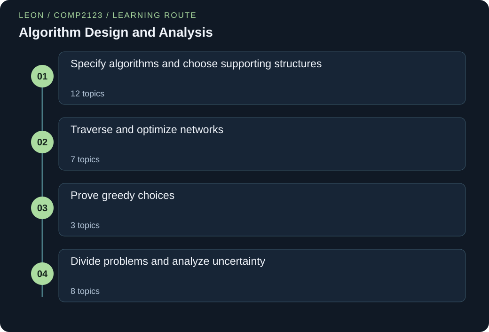

# COMP2123 — Algorithm Design and Analysis

> Leon | Original study notes

[English](COMP2123.md) · [中文](COMP2123.zh.md)



<a id="extensions"></a>

## Guided extensions

Read the linked lesson first. Then follow the story, predict the output, run the complete program and check the explanation. Each case adds one practical challenge.

1. [When greedy fails: pack whole science kits](#lab-greedy-fractional-indivisible-kit-dp) — Derive a state, prove the recurrence and recover a solution.

2. [Handle a negative edge with Bellman–Ford](#lab-dijkstra-relaxation-negative-edge-relaxation) — Replace the settled-node assumption with a pass invariant.

3. [Start BFS from every exit at once](#lab-bfs-distance-nearest-exit-wavefront) — Solve many nearest-source queries in one traversal.

Learn how to turn a problem into a correct and efficient algorithm. Begin with small stories and concrete inputs. Use Python to follow searching, sorting, graph traversal, greedy choices, divide and conquer, and randomization. Lists, trees, heaps and hash tables support the algorithms. Worked solutions explain why a method succeeds and when its assumptions fail.

Thirty connected topics cover correctness and cost, supporting data representations, graph algorithms, greedy proofs, divide and conquer, selection, randomization, and an introductory link to cryptographic complexity. This original learning guide explains mechanisms with small programs. It is not an official course or a collection of supplied assessment material. Production libraries and advanced cryptographic security proofs are outside its scope.

## Connected knowledge framework

### Specify algorithms and choose supporting structures
- [Analyze growth and prove correctness](#analysis-correctness)
- [Induction and loop invariants: proving algorithms correct](#induction-invariants)
- [Arrays, linked lists and ADT contracts](#lists-representations)
- [Stacks, queues and circular storage](#stacks-queues)
- [Stack and queue applications: delimiters, calls, scheduling and iterators](#stack-queue-applications)
- [Tree structure and traversal order](#trees-traversal)
- [Binary search trees and output-sensitive queries](#bst-range-queries)
- [AVL balance and local rotations](#avl-balance)
- [Priority queues and binary heaps](#priority-queues-heaps)
- [Selection, insertion and heap sorting](#sorting-baselines)
- [Hashing, chaining and probing](#hashing-collisions)
- [Cuckoo hashing and collection semantics](#cuckoo-maps-sets)

### Traverse and optimize networks
- [Graphs and representation choices](#graph-models)
- [Depth-first search and bridges](#dfs-bridges)
- [DAGs, topological order and strongly connected components](#topological-scc)
- [Breadth-first search and unweighted distance](#bfs-distance)
- [Dijkstra and the meaning of a settled distance](#dijkstra-relaxation)
- [Augmenting structures: extra fields and extra state](#augmenting-structures)
- [Minimum spanning trees, cuts and union-find](#minimum-spanning-trees)

### Prove greedy choices
- [Greedy choices and exchange proofs](#greedy-fractional)
- [Scheduling intervals with the fewest resources](#interval-partitioning)
- [Huffman coding and weighted path length](#huffman-coding)

### Divide problems and analyze uncertainty
- [Divide and conquer, binary search and merge sort](#recurrences-merge-sort)
- [Quicksort and comparison limits](#quicksort-lower-bound)
- [Pareto maxima and geometric pruning](#pareto-maxima)
- [Fewer recursive products and the Master theorem](#karatsuba-master)
- [Selection without fully sorting](#selection-pivots)
- [Uniform shuffling and random choices](#random-permutations)
- [Skip lists: random towers over a sorted list](#skip-lists)
- [A brief bridge to algorithmic cryptography](#cryptography-complexity)

### Run the Python examples

Use Python 3.12 or newer. Save the code as a .py file. In a terminal, run `python filename.py`; some systems use `python3`. If the code contains `import numpy as np`, first run `python -m pip install numpy`. The import loads NumPy, a package for numeric arrays, and gives it the short name np. No dataset or model-weight downloads are needed.

[Official Python downloads](https://www.python.org/downloads/) · [Official NumPy installation guide](https://numpy.org/install/)

<a id="analysis-correctness"></a>

## Analyze growth and prove correctness

### 01 / The story

Mina packed lunch boxes for a school trip. After each new request, she added up the whole list again. Her friend kept a running total instead. Mina worried that the faster method might miss a request.

They wrote down a rule: after reading the first few requests, the running total must equal their sum. They checked the rule before the first request and after each addition. Both methods gave the same final total. The running method did much less repeated work. Mina now had two separate reasons to trust it: a rule explaining correctness and an operation count explaining speed.

### 02 / The principle

An algorithm is a sequence of steps. Its specification says what answer those steps must produce. First ask whether the answer is always correct. Then ask how much work the steps need. A fast wrong answer is still wrong.

Choose an input size n and count a clear operation, such as one addition. Big-O gives an upper growth bound. Big-Omega gives a lower bound. Big-Theta gives both. These are growth descriptions, not stopwatch times. Ordinary cost estimates assume the numbers fit in a machine word. Very large Python integers can cost more to process.

An invariant is a statement that stays true after every step. Show that it starts true, survives the next step, and gives the answer when the loop ends. Also explain why the loop ends. Worst-case cost means the hardest input of a given size. Expected cost averages over stated random choices. Amortized cost spreads expensive steps across a whole sequence; it does not require randomness.

### 03 / The formula, unpacked

```text
f(n) ∈ O(g(n)) ⇔ ∃c>0, n₀: 0≤f(n)≤cg(n) for all n≥n₀
1+2+⋯+n = n(n+1)/2
```

n counts input items. f(n) counts the chosen operation. g(n) is a simpler growth pattern used for comparison. The symbol ∈ means belongs to, and ⇔ means if and only if. The symbol ∃ means there exists.

c is a fixed positive multiplier. n₀ is a fixed starting size. For every n at least n₀, the cost must stay below c times g(n). The constants cannot change with n.

The sum 1+2+…+n counts loops with one step, then two, and so on. It equals n(n+1)/2 and grows as Θ(n²). Saying O(n³) is also true, but gives a less useful upper bound.

### 04 / A first worked example

To compute prefix totals of [4,−1,6,2], keep a running sum s starting at zero. After reading each item, record s, producing [4,3,9,11]. The invariant is that after i iterations, s equals the sum of the first i input values and the first i outputs are correct.

It holds initially for i=0 and remains true when the next value is added. Four iterations give the whole answer. Computing each prefix from scratch would make 1+2+3+4=10 additions, while the running version uses four.

For length n the respective counts grow quadratically and linearly.

### Words to know

- **Invariant:** A statement that is true before and after every loop step.

- **Input size:** The amount of data, often written n. State what you count.

- **Amortized cost:** The total cost of a sequence divided across its operations; no random choices are required.

### Let us work through it

**Why is the running total initially correct?**

Before reading any values, the sum of the empty prefix is 0. The variable also starts at 0.

**What happens when the third input, 6, arrives?**

The old total is 3. Adding 6 gives 9. This equals the sum of the first three values: 4 + (−1) + 6.

**Does a single fast run prove a linear bound?**

No. A timing measures one situation. Counting one addition per input explains the linear bound for every input of that length.

### Cost of all prefixes

For n=8 values, compare recomputing each prefix with maintaining one running sum. Count additions starting from zero.

**Choose the method**

Count how often each loop performs an addition; do not infer complexity from timing.

1. Recomputing prefixes costs 1+2+…+8 additions.

2. Use 8×9/2=36 to evaluate this arithmetic series.

3. A running total reads each of 8 values once, so it uses 8 additions.

**Interpret the answer**

The running method saves 28 additions and is Θ(n), versus Θ(n²) for recomputation.

**Check the reasoning**

Both produce the same eight outputs by the prefix invariant. For n=0, both do zero additions.

<a id="lab-analysis-correctness-prefix-total-trace"></a>

### A running total and its invariant

A prefix is the part of a list from its beginning to some position. Print the total after every new value.

```python
values = [4, -1, 6, 2]
total = 0
prefixes = []
for value in values:
    total += value
    prefixes.append(total)
    print(value, total)
print(prefixes)
```

**Run it locally**

```sh
python analysis-correctness-prefix-total-trace.py
```

**Expected output**

```text
4 4
-1 3
6 9
2 11
[4, 3, 9, 11]
```

**Follow the execution**

1. Initialize total to the empty-prefix sum 0 and prefixes to an empty list.

2. Add the next value before recording total, preserving the processed-prefix invariant.

3. Print each transition and the complete prefix list after the loop.

**Follow the changing state**

| Input value | New total | Recorded prefixes |
| --- | --- | --- |
| 4 | 4 | [4] |
| -1 | 3 | [4,3] |
| 6 | 9 | [4,3,9] |
| 2 | 11 | [4,3,9,11] |

**Read the code step by step**

values creates a Python list. total = 0 sets the initial sum. The empty brackets make an empty output list. The for loop gives value each input in order. += adds to the existing total; append places that total at the end.

The second printed column is always the sum seen so far. That is the invariant. Four inputs cause four additions. For n inputs, time is O(n), and storing every prefix needs O(n) extra space. Keeping only the final total would need O(1) extra variables under the fixed-size-number model.

<a id="lab-analysis-correctness-doubling-array-cost"></a>

### Count the cost of growing storage

Separate ordinary writes from copies caused by doubling capacity.

```python
capacity = 1
size = 0
copies = 0
for value in [10, 20, 30, 40, 50]:
    if size == capacity:
        copies += size
        capacity *= 2
    size += 1
    print("size:", size, "capacity:", capacity, "copies:", copies)
print("writes plus copies:", size + copies)
```

**Run it locally**

```sh
python analysis-correctness-doubling-array-cost.py
```

**Expected output**

```text
size: 1 capacity: 1 copies: 0
size: 2 capacity: 2 copies: 1
size: 3 capacity: 4 copies: 3
size: 4 capacity: 4 copies: 3
size: 5 capacity: 8 copies: 7
writes plus copies: 12
```

**Follow the execution**

1. Start with one available cell and no stored values.

2. Before each write, double only if every current cell is occupied.

3. Charge each old cell once for a resize, then charge one new write.

**Follow the changing state**

| Append | Capacity after write | Cumulative copies |
| --- | --- | --- |
| 1 | 1 | 0 |
| 2 | 2 | 1 |
| 3 | 4 | 3 |
| 4 | 4 | 3 |
| 5 | 8 | 7 |

**Read the code step by step**

This is a cost simulation of a doubling array, not an implementation of Python list allocation. size counts occupied cells. When size equals capacity, every old reference would be copied, so copies increases by size before capacity doubles.

The fifth append causes four copies. It is expensive by itself. Across the five appends there are seven copies and five new writes. For n appends the geometric copy sum is below 2n, giving amortized O(1) append under this model. No random choices are involved.

### Leon's further thinking

**A proof and a count answer different questions**

The prefix invariant proves every recorded sum is correct, including inputs with negative values. Counting one addition per item proves linear arithmetic work. Neither a plausible output nor a fast timing supplies both arguments.

**One costly operation can fit a cheap sequence**

For doubling storage, copied blocks have sizes 1, 2, 4 and so on. Their geometric sum stays proportional to the final capacity. This is an amortized argument, unlike the expected search bound in the skip-list chapter, which depends on random towers.

**Watch out:** Calling O(n) an exact running time, or using an expected bound as though it were a worst-case guarantee.

<details>
<summary>Check your understanding</summary>

If an algorithm is Θ(n), is it also O(n²)?

Yes, for n≥1 a linear bound is also quadratic. Θ(n) is the more informative tight statement.

</details>

<a id="induction-invariants"></a>

## Induction and loop invariants: proving algorithms correct

### 01 / The story

Mia set up a long row of one thousand dominoes for a school fair. She could not push every domino to test it. Instead she checked two small things. First, the very first domino must fall when pushed. Second, every domino must stand close enough to knock over the next one.

Those two checks were enough. The first domino falls. Because it falls, the second falls. Because the second falls, the third falls, and so on to the end. Mia never looked at domino 700 on its own, yet she was sure about it.

Later, Leon counted coins from a jar, one at a time, and kept a running total on a note. At every moment the note equalled the value of the coins he had already counted. That sentence stayed true after each coin, so when the jar was empty the note held the value of all the coins. Proof by induction and a loop invariant are the same idea: one true starting point, and one step that keeps the truth going.

### 02 / The principle

A proof by induction shows that a statement P(n) is true for every whole number n from a starting value b upward. It has two parts. The base case shows that P(b) is true. The inductive step shows an if-then fact: if P(k) is true for some k ≥ b, then P(k+1) is true. The assumption "P(k) is true" is called the inductive hypothesis. You may use it, because the step only claims an implication. It does not claim that P(k) is true by itself. The base case supplies the first true statement, and the step passes truth from each number to the next.

Strong induction uses a bigger hypothesis. To prove P(k+1), you may assume P(j) for every j from b up to k. Use it when a recursive call goes to a much smaller input, not just to n − 1. A function that calls itself on n // 2 is a typical case.

Induction is the natural proof for recursive algorithms. Let P(n) say "the function returns the correct answer for every input of size n". The stopping case of the recursion is the base case. In the step, assume that the recursive calls on smaller inputs are correct, and show that the code combines their answers correctly. Also show that every call moves closer to a stopping case, so the recursion ends.

A loop invariant is an induction over the number of times a loop runs. It is a statement about the variables that is true at the same point in every pass, usually just before the loop test. A proof has three parts. Initialization: the invariant is true before the first pass. Maintenance: if it is true before a pass, it is still true after the body runs. Exit: when the loop test fails, the invariant together with the failed test implies the goal. To show that the loop ends, name a variant: a whole number that is never negative and gets strictly smaller on every pass.

Write an invariant as a full sentence about the values of variables, such as "total is the sum of the first i items". Do not just describe the code. A good invariant is strong enough to give the goal at exit, and weak enough to be true at the start.

### 03 / The formula, unpacked

```text
Induction: if P(b) is true and, for every k ≥ b, P(k) ⇒ P(k+1), then P(n) is true for every n ≥ b.
Loop invariant: initialization + maintenance + exit ⇒ goal; a variant that strictly decreases ⇒ the loop ends.
```

P(n) is a statement that depends on a whole number n, for example "the sum of the first n odd numbers is n²". b is the starting value, often 0 or 1. k is an arbitrary number that is at least b; we prove the step for it without choosing a particular value. The arrow ⇒ means "if the left side is true, then the right side is true".

The inductive hypothesis is P(k). The goal of the step is P(k+1). In a loop proof, the invariant is a statement about the variables. The variant is a number such as b in Euclid's loop. It drops on every pass and cannot go below zero. A whole number cannot drop forever, so the loop must stop.

### 04 / A first worked example

Claim P(n): the sum of the first n odd numbers equals n². For n = 4 the odd numbers are 1, 3, 5, 7. Their sum is 16, and 4² = 16, so the claim looks right. A few checks are not a proof, so we use induction.

Base case n = 0: the sum of no numbers is 0, and 0² = 0.

Step: assume P(k), that is 1 + 3 + ⋯ + (2k − 1) = k². The next odd number is 2k + 1. Add it to both sides: 1 + 3 + ⋯ + (2k − 1) + (2k + 1) = k² + 2k + 1. The right side is (k + 1)². This is exactly P(k + 1). With k = 3 the step reads 9 + 7 = 16.

Now the same idea for a loop. Euclid's loop starts with a = 252 and b = 105 and repeats a, b ← b, a mod b. The invariant is "the common divisors of a and b are the same as the common divisors of 252 and 105", namely 1, 3, 7 and 21. The pairs are (252, 105), (105, 42), (42, 21), (21, 0), and the invariant never changes. At exit b = 0, so the common divisors of a and 0 are the divisors of a. The largest one is 21, which is a.

### Words to know

- **Base case:** The smallest value of n for which the statement is checked directly. It is the first domino.

- **Inductive hypothesis:** The assumption that the statement is true for k. It is used only inside the inductive step.

- **Inductive step:** The proof that if the statement holds for k, then it holds for k + 1.

- **Strong induction:** Induction whose hypothesis covers every value from the base case up to k, not only k itself.

- **Loop invariant:** A statement about the variables that is true before the loop test in every pass.

- **Variant:** A whole number that never goes below zero and strictly decreases on every pass. It shows that the loop ends.

### Let us work through it

**Why is the base case needed if the step already works?**

The step says only "if P(k) then P(k+1)". Without a true first statement, nothing starts the chain. The claim 2n = 2n + 1 passes the step but is false for every n.

**Why does Euclid's loop have to end?**

b is never negative, and a mod b is smaller than b. So b drops on every pass, and a whole number cannot drop forever. In the example b goes 105, 42, 21, 0.

**When do you need strong induction?**

When the recursive call is on a smaller input that is not n − 1. The function power(x, n) calls itself with n // 2, so the proof must assume the result for all smaller exponents.

**Which of the three loop-invariant parts uses the fact that the loop test failed?**

The exit part. When the test fails, the invariant and the failed test together must give the goal. In Euclid's loop, b = 0 together with the invariant shows that the greatest common divisor is a.

### Bound the size of a binary tree by its height

A binary tree has height h: the longest downward route from the root has h edges. Prove by induction on h that it has at most 2^(h+1) − 1 nodes. Check the bound for h = 3.

**Choose the method**

Use strong induction on h, because the two child subtrees have heights at most h − 1 and either one may be shorter. Let P(h) say "every binary tree of height h has at most 2^(h+1) − 1 nodes", and treat an empty subtree separately.

1. Base case h = 0: a tree of height 0 is a single node. The bound is 2¹ − 1 = 1, so P(0) holds.

2. Step: let a tree have height k + 1, with k ≥ 0. Remove the root. The left and right subtrees each have height at most k, or are empty. By the hypothesis, each has at most 2^(k+1) − 1 nodes.

3. Count: the nodes number at most 1 + 2(2^(k+1) − 1) = 2^(k+2) − 1 = 2^((k+1)+1) − 1. This is P(k + 1).

4. Numbers: for h = 3 the bound is 2⁴ − 1 = 15. A perfect tree with levels of 1, 2, 4 and 8 nodes has 1 + 2 + 4 + 8 = 15 nodes, so the bound is exact.

**Interpret the answer**

Every binary tree of height h has at most 2^(h+1) − 1 nodes, and a perfect tree reaches it. Taking logarithms, a tree with n nodes has height at least log₂(n + 1) − 1, so no binary tree can be much shallower than log₂ n.

**Check the reasoning**

Test h = 1: the largest tree has a root and two children, which is 3 nodes, and 2² − 1 = 3. A bound written as 2^h would give only 2 for h = 1 and fail, so the exact exponent matters.

### Why forty correct cases do not prove a claim

A student claims that n² + n + 41 is a prime number for every whole number n ≥ 0. It is prime for n = 0, 1, 2, …, 39. Is the claim proved? What does an induction proof need that the forty checks lack?

**Choose the method**

Look for a case where the claim fails, then ask which part of an induction proof is missing.

1. Test n = 40: 40² + 40 + 41 = 1600 + 40 + 41 = 1681.

2. Factor: 1681 = 41 × 41, so it is not prime.

3. Try to build an inductive step. From "k² + k + 41 is prime" we would have to show that (k+1)² + (k+1) + 41 is prime. The two values differ by 2k + 2, and adding a number to a prime does not always give a prime. No such step exists.

**Interpret the answer**

The claim is false. Forty confirmed cases cannot replace a step that works for every k. A correct induction needs both a base case and a step proved for an arbitrary k. Here the step cannot be proved, because the claim fails at n = 40.

**Check the reasoning**

Compare with the odd-sum claim, where the step is a short piece of algebra valid for every k. If you cannot write the step for a general k, treat the claim as unproved, however many cases pass.

<a id="lab-induction-invariants-odd-sum-recursion"></a>

### A recursive function that follows its proof

The function mirrors the induction: a base case and a step that trusts the smaller call.

```python
def sum_odd(n):
    """Return 1 + 3 + 5 + ... + (2n - 1), written in the shape of the proof."""
    if n == 0:
        return 0                          # base case: the empty sum
    return sum_odd(n - 1) + (2 * n - 1)   # step: trust n - 1, add the next odd number

for n in range(0, 7):
    value = sum_odd(n)
    print("n =", n, " sum =", value, " n*n =", n * n, " equal:", value == n * n)
```

**Run it locally**

```sh
python induction-invariants-odd-sum-recursion.py
```

**Expected output**

```text
n = 0  sum = 0  n*n = 0  equal: True
n = 1  sum = 1  n*n = 1  equal: True
n = 2  sum = 4  n*n = 4  equal: True
n = 3  sum = 9  n*n = 9  equal: True
n = 4  sum = 16  n*n = 16  equal: True
n = 5  sum = 25  n*n = 25  equal: True
n = 6  sum = 36  n*n = 36  equal: True
```

**Follow the execution**

1. The base case n == 0 returns 0, the empty sum, so the first domino falls.

2. The recursive line trusts sum_odd(n - 1) and adds the next odd number 2 * n - 1. This is the inductive step.

3. The loop prints seven checks. They agree with n * n, but only the induction proof covers every n.

**Follow the changing state**

| Call that returns | Value of the smaller call | Value returned |
| --- | --- | --- |
| sum_odd(0) | none | 0 |
| sum_odd(1) | sum_odd(0) = 0 | 0 + 1 = 1 |
| sum_odd(2) | sum_odd(1) = 1 | 1 + 3 = 4 |
| sum_odd(3) | sum_odd(2) = 4 | 4 + 5 = 9 |

**Read the code step by step**

sum_odd(n) is defined for a whole number n ≥ 0. The line if n == 0 is the base case: the sum of no odd numbers is 0. The last line is the inductive step. It assumes that sum_odd(n - 1) is already correct, then adds the n-th odd number, 2 * n - 1.

The loop at the bottom is only a spot check on seven values. It cannot prove the claim for every n. The induction proof does that. Two facts are involved: sum_odd(n) really returns the sum of the odd numbers, because the recursion matches the definition, and that sum equals n², which is the induction in the example.

Each call makes one smaller call, so the time is O(n). The call stack holds n + 1 frames, so the space is O(n).

<a id="lab-induction-invariants-gcd-loop-invariant"></a>

### A loop whose invariant never changes

Euclid's loop keeps the set of common divisors fixed while the numbers shrink.

```python
def common_divisors(a, b):
    """Brute-force checker: every d >= 1 that divides both a and b."""
    return [d for d in range(1, max(a, b) + 1) if a % d == 0 and b % d == 0]

a, b = 252, 105
original = common_divisors(a, b)
print("start  a =", a, " b =", b, " common divisors:", original)

while b != 0:
    old_b = b
    a, b = b, a % b
    assert common_divisors(a, b) == original    # invariant is maintained
    assert 0 <= b < old_b                       # b shrinks, so the loop must end
    print("after  a =", a, " b =", b, " common divisors:", common_divisors(a, b))

print("exit: b = 0, so the greatest common divisor is a =", a)
```

**Run it locally**

```sh
python induction-invariants-gcd-loop-invariant.py
```

**Expected output**

```text
start  a = 252  b = 105  common divisors: [1, 3, 7, 21]
after  a = 105  b = 42  common divisors: [1, 3, 7, 21]
after  a = 42  b = 21  common divisors: [1, 3, 7, 21]
after  a = 21  b = 0  common divisors: [1, 3, 7, 21]
exit: b = 0, so the greatest common divisor is a = 21
```

**Follow the execution**

1. Store the common divisors of the starting pair before the loop. This is the fact that must never change.

2. The assignment a, b = b, a % b is one pass. Both new values are computed from the old ones before either is stored.

3. After each pass the asserts check the invariant and the variant. The loop ends when b reaches 0.

**Follow the changing state**

| Pass | a | b | Common divisors | b smaller than before? |
| --- | --- | --- | --- | --- |
| start | 252 | 105 | 1, 3, 7, 21 | not applicable |
| 1 | 105 | 42 | 1, 3, 7, 21 | yes: 42 < 105 |
| 2 | 42 | 21 | 1, 3, 7, 21 | yes: 21 < 42 |
| 3 | 21 | 0 | 1, 3, 7, 21 | yes: 0 < 21, loop ends |

**Read the code step by step**

common_divisors is a slow checker. It tries every d from 1 up to the larger number. The algorithm itself never calls it. The asserts use it to test the claims. original stores the common divisors of the starting pair, [1, 3, 7, 21].

Each pass replaces (a, b) by (b, a % b). The first assert checks maintenance: the common divisors are still original. The second assert checks the variant: b is not negative and is smaller than before. At the end the loop test b != 0 fails. At that point a and 0 share exactly the divisors of a, and the largest one is a itself, which gives the answer 21.

Every two passes at least halve b, so the number of passes is O(log b). The checker inside the asserts costs far more than the loop itself. It is there for teaching and would be removed in real use.

<a id="lab-induction-invariants-power-strong-induction"></a>

### Recursion that needs strong induction

power halves the exponent, so the proof must trust every smaller exponent, not just n - 1.

```python
def power(x, n):
    """Return (x ** n, number of multiplications used)."""
    if n == 0:
        return 1, 0                  # base case
    half, used = power(x, n // 2)    # a smaller call, but not n - 1
    result = half * half
    used += 1
    if n % 2 == 1:
        result = result * x
        used += 1
    return result, used

for n in [0, 1, 2, 5, 13, 64]:
    value, used = power(3, n)
    assert value == 3 ** n
    print("n =", n, " 3^n =", value, " multiplications:", used)
```

**Run it locally**

```sh
python induction-invariants-power-strong-induction.py
```

**Expected output**

```text
n = 0  3^n = 1  multiplications: 0
n = 1  3^n = 3  multiplications: 2
n = 2  3^n = 9  multiplications: 3
n = 5  3^n = 243  multiplications: 5
n = 13  3^n = 1594323  multiplications: 7
n = 64  3^n = 3433683820292512484657849089281  multiplications: 8
```

**Follow the execution**

1. The base case n == 0 returns 1 with no multiplications. Every chain of halving reaches it.

2. The recursive call uses n // 2. The strong hypothesis says its answer is already correct.

3. Square the half result, multiply by x once more when n is odd, and count both kinds of multiplication.

**Follow the changing state**

| Call | n // 2 | Returns (value, multiplications) |
| --- | --- | --- |
| power(3, 0) | none | (1, 0) |
| power(3, 1) | 0 | (3, 2) |
| power(3, 3) | 1 | (27, 4) |
| power(3, 6) | 3 | (729, 5) |
| power(3, 13) | 6 | (1594323, 7) |

**Read the code step by step**

power(x, n) returns a pair: x ** n and the number of multiplications used. For n = 0 the answer is 1. Otherwise it calls itself with n // 2. If n = 2q, then x^n = (x^q)². If n = 2q + 1, then x^n = (x^q)² · x. The code does exactly this.

The call uses n // 2, not n - 1, so ordinary induction from k to k + 1 does not fit. Strong induction does: assume the answer is right for every exponent below n. For n ≥ 1, n // 2 is one of them. The assert compares six spot values with Python's own power operator.

Every call halves n, so there are about log₂ n + 1 calls, and each call does at most two multiplications. For n = 64 the program uses 8 multiplications instead of the 63 that repeated multiplication needs. The count includes trivial products by 1. Python integers grow as needed, so the values are exact, but multiplying huge numbers costs more than one step each.

### Leon's further thinking

**A loop invariant is induction on the pass number**

Call the number of completed passes i, and let P(i) say "the invariant holds after i passes". Initialization is the base case P(0). Maintenance is the step P(i) ⇒ P(i+1). That is why the same three questions work for every loop: what is true at the start, what keeps it true, and what does it give at the end. Seeing this link lets you reuse one skill for both recursion and loops.

**Choose the claim before you write the proof**

A proof can fail because the statement is too weak, not because the code is wrong. To prove that a recursive tree function is correct, it may help to prove a stronger claim, such as that it returns both the size and the height, as the earlier tree chapter does. A stronger hypothesis gives the step more to work with. In Euclid's loop, the invariant about common divisors is much stronger than "a and b stay non-negative", and only the stronger one gives the answer at exit.

**Testing finds bugs; a proof covers every input**

The seven checks of n² in the program would never catch a claim that fails later. The polynomial n² + n + 41 gives a prime for every n from 0 to 39, but for n = 40 it equals 41 × 41. Examples build confidence and expose mistakes. Only a base case and a step cover infinitely many inputs.

**Watch out:** Three common mistakes. First, proving the step but skipping the base case. The false claim "n = n + 1" passes the step, because adding one to both sides of k = k + 1 keeps it true, yet the claim is false for every n. Second, using the statement P(k + 1) that you want to prove inside the step, instead of P(k). That is circular. Third, writing a loop invariant that is true only at the start, or one so weak that it says nothing useful at exit. Check the three parts one by one and write each of them down.

<details>
<summary>Check your understanding</summary>

In the proof that the sum of the first n odd numbers is n², what do you assume in the step, and what must you show?

Assume that the sum of the first k odd numbers is k². Then show that the sum of the first k + 1 odd numbers is (k + 1)². Adding 2k + 1 to k² gives k² + 2k + 1 = (k + 1)², so the step works.

</details>

<a id="lists-representations"></a>

## Arrays, linked lists and ADT contracts

### 01 / The story

Ravi kept reading cards in numbered boxes. Finding box 4 was easy. Inserting a new card near the beginning meant moving many later cards. He tried a second design: each card held a link to the next card.

Now he could insert a card by changing links. But he still had to follow the chain to find the insertion place. Ravi used numbered boxes for frequent indexed reads. He used linked cards when he already had a reference to the position being edited. He learned to count the search and the edit separately.

### 02 / The principle

A list is an ordered collection. An abstract data type, or ADT, states allowed operations without choosing storage. For example, a list may promise to read item i or insert before item i. Its contract must also say what happens for an invalid position.

An array stores equal-sized cells in a row. Its address formula lets us reach cell i directly. A Python list uses a resizable array of references. Reading an index is O(1). Inserting in the middle shifts later references and can take O(n). An occasional resize makes one append expensive, although append is amortized O(1).

A linked list stores separate nodes. Each node holds a value and a next reference. A doubly linked node also remembers its previous node. Changing a fixed number of links at an already known position is O(1). Finding index i still needs a walk. A singly linked deletion usually needs the previous node; knowing only the node to remove is not enough under the usual node-identity contract. A sentinel is a dummy endpoint that simplifies edge cases.

### 03 / The formula, unpacked

```text
Array address(i) = base + i·cell_size
Array indexed access: O(1)
Linked-list indexed access: O(n); local doubly linked edit: O(1)
```

i is an index, starting at 0. base is the address of the first array cell. cell_size is the fixed width of a cell. Multiplying i by cell_size gives its distance from the beginning.

n is the number of stored items. O(1) means the number of basic steps does not grow with n. O(n) allows a number of steps proportional to n. A constant-time linked edit assumes the required node references are already known. Include the cost of finding them. Python list cells hold references; the objects themselves need not sit next to each other.

### 04 / A first worked example

Store [L,M,N,P] in an array. Inserting X at index 1 shifts M, N and P one position right, then writes X, yielding [L,X,M,N,P]. In a doubly linked representation with a direct reference to M, let left=M.prev and create X.

Set X.prev=left, X.next=M, left.next=X and M.prev=X. Only a fixed number of links change. But if the request arrives merely as “insert at index 1,” the list must first find that position; for a general index near the far end, that traversal can dominate.

The contract must also reject invalid positions or define their behavior.

### Words to know

- **ADT:** An abstract data type: a promise about operations and results, separate from its implementation.

- **Node:** A small record containing a value and references to other nodes.

- **Reference:** A way to reach an existing object. Assigning a reference does not copy the whole object.

### Let us work through it

**Why does inserting at array index 1 shift three items here?**

In [L, M, N, P], M, N and P must each move one position to leave room for X.

**Why save old_next before changing m.next?**

It keeps access to the rest of the chain. Without that reference, replacing the link could disconnect later nodes.

**Is a linked-list insertion always O(1)?**

Only the link change at a known place is O(1). Walking to that place may take O(n).

### Search before editing

A 100-node singly linked list is indexed from 0. Insert before index 80 using only its head. Compare with an array of 100 items.

**Choose the method**

Separate locating the predecessor from changing links, then count the array suffix.

1. The linked predecessor is index 79, reached by 79 next-link moves from index 0.

2. Create one node and reconnect the predecessor and old successor using constant work.

3. The array shifts indices 80 through 99: 100−80=20 references.

**Interpret the answer**

Both requests can have linear cost; the linked edit alone is constant only after its predecessor is known.

**Check the reasoning**

If a predecessor reference is supplied directly, the 79-link search disappears.

<a id="lab-lists-representations-array-insert-shifts"></a>

### See an array insertion shift values

Build an insertion by hand instead of hiding it inside list.insert.

```python
items = ["L", "M", "N", "P"]
position = 1
items.append(None)
shifts = 0
for i in range(len(items) - 1, position, -1):
    items[i] = items[i - 1]
    shifts += 1
items[position] = "X"
print(items)
print("shifts:", shifts)
```

**Run it locally**

```sh
python lists-representations-array-insert-shifts.py
```

**Expected output**

```text
['L', 'X', 'M', 'N', 'P']
shifts: 3
```

**Follow the execution**

1. Append a spare cell so the last item has a destination.

2. Copy entries from right to left, preserving values not copied yet.

3. Fill the gap at position 1 with X and report three shifts.

**Follow the changing state**

| Action | Array |
| --- | --- |
| Spare cell | [L,M,N,P,None] |
| Copy P | [L,M,N,P,P] |
| Copy N then M | [L,M,M,N,P] |
| Write X | [L,X,M,N,P] |

**Read the code step by step**

append(None) creates one spare cell. None is a placeholder, not the text "None". range(start, stop, -1) visits indices backward and excludes stop. Moving backward avoids overwriting a value before copying it.

The loop moves P, then N, then M. The final assignment writes X into index 1. The output counts three shifted references. In the worst case, n existing items move, so insertion is O(n). This example grows a Python list; it does not expose physical memory addresses.

<a id="lab-lists-representations-linked-node-splice"></a>

### Insert a real node into a linked chain

Here the program already knows node M. Watch it insert X after M without moving N.

```python
class Node:
    def __init__(self, value, next_node=None):
        self.value = value
        self.next = next_node

n = Node("N")
m = Node("M", n)
head = Node("L", m)
old_next = m.next
m.next = Node("X", old_next)
values = []
current = head
while current is not None:
    values.append(current.value)
    current = current.next
print(values)
print("X still links to N:", m.next.next is n)
```

**Run it locally**

```sh
python lists-representations-linked-node-splice.py
```

**Expected output**

```text
['L', 'M', 'X', 'N']
X still links to N: True
```

**Follow the execution**

1. Construct the chain backward so every next reference already exists.

2. Save M’s successor, create X pointing to it, then redirect M to X.

3. Follow next references and check that the old N object remains linked.

**Follow the changing state**

| Stage | M.next | Chain |
| --- | --- | --- |
| Before | N | L→M→N |
| Save old_next | N | old_next→N |
| After splice | X | L→M→X→N |

**Read the code step by step**

class defines the shape of a node. __init__ runs when Node(...) creates one. self names that new node. The next field holds a reference, and None marks the end. Constructing N first lets M point to N and L point to M.

old_next remembers N. The new X points to N, and M now points to X. The is test asks whether two references reach the very same object. The edit uses constant work. The printing walk uses O(n) time and an O(n) result list; that display cost is separate from insertion.

### Leon's further thinking

**Choose the representation from the operation**

A list contract does not promise a particular cost. If an algorithm repeatedly reads index i, an array gives direct access. If it already holds both neighboring node references, linked splicing avoids shifting a suffix. Counting only the edit can hide the search that found its location.

**Preserve access before replacing links**

Saving old_next keeps the suffix reachable while M receives a new next link. This is an ownership-style invariant: every original node remains reachable exactly once in the final chain. A cyclic link would make the simple display loop fail to terminate.

**Watch out:** Saying all linked-list operations are O(1). Only certain operations at already located positions have that bound.

<details>
<summary>Check your understanding</summary>

Which representation is a natural fit for millions of random indexed reads and rare middle insertions?

An array-based list, because direct indexing is constant time and its occasional shifting cost may be acceptable.

</details>

<a id="stacks-queues"></a>

## Stacks, queues and circular storage

### 01 / The story

Noor ran a school print desk. She first kept incoming jobs in a pile and always took the top sheet. New arrivals kept delaying the oldest job. She changed to a waiting line, with new jobs at one end and service at the other. Everyone was then served in arrival order.

Later, she added an undo button to the editing program. This time the most recent action had to be removed first, so the pile rule was correct. Noor learned that the right structure depends on which item should leave next, not on how many items it stores.

### 02 / The principle

A stack removes the newest item first. This is last in, first out, or LIFO. push adds an item; pop removes the top. A stack fits undo history and nested brackets. A queue removes the oldest item first. This is first in, first out, or FIFO. enqueue adds at the back; dequeue removes at the front.

A Python list works well as a stack with append and pop at its end. For a queue, collections.deque supports efficient operations at both ends. Using list.pop(0) shifts the remaining items and takes O(n).

A circular queue reuses a fixed array. It stores a front index and a size. Modulo wraps an index to the beginning. The size distinguishes full from empty. Reject an enqueue when full, or define a resize rule. Never dequeue an empty queue. For bracket checking, each closing bracket must match the most recent unmatched opening bracket.

### 03 / The formula, unpacked

```text
Queue insertion index = (front + size) mod capacity
After dequeue: front ← (front+1) mod capacity; size ← size−1
```

front is the index of the oldest queued item. size counts current items. capacity is the number of physical slots and must be positive. mod is the remainder after division; Python writes it as %.

The insertion index is front plus size, wrapped into the slot range. After removing one item, advance front by one with the same wrap and reduce size by one. The arrow ← means replace the old value. These rules change storage positions but preserve FIFO order. Fixed-capacity updates use O(1) work.

### 04 / A first worked example

Use a capacity-five queue with front=3 and size=3. Its items A, B and C occupy indices 3, 4 and 0. Enqueue D at (3+3) mod 5=1, raising size to four.

Dequeue returns A, advances front to 4 and reduces size to three. The logical order is now B,C,D even though the occupied physical slots wrap across the array boundary. No items are shifted.

As a separate stack trace, the string ([ ]) with spaces ignored pushes ( then [, pops [ on ], and pops ( on ); the final empty stack confirms proper nesting.

### Words to know

- **LIFO:** Last in, first out: the newest stored item leaves first.

- **FIFO:** First in, first out: the oldest stored item leaves first.

- **Modulo:** The remainder after division. It wraps an index into a fixed range.

### Let us work through it

**Why does a stack reject ([)]?**

When ) arrives, [ is still on top. Counts alone cannot detect this wrong nesting order.

**What does deque.popleft remove?**

It removes the leftmost item. If new items were appended on the right, this is the oldest item.

**Why keep size in a circular queue?**

The same front and back positions can occur when a ring is empty or full. A size value makes the state clear.

### Wrap without shifting

A ring has capacity 5, front 3 and items A,B,C at slots 3,4,0. Enqueue D, then dequeue once.

**Choose the method**

Track logical size separately from physical indices.

1. Initially size=3; the insertion index is (3+3)%5=1.

2. Store D at 1 and set size=4. Logical order is A,B,C,D.

3. Remove A; front becomes (3+1)%5=4 and size becomes 3.

**Interpret the answer**

The remaining order is B,C,D at slots 4,0,1. No existing item shifts.

**Check the reasoning**

Walking size=3 positions from front=4 modulo 5 visits exactly 4,0,1.

<a id="lab-stacks-queues-stack-bracket-check"></a>

### Match brackets with a stack

The function checks both matching types and matching order.

```python
def balanced(text):
    stack = []
    opening = {')': '(', ']': '[', '}': '{'}
    for char in text:
        if char in "([{":
            stack.append(char)
        elif char in opening:
            if not stack or stack.pop() != opening[char]:
                return False
    return not stack

print(balanced("([])"))
print(balanced("([)]"))
print(balanced("(("))
```

**Run it locally**

```sh
python stacks-queues-stack-bracket-check.py
```

**Expected output**

```text
True
False
False
```

**Follow the execution**

1. Map each closer to its opener and begin with no unmatched brackets.

2. Push openers; a closer must safely pop a matching top.

3. Reject early mismatches and reject leftover openers after the scan.

**Follow the changing state**

| Character in ([]) | Stack afterward |
| --- | --- |
| ( | [(] |
| [ | [(,[] |
| ] | [(] |
| ) | [] |

**Read the code step by step**

def creates a reusable function. opening maps each closing bracket to its required opening bracket. append records an opening bracket. not stack is true for an empty stack; or stops immediately in that case, so pop is safe.

A closer removes only the top opening bracket. A mismatch returns False immediately. At the end, not stack rejects leftover openings. Other characters are ignored. Each character is examined once, giving O(n) time. At most n opening brackets are stored, giving O(n) extra space.

<a id="lab-stacks-queues-deque-fifo-service"></a>

### Serve waiting jobs with deque

A deque is a double-ended queue. Use its right end for arrival and left end for service.

```python
from collections import deque
queue = deque(["Ada", "Bo"])
queue.append("Cy")
print("served:", queue.popleft())
print("waiting:", list(queue))
queue.appendleft("urgent")
print("left end:", queue.popleft())
print("waiting:", list(queue))
```

**Run it locally**

```sh
python stacks-queues-deque-fifo-service.py
```

**Expected output**

```text
served: Ada
waiting: ['Bo', 'Cy']
left end: urgent
waiting: ['Bo', 'Cy']
```

**Follow the execution**

1. Append Cy behind Ada and Bo, preserving arrival order.

2. Remove Ada from the left and display the two remaining jobs.

3. Insert urgent at the left to demonstrate an explicit change of policy.

**Follow the changing state**

| Action | Waiting order |
| --- | --- |
| Append Cy | [Ada,Bo,Cy] |
| Serve Ada | [Bo,Cy] |
| Appendleft urgent | [urgent,Bo,Cy] |
| Serve urgent | [Bo,Cy] |

**Read the code step by step**

The import makes deque available. append adds Cy on the right. popleft removes Ada, who arrived first. list(queue) makes a list only so the state prints clearly.

appendleft shows a different operation: it places urgent ahead of the waiting jobs. This changes the service policy, so that part is no longer pure FIFO. Deque endpoint additions and removals take O(1) time. Copying all waiting items for display takes O(n). An empty popleft would raise IndexError.

### Leon's further thinking

**The removal rule is part of the algorithm**

Bracket matching needs the newest unmatched opening bracket, so a stack is essential to its proof. BFS needs the oldest waiting vertex, so a queue preserves distance layers. Replacing either container without changing the proof can silently change the algorithm.

**Wrap positions, not the logical order**

In a ring, indices may decrease when they wrap, but arrival order must not change. Keeping size prevents full and empty from having an ambiguous representation. The fixed-capacity O(1) bound excludes resizing and copying a whole queue for display.

**Watch out:** Using a queue to validate nesting, or shifting an entire array on every dequeue when a circular index scheme would suffice.

<details>
<summary>Check your understanding</summary>

Why does the bracket string ([)] fail despite equal counts of openers and closers?

The first closer ) does not match the current stack top [. Correct nesting requires matching the most recent unmatched opener.

</details>

<a id="stack-queue-applications"></a>

## Stack and queue applications: delimiters, calls, scheduling and iterators

### 01 / The story

Iris checked a long maths worksheet. When a problem said "use the answer to problem 7", she put her bookmark on a tray and went to do problem 7 first. If problem 7 pointed to another problem, she went further. The bookmarks piled up, and she always returned to the newest one first. A computer does the same when one function calls another.

At the same time, Noah looked after a shared printer for three classmates. If the printer stayed with one person until that person was finished, the others waited a long time. Noah gave everyone two minutes at a time, then sent that person to the back of the line. Every person got a first turn early.

Both rules come from one question: who must leave next? Bookmarks and function calls need the newest item first. A fair printer line needs the person who has waited longest.

### 02 / The principle

The earlier chapter on stacks and queues explained the removal rules. A stack removes the newest item (LIFO). A queue removes the oldest item (FIFO). This chapter uses those rules in four places.

Delimiter matching. A delimiter is a bracket-like mark such as ( ) [ ] { }. Push every opener on a stack, together with its position. When a closer arrives, pop the top. It must be the matching opener. The scan can fail in three ways. A closer may arrive when the stack is empty, which is an extra closer. The popped opener may not match, which is wrong order. Openers may remain at the end, which is an unclosed opener. The time is O(n) for text of length n. The space is O(d), where d is the deepest nesting.

The method call stack. Each time a function is called, the machine creates a frame. A frame holds the arguments, the local variables, and the place to resume when the call returns. A return pops the frame. The newest call always finishes first, so a stack is the right structure. The number of calls that are active at once is the call depth. A recursion of depth d needs O(d) space for frames. The call stack has a fixed size, so a very deep recursion causes a stack overflow. Python raises RecursionError after about a thousand frames by default. A loop that keeps its state in variables avoids the problem. So does an explicit stack kept in ordinary memory.

Round-robin scheduling. A scheduler decides which job uses the processor next. Round-robin keeps the waiting jobs in a queue. It removes the front job and lets it run for at most one time quantum q. If the job still has work left, it goes to the back of the queue. Every job gets an early first turn, and no job can hold the processor for long. A job that needs t units of time takes ⌈t / q⌉ turns. Each queue operation costs O(1).

Iterators. An iterator walks over the items of a collection one at a time, without showing how the items are stored. It can say whether another item exists, and it can return the next one. In Python, __next__ returns the next item or raises StopIteration. Iteration must not remove items, and two iterators over the same object must not disturb each other. If the collection changes during a walk, a fail-fast iterator notices (here with a version number) and raises an error, instead of returning wrong items. One full pass costs O(n), and each step costs O(1).

### 03 / The formula, unpacked

```text
Round-robin turns for one job that needs t units: ⌈t / q⌉
Total turns = Σ ⌈tᵢ / q⌉ over all jobs i
Call stack space = O(maximum depth). Delimiter scan = O(n) time, O(maximum nesting) space.
```

t is the processor time a job still needs. q is the quantum, the longest time one turn may last. The brackets ⌈ ⌉ round up to the next whole number, so ⌈5 / 2⌉ = 3. The sign Σ means "add over every job". n is the number of characters in the text. Depth is the number of calls that have started but not yet returned.

A job that needs 5 units with q = 2 runs for 2, then 2, then 1, which is 3 turns. The last turn is short because the job finishes. The total of all t values is the total running time, however the turns are split. Round-robin changes who waits, not how much work there is.

### 04 / A first worked example

Delimiters. Take f(a[1)]. The positions are f 0, ( 1, a 2, [ 3, 1 4, ) 5, ] 6. The stack holds ( from position 1, then [ from position 3. At position 5 the closer ) arrives and pops [ from position 3. They do not match, so the program reports the mistake at position 5.

Call stack. For sum(3) = 3 + sum(2), the frames grow to sum(3), sum(2), sum(1), sum(0). The depth is 4. The returns then pop the frames in reverse order, giving 0, 1, 3 and 6.

Round-robin. Leon needs 5 units, Mia 3 and Emma 1, with q = 2. The turns are Leon 2, Mia 2, Emma 1 (done at time 5), Leon 2, Mia 1 (done at 8), Leon 1 (done at 9). That is ⌈5/2⌉ + ⌈3/2⌉ + ⌈1/2⌉ = 3 + 2 + 1 = 6 turns. Without turn-taking, Emma would wait until time 8 for her first turn. With it she starts at time 4.

Iterator. A ring queue with capacity 4 holds Mia, Emma and Jack in slots 1, 2 and 3, and Noah in slot 0. The iterator starts at front = 1 and visits slots 1, 2, 3, 0. It returns Mia, Emma, Jack, Noah, and the caller never sees the wrap-around.

### Words to know

- **Delimiter:** A mark that opens or closes a group, such as a bracket or a quotation mark.

- **Stack frame:** The block of memory made for one function call. It holds the arguments, the local variables and the return point.

- **Stack overflow:** The error that occurs when calls nest deeper than the memory reserved for the call stack.

- **Time quantum:** The longest time a job may run in one turn of round-robin scheduling.

- **Iterator:** An object that returns the items of a collection one at a time and remembers where it is.

- **Fail-fast:** A design that reports a problem at once, instead of carrying on with wrong data.

### Let us work through it

**Why must the delimiter stack store positions as well as brackets?**

The bracket tells you what to match. The position tells the user where the problem is. The unmatched opener may be far from the place where the scan stops.

**Why is the call stack the right structure for function calls?**

The newest call must finish before the call that started it can continue. That is last in, first out, so each call is pushed when it starts and popped when it returns.

**Why does round-robin put an unfinished job at the back?**

The back of the queue gives every other waiting job a turn first. This keeps the wait for a first turn short for all jobs.

**What happens if a queue changes while an iterator walks over it?**

The iterator could skip or repeat items. In the example a version number detects the change, and the next step raises RuntimeError.

### Schedule four jobs with a quantum of 3

Jobs A, B, C and D arrive in this order and need 5, 2, 7 and 3 units. The quantum is 3. List the turns, find each finishing time, and count the turns.

**Choose the method**

Keep the queue and the clock. For each turn, take the front job, run it for min(3, remaining) units, and put it back at the end if work remains.

1. Start: the queue is A5, B2, C7, D3 at time 0.

2. A runs 3 (time 3) and returns with 2 left. B runs 2 and finishes at time 5. C runs 3 (time 8) and returns with 4 left. D runs 3 and finishes at time 11.

3. The queue is now A2, C4. A runs 2 and finishes at time 13. C runs 3 (time 16) and returns with 1 left. C runs 1 and finishes at time 17.

4. Count the turns: A has 2, B has 1, C has 3 and D has 1, which is 7 in total. The formula agrees: ⌈5/3⌉ + ⌈2/3⌉ + ⌈7/3⌉ + ⌈3/3⌉ = 2 + 1 + 3 + 1 = 7.

**Interpret the answer**

The finishing times are B 5, D 11, A 13 and C 17. There are 7 turns in total. The total running time is 17, which equals the sum of the needs.

**Check the reasoning**

The last finishing time must equal 5 + 2 + 7 + 3 = 17, because the processor is never idle while a job is waiting.

### Trace the delimiter checker by hand

Trace the delimiter checker from this chapter on the text a{b(c)d]e. The positions are a 0, { 1, b 2, ( 3, c 4, ) 5, d 6, ] 7, e 8. Which message does it return?

**Choose the method**

Keep the stack of (opener, position) pairs and process the characters from left to right. Stop at the first failure.

1. Position 1 is {, so push { at 1. Position 3 is (, so push ( at 3. The stack is [{ at 1, ( at 3].

2. Position 5 is ). Pop ( at 3. It matches ), so the stack becomes [{ at 1].

3. Position 7 is ]. Pop { at 1. A ] needs a [, not a {, so the check fails here.

**Interpret the answer**

The message is "found ] at 7 but { from 1 is still open". The mistake is the wrong closer at position 7.

**Check the reasoning**

The text has 2 openers and 2 closers, so counting alone says nothing is wrong. Only the order check, which compares each closer with the newest open opener, catches the mistake.

<a id="lab-stack-queue-applications-delimiter-error-report"></a>

### Report where the brackets go wrong

The stack stores each opener with its position, so every failure can be located.

```python
def check_delimiters(text):
    closer_to_opener = {")": "(", "]": "[", "}": "{"}
    stack = []                              # holds (opening character, position)
    for position, char in enumerate(text):
        if char in "([{":
            stack.append((char, position))
        elif char in closer_to_opener:
            if not stack:
                return "extra " + char + " at " + str(position)
            opener, where = stack.pop()
            if opener != closer_to_opener[char]:
                return ("found " + char + " at " + str(position) +
                        " but " + opener + " from " + str(where) + " is still open")
    if stack:
        opener, where = stack[-1]
        return "unclosed " + opener + " from " + str(where)
    return "ok"

for text in ["f(a[1], {b})", "f(a[1)]", "a)", "{(x)", ""]:
    print(repr(text), "->", check_delimiters(text))
```

**Run it locally**

```sh
python stack-queue-applications-delimiter-error-report.py
```

**Expected output**

```text
'f(a[1], {b})' -> ok
'f(a[1)]' -> found ) at 5 but [ from 3 is still open
'a)' -> extra ) at 1
'{(x)' -> unclosed { from 0
'' -> ok
```

**Follow the execution**

1. Map each closing character to the opening character it must meet, and start with an empty stack.

2. Push (opener, position) for every opener. Pop for every closer, after checking that the stack is not empty.

3. Return a message at the first mismatch, or report an opener that is left on the stack after the last character.

**Follow the changing state**

| Position | Character | Stack afterward (top at right) |
| --- | --- | --- |
| 0 | f | [] |
| 1 | ( | [( at 1] |
| 2 | a | [( at 1] |
| 3 | [ | [( at 1, [ at 3] |
| 4 | 1 | [( at 1, [ at 3] |
| 5 | ) | pops [ at 3: mismatch, stop |

**Read the code step by step**

check_delimiters scans the text once. closer_to_opener maps each closer to the opener it needs. An opener is pushed as a pair (character, position). A closer first checks that the stack is not empty, which prevents an error from pop on an empty list. It then pops the newest opener and compares.

There are three kinds of failure. 'a)' has an extra closer. 'f(a[1)]' has a closer that meets the wrong opener: ) arrives while [ is on top. '{(x)' ends with { still on the stack. The last case reports stack[-1], the innermost opener that is still open, which is the one that needs a closer first. Other characters are ignored.

The scan examines each character once, and each push or pop costs O(1), so the time is O(n). The stack holds one entry per opener that is still open, so the space is O(n) in the worst case and O(d) for nesting depth d. Only the first error is reported, because the function stops at it.

<a id="lab-stack-queue-applications-call-stack-frames"></a>

### Watch the call stack grow and overflow

A list stands in for the machine's call stack. Each call pushes a frame and each return pops one.

```python
class CallStack:
    """A tiny model of the memory that holds one frame per active call."""
    def __init__(self, capacity):
        self.frames = []
        self.capacity = capacity

    def push(self, name):
        if len(self.frames) == self.capacity:
            raise OverflowError("stack overflow while calling " + name)
        self.frames.append(name)

    def pop(self):
        self.frames.pop()

def recursive_sum(n, stack, log):
    stack.push("sum(" + str(n) + ")")
    if log:
        print("enter:", " > ".join(stack.frames))
    result = 0 if n == 0 else n + recursive_sum(n - 1, stack, log)
    if log:
        print("leave:", " > ".join(stack.frames), "returns", result)
    stack.pop()
    return result

def loop_sum(n):
    total = 0                    # one frame only: the answer lives in a variable
    for i in range(1, n + 1):
        total += i
    return total

print("answer:", recursive_sum(3, CallStack(10), True))
for n in [2, 3, 6]:
    try:
        print("capacity 4, n =", n, "->", recursive_sum(n, CallStack(4), False))
    except OverflowError as error:
        print("capacity 4, n =", n, "->", error)
print("loop version, n = 6 ->", loop_sum(6))
```

**Run it locally**

```sh
python stack-queue-applications-call-stack-frames.py
```

**Expected output**

```text
enter: sum(3)
enter: sum(3) > sum(2)
enter: sum(3) > sum(2) > sum(1)
enter: sum(3) > sum(2) > sum(1) > sum(0)
leave: sum(3) > sum(2) > sum(1) > sum(0) returns 0
leave: sum(3) > sum(2) > sum(1) returns 1
leave: sum(3) > sum(2) returns 3
leave: sum(3) returns 6
answer: 6
capacity 4, n = 2 -> 3
capacity 4, n = 3 -> 6
capacity 4, n = 6 -> stack overflow while calling sum(2)
loop version, n = 6 -> 21
```

**Follow the execution**

1. push adds a named frame and refuses when the stack is full, like a real stack that has run out of room.

2. recursive_sum pushes before the recursive call and pops after it, so the list always shows the active calls.

3. The runs with capacity 4 succeed at depth 3 and 4 and overflow at depth 7. The loop version never overflows.

**Follow the changing state**

| Event | Stack after the event (bottom to top) | Depth |
| --- | --- | --- |
| call sum(3) | sum(3) | 1 |
| call sum(2) | sum(3) > sum(2) | 2 |
| call sum(1) | sum(3) > sum(2) > sum(1) | 3 |
| call sum(0) | sum(3) > sum(2) > sum(1) > sum(0) | 4 |
| sum(0) returns 0 | sum(3) > sum(2) > sum(1) | 3 |
| sum(1) returns 1 | sum(3) > sum(2) | 2 |
| sum(2) returns 3 | sum(3) | 1 |
| sum(3) returns 6 | (empty) | 0 |

**Read the code step by step**

CallStack is a small model: a list of frame names with a fixed capacity. push raises OverflowError when the list is full. This copies what a real machine does when it runs out of stack memory.

recursive_sum(n, stack, log) pushes a frame, calls itself on n - 1 and pops the frame before returning. With log switched on, the program prints the stack on every entry and exit. For n = 3 the stack grows to four frames, then shrinks while the answers 0, 1, 3 and 6 come back.

With capacity 4, n = 2 needs three frames and n = 3 needs four, so both succeed. n = 6 needs seven frames. It fails when it tries to call sum(2) while four frames are already in use. loop_sum computes the same total with a single frame and a variable, so its stack depth does not grow with n. Both versions take O(n) time. The recursive one uses O(n) space for frames and the loop uses O(1).

<a id="lab-stack-queue-applications-round-robin-queue"></a>

### Share a processor fairly with a queue

A deque holds the waiting jobs. The front job runs for at most one quantum and, if unfinished, joins the back.

```python
from collections import deque

def round_robin(jobs, quantum, show):
    queue = deque(jobs)                  # (name, time still needed)
    clock = 0
    first_turn, finish = {}, {}
    while queue:
        name, left = queue.popleft()
        run = min(quantum, left)
        first_turn.setdefault(name, clock)
        if show:
            print("t =", clock, name, "runs", run)
        clock += run
        if left > run:
            queue.append((name, left - run))     # back of the line
        else:
            finish[name] = clock
    return first_turn, finish

jobs = [("Leon", 5), ("Mia", 3), ("Emma", 1)]
first_turn, finish = round_robin(jobs, 2, True)
print("quantum 2  first turns:", first_turn, " finish:", finish)
first_turn, finish = round_robin(jobs, 100, False)
print("quantum 100 first turns:", first_turn, " finish:", finish)
```

**Run it locally**

```sh
python stack-queue-applications-round-robin-queue.py
```

**Expected output**

```text
t = 0 Leon runs 2
t = 2 Mia runs 2
t = 4 Emma runs 1
t = 5 Leon runs 2
t = 7 Mia runs 1
t = 8 Leon runs 1
quantum 2  first turns: {'Leon': 0, 'Mia': 2, 'Emma': 4}  finish: {'Emma': 5, 'Mia': 8, 'Leon': 9}
quantum 100 first turns: {'Leon': 0, 'Mia': 5, 'Emma': 8}  finish: {'Leon': 5, 'Mia': 8, 'Emma': 9}
```

**Follow the execution**

1. The deque starts with the jobs in arrival order. popleft removes the front job, and min(quantum, left) decides how long it runs.

2. A job with work left is appended to the back with a smaller need. A finished job records its finish time.

3. The second call, with a huge quantum, shows the same code behaving as plain first in, first out.

**Follow the changing state**

| Time | Job at front | Runs | Queue afterward (front first) |
| --- | --- | --- | --- |
| 0 | Leon | 2 | Mia 3, Emma 1, Leon 3 |
| 2 | Mia | 2 | Emma 1, Leon 3, Mia 1 |
| 4 | Emma | 1 | Leon 3, Mia 1 (Emma done) |
| 5 | Leon | 2 | Mia 1, Leon 1 |
| 7 | Mia | 1 | Leon 1 (Mia done) |
| 8 | Leon | 1 | empty (Leon done) |

**Read the code step by step**

round_robin takes (name, time needed) pairs. popleft takes the job at the front. run = min(quantum, left) is the time the job uses now. first_turn.setdefault records the clock only the first time a name appears. If the job still has work left, append puts it back with the reduced need. Otherwise its finish time is stored.

With quantum 2, the log shows six turns, matching ⌈5/2⌉ + ⌈3/2⌉ + ⌈1/2⌉. Emma's job needs one unit and finishes at time 5, although she was last in line. With quantum 100, each job finishes in its first turn, so the order is plain first in, first out. Emma then waits until time 8 for her first turn, and Leon finishes first at time 5 because he is first in line. Both runs end at time 9, because the total work is 5 + 3 + 1 = 9.

Each queue operation costs O(1). The number of loop passes is the number of turns, Σ⌈tᵢ/q⌉. A very small quantum gives many turns. Real systems also pay a cost to switch jobs, which this model ignores.

<a id="lab-stack-queue-applications-ring-queue-iterator"></a>

### An iterator for a circular queue

The iterator hides the wrap-around and refuses to continue if the queue changes.

```python
class RingQueue:
    def __init__(self, capacity):
        self.slots = [None] * capacity
        self.front = 0
        self.size = 0
        self.version = 0                  # changes on every enqueue or dequeue

    def enqueue(self, item):
        if self.size == len(self.slots):
            raise OverflowError("queue is full")
        self.slots[(self.front + self.size) % len(self.slots)] = item
        self.size += 1
        self.version += 1

    def dequeue(self):
        item = self.slots[self.front]
        self.slots[self.front] = None
        self.front = (self.front + 1) % len(self.slots)
        self.size -= 1
        self.version += 1
        return item

    def __iter__(self):
        return RingIterator(self)

class RingIterator:
    def __init__(self, queue):
        self.queue = queue
        self.seen = 0                     # how many items were already returned
        self.expected = queue.version

    def __iter__(self):
        return self

    def __next__(self):
        if self.queue.version != self.expected:
            raise RuntimeError("queue changed during iteration")
        if self.seen == self.queue.size:
            raise StopIteration
        slot = (self.queue.front + self.seen) % len(self.queue.slots)
        self.seen += 1
        return self.queue.slots[slot]

q = RingQueue(4)
for name in ["Leon", "Mia", "Emma", "Jack"]:
    q.enqueue(name)
q.dequeue()
q.enqueue("Noah")                         # wraps to slot 0
print("slots:", q.slots, " front:", q.front)
print("in order:", [name for name in q], " size:", q.size)

first, second = iter(q), iter(q)
print(next(first), next(first), next(second))

try:
    for name in q:
        print("visiting", name)
        q.dequeue()
except RuntimeError as error:
    print("error:", error)
```

**Run it locally**

```sh
python stack-queue-applications-ring-queue-iterator.py
```

**Expected output**

```text
slots: ['Noah', 'Mia', 'Emma', 'Jack']  front: 1
in order: ['Mia', 'Emma', 'Jack', 'Noah']  size: 4
Mia Emma Mia
visiting Mia
error: queue changed during iteration
```

**Follow the execution**

1. enqueue and dequeue change version, so any change is visible to an iterator that already exists.

2. __next__ checks the version, then the count, then computes the physical slot with modulo.

3. The demo shows the logical order Mia, Emma, Jack, Noah, two independent iterators, and the error when the queue changes during a loop.

**Follow the changing state**

| Call of next | seen before | Slot | Result |
| --- | --- | --- | --- |
| 1 | 0 | (1 + 0) % 4 = 1 | Mia |
| 2 | 1 | (1 + 1) % 4 = 2 | Emma |
| 3 | 2 | (1 + 2) % 4 = 3 | Jack |
| 4 | 3 | (1 + 3) % 4 = 0 | Noah |
| 5 | 4 | not used | StopIteration, because seen equals size |

**Read the code step by step**

RingQueue is the circular queue from the stacks chapter, with a version counter that grows on every enqueue and dequeue. __iter__ returns a new RingIterator, so every for loop gets its own walker.

RingIterator remembers how many items it has returned (seen) and the version it started with. __next__ first compares versions. It then raises StopIteration when seen reaches size. Otherwise it computes the slot (front + seen) % capacity and returns that item. The caller never sees the wrap. After Leon leaves and Noah is stored in slot 0, the loop still gives Mia, Emma, Jack, Noah.

The two iterators first and second have separate seen counters, so next(first), next(first), next(second) give Mia, Emma, Mia. The last loop dequeues inside the walk. The version changes after the first item, and the next call to __next__ raises RuntimeError. A full walk costs O(n) and each step costs O(1). Iteration does not remove or copy anything.

Python also lets __iter__ be written as a generator with yield, which is shorter. The class form is shown because it makes the iterator's state visible.

### Leon's further thinking

**The removal rule is the algorithm**

Delimiter matching uses LIFO because the newest unclosed opener must close first. Round-robin uses FIFO because the job that has waited longest must run first. If you swapped the two containers, the delimiter checker would accept ([)] and the scheduler would let early jobs wait behind late ones. For a new problem, ask which item must leave next, and choose the container from that answer.

**Recursion and an explicit stack are two views of one idea**

The call stack stores a function's arguments and its place to resume. An explicit stack in a loop stores the same information, but you control it. It lives in ordinary memory and can be far larger than the call stack. Converting recursion to a loop is useful for very deep inputs, such as a path graph with thousands of vertices. The cost is more code, because you must store what each frame would have remembered.

**An iterator is an interface, not a storage layout**

Client code that loops over the queue works the same if the storage later changes from a ring to a linked list. The iterator is where that freedom is paid for, because it must know the layout. The version counter shows one design choice. The alternatives are to forbid changes during a walk, or to iterate over a copy, which costs O(n) extra space.

**Watch out:** Brackets: returning only True or False hides where the mistake is. Popping from an empty stack crashes the program. Store the position with each opener.

Calls: recursion is not free. The call stack grows with the depth, and a depth of a few thousand can overflow it.

Scheduling: a job that has not finished must go to the back of the queue. A job must never run longer than the time it still needs.

Iterators: removing items while a walk is in progress gives skipped or repeated items. Make the iterator detect the change, or forbid the change.

<details>
<summary>Check your understanding</summary>

A round-robin scheduler has q = 3 and jobs that need 7, 3 and 2 units. How many turns are needed in total?

The job needing 7 takes ⌈7/3⌉ = 3 turns (3, 3 and 1 units). The job needing 3 takes 1 turn and the job needing 2 takes 1 turn. The total is 5 turns. The total running time is still 7 + 3 + 2 = 12 units.

</details>

<a id="trees-traversal"></a>

## Tree structure and traversal order

### 01 / The story

Lena made a directory of props for a school play. One box contained costumes and tools. The costume box contained hats and coats. She wanted one list for opening boxes and another for packing them away.

For opening, Lena wrote the parent box before its contents. For packing, she finished every smaller box before closing its parent. Both lists included every item, but their order served different jobs. She also counted each box by adding the counts reported by its children. The directory became easier to process when she treated each smaller branch as the same kind of problem.

### 02 / The principle

A tree connects nodes without cycles. A rooted tree chooses one node as its starting point. Every other node has one parent. A child belongs directly below a parent. A leaf has no children. In a binary tree, each node has at most a left child and a right child.

Preorder visits the node before its children. Postorder visits the children first. Inorder, for a binary tree, visits the left branch, the node, then the right branch. Inorder is sorted only when the tree also satisfies the binary-search-tree rule.

Recursion means asking the same function to handle a smaller branch. The empty branch is the stopping case. Computing child results once and combining them gives O(n) traversal time. Active function calls need O(h) extra space, where h is tree height. A chain can have height n−1. Python limits recursion depth, so very deep trees may need an explicit stack. An Euler tour describes the first, middle and final visits around each binary node; these give the three traversal orders.

### 03 / The formula, unpacked

```text
size(v) = 1 + Σu child of v size(u)
height(v) = 1 + maxu child of v height(u)
Leaf height = 0
```

v names a node. u ranges over its children, and Σ means add their results. size(v) counts v and all nodes below it. Add 1 for v itself.

Height counts edges, not nodes. A leaf has height 0. For a nonleaf, take the largest child height and add 1. A binary implementation can give an empty branch height −1, so the same rule also works for leaves. n is total nodes; h is root height. Keep this convention consistent.

### 04 / A first worked example

Let root R have children A and B. Let A have children C and D, and B have one child E. Preorder is R,A,C,D,B,E; postorder is C,D,A,E,B,R.

In postorder, C,D and E each report size one. A combines its children to obtain three, B obtains two, and R obtains six. Heights are zero for the leaves, one for A and B, and two for R.

The recursion computes each result once. An algorithm that recomputes every subtree size separately at each ancestor could waste quadratic work on a chain, despite using the same recurrence conceptually.

### Words to know

- **Root:** The chosen starting node of a tree.

- **Subtree:** One node together with all nodes below it.

- **Recursion:** A function calling itself on a smaller problem until it reaches a stopping case.

### Let us work through it

**Why does postorder help compute size?**

A parent needs its child sizes first. Postorder completes those calculations before combining them.

**What is the height of a single-node tree?**

It is 0 under the edge-count convention. There is no downward edge to travel.

**Is inorder always sorted?**

No. It follows a structural order. Sorted output also requires the binary-search-tree key invariant.

### Combine subtree facts

Root R has children A and B. A has leaves C and D; B has leaf E. Count nodes and edge-height.

**Choose the method**

Work from leaves upward so every child result is already available.

1. Each leaf has size 1 and height 0.

2. A has size 1+1+1=3 and height 1; B has size 1+1=2 and height 1.

3. R has size 1+3+2=6 and height 1+max(1,1)=2.

**Interpret the answer**

There are six nodes and a longest downward path of two edges.

**Check the reasoning**

List R,A,B,C,D,E to independently count six; R→A→C has two edges.

<a id="lab-trees-traversal-tree-three-orders"></a>

### Compare three traversal orders

Represent a node as a tuple containing its label, left branch and right branch. None is an empty branch.

```python
tree = ("R", ("A", ("C", None, None), None), ("B", None, None))
def walk(node, order):
    if node is None:
        return []
    value, left, right = node
    first = walk(left, order)
    last = walk(right, order)
    if order == "pre":
        return [value] + first + last
    if order == "in":
        return first + [value] + last
    return first + last + [value]

for order in ["pre", "in", "post"]:
    print(order, walk(tree, order))
```

**Run it locally**

```sh
python trees-traversal-tree-three-orders.py
```

**Expected output**

```text
pre ['R', 'A', 'C', 'B']
in ['C', 'A', 'R', 'B']
post ['C', 'A', 'B', 'R']
```

**Follow the execution**

1. Return an empty sequence for None, the stopping case.

2. Recursively obtain left and right orders, then place the current label before, between or after them.

3. Run the same tree through all three placement rules.

**Follow the changing state**

| Rule | A subtree result | Root result |
| --- | --- | --- |
| pre | [A,C] | [R,A,C,B] |
| in | [C,A] | [C,A,R,B] |
| post | [C,A] | [C,A,B,R] |

**Read the code step by step**

A tuple groups three values. The assignment value, left, right unpacks them. The None case returns an empty list and stops recursion. The two recursive calls handle smaller branches. The + signs join lists in the requested order.

Every node appears once in each output. However, repeated list joining copies results. This clear teaching version can take O(n²) time on a chain and need O(n) peak temporary list storage in addition to the O(h) call stack. A production traversal can append to one result list for O(n) time and O(n) output plus O(h) call-stack space.

<a id="lab-trees-traversal-tree-size-height"></a>

### Calculate size and height together

Return both facts from each branch so no branch needs a second scan.

```python
tree = ("R", ("A", ("C", None, None), None), ("B", None, None))
def facts(node):
    if node is None:
        return 0, -1
    _, left, right = node
    left_size, left_height = facts(left)
    right_size, right_height = facts(right)
    return 1 + left_size + right_size, 1 + max(left_height, right_height)

size, height = facts(tree)
print("size:", size)
print("height:", height)
print("empty:", facts(None))
```

**Run it locally**

```sh
python trees-traversal-tree-size-height.py
```

**Expected output**

```text
size: 4
height: 2
empty: (0, -1)
```

**Follow the execution**

1. Use (0,-1) for an empty branch to make the formulas work at leaves.

2. Request size and height together from each child.

3. Add one for the parent and choose the longer child height.

**Follow the changing state**

| Node | Size | Height |
| --- | --- | --- |
| C | 1 | 0 |
| A | 2 | 1 |
| B | 1 | 0 |
| R | 4 | 2 |

**Read the code step by step**

The empty branch returns size 0 and height −1. The underscore means the label is deliberately unused. Each recursive call returns a pair, which the next assignment unpacks. The parent adds sizes and takes the larger height.

The root counts four nodes. The longest route R–A–C uses two edges, so height is 2. Each node does constant combining work once: O(n) time. Only the active ancestor calls need storage, so extra space is O(h). These small trees stay safely below Python's recursion limit.

### Leon's further thinking

**Compute each child result once**

The size-height routine returns two facts together. Recomputing every descendant size at every ancestor would revisit a chain quadratically often. This connects to dynamic programming: retain an already solved subproblem instead of repeating it.

**Output construction also costs time**

The three-order example joins lists for clarity. Joining copies entries, so visiting each node once does not by itself prove linear total time. Appending to one shared output list removes that repeated copying while keeping the traversal rule unchanged.

**Watch out:** Assuming every binary tree is balanced. “Binary” limits children per node; it does not bound height logarithmically.

<details>
<summary>Check your understanding</summary>

Which traversal naturally deletes an entire tree when children must be removed before their parent?

Postorder, because each subtree is processed before the node that owns it.

</details>

<a id="bst-range-queries"></a>

## Binary search trees and output-sensitive queries

### 01 / The story

Omar stored numbered library tags in a tree. At each tag, lower numbers went left and higher numbers went right. Finding tag 22 no longer required checking every tag. He compared with 18, turned right at 27, then found 22 on its left.

A teacher later requested every tag from 10 to 28. Omar skipped branches that were entirely too small or too large. When he removed the root tag, he used the next larger tag as its replacement. The tree stayed searchable because he preserved the ordering of whole branches, not just neighboring nodes.

### 02 / The principle

A binary search tree, or BST, gives each node a key. Every key in its left subtree must be smaller. Every key in its right subtree must be larger. The rule applies to all descendants. In these examples, inserting an existing key leaves one copy. A map could instead replace that key's value.

Search compares the target with the current key and chooses one branch. Insertion follows that route until it reaches an empty position. Delete a leaf directly. For one child, connect the parent to that child. For two children, use the smallest key in the right subtree, called the successor, then remove its old node.

Search and updates take O(h), where h is height. A balanced tree has logarithmic height; a badly shaped tree can be a chain. A range query visits useful branches and outputs keys between two bounds. Its O(h+k) cost includes writing k answers. This is output-sensitive: a large answer necessarily costs more.

### 03 / The formula, unpacked

```text
∀u in left(v), key(u)<key(v); ∀w in right(v), key(v)<key(w)
Search/update: O(h); report range: O(h+k)
```

v is the node whose key we compare. u and w name any nodes in its left and right subtrees. key reads a stored key. ∀ means for every, so the rule is about whole subtrees.

h is tree height, n is the number of nodes, and k is the number of reported keys. The query includes both endpoints of [a,b]. Even a perfect search cannot write k answers in fewer than Ω(k) output steps. O(log n) requires a balancing rule; an ordinary BST does not guarantee it.

### 04 / A first worked example

Insert keys 18, 9, 27, 4, 13, 22 and 31 into an empty BST. Searching for 22 visits 18,27,22. A query for [10,28] reports 13,18,22,27 in order, pruning the subtree rooted at 4 and excluding 31 from the output.

To delete 18, choose its inorder successor 22, the smallest key in the right subtree. Move the entry 22 into the root position and remove its old node, which has no left child. The resulting tree keeps the ordering invariant.

Merely replacing the root with an arbitrary descendant, such as 31, would violate the placement of smaller keys in the right subtree.

### Words to know

- **Key:** The value used to order and find a record.

- **Successor:** The next larger key; for a node with a right branch, its smallest key lies down that branch's leftmost path.

- **Output-sensitive:** A cost bound that includes the number of answers produced.

### Let us work through it

**Why can search skip the left branch after seeing 18 when looking for 22?**

Every key in that left branch is smaller than 18. None can be 22.

**What does a query for [10,28] return here?**

It returns 13, 18, 22 and 27. Both query endpoints are included if they are stored.

**What happens if increasing keys are inserted without balancing?**

They form a rightward chain. Search may inspect every node, so its worst-case cost becomes O(n).

### A range with necessary output work

Use the BST with insertion order 18,9,27,4,13,22,31. Report keys in [10,28].

**Choose the method**

Use subtree ordering to prune and inorder to keep answers sorted.

1. At 9, the entire left subtree is below 10, so skip key 4. Visit 13.

2. Root 18 is in range. In its right subtree, 22 and 27 are also in range.

3. Key 31 is above 28, so report only 13,18,22,27. Here k=4 and h=2.

**Interpret the answer**

Four ordered keys are returned. The O(h+k) bound includes the unavoidable four output entries.

**Check the reasoning**

A full inorder list is [4,9,13,18,22,27,31]; filtering it gives the same answer.

<a id="lab-bst-range-queries-bst-build-search"></a>

### Insert keys and record the search route

These are actual linked tree nodes, not a call to Python sorting.

```python
class Node:
    def __init__(self, key):
        self.key = key
        self.left = None
        self.right = None
def insert(node, key):
    if node is None:
        return Node(key)
    if key < node.key:
        node.left = insert(node.left, key)
    elif key > node.key:
        node.right = insert(node.right, key)
    return node
root = None
for key in [18, 9, 27, 4, 13, 22, 31]:
    root = insert(root, key)
current = root
route = []
while current is not None:
    route.append(current.key)
    if current.key == 22:
        break
    current = current.left if 22 < current.key else current.right
print("route:", route)
print("found:", current is not None)
```

**Run it locally**

```sh
python bst-range-queries-bst-build-search.py
```

**Expected output**

```text
route: [18, 27, 22]
found: True
```

**Follow the execution**

1. Insert each key by reconnecting the root returned by the recursive call.

2. At each comparison, rule out the subtree on the wrong side.

3. Stop at 22 or at None, recording the route for inspection.

**Follow the changing state**

| Current key | Comparison with 22 | Next step |
| --- | --- | --- |
| 18 | 22>18 | right |
| 27 | 22<27 | left |
| 22 | 22=22 | stop |

**Read the code step by step**

Each Node starts with two empty child references. insert returns the root of the updated branch. Assigning its result to node.left or node.right keeps the new child connected. Equal keys take neither branch, so this example stores unique keys.

The while loop records each comparison. The conditional expression chooses left when the target is smaller, otherwise right. It reaches 22 after three visits. Search takes O(h) time and O(1) working references; route uses O(h) display space. Recursive insertion uses O(h) stack space and does not balance the tree.

<a id="lab-bst-range-queries-bst-pruned-range"></a>

### Report a range without visiting every branch

Use a nested tuple to keep this range-query example short. Each tuple is key, left, right.

```python
tree = (18, (9, (4, None, None), (13, None, None)),
            (27, (22, None, None), (31, None, None)))
def report(node, low, high, result):
    if node is None:
        return
    key, left, right = node
    if low < key:
        report(left, low, high, result)
    if low <= key <= high:
        result.append(key)
    if key < high:
        report(right, low, high, result)
result = []
report(tree, 10, 28, result)
print(result)
```

**Run it locally**

```sh
python bst-range-queries-bst-pruned-range.py
```

**Expected output**

```text
[13, 18, 22, 27]
```

**Follow the execution**

1. Check whether the left subtree could intersect the lower bound.

2. Append the current key only when both inclusive bounds accept it.

3. Check the right subtree separately to retain inorder output.

**Follow the changing state**

| Visited key | Decision | Output so far |
| --- | --- | --- |
| 9 | skip left; visit 13 | [] |
| 13 | report | [13] |
| 18 | report | [13,18] |
| 22,27 | report both | [13,18,22,27] |

**Read the code step by step**

The function shares one result list across calls. It enters the left subtree only when smaller keys might still reach low. It appends the current key only if both bounds accept it. It enters the right subtree only when larger keys might still fit below high.

These three actions follow inorder order, so the printed answer is sorted. The tests skip the branch rooted at 4. They visit 31 but exclude it from the output and do not enter its right subtree. With unique keys and a valid BST, time is O(h+k). Output needs O(k) storage, and recursive calls need O(h). The example assumes low is no greater than high.

### Leon's further thinking

**Pruning needs a global ordering rule**

If a node key is below the query’s lower bound, every key in its left subtree is also too small. That conclusion uses the rule for all descendants, not only the left child. A locally plausible but invalid BST can make pruning omit a valid answer.

**Output size is an unavoidable cost**

Even a perfectly balanced tree cannot list n matching keys in O(log n) time. O(h+k) separates the boundary search from writing k answers. A count-only query could use stored subtree sizes, but that is a different operation with extra metadata to maintain.

**Watch out:** Checking only that a left child is smaller and a right child larger. The ordering restriction applies to entire subtrees.

<details>
<summary>Check your understanding</summary>

What happens if increasing keys are inserted into an ordinary empty BST?

They form a rightward chain, giving linear height and linear worst-case lookup despite the BST ordering invariant.

</details>

<a id="avl-balance"></a>

## AVL balance and local rotations

### 01 / The story

Tess inserted shelf numbers 30, 20 and 10 into a search tree. Each number went left, leaving a long chain. Her search tree was correct, but it was starting to behave like a slow list.

She moved 20 to the top of this small branch. It kept 10 on the left and placed 30 on the right. Reading from left to right still gave 10, 20, 30. The routes were now shorter. Tess then tried 30, 10, 20 and needed two small rotations. She learned that balance repairs change links while preserving the order of keys.

### 02 / The principle

An AVL tree is a BST with one extra rule. At every node, the left and right child heights may differ by at most one. Height measures the longest downward route. Store a height at each node so it can be updated from its children.

After inserting or deleting with BST rules, walk back toward the root. A rotation reconnects a few nearby nodes. One rotation repairs an outer-heavy shape. An inner-heavy shape needs a rotation at the child followed by a rotation at the parent. Always update the lower node's height before the new root's height. Inorder key order stays unchanged.

The fewest nodes possible at height h obey a Fibonacci-like recurrence. This forces height O(log n), giving worst-case logarithmic search and updates. Deletion can reduce several ancestor heights. It may need more repairs after the first rotation. The examples below demonstrate rotations; they are not a complete AVL insertion or deletion library.

### 03 / The formula, unpacked

```text
|height(left(v))−height(right(v))| ≤ 1
N(h)=1+N(h−1)+N(h−2), N(−1)=0, N(0)=1
```

height(left(v)) and height(right(v)) are the heights of node v's child branches. The vertical bars around their difference mean absolute value: ignore its sign. An empty branch has height −1; a leaf has height 0.

N(h) is the smallest node count for an AVL tree of height h. One child must have height h−1, and the smallest allowed other child has height h−2. Add 1 for the root. N(−1)=0 and N(0)=1 start the recurrence. The quickly growing node count prevents a tall tree with very few nodes.

### 04 / A first worked example

Insert 30,20,10 into an initially empty AVL tree. Before repair, 30 has a left child 20, which has a left child 10. Node 30 has child heights one and −1, a difference of two.

Rotate right at 30: 20 becomes the subtree root, 10 its left child and 30 its right child. Inorder remains 10,20,30, so the BST property is unchanged, while all balance differences become zero. For insertion order 30,10,20, the heavy path bends inward.

Rotate left at 10 first, then right at 30; the same balanced result is obtained through a double rotation.

### Words to know

- **Balance factor:** Left-child height minus right-child height. AVL permits −1, 0 or 1.

- **Rotation:** A local change of child links that preserves the inorder sequence.

- **Metadata:** Extra stored facts about a node, such as its height.

### Let us work through it

**Why is 30 unbalanced before rotating 30–20–10?**

Its left child has height 1 and its missing right child has height −1. Their difference is 2.

**Why update the old root before the new root?**

The new root's height depends on the repaired old root. Using the old height could store a wrong result.

**Does one successful rotation finish every AVL deletion?**

No. The repaired branch can become shorter, making another ancestor unbalanced. Continue checking upward.

### How few nodes can a tall AVL tree contain?

Use N(−1)=0, N(0)=1 and N(h)=1+N(h−1)+N(h−2). Find N(3) and N(4).

**Choose the method**

Compute smaller heights first and use the least-balanced allowed children.

1. N(1)=1+1+0=2.

2. N(2)=1+2+1=4; N(3)=1+4+2=7.

3. N(4)=1+7+4=12. Each child-height gap is at most one.

**Interpret the answer**

An AVL tree of height 4 needs at least 12 nodes; 11 nodes cannot support that height.

**Check the reasoning**

A perfect height-4 binary tree has 31 nodes, which exceeds the minimum as expected.

<a id="lab-avl-balance-avl-single-rotation"></a>

### Rotate an outer-heavy branch right

All nodes store heights. The helper recalculates a node after its links change.

```python
class Node:
    def __init__(self, key):
        self.key, self.left, self.right, self.height = key, None, None, 0
def height(node):
    return -1 if node is None else node.height
def update(node):
    node.height = 1 + max(height(node.left), height(node.right))
def rotate_right(root):
    new_root = root.left
    root.left = new_root.right
    new_root.right = root
    update(root)
    update(new_root)
    return new_root
root = Node(30)
root.left = Node(20)
root.left.left = Node(10)
update(root.left)
update(root)
print("before height:", root.height)
root = rotate_right(root)
print("keys:", root.left.key, root.key, root.right.key)
print("after height:", root.height)
```

**Run it locally**

```sh
python avl-balance-avl-single-rotation.py
```

**Expected output**

```text
before height: 2
keys: 10 20 30
after height: 1
```

**Follow the execution**

1. Build 30→20→10 and update heights from the leaf upward.

2. Promote the left child while transferring its middle subtree to the old root.

3. Update the old root before the promoted root, then inspect height and order.

**Follow the changing state**

| Stage | Root | Height | Inorder |
| --- | --- | --- | --- |
| Before | 30 | 2 | 10,20,30 |
| Links repaired | 20 | recompute | 10,20,30 |
| After updates | 20 | 1 | 10,20,30 |

**Read the code step by step**

The class stores each key, two links and a height. height(None) supplies the empty-branch convention. update uses stored child heights. rotate_right first saves the left child. It moves that child's old right branch to the old root's left, then makes the old root its right child.

Updating the old root first makes the new root's height calculation valid. The printed keys show the same sorted order; height falls from 2 to 1. Each rotation uses O(1) time and space with stored heights. Finding the repair point still takes O(h). This function assumes the left child exists.

<a id="lab-avl-balance-avl-double-rotation"></a>

### Repair an inner-heavy branch

First straighten 30–10–20 with a left rotation. Then perform a right rotation.

```python
class Node:
    def __init__(self, key, left=None, right=None):
        self.key, self.left, self.right = key, left, right
def rotate_left(root):
    top = root.right
    root.right = top.left
    top.left = root
    return top
def rotate_right(root):
    top = root.left
    root.left = top.right
    top.right = root
    return top
root = Node(30, Node(10, right=Node(20)))
root.left = rotate_left(root.left)
print("after first:", root.key, root.left.key, root.left.left.key)
root = rotate_right(root)
print("after second:", root.left.key, root.key, root.right.key)
```

**Run it locally**

```sh
python avl-balance-avl-double-rotation.py
```

**Expected output**

```text
after first: 30 20 10
after second: 10 20 30
```

**Follow the execution**

1. Recognize the left-right bend before choosing a repair.

2. Rotate at child 10 and reconnect the returned root 20 to node 30.

3. Rotate at 30 to make 20 the root and inspect both children.

**Follow the changing state**

| Stage | Root | Left structure | Right child |
| --- | --- | --- | --- |
| Before | 30 | 10→right 20 | None |
| After left rotation | 30 | 20→left 10 | None |
| After right rotation | 20 | 10 | 30 |

**Read the code step by step**

The first tree bends left and then right. rotate_left promotes 20 above 10, converting the bend into a leftward chain. The assignment to root.left reconnects that changed branch. rotate_right then promotes 20 above 30.

The final print uses left, root, right order and shows 10, 20, 30. These link changes cost O(1). To focus on the two shapes, this second example omits height fields; a full AVL implementation must update metadata after both rotations, as the first example does. Neither function handles a missing required child.

### Leon's further thinking

**Rotations preserve more than three keys**

In a right rotation, the promoted child’s right subtree moves to the old root’s left. Its keys lie between those two roots, so this transfer preserves all BST inequalities. Dropping that middle subtree would lose data even if the printed root keys look sorted.

**Metadata determines the next repair**

Update heights from the bottom upward because a parent depends on its new child heights. After deletion, a repaired branch may be shorter and trigger another repair above. The single-rotation demonstrations do not replace the full upward maintenance algorithm.

**Watch out:** Rebalancing from stale heights, or assuming one rotation is enough for every case. Identify the child and grandchild directions and update metadata consistently.

<details>
<summary>Check your understanding</summary>

Does a rotation change the sorted order returned by inorder traversal?

No. A correct rotation rearranges parent relationships while preserving the relative inorder sequence of all keys and attached subtrees.

</details>

<a id="priority-queues-heaps"></a>

## Priority queues and binary heaps

### 01 / The story

A robotics club shared one printer. Jules assigned each print job a priority number; smaller numbers meant greater urgency. Sorting the whole waiting list after every arrival felt wasteful. He only needed the smallest number next.

Jules arranged the jobs so each parent had no larger priority than its children. The smallest was always at the top. A new urgent job moved upward until the rule held again. After removing the top job, he moved the final job there and repaired downward. The rest of the jobs were not fully sorted, but the next urgent job was always easy to find.

### 02 / The principle

A priority queue returns the item with the best priority. A min-heap uses the smallest key as best. It keeps two rules: parents are no larger than children, and the tree fills each level from left to right. This complete shape fits naturally into an array.

Insertion appends a key at the end. Compare it with its parent and swap while it is smaller. Removal saves the root, puts the last key at the root, then swaps downward with the smaller child until the rule holds. The height is logarithmic, so each repair takes O(log n). Reading the minimum is O(1).

Building a heap from the bottom up is O(n), because most nodes are near the leaves. Repeated insertion has an O(n log n) upper bound. Python's heapq works directly on a list. Equal priorities do not automatically give arrival order; add a sequence number if that matters. A heap array is not a sorted array.

### 03 / The formula, unpacked

```text
parent(i)=⌊(i−1)/2⌋; left(i)=2i+1; right(i)=2i+2
A[parent(i)] ≤ A[i] for i>0
```

A is the heap array. i is a zero-based index. The floor signs ⌊ ⌋ mean round down; Python's // performs integer division for these nonnegative indices. For a nonroot node, (i−1)//2 gives its parent.

The child indices are 2i+1 and 2i+2. A child exists only if its index is below the current length n. The parent inequality applies when i>0. It guarantees a minimum at index 0, but says nothing about the relative order of two siblings.

### 04 / A first worked example

Begin with min-heap array [3,8,5,12,10]. Insert 4 at index 5, whose parent is index 2 holding 5. Swap those entries to obtain [3,8,4,12,10,5]; 4 is now below 3, so stop.

Remove the minimum 3 by placing the final 5 at the root and reducing size: [5,8,4,12,10]. Compare children 8 and 4, swap with the smaller child 4, and finish at [4,8,5,12,10]. The removed value was correct because heap order puts a minimum at the root.

Notice that 8 precedes 5 in the array; a heap is not a sorted list.

### Words to know

- **Priority queue:** A collection that removes an item according to priority rather than arrival time.

- **Min-heap invariant:** Every parent key is no larger than either child key.

- **Complete binary tree:** A binary tree whose levels fill from left to right without gaps.

### Let us work through it

**Why can index 0 hold a minimum without sorting all other entries?**

Every downward step is nondecreasing by the parent rule. No descendant can be smaller than the root.

**Which parent does an item at index 5 compare with?**

Its parent index is (5−1)//2 = 2.

**Why choose the smaller child during downward repair?**

The replacement parent must be no larger than both children. Swapping with the larger child could leave the smaller child above it in priority.

### Repair one new heap key

Append 4 to min-heap [3,8,5,12,10]. Find its final location and count swaps.

**Choose the method**

Only the new node’s ancestor path may violate heap order.

1. The appended value is at index 5; its parent is (5−1)//2=2, holding 5.

2. Swap 4 and 5. The array becomes [3,8,4,12,10,5].

3. At index 2, the parent is index 0 holding 3. Since 3≤4, stop.

**Interpret the answer**

One swap places 4 at index 2. Every parent is still no larger than its children.

**Check the reasoning**

Check all five parent inequalities independently; no sibling ordering is required.

<a id="lab-priority-queues-heaps-heapq-priority-service"></a>

### Use heapq to serve priorities

heapify builds the heap. heappop removes its smallest entry.

```python
import heapq
jobs = [8, 3, 5, 12, 10]
heapq.heapify(jobs)
print("minimum:", jobs[0])
heapq.heappush(jobs, 4)
served = []
while jobs:
    served.append(heapq.heappop(jobs))
print("served:", served)
```

**Run it locally**

```sh
python priority-queues-heaps-heapq-priority-service.py
```

**Expected output**

```text
minimum: 3
served: [3, 4, 5, 8, 10, 12]
```

**Follow the execution**

1. Heapify the five jobs and read the root as the minimum.

2. Push priority 4 and let heapq restore parent-child order.

3. Repeatedly remove minima, extending a sorted service history.

**Follow the changing state**

| Removal number | Removed value | Served prefix |
| --- | --- | --- |
| 1 | 3 | [3] |
| 2 | 4 | [3,4] |
| 3 | 5 | [3,4,5] |
| 6 | 12 | [3,4,5,8,10,12] |

**Read the code step by step**

import loads a standard-library module. heapify rearranges the existing list into heap order; it does not return a new sorted list. jobs[0] reads the minimum. heappush adds 4 and repairs the heap.

while jobs repeats until the list is empty. Each heappop returns the current minimum, so the served list is sorted even though the internal heap was not. Heap construction is O(n), each push or pop is O(log n), and removing all items is O(n log n). The output list uses O(n) extra space.

<a id="lab-priority-queues-heaps-heap-bubble-up"></a>

### Write the heap insertion repair

Watch the new value 4 move from index 5 to index 2.

```python
heap = [3, 8, 5, 12, 10]
heap.append(4)
i = len(heap) - 1
swaps = 0
while i > 0:
    parent = (i - 1) // 2
    if heap[parent] <= heap[i]:
        break
    heap[parent], heap[i] = heap[i], heap[parent]
    i = parent
    swaps += 1
print(heap)
print("swaps:", swaps)
print("valid:", all(heap[(j - 1) // 2] <= heap[j] for j in range(1, len(heap))))
```

**Run it locally**

```sh
python priority-queues-heaps-heap-bubble-up.py
```

**Expected output**

```text
[3, 8, 4, 12, 10, 5]
swaps: 1
valid: True
```

**Follow the execution**

1. Append 4 and initialize i to its new index 5.

2. Compare with parent index 2 and swap the violating pair.

3. Stop beneath 3, then independently audit all parent inequalities.

**Follow the changing state**

| i | Parent index | Comparison | Action |
| --- | --- | --- | --- |
| 5 | 2 | 5>4 | swap |
| 2 | 0 | 3≤4 | stop |
| audit | all nonroots | all valid | True |

**Read the code step by step**

The new value starts at the final index. // finds its parent. The if test stops when the parent already has no larger value. The paired assignment swaps two list entries without losing either. Setting i = parent continues upward from the new position.

Only 4 and 5 swap. all checks that every nonroot item obeys the parent inequality. That final audit scans O(n) entries; it is not part of the O(log n) insertion repair. The repair uses O(1) extra variables. It assumes the original array already satisfied heap order.

### Leon's further thinking

**A heap stores just enough order**

Priority service needs the next minimum, not a full sorted sequence. Parent-child inequalities guarantee the root is minimal while leaving siblings unordered. If repeated ordered range queries are required, a balanced search tree is often a better match.

**Separate repair from the audit**

Bubble-up touches only one ancestor route of logarithmic length in a complete tree. The all(...) validation deliberately scans every item. Including that audit after every insertion changes measured total work; it must not be hidden inside an O(log n) claim.

**Watch out:** Using a heap as though it supported arbitrary-key search in O(log n). Without an auxiliary index, locating an arbitrary key can require O(n).

<details>
<summary>Check your understanding</summary>

Why swap a sinking element with the smaller child in a min-heap?

Using the larger child could leave that parent larger than its other child, violating heap order immediately.

</details>

<a id="sorting-baselines"></a>

## Selection, insertion and heap sorting

### 01 / The story

Amira sorted numbered cards for a school display. At first she searched the whole unsorted pile for the smallest card each time. It worked, but she repeated many comparisons. Then she tried building an ordered row, sliding each new card into place.

The second method was quick when the cards were almost ordered. It was slow when every new card belonged at the beginning. For a large mixed pile, Amira used a heap to keep finding the next extreme. All three methods produced the same order. Their differences appeared in the work needed to maintain that order.

### 02 / The principle

Sorting puts values into a chosen order. Selection sort finds the smallest remaining value and swaps it into the next position. It makes a quadratic number of comparisons even on sorted input, but only a linear number of swaps.

Insertion sort keeps a sorted prefix. Take the next value, shift larger prefix values right, and place it in the gap. On sorted input, each new value needs little work, so time is Θ(n). Reverse order can require Θ(n²) shifts. Moving only strictly larger values preserves the order of equal-key records. This property is called stability.

Heap sort uses heap order to remove extremes. An in-place ascending version uses a max-heap, sending the largest value to the shrinking right boundary. It gives O(n log n) worst-case time and O(1) extra array storage when repairs are iterative. It is generally not stable. The simple heapq example below instead builds a separate result list, so it does not have that in-place space bound.

### 03 / The formula, unpacked

```text
Selection comparisons = (n−1)+(n−2)+⋯+1 = n(n−1)/2
Insertion shifts = number of inversions
Heap sort = O(n log n) worst-case time
```

n is the number of values. Selection compares the first candidate with n−1 others, then n−2, down to 1. The sum is n(n−1)/2.

An inversion is a pair of indices i<j where A[i]>A[j]. The values are in the wrong relative order. Each insertion-sort shift repairs one inversion when the comparison uses strict >. Equal values are not inversions under this rule. The heap-sort cost assumes constant-time comparisons and swaps. Count result lists when reporting an implementation's extra space.

### 04 / A first worked example

Sort [5,2,4,1] by insertion. Start with sorted prefix [5]. Insert 2 by shifting 5 once, giving [2,5,4,1].

Insert 4 by shifting 5 once, giving [2,4,5,1]. Insert 1 by shifting 5,4 and 2, finishing [1,2,4,5]. There were five shifts, matching the original inversions (5,2),(5,4),(5,1),(2,1),(4,1).

Selection sort instead makes six comparisons across suffixes of lengths four, three and two, regardless of whether the input was already sorted. Heap sort avoids quadratic comparison growth on large arbitrary inputs by maintaining only the heap invariant between removals.

### Words to know

- **Sorted prefix:** The beginning of an array that is already in order.

- **Inversion:** An earlier value that is larger than a later value.

- **Stable sort:** A sort that keeps equal-key records in their original relative order.

### Let us work through it

**Why shift right before writing the new value?**

The shifts make an empty position while preserving every larger value. Writing first could overwrite a value that is still needed.

**Why are there five shifts for [5,2,4,1]?**

The steps shift 1, then 1, then 3 values. These five shifts match the five original inverted pairs.

**Is a heapq-based result list an in-place heap sort?**

No. It uses another list for the answers. The time can still be O(n log n), but extra storage is O(n).

### Explain five insertion shifts

Sort [5,2,4,1] with insertion sort using strict > comparisons. Count shifts and original inversions.

**Choose the method**

Each right shift crosses one earlier larger value, so count both ways.

1. Insert 2: shift 5 once. Insert 4: shift 5 once again.

2. Insert 1: shift 5,4,2, adding three shifts. Total=1+1+3=5.

3. Original inversions are (5,2),(5,4),(5,1),(2,1),(4,1): five pairs.

**Interpret the answer**

The final array is [1,2,4,5], and the shift count matches the inversion count 5.

**Check the reasoning**

Already sorted input has zero inversions and zero shifts, though the outer loop still checks each next item.

<a id="lab-sorting-baselines-insertion-sort-trace"></a>

### Watch insertion sort grow a prefix

Print the full array after each insertion and count the values shifted.

```python
values = [5, 2, 4, 1]
shifts = 0
for i in range(1, len(values)):
    item = values[i]
    j = i - 1
    while j >= 0 and values[j] > item:
        values[j + 1] = values[j]
        j -= 1
        shifts += 1
    values[j + 1] = item
    print(values)
print("shifts:", shifts)
```

**Run it locally**

```sh
python sorting-baselines-insertion-sort-trace.py
```

**Expected output**

```text
[2, 5, 4, 1]
[2, 4, 5, 1]
[1, 2, 4, 5]
shifts: 5
```

**Follow the execution**

1. Save the next unsorted item before shifting any cells.

2. Move every larger prefix value right until the insertion gap appears.

3. Write the saved item into the gap and print the enlarged sorted prefix.

**Follow the changing state**

| Inserted | Array after insertion | Cumulative shifts |
| --- | --- | --- |
| 2 | [2,5,4,1] | 1 |
| 4 | [2,4,5,1] | 2 |
| 1 | [1,2,4,5] | 5 |

**Read the code step by step**

range begins at 1 because a one-item prefix is already sorted. item saves the next value before shifts overwrite its slot. j walks left. The and test checks the boundary before reading the array. Each larger value moves one position right.

After the loop, j+1 is the correct gap. The prefix through i is now sorted; later positions are still waiting. The printed states show that invariant growing. Worst-case time is O(n²), sorted-input time is O(n), and only a few working variables are added: O(1) extra space.

<a id="lab-sorting-baselines-heap-sort-output"></a>

### Sort by repeatedly removing a heap minimum

This is a clear heap-based sorting version with a separate result list.

```python
import heapq
values = [5, 2, 4, 1]
heap = values.copy()
heapq.heapify(heap)
result = []
while heap:
    result.append(heapq.heappop(heap))
print("input:", values)
print("sorted:", result)
```

**Run it locally**

```sh
python sorting-baselines-heap-sort-output.py
```

**Expected output**

```text
input: [5, 2, 4, 1]
sorted: [1, 2, 4, 5]
```

**Follow the execution**

1. Copy the input so the original remains available for comparison.

2. Build a min-heap in the copy.

3. Append each removed minimum to result until the heap is empty.

**Follow the changing state**

| Pops completed | Result | Items left |
| --- | --- | --- |
| 0 | [] | 4 |
| 1 | [1] | 3 |
| 2 | [1,2] | 2 |
| 4 | [1,2,4,5] | 0 |

**Read the code step by step**

copy preserves the original list. heapify makes the copy a min-heap in O(n) time. Each heappop returns the smallest remaining value, so append extends an already sorted result.

There are n removals, each costing at most O(log n), for O(n log n) total time. The heap copy and result together use O(n) extra space. This program demonstrates the heap-sorting mechanism, not the constant-space max-heap version. It sorts numbers; equal-key records would require an explicit stability policy.

### Leon's further thinking

**Use disorder, not only length, to choose a sort**

Insertion sort’s shifts equal its inversion count with a strict comparison. A nearly sorted list may have few inversions even when n is fairly large. Selection sort still scans every remaining suffix, so it cannot exploit that same structure.

**Stability matters when records have labels**

For records with equal score but different arrival times, a stable sort preserves arrival order. Insertion sort must shift only strictly greater keys. Changing > to >= leaves numeric order correct but can reverse equal-key records, violating a stronger contract.

**Watch out:** Assuming all in-place sorting algorithms are stable, or equating insertion sort’s quadratic worst case with its cost on nearly sorted data.

<details>
<summary>Check your understanding</summary>

Why can insertion sort be useful for small or nearly sorted arrays despite its worst-case bound?

Its control overhead is small and work tracks inversions. Few inversions mean few shifts, so the worst-case quadratic pattern may not arise.

</details>

<a id="hashing-collisions"></a>

## Hashing, chaining and probing

### 01 / The story

Leo labeled storage bins with numbers from 0 to 6. He assigned a key to the bin given by its remainder after division by 7. Keys 10, 17 and 24 all wanted bin 3. Leo tried putting them in a small chain there.

He also tested moving along the table until finding an empty slot. That worked until he erased the middle key. Searches stopped at the new gap and missed a later key. Leo replaced the gap with a deleted marker. Searches could now continue. He learned that a fast address rule still needs a careful collision and deletion policy.

### 02 / The principle

A map connects each key to a value. A hash function turns a key into a bucket number. Different keys can choose the same bucket; this is a collision. Always compare actual keys, not just their hashes. Equal keys must have consistent hashes.

Separate chaining keeps a small collection in each bucket. Its expected lookup cost is O(1+α) under suitable distribution assumptions. The load factor α is stored entries divided by buckets. A poor hash function can still put every key in one bucket, causing O(n) lookup.

Linear probing stores entries directly in table slots. It checks consecutive slots after a collision. A never-used empty slot ends a search. A tombstone marks a deleted slot but does not end the search. Insertion must also handle a full table. Changing table size changes bucket numbers, so resizing needs reinsertion. Expected collision cost and amortized resizing cost are different kinds of average.

### 03 / The formula, unpacked

```text
α = n/m
Linear probe j: (h(k)+j) mod m, j=0,1,…
Expected chaining lookup = O(1+α) under uniform hashing assumptions
```

n counts stored entries, and m counts buckets or slots. α=n/m is average entries per bucket. It may exceed 1 for chaining. A probing table needs spare slots, so its operating load should be below 1.

k is a key. h(k) is its initial bucket. j counts how many slots have already been tried. mod wraps h(k)+j into indices 0 through m−1. The expected chaining bound assumes the hash choices spread keys appropriately; load factor alone does not prove it.

### 04 / A first worked example

Take a seven-slot linear-probing table with h(k)=k mod 7. Insert keys 10,17 and 24. All hash to 3, so they occupy slots 3,4 and 5 respectively.

To find 24, inspect 3, then 4, then 5. Now remove 17. If slot 4 becomes a never-used empty slot, a later search for 24 stops there and incorrectly reports absence.

A tombstone lets that search continue. With separate chaining, the three keys would instead share bucket 3 and be checked in its local container. This example shows that a correct deletion policy is as important as a fast hash computation.

### Words to know

- **Hash function:** A rule that maps a key to a table position.

- **Collision:** Two different keys selecting the same initial table position.

- **Tombstone:** A deleted-slot marker that tells a probing search to keep going.

### Let us work through it

**Why do 10, 17 and 24 collide modulo 7?**

Each leaves remainder 3. A collision is normal and does not mean the keys are equal.

**Why can search pass a tombstone but stop at None?**

Here None means the slot was never occupied. A tombstone means a displaced key may still lie farther along the probe route.

**Does doubling the number of buckets guarantee constant-time search?**

No. Keys could still collide badly. The expected bound also needs suitable hash-distribution assumptions.

### Why a tombstone is necessary

Insert 10,17,24 into 7 slots using h(k)=k mod 7 and linear probing. Delete 17, then search for 24.

**Choose the method**

Follow the exact insertion route and preserve its search stopping rule.

1. All three keys start at slot 3. They occupy 3,4,5 in that order.

2. Replace slot 4 by a tombstone. Searching 24 checks 3, passes 4, then succeeds at 5.

3. If slot 4 were marked never-used, search would stop after two probes and falsely report absence.

**Interpret the answer**

A tombstone keeps lookup correct; this successful search uses three slot probes.

**Check the reasoning**

A chaining implementation has all three keys in one bucket and can remove 17 without changing other search routes.

<a id="lab-hashing-collisions-hash-chaining-buckets"></a>

### Store colliding keys in one bucket

This tiny map uses integer remainders so the printed bucket placement is deterministic.

```python
buckets = [[] for _ in range(7)]
for key, value in [(10, "ten"), (17, "seventeen"), (24, "twenty-four")]:
    buckets[key % 7].append((key, value))
print("bucket 3:", buckets[3])
def lookup(key):
    for stored_key, value in buckets[key % 7]:
        if stored_key == key:
            return value
    return None
print("24:", lookup(24))
print("31:", lookup(31))
```

**Run it locally**

```sh
python hashing-collisions-hash-chaining-buckets.py
```

**Expected output**

```text
bucket 3: [(10, 'ten'), (17, 'seventeen'), (24, 'twenty-four')]
24: twenty-four
31: None
```

**Follow the execution**

1. Create seven independent bucket lists rather than seven references to one list.

2. Send each integer key to key%7 and preserve its paired value.

3. Scan bucket 3 using actual key equality for both present 24 and absent 31.

**Follow the changing state**

| Inserted key | Bucket | Keys in bucket 3 |
| --- | --- | --- |
| 10 | 3 | [10] |
| 17 | 3 | [10,17] |
| 24 | 3 | [10,17,24] |

**Read the code step by step**

The list comprehension creates seven separate empty lists. The underscore means the loop number is unused. key % 7 selects a bucket. append stores a key–value tuple there. lookup scans only that bucket and compares keys.

31 hashes to the same bucket but is absent, so the function returns None. This insert-only demonstration assumes distinct inserted keys; a full map must replace the old value when inserting an existing key. Lookup costs the bucket length: O(n) in the worst case, expected O(1+α) only with suitable hashing.

<a id="lab-hashing-collisions-linear-probe-tombstone"></a>

### Delete without breaking a probe chain

A unique object marks a deleted slot. It is never printed, so output does not depend on memory addresses.

```python
deleted = object()
table = [None] * 7
for key in [10, 17, 24]:
    index = key % 7
    while table[index] is not None:
        index = (index + 1) % 7
    table[index] = key
table[4] = deleted
def contains(key):
    visited = []
    for offset in range(len(table)):
        index = (key % 7 + offset) % 7
        visited.append(index)
        item = table[index]
        if item is None:
            return False, visited
        if item is not deleted and item == key:
            return True, visited
    return False, visited
print(contains(24))
table[4] = None
print(contains(24))
```

**Run it locally**

```sh
python hashing-collisions-linear-probe-tombstone.py
```

**Expected output**

```text
(True, [3, 4, 5])
(False, [3, 4])
```

**Follow the execution**

1. Insert the three colliding keys in adjacent slots.

2. Delete 17 with a marker and verify that search for 24 passes it.

3. Replace the marker with None to demonstrate a broken stopping rule.

**Follow the changing state**

| Slot 4 meaning | Visited slots | Found 24? |
| --- | --- | --- |
| tombstone | [3,4,5] | True |
| never used | [3,4] | False |

**Read the code step by step**

object() creates a unique marker. The initial inserts place 10, 17 and 24 at slots 3, 4 and 5. Replacing slot 4 with deleted simulates removing 17. contains checks at most the table length, preventing an endless search.

The is not comparison recognizes the marker by identity. The first search passes slot 4 and finds 24. Replacing that marker with None incorrectly ends the second search early. Probing can take O(m) time. The initial insertion loop is deliberately limited to these known nonfull inputs; a complete implementation also needs full-table detection and tombstone reuse.

### Leon's further thinking

**An empty slot is a logical certificate**

In probing, a never-used empty slot proves the key was never displaced past it under the insertion rule. A deleted slot proves no such thing. A tombstone preserves the route’s history; it is not merely a special visual marker.

**Two averages need different arguments**

Expected collision cost assumes suitable distribution of hashes. Amortized resizing cost counts copies across updates. A table can have cheap amortized resizing and still suffer linear lookup if every key shares a bucket. See the first chapter’s distinction between expected and amortized cost.

**Watch out:** Claiming unconditional O(1) hash lookup, or treating a collision as proof that two keys are equal.

<details>
<summary>Check your understanding</summary>

Why does changing table capacity usually require rehashing existing keys?

The compression into bucket indices depends on capacity, so old positions may no longer lie on each key’s correct lookup path.

</details>

<a id="cuckoo-maps-sets"></a>

## Cuckoo hashing and collection semantics

### 01 / The story

Iris organized equipment labels using two small boards. Each label had one allowed spot on each board. When a new label arrived at an occupied spot, Iris moved the old label to its alternative spot. A few moves often made room.

Sometimes moving labels would return to an earlier arrangement. Iris set a move limit and rebuilt the arrangement if that happened. She also noticed that her attendance list needed only membership, while her supply list needed counts. Choosing two storage homes did not decide whether repeated labels should be ignored, replaced or counted. That was a separate rule for the collection.

### 02 / The principle

Cuckoo hashing gives each key two candidate locations. A lookup checks both locations, so it uses at most two key probes when hash computation and comparison have constant cost. Insertion can evict the current occupant. Move that key to its other location and continue.

A long relocation chain may require new hash functions or a larger table. Thus one insertion is not guaranteed O(1). Expected amortized constant insertion needs suitable random hash families and a sufficiently low load. A move limit prevents infinite loops but does not itself solve the placement problem.

A set records membership. A map stores one value for each key. A multiset records how many times each value occurs. A dictionary of positive counts can implement a multiset. These contracts are separate from the hashing method. Python set, dict and Counter do not promise to use this two-table cuckoo design.

### 03 / The formula, unpacked

```text
location(k) ∈ {T₁[h₁(k)], T₂[h₂(k)]}
Multiset total size = Σk count(k)
```

T₁ and T₂ are two arrays. h₁(k) chooses key k's slot in the first array; h₂(k) chooses its slot in the second. The braces list its two permitted homes. Every stored key must occupy one of them.

count(k) is the number of occurrences of k. Σ means sum over distinct keys. The sum gives the total number of occurrences, which can exceed the number of distinct keys. Two-probe lookup counts table positions; expensive key hashing or equality tests need additional work.

### 04 / A first worked example

Suppose key A occupies its first-table slot 0, with alternative second-table slot 2 free. A new key B also chooses first-table slot 0. Place B there, evict A, then place A in its alternative slot 2.

Both keys now satisfy the two-home invariant, and searching A checks only those two locations. If relocations instead return to an earlier occupied arrangement, rebuild with fresh hash choices rather than loop forever. Separately, inserting red, blue, red into a set yields two distinct members; into a multiset it yields counts red:2 and blue:1, totaling three occurrences.

The collection contract determines which behavior is correct.

### Words to know

- **Eviction:** Replacing a stored key and moving the displaced key to another permitted location.

- **Set:** A collection that remembers whether a value is present, not how many times it was added.

- **Multiset:** A collection that keeps an occurrence count for each value.

### Let us work through it

**Where does key 0 go when key 3 takes its first slot?**

Key 0 moves from first[0] to second[0], its other allowed location.

**Why is a move limit necessary?**

A sequence of evictions can cycle. A full implementation must rebuild rather than keep moving forever.

**How do set and Counter treat red, blue, red?**

A set keeps two distinct colors. Counter keeps red:2 and blue:1, for three total occurrences.

### Trace the displaced key

Two tables each have three slots. h₁(k)=k mod 3, h₂(k)=floor(k/3) mod 3. Insert 0,3,6 by trying table 1 first.

**Choose the method**

Track the incoming key separately from keys already occupying legal homes.

1. 0 enters first[0]. Inserting 3 replaces it there and sends 0 to second[0].

2. Inserting 6 replaces 3 at first[0]. Key 3 moves to second[1].

3. The legal homes are now first[0]=6, second[0]=0, second[1]=3.

**Interpret the answer**

All three keys are stored. Lookup for 3 checks first[0] then second[1], at most two probes.

**Check the reasoning**

Check both hash formulas for every stored key. This successful trace does not bound every possible insertion chain.

<a id="lab-cuckoo-maps-sets-cuckoo-two-home-demo"></a>

### Follow a bounded cuckoo insertion

The two hash rules are fixed for this small demonstration. They illustrate relocation, not good general-purpose hashing.

```python
first = [None] * 3
second = [None] * 3
def insert(key):
    board = 0
    for _ in range(8):
        table = first if board == 0 else second
        index = key % 3 if board == 0 else (key // 3) % 3
        table[index], key = key, table[index]
        if key is None:
            return
        board = 1 - board
    raise RuntimeError("Rebuild required; an evicted key remains")
for key in [0, 3, 6]:
    insert(key)
print("first:", first)
print("second:", second)
print("3 found:", first[3 % 3] == 3 or second[(3 // 3) % 3] == 3)
```

**Run it locally**

```sh
python cuckoo-maps-sets-cuckoo-two-home-demo.py
```

**Expected output**

```text
first: [6, None, None]
second: [0, 3, None]
3 found: True
```

**Follow the execution**

1. Try each incoming key in its first-table home.

2. Keep an evicted key in the local variable and move it to its other table.

3. Finish only on an empty cell; otherwise signal rebuilding after the move limit.

**Follow the changing state**

| Inserted | First table | Second table |
| --- | --- | --- |
| 0 | [0,None,None] | [None,None,None] |
| 3 | [3,None,None] | [0,None,None] |
| 6 | [6,None,None] | [0,3,None] |

**Read the code step by step**

board chooses which table to inspect. The paired assignment installs the incoming key and keeps the displaced one in key. If the displaced value is None, the insertion found free space. Otherwise, 1−board switches to its other board.

The final arrangement gives each of 0, 3 and 6 a legal home. Lookup checks only two cells. Insertion can use many moves. The exception signals failure but does not implement rebuilding or rollback; after such a failure a pending key is outside the table. Only the demonstrated successful inputs are a complete insert sequence here.

<a id="lab-cuckoo-maps-sets-set-and-counter-contracts"></a>

### Separate membership from multiplicity

Use standard-library containers to show what different collection contracts mean.

```python
from collections import Counter
colors = ["red", "blue", "red"]
members = set(colors)
counts = Counter(colors)
print("red present:", "red" in members)
print("distinct:", len(members))
print("red count:", counts["red"])
print("total:", sum(counts.values()))
```

**Run it locally**

```sh
python cuckoo-maps-sets-set-and-counter-contracts.py
```

**Expected output**

```text
red present: True
distinct: 2
red count: 2
total: 3
```

**Follow the execution**

1. Use the same three color occurrences for both containers.

2. Ask set for membership and Counter for the number of red occurrences.

3. Compare distinct count with the sum of all occurrence counts.

**Follow the changing state**

| Input prefix | Distinct colors | Total occurrences |
| --- | --- | --- |
| [red] | 1 | 1 |
| [red,blue] | 2 | 2 |
| [red,blue,red] | 2 | 3 |

**Read the code step by step**

set removes duplicate membership entries. Counter builds a mapping from each color to its number of occurrences. The in operator asks about membership; square brackets retrieve a count. values selects the counts, and sum adds them.

The output distinguishes two unique colors from three occurrences. We avoid printing a set because its iteration order is not a stable output format. This code teaches collection semantics, not cuckoo internals. Counting the n inputs takes expected O(n) work under normal hash-table assumptions and O(k) space for k distinct colors.

### Leon's further thinking

**A failed insertion must not lose a key**

During eviction, one key is held outside the tables in the local variable. If the move limit is reached, rebuilding must include that pending key as well as stored keys. Throwing an exception alone is only a demonstration boundary, not a complete recoverable map update.

**Collection meaning precedes storage**

A map replaces one value for a repeated key; a set ignores repeated membership; a multiset increments a count. Two-probe cuckoo lookup does not decide among these contracts. Specify the desired result before selecting the implementation.

**Watch out:** Transferring cuckoo lookup’s worst-case bound to insertion. An individual insertion can trigger many evictions and a rebuild.

<details>
<summary>Check your understanding</summary>

If a multiset map stores {x:4,y:2}, how many distinct elements and total occurrences are present?

Two distinct elements and six occurrences. These are different size measures and should be named explicitly.

</details>

<a id="graph-models"></a>

## Graphs and representation choices

### 01 / The story

Nia drew a map of five rooms. A line represented a corridor. Four rooms formed a loop, and the fifth room had no corridor. She counted five rooms and four lines and initially called the map a tree.

A friend asked her to walk to the isolated room. There was no route. Nia realized that the edge count alone was not enough. She wrote a neighbor list for each room and checked the connections directly. The lists made the loop and isolated room clear. A graph description needs both the objects and the relationships, not just their totals.

### 02 / The principle

A graph contains vertices and edges. A vertex represents an object. An edge represents a connection. An undirected edge works both ways; a directed edge has a source and a destination. State whether repeated edges or edges from a vertex to itself are allowed.

An adjacency list stores the neighbors of each vertex. It uses O(n+m) space and can list a vertex's neighbors in time proportional to its degree. An adjacency matrix stores one cell for every ordered pair. It uses O(n²) space, gives O(1) edge tests, and takes O(n) time to scan one row.

An undirected tree is connected and has no cycle. Connected means every vertex can reach every other. A cycle returns to its start through a sequence of edges. A tree with n vertices has n−1 edges, but that edge count alone does not prove a graph is a tree. Undirected adjacency lists normally store each edge twice.

### 03 / The formula, unpacked

```text
G=(V,E); n=|V|; m=|E|
Undirected graph: Σv∈V degree(v)=2m
Tree with n≥1 vertices: m=n−1
```

G names the graph. V is its vertex set, and E is its edge collection. |V| means the number of vertices n; |E| means the number of edges m.

degree(v) counts edge ends touching vertex v. Each ordinary undirected edge contributes one to each endpoint, so the degree sum is 2m. A self-loop contributes two under this convention. In a directed graph, incoming degrees sum to m and outgoing degrees separately sum to m. The tree formula requires n≥1, connectivity and no cycles.

### 04 / A first worked example

Model five rooms A,B,C,D,E with undirected corridors AB,AC,BD,CD. Here n=5 and m=4. Degrees are 2,2,2,2,0, summing to eight as expected.

Although m=n−1, this graph is not a tree: A,B,D,C form a cycle and E is isolated. An adjacency matrix allocates 25 entries; neighbor lists use five list headers containing eight neighbor references in total. The example warns against using the edge-count identity alone as a complete tree test; connectivity or acyclicity must also be established.

### Words to know

- **Vertex:** An object or location represented by one graph node.

- **Edge:** A connection between vertices; it may have a direction or a weight.

- **Degree:** The number of edge ends incident to a vertex in an undirected graph.

### Let us work through it

**Why is each corridor added to two neighbor lists?**

The corridor is undirected. From either endpoint, the other endpoint must be reachable in one step.

**Why do the degrees add to 8?**

The four corridors each contribute two endpoint entries, giving 2×4=8.

**Why is this five-vertex, four-edge graph not a tree?**

A, B, D and C form a cycle, and E is isolated. The edge count does not replace a connectivity check.

### Reject a false tree certificate

Five vertices A,B,C,D,E have undirected edges AB,AC,BD,CD. Is the graph a tree?

**Choose the method**

Check the count and then test the missing structural condition.

1. n=5 and m=4, so m=n−1 does hold.

2. Degrees are 2,2,2,2,0, whose sum 8 agrees with 2m.

3. E is isolated, while A→B→D→C→A is a cycle.

**Interpret the answer**

It is not a tree. Correct edge and degree counts do not establish connectivity or acyclicity.

**Check the reasoning**

BFS from A reaches four vertices, not five, independently showing disconnection.

<a id="lab-graph-models-adjacency-list-degree-check"></a>

### Build an undirected adjacency list

Use an ordinary dictionary to map each room to a list of neighboring rooms.

```python
vertices = ["A", "B", "C", "D", "E"]
edges = [("A", "B"), ("A", "C"), ("B", "D"), ("C", "D")]
graph = {vertex: [] for vertex in vertices}
for u, v in edges:
    graph[u].append(v)
    graph[v].append(u)
for vertex in vertices:
    print(vertex, graph[vertex])
print("degree sum:", sum(len(graph[v]) for v in vertices))
print("twice edges:", 2 * len(edges))
```

**Run it locally**

```sh
python graph-models-adjacency-list-degree-check.py
```

**Expected output**

```text
A ['B', 'C']
B ['A', 'D']
C ['A', 'D']
D ['B', 'C']
E []
degree sum: 8
twice edges: 8
```

**Follow the execution**

1. Create a dictionary entry for every vertex, including isolated E.

2. Record each undirected edge at both endpoints.

3. Count all neighbor entries and compare the result with twice the edge count.

**Follow the changing state**

| Vertex | Neighbors | Degree |
| --- | --- | --- |
| A | [B,C] | 2 |
| B | [A,D] | 2 |
| C | [A,D] | 2 |
| D | [B,C] | 2 |
| E | [] | 0 |

**Read the code step by step**

The dictionary comprehension gives every room its own list, including isolated E. The loop unpacks each edge into u and v, then records both directions. Iterating over the original vertex list keeps the printed order deterministic.

len(graph[v]) is the degree for this simple graph. sum adds the five degrees. Building the lists takes O(n+m) time and space. Testing whether a specific neighbor occurs in a Python list can take O(degree) time; adjacency-list storage does not automatically give constant-time membership tests.

<a id="lab-graph-models-matrix-edge-tests"></a>

### Trade matrix space for direct edge tests

Store a directed graph. Direction makes the two matrix entries different.

```python
vertices = ["A", "B", "C"]
index = {v: i for i, v in enumerate(vertices)}
matrix = [[False] * 3 for _ in vertices]
for u, v in [("A", "B"), ("B", "C")]:
    matrix[index[u]][index[v]] = True
print("A to B:", matrix[index["A"]][index["B"]])
print("B to A:", matrix[index["B"]][index["A"]])
neighbors = [vertices[j] for j in range(3) if matrix[index["B"]][j]]
print("B neighbors:", neighbors)
print("cells:", sum(len(row) for row in matrix))
```

**Run it locally**

```sh
python graph-models-matrix-edge-tests.py
```

**Expected output**

```text
A to B: True
B to A: False
B neighbors: ['C']
cells: 9
```

**Follow the execution**

1. Build the label-to-index dictionary and three independent rows.

2. Set A→B and B→C, without setting reverse entries.

3. Read a single cell for membership, then scan a full row for neighbors.

**Follow the changing state**

| Operation | Changed cell | Value |
| --- | --- | --- |
| Add A→B | [0][1] | True |
| Add B→C | [1][2] | True |
| Read B→A | [1][0] | False |

**Read the code step by step**

enumerate supplies an index and a label. The dictionary maps labels to indices. Each comprehension iteration creates a separate row; repeating one shared row would make unrelated updates interfere. We set only the directed entry.

An indexed edge test uses O(1) array work after identifying indices. Listing B’s neighbors scans all n columns, even if only one edge exists. Allocating the n by n matrix costs O(n²) time and space. This can be useful for dense graphs or frequent edge queries; sparse traversal usually favors adjacency lists.

### Leon's further thinking

**Check the graph assumptions before counting**

The identity degree sum = 2m counts edge endpoints in an undirected graph. Directed edges instead contribute once to an outgoing sum and once to an incoming sum. Mixing these meanings can make a correct representation appear broken.

**Combine a count with a structural test**

For a simple undirected graph with n≥1, connectivity together with m=n−1 proves it is a tree. The count alone does not. BFS or DFS supplies the missing connectivity test in O(n+m) time using adjacency lists.

**Watch out:** Assuming m=n−1 proves a graph is a tree. That count alone does not exclude a cycle in one component and an isolated vertex elsewhere.

<details>
<summary>Check your understanding</summary>

Which representation is usually preferable for traversing a very sparse graph?

Adjacency lists, because they store and scan actual edges in O(n+m) total space and traversal work.

</details>

<a id="dfs-bridges"></a>

## Depth-first search and bridges

### 01 / The story

Eli checked paths between rooms before a school exhibition. He explored one corridor as far as possible before returning to try another. In one part of the building, three rooms formed a triangle. A fourth room connected to that triangle by a single corridor.

Eli noticed that closing a triangle corridor still left another route. Closing the corridor to the fourth room isolated it. He numbered rooms as he first visited them and recorded how far back each branch could reconnect. Those numbers identified the vulnerable corridor without trying every possible closure. This is the idea behind depth-first bridge detection.

### 02 / The principle

Depth-first search, or DFS, follows an unvisited neighbor before returning to other choices. Mark a vertex as soon as it is discovered. A recursive call remembers where to return. An explicit stack can do the same job. Restart at unvisited vertices if the graph is disconnected. With adjacency lists, the total work is O(n+m).

In an undirected graph, a bridge is an edge whose removal increases the number of connected components. Discovery time records when a vertex is first seen. A low value records the earliest discovery time reachable from that DFS branch by going down tree edges and using at most one back edge.

After a child finishes, compare its low value with its parent's discovery time. If the child cannot get back to that parent or an earlier vertex, their edge is a bridge. Ignore the edge used to enter the current node. For parallel edges, ignore only that exact edge identifier, not every edge to the parent. The small example assumes a simple undirected graph; this rule is not a general directed-graph bridge algorithm.

### 03 / The formula, unpacked

```text
low[u] = min(disc[u], disc[w] for back edges u–w, low[v] for DFS children v)
(u,v) is a bridge ⇔ low[v]>disc[u]
```

disc[u] is the discovery number of vertex u. low[u] begins at that number. A visited nonparent neighbor w may offer an earlier disc[w]. A fully explored child v may offer its smaller low[v]. min keeps the earliest available number.

For a DFS tree edge (u,v), low[v]>disc[u] means the child branch has no alternate route back to u or above. The inequality is strict: reaching u itself is enough to avoid a bridge. Child low values must be final before testing the edge.

### 04 / A first worked example

Use a graph with triangle A–B–C–A and one extra edge C–D. Start DFS at A, visiting B, then C, then D, with discovery times 0,1,2,3. At C, the back edge to A makes low[C]=0.

D has no return edge, so low[D]=3. Since 3>disc[C]=2, C–D is a bridge. On return, low[B] becomes zero through C, so A–B is not a bridge; B–C is not one either.

Removing C–D isolates D, while removing any triangle edge leaves an alternate route. The low values turn this geometric observation into a linear-time test.

### Words to know

- **DFS:** Depth-first search: finish a newly entered branch before exploring another.

- **Bridge:** An undirected edge whose removal disconnects an additional part of the graph.

- **Back edge:** In this undirected DFS explanation, a nonparent edge that reconnects a branch to an already visited ancestor.

### Let us work through it

**Why is C–D a bridge?**

D has no edge back to C or earlier vertices except the edge used to enter D. Removing C–D isolates D.

**Why does low[C] become 0?**

C has a nonparent edge to A, whose discovery number is 0.

**Can we skip every edge to the parent in a graph with parallel edges?**

No. A second parallel edge is an alternate connection. Track edge identifiers and skip only the exact entering edge.

### Use a strict bridge inequality

DFS visits A,B,C,D in a triangle A–B–C–A with extra edge C–D. Discovery numbers are 0,1,2,3.

**Choose the method**

Propagate each finished child’s earliest return before testing its entering edge.

1. C sees nonparent A, so low[C] becomes 0.

2. D has no alternate route, so low[D]=3>disc[C]=2. Mark C–D as a bridge.

3. Return low[C]=0 to B, then to A. Their entering tree edges fail the strict test.

**Interpret the answer**

Only C–D is a bridge. Removing it isolates D; triangle edges have alternate routes.

**Check the reasoning**

Directly remove any triangle edge and verify all triangle vertices remain connected.

<a id="lab-dfs-bridges-dfs-low-bridge-trace"></a>

### Find a bridge with discovery and low values

This is a small simple undirected graph: no parallel edges or self-loops.

```python
graph = {"A": ["B", "C"], "B": ["A", "C"],
         "C": ["B", "A", "D"], "D": ["C"]}
discovery = {}
low = {}
bridges = []
def dfs(u, parent=None):
    discovery[u] = len(discovery)
    low[u] = discovery[u]
    for v in graph[u]:
        if v == parent:
            continue
        if v not in discovery:
            dfs(v, u)
            low[u] = min(low[u], low[v])
            if low[v] > discovery[u]:
                bridges.append((u, v))
        else:
            low[u] = min(low[u], discovery[v])
for vertex in graph:
    if vertex not in discovery:
        dfs(vertex)
print("discovery:", discovery)
print("low:", low)
print("bridges:", bridges)
```

**Run it locally**

```sh
python dfs-bridges-dfs-low-bridge-trace.py
```

**Expected output**

```text
discovery: {'A': 0, 'B': 1, 'C': 2, 'D': 3}
low: {'A': 0, 'B': 0, 'C': 0, 'D': 3}
bridges: [('C', 'D')]
```

**Follow the execution**

1. Assign a discovery number and initialize low when a vertex is first entered.

2. Finish each unseen child, then propagate its low value and test the bridge inequality.

3. Use nonparent visited edges to lower low and restart DFS for unvisited components.

**Follow the changing state**

| Finished vertex | Discovery | Final low | Entering edge a bridge? |
| --- | --- | --- | --- |
| D | 3 | 3 | yes: C–D |
| C | 2 | 0 | no |
| B | 1 | 0 | no |
| A | 0 | 0 | root has no entering edge |

**Read the code step by step**

The discovery dictionary doubles as the visited marker. Its current length supplies the next number. continue skips the entering edge. An unseen neighbor causes a recursive visit; only after that call returns do we use its final low value.

The else branch handles an already visited neighbor. The strict comparison adds only C–D to bridges. The outer loop also covers disconnected components. Each adjacency entry is examined once, giving O(n+m) time. Dictionaries, bridge output and recursive calls use O(n+m) space overall, with O(n) auxiliary state excluding the input and up to O(n) recursion depth. Deep graphs may exceed Python's recursion limit.

<a id="lab-dfs-bridges-dfs-explicit-stack"></a>

### Explore without recursive calls

A stack stores unfinished visits. This example finds reachability, not bridge low values.

```python
graph = {"A": ["B", "C"], "B": ["D"], "C": ["D"], "D": [], "X": []}
stack = ["A"]
seen = set()
order = []
while stack:
    u = stack.pop()
    if u in seen:
        continue
    seen.add(u)
    order.append(u)
    for v in reversed(graph[u]):
        if v not in seen:
            stack.append(v)
print("order:", order)
print("X reachable:", "X" in seen)
```

**Run it locally**

```sh
python dfs-bridges-dfs-explicit-stack.py
```

**Expected output**

```text
order: ['A', 'B', 'D', 'C']
X reachable: False
```

**Follow the execution**

1. Place only A on the stack; the seen set is initially empty.

2. Remove a vertex, skip an already processed one, and record its first visit.

3. Push neighbors in reverse order so the next pop follows the desired branch.

**Follow the changing state**

| Visited vertex | Stack afterward, top at right |
| --- | --- |
| A | [C, B] |
| B | [C, D] |
| D | [C] |
| C | [] |

**Read the code step by step**

pop removes the most recently pushed vertex. reversed pushes the listed neighbors backward, so B is explored before C. Marking on removal allows duplicate pending entries; the seen test skips them. This policy preserves the familiar depth-first visit order.

Each reached vertex expands its adjacency list once. Time is O(n+m), and the pending stack can use O(n+m) space with duplicate entries. An explicit stack avoids Python’s recursion-depth limit. To compute low values, stack frames must also record the next neighbor and the return-from-child step; this simple stack alone does not implement bridge detection.

### Leon's further thinking

**Wait for a child before using its low value**

A child can discover a back edge late in its traversal. Testing the bridge inequality before that child returns may incorrectly label the entering edge as a bridge. Postorder-style completion is therefore part of the proof, connecting this chapter to tree traversal.

**Edge identity matters with parallel edges**

Two edges from u to v form alternate connections. If DFS skips every edge to its parent vertex, it hides that alternate route. Store an edge identifier and skip only the exact entering edge when extending the algorithm beyond simple graphs.

**Watch out:** Updating low values with the parent edge as though it were a back edge. That would hide true bridges in a simple undirected graph.

<details>
<summary>Check your understanding</summary>

Why is the bridge condition strict rather than low[v]≥disc[u]?

Equality means the subtree can reconnect directly to u through another route, forming a cycle and protecting the tree edge from being a bridge.

</details>

<a id="topological-scc"></a>

## DAGs, topological order and strongly connected components

### 01 / The story

Emma planned a dinner. She could not fry the onions before chopping them, and she could not mix the sauce into the pasta before both were ready. Each task had to wait for some other tasks. She drew an arrow from each task to the tasks that depend on it. Then she wrote the tasks in a line so that every arrow pointed forward. Any such line was a safe plan. Only one thing could spoil it: a ring of tasks that each waited for the next, like a key locked inside the room it opens. No order exists for such a ring.

Jack, in another part of town, studied one-way streets. In some districts you could drive from any street to any other street and back again. Between districts the roads went only one way. Jack wanted to find those districts. They are the strongly connected pieces of a directed graph.

### 02 / The principle

A directed graph has edges with a direction: an edge u → v goes from u to v. A directed cycle is a route that follows edges and returns to its start. A directed acyclic graph, or DAG, has no directed cycle. A DAG is the natural model for tasks that depend on one another.

A topological order lists every vertex so that, for every edge u → v, vertex u comes before vertex v. One exists exactly when the graph is a DAG. It is usually not unique.

Method 1: DFS finishing times. Run depth-first search from every unvisited vertex. A vertex finishes when all its outgoing edges have been explored. Record the vertices in finishing order, then reverse the list. Take an edge u → v. If v is new when DFS examines the edge, v is explored inside u and finishes first. If v is already done, it finished earlier. Either way v finishes before u, so u comes first after the reversal. The third case is that v is still active, which means it is on the current DFS path. Then the edge returns to an ancestor, and that is a directed cycle. So mark each vertex new, active or done, and stop when an active vertex is met.

Method 2: Kahn's algorithm. The in-degree of a vertex is the number of edges entering it. A vertex with in-degree 0 has no unmet prerequisite. Put all such vertices in a queue. Repeatedly remove one, output it, and subtract one from the in-degree of each vertex it points to. A vertex whose in-degree reaches 0 joins the queue. If fewer than n vertices are output, the leftover vertices lie on a cycle or can be reached only through one.

Both methods take O(n + m) time with adjacency lists.

Strongly connected components. Two vertices u and v are strongly connected if there is a route from u to v and a route from v to u. This relation splits the vertices into groups called strongly connected components, or SCCs. If every SCC is shrunk to a single point, the result is always a DAG.

The two-pass algorithm. Pass 1: run DFS on the graph and record the finishing order. Build the transpose, which is the same vertices with every edge reversed. Pass 2: run DFS on the transpose, starting new trees in decreasing order of the pass-1 finishing time. Each tree of pass 2 is one SCC. The reason is that the vertex finishing last in pass 1 lies in an SCC that no other SCC points to. In the transpose, no edge leaves that component, so DFS cannot escape from it. Remove it and the same argument repeats. The total time is O(n + m).

### 03 / The formula, unpacked

```text
Topological order: for every edge u → v, position(u) < position(v)
Kahn: in-degree(v) = number of edges entering v; output v when in-degree(v) = 0
SCC: pass 1 on G gives the finishing order; pass 2 on Gᵀ in reverse finishing order gives one SCC per tree
All three run in O(n + m) time.
```

G = (V, E) is the directed graph, n = |V| and m = |E|. An edge u → v points from u to v. Gᵀ, the transpose, has the edge v → u for every edge u → v of G. position(u) is the index of u in the output list, counting from 0. The in-degree of a vertex counts the edges entering it. The out-neighbours of u are the vertices that edges from u point to.

Reversing every edge does not change which vertices can reach each other in both directions, so G and Gᵀ have the same SCCs. That is why the second pass can safely use Gᵀ.

### 04 / A first worked example

A tiny DAG has the edges A → B, A → C, B → D and C → D. Two orders are valid: A, B, C, D and A, C, B, D. A must come first and D last, while B and C may swap. The list A, D, B, C is not valid, because B → D needs B before D.

DFS from A, taking neighbours in the order B, C, explores B and then D. It finishes D first, then B, then C, then A. The reversed finishing order is A, C, B, D. Kahn's algorithm starts with the in-degrees A 0, B 1, C 1, D 2. It outputs A, which makes B and C ready. It outputs B, which lowers D to 1. It outputs C, which lowers D to 0. It outputs D. The order is A, B, C, D. Both answers are correct.

For SCCs, take the seven-street town from the code. A and B point to each other. C and D point to each other. E, F and G form a ring E → F → G → E. Extra one-way roads lead from C to A, from D to B, from E to C and from G to D. The SCCs are {A, B}, {C, D} and {E, F, G}.

Pass 1 starts at A, inside the lowest group. The finishing order is B, A, D, C, G, F, E, so E finishes last and lies in {E, F, G}, which no other group points to. In the transpose, edges leave E only toward G, so pass 2 starting at E collects E, G and F and cannot wander into C or D. The next start, C, collects C and D. The last start, A, collects A and B.

### Words to know

- **DAG:** A directed graph with no directed cycle. It is the natural model for tasks with prerequisites.

- **Topological order:** A list of all vertices in which every edge u → v has u before v.

- **In-degree:** The number of edges that enter a vertex.

- **Finishing time:** The moment DFS has explored every edge out of a vertex and leaves it for good.

- **Strongly connected component:** A largest group of vertices in which each vertex can reach every other vertex of the group.

- **Transpose graph:** The graph obtained by reversing the direction of every edge.

### Let us work through it

**Why does reversing the DFS finishing order give a topological order?**

For every edge u → v in a DAG, v finishes before u. So u comes later in the finishing list, and earlier after the reversal.

**How does Kahn's algorithm show that a graph has a cycle?**

It stops with fewer than n vertices output. Every vertex on a cycle has an incoming edge from another vertex on the cycle, so none of them ever reaches in-degree 0.

**Why does the second pass of the SCC algorithm use the transpose?**

The last vertex to finish is in a component that no other component points to. In the transpose, no edge leaves that component, so DFS from that vertex stays inside it.

**Can a graph with an undirected edge have a topological order?**

Treat an undirected edge as two directed edges, u → v and v → u. They form a cycle of length 2, so no topological order exists.

### Blocked vertices in Kahn's algorithm

A graph has edges A → B, B → C, C → B and C → D. Run Kahn's algorithm by hand. Which vertices are output, and which are blocked?

**Choose the method**

Count the in-degrees first. Then repeatedly remove ready vertices and update the counts.

1. In-degrees: A has 0, B has 2 (from A and from C), C has 1 (from B) and D has 1 (from C).

2. Only A is ready. Output A. B drops from 2 to 1. No vertex reaches 0.

3. The queue is empty after outputting 1 vertex out of 4.

**Interpret the answer**

Only A is output. B, C and D are blocked. B and C form a cycle, and D is blocked because its only prerequisite, C, is never placed. So no topological order exists.

**Check the reasoning**

Remove the edge C → B. The in-degree of B drops to 1, so B becomes ready after A, then C, then D. The order is A, B, C, D. Removing the cycle fixes the problem.

### Why pass 2 must start in the right place

A graph has the edges 1 → 2, 2 → 3, 3 → 1, 3 → 4, 4 → 5 and 5 → 4. Its SCCs are {1, 2, 3} and {4, 5}. Find the pass-1 finishing order, then compare the correct pass 2 with a pass 2 that starts at vertex 4.

**Choose the method**

Do pass 1 from vertex 1, list the transpose edges, then explore the transpose from each starting vertex.

1. Pass 1 from vertex 1 visits 2, then 3, then 4, then 5. The finishing order is 5, 4, 3, 2, 1. The last finisher is 1, which is in {1, 2, 3}, the group that no other group points to.

2. The transpose edges are 2 → 1, 3 → 2, 1 → 3, 4 → 3, 5 → 4 and 4 → 5.

3. The correct pass 2 starts at 1. It reaches 3, then 2, and stops, because 2 → 1 returns to a vertex already seen. That tree is {1, 2, 3}. The next unseen vertex in reverse finishing order is 4. It reaches 5 only, because 4 → 3 leads to a vertex already placed. That tree is {4, 5}.

4. A wrong start at 4 explores 4 → 3 → 2 → 1 and 4 → 5. One tree contains all five vertices.

**Interpret the answer**

Starting at the last finisher gives {1, 2, 3} and then {4, 5}, which is correct. Starting at 4 gives one group of all five vertices, which is wrong, because the transpose edge 4 → 3 lets the search escape from {4, 5}.

**Check the reasoning**

In the original graph, 4 cannot reach 1, so 4 and 1 are not strongly connected. Any answer that puts them in one group must be wrong.

<a id="lab-topological-scc-topo-dfs-finishing"></a>

### Order tasks by reversed DFS finishing times

DFS marks each vertex new, active or done. An edge into an active vertex is a cycle.

```python
def topological_order(graph):
    """Return the vertices in a valid order, or None if a directed cycle exists."""
    state = {v: "new" for v in graph}       # new -> active -> done
    finished = []                           # vertices in the order they finish

    def visit(u):
        state[u] = "active"                 # u is on the current DFS path
        for v in graph[u]:
            if state[v] == "active":
                return False                # edge back to the path: a cycle
            if state[v] == "new" and not visit(v):
                return False
        state[u] = "done"
        finished.append(u)
        return True

    for u in graph:
        if state[u] == "new" and not visit(u):
            return None
    print("finishing order:", finished)
    return finished[::-1]                   # latest finisher goes first

meals = {
    "shop": ["chop", "boil"],
    "chop": ["fry"],
    "boil": ["pasta"],
    "fry": ["mix"],
    "pasta": ["mix"],
    "mix": ["serve"],
    "serve": [],
}
print("order:", topological_order(meals))

stuck = {"plan": ["unlock"], "unlock": ["enter"], "enter": ["key"], "key": ["unlock"]}
print("order:", topological_order(stuck))
```

**Run it locally**

```sh
python topological-scc-topo-dfs-finishing.py
```

**Expected output**

```text
finishing order: ['serve', 'mix', 'fry', 'chop', 'pasta', 'boil', 'shop']
order: ['shop', 'boil', 'pasta', 'chop', 'fry', 'mix', 'serve']
order: None
```

**Follow the execution**

1. The state dictionary has three values. active means "on the current DFS path", and meeting it again means a cycle.

2. A vertex is appended to finished only after every neighbour is done, so it finishes after everything it points to.

3. Reversing finished gives the order. A cycle makes the function return None instead of a list.

**Follow the changing state**

| Finishing step | Vertex | Why it can finish |
| --- | --- | --- |
| 1 | serve | it has no outgoing edges |
| 2 | mix | serve is done |
| 3 | fry | mix is done |
| 4 | chop | fry is done |
| 5 | pasta | mix is already done |
| 6 | boil | pasta is done |
| 7 | shop | chop and boil are done |

**Read the code step by step**

meals maps each task to the tasks that need it. topological_order marks every vertex new. visit(u) marks u active while its outgoing edges are explored. If an edge leads to an active vertex, the route has come back to its own path, so the function reports a cycle by returning False all the way up. A new neighbour is visited first. Only after all edges are examined is u marked done and appended to finished.

The finishing order is serve, mix, fry, chop, pasta, boil, shop. Every task appears after the tasks that depend on it. Reversing the list puts shop first and serve last, and every dependency now points forward. The second graph, stuck, contains unlock → enter → key → unlock. DFS reaches key, sees unlock still active, and the function returns None.

Each vertex is visited once and each edge is examined once, so the time is O(n + m). The recursion and the lists need O(n) space. Very long chains may exceed Python's recursion limit. An explicit stack avoids that.

<a id="lab-topological-scc-kahn-indegree-queue"></a>

### Order tasks with in-degrees and a queue

A task is ready when all of its prerequisites are placed. A queue holds the ready tasks.

```python
from collections import deque

def kahn(graph):
    indegree = {v: 0 for v in graph}
    for u in graph:
        for v in graph[u]:
            indegree[v] += 1                # count the edges that enter v
    ready = deque(v for v in graph if indegree[v] == 0)
    order = []
    while ready:
        u = ready.popleft()
        order.append(u)
        for v in graph[u]:
            indegree[v] -= 1                # u is placed, so one prerequisite is met
            if indegree[v] == 0:
                ready.append(v)
    return order

meals = {
    "shop": ["chop", "boil"],
    "chop": ["fry"],
    "boil": ["pasta"],
    "fry": ["mix"],
    "pasta": ["mix"],
    "mix": ["serve"],
    "serve": [],
}
order = kahn(meals)
print("order:", order)
position = {v: i for i, v in enumerate(order)}
print("all edges point forward:", all(position[u] < position[v] for u in meals for v in meals[u]))

stuck = {"plan": ["unlock"], "unlock": ["enter"], "enter": ["key"],
         "key": ["unlock"], "party": []}
order = kahn(stuck)
print("placed:", order)
print("blocked:", [v for v in stuck if v not in order])
```

**Run it locally**

```sh
python topological-scc-kahn-indegree-queue.py
```

**Expected output**

```text
order: ['shop', 'chop', 'boil', 'fry', 'pasta', 'mix', 'serve']
all edges point forward: True
placed: ['plan', 'party']
blocked: ['unlock', 'enter', 'key']
```

**Follow the execution**

1. The double loop builds the in-degree table by counting every edge once.

2. A task leaves the queue, is placed in order, and removes one waiting prerequisite from each task it points to.

3. If the order is shorter than the number of tasks, the blocked tasks show where a cycle is.

**Follow the changing state**

| Step | Task placed | Queue afterward | In-degrees that changed |
| --- | --- | --- | --- |
| 1 | shop | chop, boil | chop 1 to 0, boil 1 to 0 |
| 2 | chop | boil, fry | fry 1 to 0 |
| 3 | boil | fry, pasta | pasta 1 to 0 |
| 4 | fry | pasta | mix 2 to 1 |
| 5 | pasta | mix | mix 1 to 0 |
| 6 | mix | serve | serve 1 to 0 |
| 7 | serve | empty | none |

**Read the code step by step**

The first loop counts the edges entering each vertex. ready starts with every vertex whose in-degree is 0. Each pass removes one task, appends it to order, and reduces the in-degree of every task that depends on it. Any task that reaches 0 has all its prerequisites placed, so it joins the queue.

For meals the result is shop, chop, boil, fry, pasta, mix, serve. It differs from the DFS answer, and both are valid. The program checks every edge to show it. For the cyclic graph the program places plan and party. The three tasks unlock, enter and key keep an in-degree of at least 1, because each waits for another one in the ring, so they are blocked. The leftover list can also include tasks that depend on a cycle, not only the cycle itself.

Counting the in-degrees takes O(n + m). Each vertex enters the queue once and each edge is processed once, so the total is O(n + m). The space is O(n) for the in-degree table and the queue. The queue order decides which valid order you get.

<a id="lab-topological-scc-scc-two-pass"></a>

### Find strongly connected components in two passes

Pass 1 records the finishing order on the graph. Pass 2 explores the transpose in reverse finishing order.

```python
def explore(graph, u, seen, out):
    seen.add(u)
    for v in graph[u]:
        if v not in seen:
            explore(graph, v, seen, out)
    out.append(u)                           # u finishes after everything below it

def transpose(graph):
    flipped = {u: [] for u in graph}
    for u in graph:
        for v in graph[u]:
            flipped[v].append(u)            # reverse the edge u -> v
    return flipped

def strongly_connected(graph):
    seen, finish = set(), []
    for u in graph:                         # pass 1: DFS on the original graph
        if u not in seen:
            explore(graph, u, seen, finish)
    print("finishing order:", finish)
    flipped = transpose(graph)
    seen, components = set(), []
    for u in reversed(finish):              # pass 2: DFS on the transpose
        if u not in seen:
            members = []
            explore(flipped, u, seen, members)
            components.append(sorted(members))
    return components

roads = {
    "A": ["B"], "B": ["A"],
    "C": ["D", "A"], "D": ["C", "B"],
    "E": ["F", "C"], "F": ["G"], "G": ["E", "D"],
}
print("components:", strongly_connected(roads))
```

**Run it locally**

```sh
python topological-scc-scc-two-pass.py
```

**Expected output**

```text
finishing order: ['B', 'A', 'D', 'C', 'G', 'F', 'E']
components: [['E', 'F', 'G'], ['C', 'D'], ['A', 'B']]
```

**Follow the execution**

1. Pass 1 calls explore on every unseen vertex and collects the finishing order in finish.

2. transpose reverses every edge. Strong connection is unchanged by reversal, but which component can reach which is flipped.

3. Pass 2 starts trees in reverse finishing order. Each tree stays inside one component, and its members are sorted for display.

**Follow the changing state**

| Pass 2 start | Reached in the transpose | Component |
| --- | --- | --- |
| E | E, G, F | {E, F, G} |
| C | C, D (E and G already seen) | {C, D} |
| A | A, B (C and D already seen) | {A, B} |

**Read the code step by step**

explore is a plain DFS that appends a vertex to out when the vertex finishes. In pass 1 it runs over the original graph and fills finish. transpose builds a new graph in which every edge u → v becomes v → u. Pass 2 walks finish backwards. Whenever a vertex has not been seen, a fresh explore on the transpose collects everything reachable from it that is still unseen. That set is one SCC.

The finishing order is B, A, D, C, G, F, E. The last vertex, E, belongs to {E, F, G}, which no other group points to. Pass 1 started in {A, B}, but the last finisher is still in a group that nothing points to. In the transpose, edges leave E only toward G, so pass 2 finds E, G and F, and cannot wander into C or D. It then finds {C, D} and {A, B}. The components come out in a topological order of the component graph.

Both passes and the transpose take O(n + m). The seen sets, the lists and the transpose use O(n + m) space. For very large graphs, an explicit stack avoids Python's recursion limit.

### Leon's further thinking

**A topological order is easy to check**

To check an order, scan the edges. Every edge u → v needs position(u) < position(v). This check takes O(n + m) and does not depend on how the order was made, so it is a good test for both algorithms. Because many orders are valid, compare with this property and not with one fixed list. Counting the valid orders is harder. The DAG A → B, A → C, B → D, C → D has 2, but a graph with no edges on n vertices has n! orders.

**Choose DFS or Kahn for the job**

Kahn's algorithm builds the order from the front and can release ready tasks in rounds. That suits work that can run in parallel, because all tasks in the queue at the same time can run together. The DFS method fits when you already run a DFS, as the SCC algorithm does, and it finds a cycle through the active state. Kahn reports only the blocked vertices. If you want an actual cycle, the DFS path gives it.

**Components turn a cyclic graph into a DAG**

If each SCC is treated as one vertex, the resulting graph of components has no cycle, because a cycle between components would merge them. So a problem on a cyclic graph can be solved by finding the SCCs first and then ordering the components topologically. The second pass of the two-pass algorithm lists the components in that order, source components first.

**Watch out:** Do not read the finishing order without reversing it. That lists every task before the tasks it depends on. Do not assume that the topological order is unique, so a test should check every edge instead of comparing with one fixed list.

Do not forget to detect cycles. A DFS that only watches "visited" accepts an edge back to the current path and returns a list that is not a valid order.

In the SCC algorithm, running the second pass on the original graph instead of the transpose, or ignoring the decreasing finishing-time order, gives groups that are too large or wrong. Also remember that a graph that is connected when directions are ignored is not necessarily strongly connected.

<details>
<summary>Check your understanding</summary>

A graph has edges A → B, B → C and C → A, plus C → D. How many SCCs does it have, and what are they?

Two: {A, B, C} and {D}. A, B and C form a directed cycle, so each can reach each of the others. D can be reached from C but cannot return, so D is alone.

</details>

<a id="bfs-distance"></a>

## Breadth-first search and unweighted distance

### 01 / The story

Sara wanted the fewest corridor crossings from the entrance to the stage. She first explored one route deeply, but it reached the stage by a long detour. She changed her method. First she listed every room one step away, then every room two steps away.

A waiting queue kept that layer order. Sara marked rooms when adding them, so two corridors did not add the same room twice. The first discovery of the stage used three edges. Following the recorded parents gave a matching route. This worked because every corridor counted as one step; unequal travel times would need another method.

### 02 / The principle

Breadth-first search, or BFS, explores a graph in distance layers. Start with the source at distance 0. Put it in a FIFO queue. Remove the oldest queued vertex and discover its unseen outgoing neighbors. Each new neighbor receives the current distance plus 1. Mark it when enqueuing, not later.

The queue contains vertices in nondecreasing distance order. Therefore, the first route that reaches a vertex uses the fewest edges. Record a parent at first discovery to reconstruct one shortest route. A different neighbor order may select a different route of equal length.

With adjacency lists, BFS takes O(n+m) time including initialization. A single start reaches only its reachable component. Unreachable vertices keep infinity or another explicit missing marker. Repeating from unseen vertices gives a full traversal forest, but those starts are separate searches. Ordinary BFS minimizes edge count; it does not handle arbitrary edge weights.

### 03 / The formula, unpacked

```text
d[s]=0
On first discovery of v from u: d[v]=d[u]+1, parent[v]=u
Unreachable vertices retain d[v]=∞
```

s is the source. d[s]=0 says no edge is needed to stay there. u is the vertex removed from the queue, and v is an unseen outgoing neighbor. d[v]=d[u]+1 extends the route by one edge.

parent[v]=u remembers where the first route came from. Repeated parent links walk back to s. The infinity symbol ∞ means no route has been found. Distances count edges, not physical meters or travel time. With equal weights, multiplying the edge count by that shared weight gives path cost.

### 04 / A first worked example

Let undirected edges be S–A,S–B,A–C,B–D,C–E,D–E. Start with queue [S]. Removing S discovers A and B at distance one.

Removing A discovers C at two; removing B discovers D at two. Removing C discovers E at three. When D later examines E, E is already marked, so no duplicate enqueue is needed.

One parent chain is E,C,A,S, giving the path S–A–C–E of length three. The alternative S–B–D–E is equally short. BFS need not find every shortest route to certify the minimum distance, but it can be extended to record multiple predecessors.

### Words to know

- **BFS layer:** All vertices at the same minimum number of edges from the source.

- **Parent pointer:** A stored predecessor used to reconstruct a discovered route.

- **Reachable:** A vertex is reachable from a start if some permitted edge sequence connects them.

### Let us work through it

**Why mark E when it enters the queue?**

Later, another neighbor may also see E. The mark prevents duplicate queue entries and keeps one parent choice.

**Why is E at distance 3 in the example?**

A route S–A–C–E uses three edges, and BFS checks every shorter layer before discovering E.

**What if a one-edge route costs 20 minutes and a two-edge route costs 2?**

BFS chooses fewer edges, not less time. Use an algorithm for weighted paths, such as Dijkstra when weights are nonnegative.

**Why not place the second exit into the queue only after finishing the first search?**

Cells would already be marked with distances to the first exit. Without resetting or relaxing them, the second wave cannot improve those distances. Seed the whole source set first.

### Read a shortest route from parents

For edges S–A,S–B,A–C,B–D,C–E,D–E, use neighbor order A before B and C before D. Find E’s distance.

**Choose the method**

Expand whole distance layers and mark each vertex when enqueued.

1. S has distance 0; A and B first appear at 1.

2. C and D first appear at 2. C discovers E at 3.

3. Parents E←C←A←S reverse to S→A→C→E.

**Interpret the answer**

E is three edges away. The parent route certifies an achievable length of three, and layer order rules out shorter routes.

**Check the reasoning**

The route S→B→D→E also has length three; the algorithm need not choose a unique route.

### Read a distance layer by hand

For rows ["..#.","....",".#.."] and exits (0,0),(2,3), find the distance of (1,1). Movement is four-directional and each move costs one.

**Choose the method**

Expand both sources layer by layer and stop when the target first appears.

1. Layer 0 contains (0,0) and (2,3).

2. Layer 1 contains (1,0),(0,1),(1,3),(2,2).

3. Layer 2 reaches (1,1) through (1,0) or (0,1).

**Interpret the answer**

The nearest-exit distance is 2. Equal shortest routes do not change the distance.

**Check the reasoning**

The Manhattan lower bound from (0,0) is |1|+|1|=2, and a legal two-step route exists, so the result is optimal.

<a id="lab-bfs-distance-bfs-distance-and-route"></a>

### Use a queue to find distance and a route

An isolated vertex X shows how the result represents an unreachable destination.

```python
from collections import deque
graph = {"S": ["A", "B"], "A": ["S", "C"], "B": ["S", "D"],
         "C": ["A", "E"], "D": ["B", "E"], "E": ["C", "D"], "X": []}
distance = {vertex: None for vertex in graph}
parent = {"S": None}
distance["S"] = 0
queue = deque(["S"])
while queue:
    u = queue.popleft()
    for v in graph[u]:
        if distance[v] is None:
            distance[v] = distance[u] + 1
            parent[v] = u
            queue.append(v)
route = []
current = "E"
while current is not None:
    route.append(current)
    current = parent[current]
route.reverse()
print("distance to E:", distance["E"])
print("route:", route)
print("distance to X:", distance["X"])
```

**Run it locally**

```sh
python bfs-distance-bfs-distance-and-route.py
```

**Expected output**

```text
distance to E: 3
route: ['S', 'A', 'C', 'E']
distance to X: None
```

**Follow the execution**

1. Initialize S to distance zero and all other distances to None.

2. Enqueue each unseen neighbor only after assigning its distance and parent.

3. Follow E’s parent chain backward, reverse it, and retain X’s missing marker.

**Follow the changing state**

| Removed vertex | Newly discovered | Queue afterward |
| --- | --- | --- |
| S | A:1, B:1 | [A,B] |
| A | C:2 | [B,C] |
| B | D:2 | [C,D] |
| C | E:3 | [D,E] |
| D | none | [E] |

**Read the code step by step**

None marks an unseen vertex in the distance dictionary. popleft preserves arrival order. The if block assigns distance and parent before appending the neighbor, so it cannot be enqueued twice.

The second loop starts at E and follows parents toward S. reverse changes that backward list into a forward route. It is safe here because E was reached; a general query must check that first. X keeps None, which represents infinity in this program. Time is O(n+m), extra working and parent storage is O(n), and the route output uses at most O(n) space.

<a id="lab-bfs-distance-multi-source-bfs"></a>

### Find distance to the nearest starting point

Start from both ends of a path. All starting vertices have distance zero.

```python
from collections import deque
graph = {0: [1], 1: [0, 2], 2: [1, 3], 3: [2, 4], 4: [3]}
sources = [0, 4]
distance = {v: None for v in graph}
queue = deque()
for source in sources:
    distance[source] = 0
    queue.append(source)
while queue:
    u = queue.popleft()
    for v in graph[u]:
        if distance[v] is None:
            distance[v] = distance[u] + 1
            queue.append(v)
print("nearest distances:", [distance[v] for v in range(5)])
```

**Run it locally**

```sh
python bfs-distance-multi-source-bfs.py
```

**Expected output**

```text
nearest distances: [0, 1, 2, 1, 0]
```

**Follow the execution**

1. Assign 0 to sources 0 and 4, then enqueue both.

2. First visits from the two ends discover vertices 1 and 3 at distance 1.

3. Discover the middle once at distance 2 and ignore its later duplicate route.

**Follow the changing state**

| Queue before removal | New distance |
| --- | --- |
| [0, 4] | d[1]=1 |
| [4, 1] | d[3]=1 |
| [1, 3] | d[2]=2 |
| [3, 2] | none; 2 is already seen |

**Read the code step by step**

Both sources enter the same FIFO queue before exploration starts. First discovery still happens in increasing distance layers. A vertex receives the minimum number of edges from any source, because all source routes compete in that shared order.

Vertex 2 is two edges from either endpoint; it is marked only once. This is one O(n+m) traversal, rather than one BFS per source. Distance storage and the queue use O(n) space. The sources are distinct valid vertices here. The result does not count how many nearest sources tie.

<a id="lab-bfs-distance-nearest-exit-wavefront"></a>

### Start BFS from every exit at once

A school map has two exits. Mina wants the number of corridor steps from every cell to its nearest exit. Running a separate search from every cell repeats much of the same work. She puts both exits into one queue at distance zero. Their waves spread together. The first wave reaching a cell already gives its nearest-exit distance.

```python
from collections import deque

def nearest_exit(grid, exits):
    rows, cols = len(grid), len(grid[0])
    if any(len(row) != cols for row in grid):
        raise ValueError("rectangular grid required")
    distance = {}
    queue = deque()
    for r, c in exits:
        if not (0 <= r < rows and 0 <= c < cols) or grid[r][c] == "#":
            raise ValueError("exit must be an open cell")
        if (r, c) not in distance:
            distance[r, c] = 0
            queue.append((r, c))
    while queue:
        r, c = queue.popleft()
        for dr, dc in [(1, 0), (-1, 0), (0, 1), (0, -1)]:
            nr, nc = r + dr, c + dc
            if (0 <= nr < rows and 0 <= nc < cols and
                    grid[nr][nc] != "#" and (nr, nc) not in distance):
                distance[nr, nc] = distance[r, c] + 1
                queue.append((nr, nc))
    return distance

grid = ["..#.", "....", ".#.."]
distance = nearest_exit(grid, [(0, 0), (2, 3)])
assert distance[0, 3] == 2 and distance[1, 1] == 2
assert nearest_exit(grid, []) == {}
for r, row in enumerate(grid):
    print(" ".join("#" if cell == "#" else str(distance.get((r, c), "X"))
                   for c, cell in enumerate(row)))
```

**Run it locally**

```sh
python bfs-distance-nearest-exit-wavefront.py
```

**Expected output**

```text
0 1 # 2
1 2 2 1
2 # 1 0
```

**Follow the execution**

1. Seed all exits before processing any cell. Each exit starts in the same distance layer, zero.

2. Mark a cell when enqueuing it. This stops two waves from adding the same cell repeatedly.

3. Each legal move adds one. FIFO order finishes one distance layer before the next.

4. Print # for walls and X for unreachable open cells. Missing data should not silently become distance zero.

**Read the code step by step**

The desired value is d(v)=min over exits s of dist(s,v). The invariant is that dequeued cells have the smallest unprocessed distance from this source set. If a shorter route to a newly reached cell existed, its predecessor would have been processed earlier.

A grid with R rows and C columns has at most RC cells and four edges per cell. The algorithm takes O(RC) time and space. It assumes a nonempty rectangular grid, undirected movement and equal move costs. With one-way corridors, search from exits on reversed edges to answer distance-to-exit queries. With unequal nonnegative costs, use multi-source Dijkstra instead.

The toy grid is an algorithm illustration, not an evacuation planner. It omits congestion, blocked doors and time-dependent conditions. The useful engineering lesson is to model the requested direction and cost before selecting a graph algorithm.

### Leon's further thinking

**Mark on enqueue to bound repeated work**

Two vertices in one layer may both point to the same next-layer vertex. Marking it immediately makes its first parent and distance final and prevents duplicate queue entries. This is both a correctness explanation and a space bound.

**Multiple sources change initialization, not the layer proof**

Enqueue all valid sources at distance zero before processing any. The shared queue then grows outward from the nearest source. Running separate searches also works, but can multiply the traversal cost by the number of sources.

**Watch out:** Using BFS to minimize total weight when edge costs differ. Its layer invariant minimizes number of edges only.

<details>
<summary>Check your understanding</summary>

If every edge has weight seven, can BFS still find a minimum-weight path?

Yes. Minimizing edge count also minimizes total weight 7 times that count because all edges have the same positive weight.

</details>

<a id="dijkstra-relaxation"></a>

## Dijkstra and the meaning of a settled distance

### 01 / The story

Ben planned a robot route through connected stations. Some links took one second and others took much longer. Counting links did not give the fastest trip. He kept the best travel time found for each station.

A station initially reachable in six seconds later gained a three-second route through another station. Ben updated its label and continued with the smallest waiting label. An old six-second queue entry still existed, so he ignored it when it appeared. With nonnegative link times, the earliest current distance could be settled safely. The final route took six seconds and included three links, not the fewest possible links.

### 02 / The principle

Dijkstra finds shortest paths from one source when every edge weight is nonnegative. A tentative distance is the cost of the best route discovered so far. Initialize the source to 0 and all other vertices to infinity.

Choose the unsettled vertex with the smallest current distance. Its label is now final. A remaining route cannot become cheaper by adding nonnegative edges. Relax each outgoing edge: compare the old neighbor distance with the route through the current vertex, then keep the smaller one. Store a parent when an improvement occurs.

An indexed binary heap can update one queued key and gives O((n+m)log n) time. A simpler heapq version pushes a new entry after each improvement. Old entries become stale and must be skipped. This lazy version can store O(m) entries. Its general bound is O(n+(m+1)log(m+2)) time and O(n+m) space with constant-time arithmetic. A simple array implementation instead takes O(n²+m). Negative edges break the settlement proof, even without a negative cycle.

### 03 / The formula, unpacked

```text
d[v] ← min(d[v], d[u]+w(u,v))
w(e)≥0 for every edge e
Binary-heap implementation: O((n+m)log n)
```

d[v] is the best discovered path cost to vertex v, not merely the cost of one edge. w(u,v) is the weight of the directed edge from u to v. d[u]+w(u,v) is a candidate route through u. min selects the cheaper route. The arrow means update d[v].

e ranges over all edges, and w(e)≥0 includes zero-weight edges. n counts vertices; m counts edges. The displayed binary-heap bound assumes an indexed heap with decrease-key. The runnable lazy-heap example has the separately stated bound because it keeps old entries.

### 04 / A first worked example

Use directed edges S→A of weight 6, S→B of weight 2, B→A of weight 1, B→C of weight 7 and A→C of weight 3. After settling S, labels are A:6 and B:2. Settle B next, improving A to 3 and setting C to 9.

Settle A at 3, improving C to 6. Finally settle C at 6. Its predecessor chain is C,A,B,S, so the shortest path is S→B→A→C with total 2+1+3=6.

The direct-looking route through the first edge to A costs 9 instead. Each improvement reflects a concrete discovered path.

### Words to know

- **Relaxation:** Replacing a distance with a cheaper route through a newly examined edge.

- **Settled distance:** A label proved to be the true shortest distance under Dijkstra's assumptions.

- **Stale heap entry:** An old queued distance that no longer equals the vertex's best known distance.

### Let us work through it

**Why does A improve from 6 to 3?**

The route S→B costs 2, and B→A costs 1. Together they cost 3, which is smaller than 6.

**Why skip the heap entry (6,A)?**

A already has distance 3. Processing its old value repeats work and no longer represents the current best route.

**Does a negative edge always make the answer wrong?**

Not necessarily on every input, but it removes the proof that a settled label is final. Use an algorithm designed for negative weights instead.

**Does every negative edge create a negative cycle?**

No. A cycle must return to its start, and its total weight must be negative. A single edge A->B with weight -2 does not establish either condition.

### Relax a better weighted route

Directed edges are S→A:6, S→B:2, B→A:1, B→C:7, A→C:3. Find the shortest S-to-C cost.

**Choose the method**

All weights are nonnegative, so settle the smallest current tentative distance.

1. After S, labels are A=6 and B=2. Choose B.

2. Through B, A becomes 2+1=3 and C becomes 2+7=9. Choose A.

3. Through A, C improves to 3+3=6. Old heap labels A=6 and C=9 are stale.

**Interpret the answer**

S→B→A→C costs 6. Settlement under the nonnegative-weight assumption proves no cheaper route exists.

**Check the reasoning**

The alternatives S→A→C and S→B→C both cost 9.

### Count edges before accepting a distance

Use S->A:4, S->B:5, A->B:-2 and B->C:3. What is d_2(C), and what is the final shortest distance to C?

**Choose the method**

Track the limit of at most k edges. Do not mix the previous-pass and current-pass values.

1. With at most one edge, d_1(A)=4 and d_1(B)=5; C is unreachable.

2. With at most two edges, C gets d_1(B)+3=8. At the same time B improves to 4-2=2.

3. Only the third pass can use the improved B: d_3(C)=2+3=5.

**Interpret the answer**

d_2(C)=8; the final distance is 5 on S,A,B,C.

**Check the reasoning**

Sum the path edges directly: 4-2+3=5. The route uses three edges, so it cannot appear in a two-edge table.

<a id="lab-dijkstra-relaxation-dijkstra-lazy-heap"></a>

### Trace shorter routes with a lazy heap

This self-contained example uses a directed graph with nonnegative integer weights.

```python
import heapq
graph = {"S": [("A", 6), ("B", 2)], "B": [("A", 1), ("C", 7)],
         "A": [("C", 3)], "C": []}
distance = {v: float("inf") for v in graph}
distance["S"] = 0
parent = {}
heap = [(0, "S")]
while heap:
    cost, u = heapq.heappop(heap)
    if cost != distance[u]:
        continue
    for v, weight in graph[u]:
        candidate = cost + weight
        if candidate < distance[v]:
            distance[v] = candidate
            parent[v] = u
            heapq.heappush(heap, (candidate, v))
route = ["C"]
while route[-1] != "S":
    route.append(parent[route[-1]])
route.reverse()
print("distances:", [(v, distance[v]) for v in ["S", "A", "B", "C"]])
print("route:", route)
```

**Run it locally**

```sh
python dijkstra-relaxation-dijkstra-lazy-heap.py
```

**Expected output**

```text
distances: [('S', 0), ('A', 3), ('B', 2), ('C', 6)]
route: ['S', 'B', 'A', 'C']
```

**Follow the execution**

1. Push the source’s zero-distance proposal and initialize all other labels to infinity.

2. Skip stale proposals; otherwise relax each outgoing edge using the complete route cost.

3. Update parent with each improvement and reconstruct the reachable destination’s route.

**Follow the changing state**

| Processed entry | Effect | Current C distance |
| --- | --- | --- |
| (0,S) | A=6, B=2 | ∞ |
| (2,B) | A=3, C=9 | 9 |
| (3,A) | C=6 | 6 |
| (6,A) | stale; skip | 6 |
| (6,C) | C settled; no outgoing edges | 6 |
| (9,C) | stale; skip | 6 |

**Read the code step by step**

Each neighbor entry is a destination–weight pair. float("inf") is larger than every finite route cost. The heap orders pairs by cost, then by the string label if costs tie. The stale-entry test skips obsolete proposals.

A successful relaxation updates both the distance and its parent, then queues the new proposal. The route uses parent links backward and reverses them. It assumes C is reachable. All vertices appear as dictionary keys. This lazy method can queue O(m) entries, so its extra space is O(n+m), and its general running time is O(n+(m+1)log(m+2)). These small examples do not test negative-weight inputs.

<a id="lab-dijkstra-relaxation-dijkstra-array-choice"></a>

### Choose a minimum without a heap

An array-style scan makes settlement visible and keeps an unreachable vertex explicit.

```python
graph = {"S": [("A", 0), ("B", 5)], "A": [("B", 2)], "B": [], "X": []}
distance = {v: float("inf") for v in graph}
distance["S"] = 0
settled = set()
while True:
    candidates = [v for v in graph if v not in settled]
    if not candidates:
        break
    u = min(candidates, key=lambda v: distance[v])
    if distance[u] == float("inf"):
        break
    settled.add(u)
    print("settled:", u, distance[u])
    for v, weight in graph[u]:
        distance[v] = min(distance[v], distance[u] + weight)
print("X:", distance["X"])
```

**Run it locally**

```sh
python dijkstra-relaxation-dijkstra-array-choice.py
```

**Expected output**

```text
settled: S 0
settled: A 0
settled: B 2
X: inf
```

**Follow the execution**

1. Initialize only S to zero; all other labels are infinity.

2. Scan unsettled labels and finalize the smallest finite one.

3. Relax its outgoing edges and stop when only unreachable vertices remain.

**Follow the changing state**

| Settled | d[A] | d[B] | d[X] |
| --- | --- | --- | --- |
| S | 0 | 5 | ∞ |
| A | 0 | 2 | ∞ |
| B | 0 | 2 | ∞ |

**Read the code step by step**

The candidate list contains every unsettled vertex. min scans its distances; key=lambda v: distance[v] tells Python what quantity to compare. Zero-weight edges are valid, so A can settle at the same distance as S.

The infinity test stops once no remaining vertex is reachable. At most n scans of at most n vertices cost O(n²); edge relaxations add O(m). Working storage is O(n), apart from the graph. This is a reasonable simple alternative on dense graphs. It still requires nonnegative weights; changing the container does not remove Dijkstra’s assumption.

<a id="lab-dijkstra-relaxation-negative-edge-relaxation"></a>

### Handle a negative edge with Bellman–Ford

Mina models route scores, where a training station can give a bonus represented by a negative edge. She cannot assume that a node with a small current score is settled forever. She instead asks a safer question: what is the best score using at most one edge, then two, then three? If a reachable loop keeps reducing the score, she reports that there is no finite minimum rather than printing a misleading route.

```python
from math import inf

def bellman_ford(nodes, edges, source):
    distance = {node: inf for node in nodes}
    distance[source] = 0
    history = [distance.copy()]
    for _ in range(len(nodes) - 1):
        next_distance = distance.copy()
        for u, v, cost in edges:
            if distance[u] != inf:
                next_distance[v] = min(next_distance[v], distance[u] + cost)
        history.append(next_distance.copy())
        if next_distance == distance:
            break
        distance = next_distance
    if any(distance[u] != inf and distance[u] + w < distance[v]
           for u, v, w in edges):
        raise ValueError("reachable negative cycle")
    return distance, history

nodes = ["S", "A", "B", "C", "Z"]
edges = [("S", "A", 4), ("S", "B", 5), ("A", "B", -2),
         ("B", "C", 3), ("Z", "Z", -1)]
distance, history = bellman_ford(nodes, edges, "S")
assert distance == {"S": 0, "A": 4, "B": 2, "C": 5, "Z": inf}
for k, row in enumerate(history[:4]):
    print(f"at most {k} edges:", [row[v] for v in nodes[:4]])
print("Z is unreachable:", distance["Z"] == inf)
try:
    bellman_ford(nodes, edges + [("C", "A", -6)], "S")
except ValueError as error:
    print(error)
```

**Run it locally**

```sh
python dijkstra-relaxation-negative-edge-relaxation.py
```

**Expected output**

```text
at most 0 edges: [0, inf, inf, inf]
at most 1 edges: [0, 4, 5, inf]
at most 2 edges: [0, 4, 2, 8]
at most 3 edges: [0, 4, 2, 5]
Z is unreachable: True
reachable negative cycle
```

**Follow the execution**

1. Start with source distance zero and every other distance infinite. Zero edges can reach only the source.

2. Read the previous dictionary and write a new one. Each pass adds at most one edge, matching the stated invariant exactly.

3. Run at most |V|-1 passes. Without a reachable negative cycle, a best path can be chosen without repeated vertices.

4. Try one more relaxation. Improvement then exposes a reachable negative cycle. Ignore unreachable origins such as Z.

**Read the code step by step**

The recurrence is d_k(v)=min(d_(k-1)(v), min over edges u->v of d_(k-1)(u)+w(u,v)). The subscript k limits edge count, not graph distance in time. Infinity means no route has yet been found; it is not a large guessed integer.

For |V| vertices and |E| edges, relaxation takes O(|V||E|) time in the worst case. The algorithm needs O(|V|) working distance space; this teaching version also stores its history and can use O(|V|²) space. The negative self-loop at Z is irrelevant to routes from S because Z is unreachable. If a reachable negative cycle exists, this implementation rejects the whole query. It does not label which individual destinations are affected.

The copy-per-pass version is easier to trace than an in-place implementation, which can propagate across several edges within one pass. Both can be correct, but their intermediate tables mean different things. Do not explain one implementation using the invariant of the other.

### Leon's further thinking

**Settlement depends on nonnegative extensions**

Take a shortest hypothetical route to an unsettled vertex. The part of that route up to its first unsettled vertex already costs at least the smallest tentative label, and later nonnegative edges cannot make it cheaper. The smallest tentative label is therefore safe. A negative later edge removes this comparison and requires another algorithm such as Bellman–Ford.

**The queue design changes the bound**

An indexed heap keeps one entry per vertex and supports decrease-key. heapq’s lazy pattern stores old entries and skips them on removal. The same relaxation idea remains correct, but extra entries change the space count and the logarithm in a general multigraph bound.

**Watch out:** Using Prim’s update rule d[v]=min(d[v],w(u,v)) for shortest paths. Dijkstra must include the distance already spent reaching u.

<details>
<summary>Check your understanding</summary>

Does Dijkstra require distinct positive edge weights?

No. Equal weights and zero weights are valid. All weights must be nonnegative for the standard correctness guarantee.

</details>

<a id="augmenting-structures"></a>

## Augmenting structures: extra fields and extra state

### 01 / The story

Leon kept a sorted list of race times on a whiteboard. Someone asked, "How many runners were faster than Mia?" He counted from the left, one name at a time. A friend then gave each section of the board a small label: the number of names inside it. Now Leon could skip a whole section at once. He added up the labels of the sections to the left of Mia and had the answer without reading every name. When a runner was added, he fixed only the labels on the way to the new name.

Later, Iris planned a bus trip with one free ticket. Plain shortest-path rules were not enough, because the best road depends on whether the ticket is still unused. She drew two copies of the map: one for "ticket in hand" and one for "ticket used". A free ride led from the first copy to the second. An ordinary shortest-path search on the two maps solved her problem. In both stories a little extra information, kept in the right place, let a known method answer a new question.

### 02 / The principle

To augment a data structure is to store an extra fact in it, so that it can answer new questions quickly. Follow four steps. Choose the extra field. Check that a node's field can be computed from the node itself and its children's fields. Update the field wherever the structure changes. Write the new operations so that they use the field, and state the cost of every operation.

Order statistics. In a balanced binary search tree, store at each node its subtree size: the number of keys in the subtree rooted there. The rule is size(v) = 1 + size(left) + size(right), and an empty subtree has size 0. The rank of x is the position x has in sorted order, counting from 1. select(k) returns the k-th smallest key. Both walk down one path. At a node v, let r = size(left) + 1. This is the position of v inside its own subtree. For select, k = r means v is the answer, k < r means go left, and k > r means go right with k − r. For rank, going right adds r to the count, and going left adds nothing. Both operations cost O(h). In an AVL tree h = O(log n), so each costs O(log n). The number of keys in a range [lo, hi) is rank(hi) − rank(lo), which also costs O(log n), and no key needs to be listed.

Why the field is cheap to keep. An insertion or deletion changes only one root-to-node path. Recompute size along that path from the bottom up, which costs O(1) per node. A rotation changes the children of two nodes, so recompute the lower one first and then the new top, as the AVL chapter did for height. That adds O(1) per rotation and keeps each update at O(log n). This works because size depends only on a node's children. A field such as depth depends on the ancestors. One rotation changes the depth of a whole subtree, which can take O(n) updates.

Modifying an ADT. An ADT, or abstract data type, is a set of operations with promised costs. Sometimes the structure is not a tree. State the new operation, the required cost of every operation, and how much extra space is acceptable. Then store a summary with each element. In a stack, the summary "smallest value at or below this item" is fixed when the item is pushed and disappears when it is popped. The stack answers minimum() in O(1) worst-case time, and push and pop stay O(1). The price is one extra number per item. A single remembered minimum is not enough, because after a pop you cannot recover the previous one.

Extra state in graph vertices. Some rules depend on history: a ticket that can be used once, a key that opens a door, whether the walk so far has even length. Put the history into the vertex. A new vertex is a pair (place, state). Moves that keep the state stay inside one copy of the map. Moves that change the state lead to another copy. Then BFS or Dijkstra runs unchanged. With s possible states, the new graph has n·s vertices and about m·s edges plus the state-changing ones, so the time grows by about a factor of s. The state must hold exactly what the rule needs. Too little gives wrong answers. Too much makes the graph huge.

### 03 / The formula, unpacked

```text
size(v) = 1 + size(left(v)) + size(right(v)); size(empty) = 0
rank(x) = 1 + (number of keys smaller than x)
select(k): r = size(left(v)) + 1; if k = r the answer is v; if k < r go left with k; if k > r go right with k − r
State graph: vertices (place, state), so |V′| = n·s
```

v is a node, left(v) and right(v) are its children, and h is the height of the tree. k counts from 1, so select(1) is the smallest key. s is the number of different states a traveller can be in, n is the number of places and m is the number of roads. A pair (place, state) is one vertex of the new graph.

size(v) counts v itself plus everything below it. The value r = size(left(v)) + 1 tells how many keys of v's subtree are at most v. In the state graph, a move that changes the state, such as using a ticket, is an edge between two layers of the map.

### 04 / A first worked example

Insert 40, 20, 60, 10, 30, 50, 70 into a search tree. The tree is perfect: 40 is the root, 20 and 60 are its children, and 10, 30, 50, 70 are the leaves. The sizes are 7 at the root, 3 at 20 and at 60, and 1 at each leaf.

select(5) asks for the fifth smallest key. At the root, r = 3 + 1 = 4. Since 5 > 4, go right with k = 5 − 4 = 1. At 60, r = 1 + 1 = 2. Since 1 < 2, go left. At 50, r = 0 + 1 = 1, which equals k, so the answer is 50. Only three nodes were read, and the sorted list 10, 20, 30, 40, 50 agrees.

rank(65): at 40, 65 > 40, so add r = 4. At 60, 65 > 60, so add r = 2, making 6. At 70, 65 ≤ 70, so go left to an empty subtree and add 1. The rank of 65 is 7, and indeed six keys are smaller. The number of keys in [25, 56) is rank(56) − rank(25) = 6 − 3 = 3. They are 30, 40 and 50.

For the ticket trip, let the roads be S–A 2, A–T 9, A–C 1, S–B 4, B–C 3 and C–T 4. With no ticket the cheapest route is S, A, C, T for 7. One free ticket makes S, A, T possible: pay 2 for S–A and nothing for A–T, for a total of 2. Planning the cheapest route first and then discounting its dearest road gives 7 − 4 = 3, which is not the best.

### Words to know

- **Augmentation:** Storing an extra field in a data structure so that it can answer new questions quickly.

- **Subtree size:** The number of keys stored in the subtree rooted at a node, including the node itself.

- **Rank:** The position a key has in sorted order, counting from 1.

- **Select:** The operation that returns the k-th smallest key.

- **State graph:** A graph whose vertices are pairs (place, state), so that history becomes part of the vertex.

- **Stale field:** A stored extra value that no longer matches the structure because a change was not followed by a repair.

### Let us work through it

**Why can size be repaired after a rotation in O(1)?**

A rotation changes the children of only two nodes. Their new sizes come from their children's sizes, so recompute the lower node first and then the new top.

**Why is depth a poor field to store in a tree that rotates?**

Depth depends on the ancestors. A rotation moves a whole subtree by one level, so every node inside must be updated, which can take O(n).

**Why does the min-stack store a minimum in every item?**

When an item is popped, the stack below it must know its own minimum at once. Each item keeps the smallest value at or below it, so the answer is already stored.

**How big is the ticket graph for n towns and one ticket?**

There are two copies of every town, so 2n vertices. Each road gives four ordinary arcs and two free arcs, so there are 6m arcs, which is still proportional to m.

### Select and rank by hand

A search tree holds the keys 10, 20, 30, 40, 50, 60, 70 in the perfect shape, with 40 at the root. The sizes are 7 at 40, 3 at 20 and at 60, and 1 at each leaf. Find select(6) and rank(35), and list the nodes read.

**Choose the method**

At every node compute r = size(left) + 1 and compare it with k. For rank, add r each time you go right and add 1 when you reach an empty subtree.

1. select(6): at 40, r = 3 + 1 = 4. Since 6 > 4, go right and ask for k = 6 − 4 = 2.

2. At 60, r = 1 + 1 = 2. Since k = 2, the answer is 60. Two nodes were read: 40 and 60.

3. rank(35): at 40, 35 ≤ 40, so go left and add nothing. At 20, 35 > 20, so add r = 2 and go right. At 30, 35 > 30, so add r = 1 and go right to an empty subtree, which adds 1. The total is 2 + 1 + 1 = 4.

**Interpret the answer**

select(6) is 60, and rank(35) is 4, which means 35 would be the fourth smallest key.

**Check the reasoning**

In the sorted list 10, 20, 30, 40, 50, 60, 70 the sixth item is 60. Exactly three keys, 10, 20 and 30, are smaller than 35. Also select(rank(30)) = select(3) = 30.

### Count the work of one insertion

An AVL tree holds 1,000,000 keys. The smallest AVL tree of height h has N(h) = F(h + 3) − 1 nodes, where F is the Fibonacci sequence with F(1) = F(2) = 1. Find the greatest possible height. Then bound the number of size fields recomputed by one insertion that needs one single or one double rotation.

**Choose the method**

Find the largest h with N(h) at most the number of keys. Then count the nodes on one root-to-leaf path and add the nodes touched by the rotations.

1. Check the formula with the earlier values: N(3) = F(6) − 1 = 8 − 1 = 7 and N(4) = F(7) − 1 = 13 − 1 = 12, which match the AVL chapter.

2. F(30) = 832,040 and F(31) = 1,346,269. So N(27) = 832,039, which is below 1,000,001 keys, but N(28) = 1,346,268, which is above. A tree of height 28 would need more keys than we have, so the height is at most 27.

3. A root-to-leaf path has at most 28 nodes. The insertion recomputes size on each of them, at most 28 recomputations. A double rotation changes the children of up to three nodes, so allow 4 more.

4. The total is at most 28 + 4 = 32 recomputations. Recounting every size from scratch would touch about 1,000,000 nodes.

**Interpret the answer**

The height is at most 27, and one insertion recomputes at most about 32 size fields, so it uses roughly 32 constant-time steps instead of a million.

**Check the reasoning**

The count grows with log n. Doubling the keys to 2,000,000 adds only about one more level. An unbalanced search tree could reach height 1,000,000, and the bound would be lost.

### Size the ticket graph

A map has 5 towns and 6 undirected roads, and a traveller holds 1 free ticket. How many vertices and arcs does the state graph have? How many would there be with no ticket?

**Choose the method**

Count the states first. Then count, for one road, the ordinary arcs in each copy and the free arcs between the copies.

1. The states are (town, tickets left) with tickets left equal to 0 or 1, so 5 × 2 = 10 vertices.

2. One road gives ordinary arcs in both directions in both copies: 2 × 2 = 4 arcs.

3. One road also gives free arcs from the "ticket in hand" copy to the "ticket used" copy, one for each direction: 2 arcs. So one road gives 6 arcs, and 6 roads give 36 arcs.

**Interpret the answer**

The state graph has 10 vertices and 36 arcs. With no ticket there is just the original map: 5 vertices and 12 arcs.

**Check the reasoning**

The state graph is about twice as large in vertices and three times in arcs, so Dijkstra costs only a small constant factor more. With t tickets there are n(t + 1) vertices and m(4t + 2) arcs.

<a id="lab-augmenting-structures-tree-size-rank-select"></a>

### Rank and select with subtree sizes

Each node stores how many keys lie in its subtree. A single walk from the root then answers position questions.

```python
class Node:
    def __init__(self, key):
        self.key = key
        self.left = None
        self.right = None
        self.size = 1                       # keys stored in this subtree

def size(node):
    return 0 if node is None else node.size

def insert(node, key):
    if node is None:
        return Node(key)
    if key < node.key:
        node.left = insert(node.left, key)
    elif key > node.key:
        node.right = insert(node.right, key)
    node.size = 1 + size(node.left) + size(node.right)   # repair on the way up
    return node

def rank(node, key):
    """Position key has (or would have) in sorted order, counting from 1."""
    if node is None:
        return 1
    if key <= node.key:
        return rank(node.left, key)
    return size(node.left) + 1 + rank(node.right, key)

def select(node, k, path):
    """The k-th smallest key (k = 1 is the smallest). path records the walk."""
    path.append(node.key)
    left = size(node.left)
    if k <= left:
        return select(node.left, k, path)
    if k == left + 1:
        return node.key
    return select(node.right, k - left - 1, path)

root = None
for key in [40, 20, 60, 10, 30, 50, 70]:
    root = insert(root, key)
print("sizes: root", root.size, " left", root.left.size, " right", root.right.size)

path = []
print("5th smallest:", select(root, 5, path), " walk:", path)
print("rank of 50:", rank(root, 50), " rank of 65:", rank(root, 65))
print("keys in [25, 56):", rank(root, 56) - rank(root, 25))
```

**Run it locally**

```sh
python augmenting-structures-tree-size-rank-select.py
```

**Expected output**

```text
sizes: root 7  left 3  right 3
5th smallest: 50  walk: [40, 60, 50]
rank of 50: 5  rank of 65: 7
keys in [25, 56): 3
```

**Follow the execution**

1. size(None) is 0, so a missing child adds nothing to the formula 1 + size(left) + size(right).

2. insert places the key as usual, then repairs size while returning to the root.

3. select compares k with size(left) + 1 to choose between left, stop and right. rank adds the same quantity whenever it goes right.

**Follow the changing state**

| Node read | r = size(left) + 1 | k on arrival | Decision |
| --- | --- | --- | --- |
| 40 | 4 | 5 | 5 > 4: go right with k = 1 |
| 60 | 2 | 1 | 1 < 2: go left |
| 50 | 1 | 1 | k = r: the answer is 50 |

**Read the code step by step**

Node stores size, starting at 1. insert is ordinary search-tree insertion with one extra line: on the way back from the recursion, size is recomputed from the children. rank and select read these sizes to skip whole subtrees.

The keys are inserted in the order 40, 20, 60, 10, 30, 50, 70, which builds a perfect tree. The output shows sizes 7, 3 and 3. select(root, 5, path) goes right at 40, left at 60 and stops at 50, so the path is [40, 60, 50]. rank returns 5 for the key 50, and 7 for 65, which is not stored but would be seventh. The last line counts the keys in [25, 56) as the difference of two ranks.

This code does not rebalance. In an AVL tree the same size line goes next to the height update, and each rotation also recomputes size. Every operation walks one root-to-leaf path, so it costs O(h), which is O(log n) when the tree is balanced. Counting by an inorder walk would cost O(n). The recursion uses O(h) stack space.

<a id="lab-augmenting-structures-rotation-size-repair"></a>

### A rotation must repair sizes

A right rotation keeps the sorted order, but it leaves some stored sizes wrong until they are recomputed.

```python
class Node:
    def __init__(self, key, left=None, right=None):
        self.key, self.left, self.right = key, left, right
        self.size = 1 + (left.size if left else 0) + (right.size if right else 0)

def size(node):
    return 0 if node is None else node.size

def true_count(node):
    """Slow checker: count the nodes by visiting all of them."""
    return 0 if node is None else 1 + true_count(node.left) + true_count(node.right)

def inorder(node):
    return [] if node is None else inorder(node.left) + [node.key] + inorder(node.right)

root = Node(30, Node(20, Node(10)))
print("before: root", root.key, " size", root.size, " inorder", inorder(root))

top = root.left                              # rotate right at 30
root.left = top.right
top.right = root
print("links changed, sizes not yet repaired:")
print("  new root", top.key, " stored size", top.size, " true size", true_count(top))

root.size = 1 + size(root.left) + size(root.right)   # lower node first
top.size = 1 + size(top.left) + size(top.right)      # then the new top
print("after repair: new root", top.key, " stored size", top.size, " true size", true_count(top))
print("old root", root.key, " size", root.size, " inorder", inorder(top))
```

**Run it locally**

```sh
python augmenting-structures-rotation-size-repair.py
```

**Expected output**

```text
before: root 30  size 3  inorder [10, 20, 30]
links changed, sizes not yet repaired:
  new root 20  stored size 2  true size 3
after repair: new root 20  stored size 3  true size 3
old root 30  size 1  inorder [10, 20, 30]
```

**Follow the execution**

1. Build 30, 20, 10 as a chain with sizes 3, 2 and 1, then change the three links of the rotation.

2. Print the stored and the true size of the new top to show the stale field.

3. Recompute the old root and then the new top, and compare with the slow count again.

**Follow the changing state**

| Stage | Stored size of 30 | Stored size of 20 | Inorder |
| --- | --- | --- | --- |
| Before | 3 | 2 | 10, 20, 30 |
| Links changed | 3 (stale) | 2 (stale) | 10, 20, 30 |
| Old root repaired | 1 | 2 (stale) | 10, 20, 30 |
| New top repaired | 1 | 3 | 10, 20, 30 |

**Read the code step by step**

The tree starts as 30 with left child 20, which has left child 10. Node computes its size when it is created. true_count is a slow checker that visits every node. The program rotates right at 30 by changing links, as in the AVL chapter. Then it prints the new top, 20. Its stored size is still 2, which was right when 20 had no right child, but its true size is 3.

The fix has two lines. Recompute the old root first, because it is now the lower node and its children are final. Its size is 1. Then recompute the new top from its children: 1 + 1 + 1 = 3. The last prints show that the stored and true values agree. The inorder list is [10, 20, 30] before and after, so the rotation kept the order.

A rotation changes two nodes, so the repair costs O(1). If the two lines are swapped, the new top reads the old root's stale size and stores a wrong value. The checker costs O(n). It is meant for testing, not for the data structure itself.

<a id="lab-augmenting-structures-min-stack-adt"></a>

### Add a minimum() operation to a stack

Each item remembers the smallest value at or below it, so the answer survives pops.

```python
class WrongMinStack:
    """Remembers one smallest value for the whole stack."""
    def __init__(self):
        self.items = []
        self.smallest = None

    def push(self, value):
        self.items.append(value)
        if self.smallest is None or value < self.smallest:
            self.smallest = value

    def pop(self):
        return self.items.pop()               # smallest is never repaired

class MinStack:
    """Each item also stores the smallest value at or below it."""
    def __init__(self):
        self.items = []                       # pairs (value, smallest so far)

    def push(self, value):
        smallest = value if not self.items else min(value, self.items[-1][1])
        self.items.append((value, smallest))

    def pop(self):
        return self.items.pop()[0]

    def minimum(self):
        return self.items[-1][1]

wrong, good = WrongMinStack(), MinStack()
for value in [5, 3, 7, 3, 8]:
    wrong.push(value)
    good.push(value)
    print("push", value, " minimum:", good.minimum())

for _ in range(4):
    popped = good.pop()
    wrong.pop()
    print("pop", popped, " minimum:", good.minimum(), " one-variable version says:", wrong.smallest)
```

**Run it locally**

```sh
python augmenting-structures-min-stack-adt.py
```

**Expected output**

```text
push 5  minimum: 5
push 3  minimum: 3
push 7  minimum: 3
push 3  minimum: 3
push 8  minimum: 3
pop 8  minimum: 3  one-variable version says: 3
pop 3  minimum: 3  one-variable version says: 3
pop 7  minimum: 3  one-variable version says: 3
pop 3  minimum: 5  one-variable version says: 3
```

**Follow the execution**

1. The wrong class tracks a single smallest value that only ever improves.

2. The good class stores (value, smallest at or below) and reads the answer from the top item.

3. The loop pops four items and prints both versions. They first disagree when only 5 remains.

**Follow the changing state**

| After push | Stored pairs (value, smallest) | minimum() |
| --- | --- | --- |
| 5 | (5, 5) | 5 |
| 3 | (5, 5) (3, 3) | 3 |
| 7 | (5, 5) (3, 3) (7, 3) | 3 |
| 3 | (5, 5) (3, 3) (7, 3) (3, 3) | 3 |
| 8 | (5, 5) (3, 3) (7, 3) (3, 3) (8, 3) | 3 |

**Read the code step by step**

WrongMinStack keeps one variable, smallest. It is correct after pushes, but pop never repairs it. After the last pop the stack holds only 5, and the one-variable version still says 3.

MinStack stores pairs. When a value is pushed, the second part is min(value, smallest of the item below). The minimum of the whole stack is the second part of the top pair, so minimum() is O(1). pop removes the pair, and the answer for the remaining stack is already stored one level down. The duplicate 3 shows why the stored number must mean "at or below" and not "strictly below": after one 3 leaves, the other 3 still holds the minimum.

push, pop and minimum cost O(1) in the worst case. The space is O(n) for n items, with one extra number each. The design changed the ADT by adding an operation, and it paid for it with space. The same pattern gives a maximum, a running sum or a count.

<a id="lab-augmenting-structures-ticket-state-graph"></a>

### Model a free ticket as extra state

A vertex is a pair (town, tickets left). Dijkstra then solves the new problem without changes.

```python
import heapq

roads = [("S", "A", 2), ("A", "T", 9), ("A", "C", 1),
         ("S", "B", 4), ("B", "C", 3), ("C", "T", 4)]
graph = {}
for u, v, w in roads:
    graph.setdefault(u, []).append((v, w))
    graph.setdefault(v, []).append((u, w))

def cheapest(source, target, tickets):
    """Dijkstra over states (town, tickets still unused)."""
    start = (source, tickets)
    best = {start: 0}
    parent = {}
    heap = [(0, start)]
    while heap:
        cost, state = heapq.heappop(heap)
        if cost > best[state]:
            continue                                   # stale heap entry
        town, left = state
        moves = [((nxt, left), cost + w) for nxt, w in graph[town]]
        if left > 0:                                   # use a ticket: free road
            moves += [((nxt, left - 1), cost) for nxt, w in graph[town]]
        for new_state, new_cost in moves:
            if new_cost < best.get(new_state, float("inf")):
                best[new_state] = new_cost
                parent[new_state] = state
                heapq.heappush(heap, (new_cost, new_state))
    end = min((s for s in best if s[0] == target), key=lambda s: best[s])
    route = [end]
    while route[-1] != start:
        route.append(parent[route[-1]])
    return best[end], route[::-1]

for tickets in [0, 1, 2]:
    cost, route = cheapest("S", "T", tickets)
    print("tickets", tickets, "-> cost", cost, " states:", route)

cost, route = cheapest("S", "T", 0)
weights = {(u, v): w for u, v, w in roads}
weights.update({(v, u): w for u, v, w in roads})
biggest = max(weights[(a[0], b[0])] for a, b in zip(route, route[1:]))
print("plan first, discount the dearest road later:", cost - biggest)
```

**Run it locally**

```sh
python augmenting-structures-ticket-state-graph.py
```

**Expected output**

```text
tickets 0 -> cost 7  states: [('S', 0), ('A', 0), ('C', 0), ('T', 0)]
tickets 1 -> cost 2  states: [('S', 1), ('A', 1), ('T', 0)]
tickets 2 -> cost 0  states: [('S', 2), ('A', 1), ('T', 0)]
plan first, discount the dearest road later: 3
```

**Follow the execution**

1. Each state is a tuple (town, left). The start state is (S, tickets).

2. Two kinds of move are added to the heap: pay and keep the ticket count, or use a ticket for cost 0 and lower the count.

3. The target can be reached in several states. Take the cheapest one and rebuild the route from the parent links.

**Follow the changing state**

| Settled state (town, tickets left) | Cost | Reached from |
| --- | --- | --- |
| (S, 1) | 0 | start |
| (A, 0) | 0 | (S, 1): free ticket on S–A |
| (B, 0) | 0 | (S, 1): free ticket on S–B |
| (C, 0) | 1 | (A, 0): pay 1 for A–C |
| (A, 1) | 2 | (S, 1): pay 2 for S–A |
| (S, 0) | 2 | (A, 0): pay 2 for A–S |
| (T, 0) | 2 | (A, 1): free ticket on A–T |

**Read the code step by step**

graph lists, for every town, its neighbours and road costs. cheapest runs Dijkstra on states. From (town, left) there are two kinds of move. Paying for a road keeps left unchanged and adds the cost. Using a ticket, allowed only when left > 0, goes to the same neighbour with left reduced by one and adds nothing. best holds the cheapest known cost per state, parent allows the route to be rebuilt, and stale heap entries are skipped, as in the Dijkstra chapter.

The answer is the cheapest state whose town is T, whatever tickets remain. With 0 tickets the cost is 7 along S, A, C, T. With 1 ticket the route is S, A, T and the cost is 2: pay 2 for S–A and use the ticket on A–T. With 2 tickets both roads are free, so the cost is 0. The last line shows why the state matters. Planning the cheapest route first (cost 7) and then discounting its dearest road (4) gives 3, but the true best with one ticket is 2, because the ticket changes which route is best.

With t tickets there are n(t + 1) states and at most m(4t + 2) arcs, so the running time grows roughly in proportion to t + 1. For one ticket the search is about twice as large as the plain one.

### Leon's further thinking

**A field is safe when it depends only downward**

Subtree size and height are computed from a node and its children, so any change near a node can be repaired along the path to the root. Depth, or the number of ancestors with a bigger key, depends on what is above, so a single rotation can make many nodes wrong. Before adding a field, ask: if I change one link, which fields become stale? If the answer is "only the nodes on one path", the augmentation is cheap.

**Choose the augmentation from the query, not from the structure**

To count the keys in a range quickly we did not need a new kind of tree. We needed one number per node. The same tree with other fields answers other questions: the sum of keys in a subtree gives range sums, and the largest interval end in a subtree helps with overlap queries. The skill is to list the queries first, then find the smallest summary that lets a single walk answer them.

**State is the memory the rule needs**

A shortest-path algorithm forgets how it reached a vertex. If the rule depends on history, the vertex must carry that history. The ticket count, the keys held and the parity of the steps are typical examples. A good test for a state is this: given the state and the next move, can I decide whether the move is legal and what it costs, without knowing anything else about the past? If yes, the state is enough. If a state can take s values, expect the graph and the running time to grow by about a factor of s.

**Watch out:** Do not store a field that depends on ancestors, such as depth, in a tree that rotates. Every rotation then forces a large update. Do not forget to recompute size after a rotation. If you do, select returns the wrong key even though the tree still looks sorted. Do not update the new top before the old root, because the new top would read a stale child size.

For ADT changes, a single remembered "current minimum" cannot be repaired after a pop.

For state graphs, leaving out part of the state is a serious mistake. A graph whose vertices are only places cannot tell whether the ticket is unused. The shortcut of planning first and discounting later gives 3 where the true best is 2.

<details>
<summary>Check your understanding</summary>

In the tree of the example, what does select(3) return, and which nodes does it read?

At the root, r = 4 and k = 3 < 4, so go left. At 20, r = 1 + 1 = 2 and k = 3 > 2, so go right with k = 3 − 2 = 1. At 30, r = 1 equals k. The answer is 30, and the nodes read are 40, 20 and 30.

</details>

<a id="minimum-spanning-trees"></a>

## Minimum spanning trees, cuts and union-find

### 01 / The story

Mei needed cables connecting four workshop stations. She wanted every station connected, but the total cable length had to be as small as possible. Adding the cheapest available cable looked sensible until a cable merely closed a loop among stations already connected.

Mei kept a record of which stations belonged to the same connected group. She accepted a cable only when it joined two different groups. Three chosen cables connected all four stations with total length six. This solved the whole-network problem. It did not promise that each individual station had the shortest possible route from a particular starting station.

### 02 / The principle

A spanning tree connects every vertex without cycles. A minimum spanning tree, or MST, minimizes the total weight of its selected edges. The graph must be undirected. If it is disconnected, the corresponding answer is a minimum spanning forest. Negative weights are allowed, and ties may give several equally good answers.

Kruskal sorts edges by weight. Accept an edge if its endpoints are currently in different components, then merge those components. Union-find stores this changing grouping. find returns a representative; union joins groups. Representatives are bookkeeping labels, not path distances.

The cut property justifies the greedy choice. Split the vertices without dividing any component already joined by selected edges. A cheapest crossing edge can safely join the solution. Prim uses this rule to grow one tree by its cheapest outgoing connection. That priority is a single edge weight, unlike Dijkstra's complete route cost. Kruskal takes O(m log m) for sorting plus near-linear amortized union-find work when using path compression and union by size or rank.

### 03 / The formula, unpacked

```text
Minimize Σe∈T w(e), subject to T spanning and acyclic
Kruskal: add (u,v) iff find(u)≠find(v), then union(u,v)
```

T is the selected edge set. e ranges over its edges, and w(e) is one edge's weight. Σ adds those weights. Spanning means all vertices are covered, and acyclic means no cycle exists. A spanning tree with n vertices has n−1 edges.

u and v are endpoints of the edge being considered. find(u) and find(v) identify their current groups. The symbol ≠ means not equal, and iff means if and only if. union joins different groups after accepting an edge. This test concerns connectivity, not shortest-route length.

### 04 / A first worked example

Take vertices A,B,C,D with edges AB:1,BC:2,AC:4,CD:3 and BD:6. Kruskal considers AB first and merges A with B. It takes BC next, joining C to that component.

It then takes CD, adding D and completing a tree of total weight 1+2+3=6. Edge AC would be rejected because its endpoints are already connected and adding it forms a cycle. A shortest-path tree rooted at A has a different objective: in other graphs it may choose extra costly edges to shorten individual routes.

The MST guarantees cheapest total infrastructure, not the shortest route between every pair.

### Words to know

- **Spanning tree:** A cycle-free set of edges that connects every vertex.

- **Component:** A group of vertices connected by paths in the currently selected edges.

- **Union-find:** A structure that tracks separate groups and supports finding and merging them.

### Let us work through it

**Why reject AC after accepting AB and BC?**

A and C are already connected through B. Adding AC would create a cycle.

**What does path compression change?**

It shortens links in the union-find bookkeeping forest. It does not change the graph's selected cables.

**Can an MST contain a negative-weight edge?**

Yes. The MST proof allows negative weights. Dijkstra's nonnegative requirement belongs to a different problem.

### Certify a cheapest connecting network

An undirected graph has AB:1, BC:2, CD:3, AC:4, BD:6. Find an MST and total weight.

**Choose the method**

Process increasing edge weights and reject edges joining already connected vertices.

1. Choose AB of weight 1, merging components A and B.

2. Choose BC of weight 2, joining C; then CD of weight 3, joining D.

3. Three edges connect four vertices without a cycle. Their total is 1+2+3=6.

**Interpret the answer**

AB,BC,CD form a minimum spanning tree of weight 6.

**Check the reasoning**

Every spanning tree needs three edges; the three smallest weights already sum to 6 and form a valid tree.

<a id="lab-minimum-spanning-trees-kruskal-union-find"></a>

### Build an MST with union-find

The union-find parent links track connected groups, not the actual cable routes.

```python
vertices = ["A", "B", "C", "D"]
edges = [(1, "A", "B"), (2, "B", "C"), (4, "A", "C"),
         (3, "C", "D"), (6, "B", "D")]
parent = {v: v for v in vertices}
size = {v: 1 for v in vertices}
def find(x):
    while parent[x] != x:
        parent[x] = parent[parent[x]]
        x = parent[x]
    return x
chosen = []
total = 0
for weight, u, v in sorted(edges):
    a, b = find(u), find(v)
    if a == b:
        continue
    if size[a] < size[b]:
        a, b = b, a
    parent[b] = a
    size[a] += size[b]
    chosen.append((u, v, weight))
    total += weight
print("edges:", chosen)
print("total:", total)
```

**Run it locally**

```sh
python minimum-spanning-trees-kruskal-union-find.py
```

**Expected output**

```text
edges: [('A', 'B', 1), ('B', 'C', 2), ('C', 'D', 3)]
total: 6
```

**Follow the execution**

1. Create one parent and size record per vertex before sorting edges.

2. Find endpoint representatives and skip edges already internal to a component.

3. Join the smaller component to the larger, recording the accepted graph edge separately.

**Follow the changing state**

| Edge considered | Decision | Components afterward |
| --- | --- | --- |
| AB:1 | accept | {AB},{C},{D} |
| BC:2 | accept | {ABC},{D} |
| CD:3 | accept | {ABCD} |
| AC:4 | reject cycle | {ABCD} |
| BD:6 | reject cycle | {ABCD} |

**Read the code step by step**

Each vertex begins as its own representative. find follows parent links until reaching a root. The assignment to the grandparent shortens future walks; this is path compression by halving. sorted orders edge tuples by weight first.

Matching representatives mean an edge would close a cycle. Otherwise, the smaller group attaches to the larger, and its size is added. The selected edges total 1+2+3=6. Sorting takes O(m log m), with near-linear amortized group operations. The separate sorted edge list and outputs use O(n+m) extra space in this version. Disconnected inputs produce a forest, not a single spanning tree.

<a id="lab-minimum-spanning-trees-prim-cut-frontier"></a>

### Grow a minimum spanning tree across a cut

Prim chooses the cheapest crossing edge; it does not add a source distance.

```python
import heapq
graph = {"A": [("B", 1), ("C", 4)], "B": [("A", 1), ("C", 2), ("D", 6)],
         "C": [("A", 4), ("B", 2), ("D", 3)], "D": [("B", 6), ("C", 3)]}
visited = {"A"}
heap = [(w, "A", v) for v, w in graph["A"]]
heapq.heapify(heap)
chosen = []
total = 0
while heap:
    weight, u, v = heapq.heappop(heap)
    if v in visited:
        continue
    visited.add(v)
    chosen.append((u, v, weight))
    total += weight
    for neighbor, cost in graph[v]:
        if neighbor not in visited:
            heapq.heappush(heap, (cost, v, neighbor))
print("edges:", chosen)
print("total:", total)
print("spans graph:", len(visited) == len(graph))
```

**Run it locally**

```sh
python minimum-spanning-trees-prim-cut-frontier.py
```

**Expected output**

```text
edges: [('A', 'B', 1), ('B', 'C', 2), ('C', 'D', 3)]
total: 6
spans graph: True
```

**Follow the execution**

1. Begin with A and place all edges leaving A into a min-heap.

2. Accept a cheapest edge only if it reaches a new vertex.

3. Add the new boundary edges, skip obsolete entries, and total accepted weights.

**Follow the changing state**

| Chosen edge | Visited set | Total |
| --- | --- | --- |
| A–B (1) | {A,B} | 1 |
| B–C (2) | {A,B,C} | 3 |
| C–D (3) | {A,B,C,D} | 6 |

**Read the code step by step**

visited defines one side of the cut. Every new heap entry connects a visited vertex to a then-unvisited one. A later entry may become obsolete after its destination joins the tree; the membership test discards it. The minimum remaining crossing edge is safe by the cut argument.

The accepted costs are 1, 2 and 3. Unlike Dijkstra, a priority is only the crossing edge cost. This lazy edge-heap implementation costs O(n+m log(m+1)) time and O(n+m) space including graph storage. Starting once spans only the reachable component on disconnected inputs; the final Boolean exposes that limitation.

### Leon's further thinking

**Use a cut to justify a local choice**

A cheapest edge crossing a cut can replace a crossing edge in a suitable optimal tree without increasing cost. This exchange supports both Prim and Kruskal. It does not say that every chosen edge minimizes distance from a fixed source.

**Union-find answers connectivity, not route length**

Kruskal’s parent forest represents components of already chosen edges. Its links are bookkeeping, not necessarily physical graph edges in the spanning tree. Path compression may change those links while leaving component membership and the chosen graph edges unchanged.

**Watch out:** Confusing an MST with a shortest-path tree, or rejecting negative weights merely because Dijkstra cannot handle them.

<details>
<summary>Check your understanding</summary>

If two crossing edges tie for minimum weight, is every MST forced to contain both?

No. A light edge is safe for some compatible MST, but ties can produce different optimal trees. Uniqueness needs stronger conditions.

</details>

<a id="greedy-fractional"></a>

## Greedy choices and exchange proofs

### 01 / The story

A school robot could carry ten kilograms of loose demonstration material. Each material earned a different number of usefulness points per kilogram. Yara first considered taking the lightest material, then realized that weight alone ignored how much the material helped.

She compared usefulness per kilogram instead. She took all of the best material, then all of the next, and filled the last kilogram with a fraction of the third. That earned 56 points. Her reasoning depended on being allowed to split the material. When the club later used sealed boxes, she stopped applying the same rule without a new proof.

### 02 / The principle

A greedy algorithm chooses the locally best option and does not undo it. The difficult part is proving that these choices can form a globally best answer. An exchange argument starts with a best possible answer and shows how to replace part of it with the greedy choice without making it worse.

Fractional knapsack allows any fraction of an item. Divide usefulness by weight to get density. Take positive-value material in descending density order until the capacity is full or nothing useful remains. Replacing one kilogram of lower-density material with one kilogram of available higher-density material cannot reduce usefulness. Repeating this exchange justifies the rule.

The assumptions matter: weights are positive, value grows directly with the chosen fraction, and materials have no other interactions. Sorting takes O(n log n); the following scan takes O(n). In 0/1 knapsack, each item must be taken whole or left behind. Equal-weight exchanges may then be impossible, so density alone is not a correct general solution.

### 03 / The formula, unpacked

```text
Maximize Σᵢ vᵢxᵢ subject to Σᵢ wᵢxᵢ≤W, 0≤xᵢ≤1
Greedy order: descending ρᵢ=vᵢ/wᵢ
```

wᵢ is the full weight of item i, and vᵢ is its full value or usefulness score. xᵢ is the fraction chosen, from 0 to 1. W is the maximum total weight. Σ adds one contribution from each item.

The constraint Σwᵢxᵢ≤W prevents overload. The objective Σvᵢxᵢ is the score to maximize. The Greek letter ρ names density vᵢ/wᵢ. Positive weights make division valid. If capacity is only an upper limit, skip items with nonpositive value rather than taking them merely to fill space.

### 04 / A first worked example

A drone can carry 10 kg. Powder A has weight 4 kg and value 28, B has weight 5 kg and value 25, and C has weight 6 kg and value 18. Their densities are 7,5 and 3.

Take all of A and B, using 9 kg for value 53, then one kilogram of C for value 3. The total is 56. Any solution that replaces an A kilogram with a C kilogram loses four units of value without saving weight.

For indivisible boxes, such a kilogram exchange is not permitted, so this reasoning cannot simply be reused.

### Words to know

- **Greedy choice:** A locally preferred choice made without later undoing it.

- **Density:** Value per unit weight, found by dividing value by weight.

- **Exchange argument:** A proof that swaps part of an optimal answer for the greedy choice without losing quality.

### Let us work through it

**Why compare densities instead of full values?**

The capacity limits weight. Density measures what each unit of that scarce weight buys in usefulness.

**Why is the last fraction of C equal to one sixth?**

A and B use 9 of 10 kilograms. C weighs 6 kilograms, so taking one kilogram means taking 1/6 of C.

**Why does the proof fail for sealed boxes?**

A box cannot be exchanged kilogram by kilogram. Feasible fractional choices may be impossible when each box is indivisible.

**Why not use F(i,c-w_i) when taking an item?**

That state may already contain item i. Adding v_i could reuse it. Row i-1 contains only earlier items.

### Fill capacity by density

Items (weight,value) are A=(4,28), B=(5,25), C=(6,18), capacity 10. Fractions are allowed with linear value.

**Choose the method**

Compute value per unit weight, then take as much as possible in that order.

1. Densities are 28/4=7, 25/5=5 and 18/6=3.

2. Take all A and B: weight 9, value 28+25=53, remaining capacity 1.

3. Take 1/6 of C, adding weight 1 and value 18/6=3.

**Interpret the answer**

The optimal fractional value is 56 at total weight 10.

**Check the reasoning**

Replacing any chosen high-density weight by lower-density weight cannot improve value; forbidding fractions invalidates this exchange.

### Calculate the final two table rows

Use A=(3,5), B=(2,3), C=(2,3), with integer capacity 4. What are the rows after B and C?

**Choose the method**

List capacities 0 through 4. For each new item, compare the previous-row skip value with the take value.

1. After A: [0,0,0,5,5]. A fits only at capacities 3 and 4.

2. After B: [0,0,3,5,5]. At capacity 4, taking B gives 3+F(1,2)=3, so keep 5.

3. After C: [0,0,3,5,6]. At capacity 4, taking C gives 3+F(2,2)=6.

**Interpret the answer**

The best value is 6, from B and C. Their total weight is exactly 4.

**Check the reasoning**

Enumerate the feasible nonempty subsets: A, B, C and BC. Values are 5,3,3,6, which independently confirms the result.

<a id="lab-greedy-fractional-fractional-knapsack-trace"></a>

### Fill a capacity by density

Treat value as an abstract usefulness score. The inputs have positive weights and divisible contents.

```python
items = [("A", 4, 28), ("B", 5, 25), ("C", 6, 18)]
remaining = 10
total = 0.0
for name, weight, value in sorted(items, key=lambda item: item[2] / item[1], reverse=True):
    taken_weight = min(weight, remaining)
    fraction = taken_weight / weight
    total += fraction * value
    remaining -= taken_weight
    print(name, "weight:", taken_weight, "fraction:", round(fraction, 3))
    if remaining == 0:
        break
print("total value:", total)
```

**Run it locally**

```sh
python greedy-fractional-fractional-knapsack-trace.py
```

**Expected output**

```text
A weight: 4 fraction: 1.0
B weight: 5 fraction: 1.0
C weight: 1 fraction: 0.167
total value: 56.0
```

**Follow the execution**

1. Sort by value divided by weight rather than either quantity alone.

2. Take the smaller of full item weight and remaining capacity.

3. Scale value by the taken fraction and stop exactly when capacity reaches zero.

**Follow the changing state**

| Item | Weight taken | Remaining | Total value |
| --- | --- | --- | --- |
| A | 4 | 6 | 28 |
| B | 5 | 1 | 53 |
| C | 1 | 0 | 56 |

**Read the code step by step**

The lambda is a small function: it reads tuple positions 2 and 1, then divides value by weight. reverse=True puts the largest density first. min takes either the whole item or the remaining capacity.

The fraction scales the full value. Subtracting taken_weight keeps remaining equal to unused capacity. Only the displayed fraction is rounded; the internal calculation uses 1/6. The scan stops at zero capacity. Sorting takes O(n log n), scanning O(n), and the sorted copy uses O(n) space. This demonstration assumes all values are positive and does not solve indivisible knapsack.

<a id="lab-greedy-fractional-indivisible-knapsack-counterexample"></a>

### Check where a greedy proof stops working

Enumerate all eight subsets of three indivisible items and compare with density-first choice.

```python
from itertools import product
items = [("A", 3, 5), ("B", 2, 3), ("C", 2, 3)]
capacity = 4
remaining = capacity
greedy = []
for name, weight, value in sorted(items, key=lambda x: x[2] / x[1], reverse=True):
    if weight <= remaining:
        greedy.append(name)
        remaining -= weight
best_value = -1
best_names = []
for mask in product([0, 1], repeat=len(items)):
    weight = sum(take * item[1] for take, item in zip(mask, items))
    value = sum(take * item[2] for take, item in zip(mask, items))
    if weight <= capacity and value > best_value:
        best_value = value
        best_names = [item[0] for take, item in zip(mask, items) if take]
print("density choice:", greedy)
print("best whole items:", best_names)
print("best value:", best_value)
```

**Run it locally**

```sh
python greedy-fractional-indivisible-knapsack-counterexample.py
```

**Expected output**

```text
density choice: ['A']
best whole items: ['B', 'C']
best value: 6
```

**Follow the execution**

1. Run the density rule while requiring every selected item to fit completely.

2. Enumerate binary inclusion masks and compute each total weight and value.

3. Keep the best feasible subset and compare its value with the greedy choice.

**Follow the changing state**

| Subset | Weight | Value | Fits? |
| --- | --- | --- | --- |
| A | 3 | 5 | yes |
| B,C | 4 | 6 | yes |
| A,B | 5 | 8 | no |

**Read the code step by step**

A has density 5/3, larger than 3/2 for B and C. Taking A leaves capacity 1, so neither remaining item fits. product generates a 0-or-1 decision for each item. zip pairs each decision with its item, and the sums check feasibility and value.

Taking B and C uses capacity 4 and value 6, beating A’s value 5. Equal-weight exchanges are no longer always allowed when items cannot be split. Enumeration proves this tiny counterexample by checking all 2^n subsets; each scan costs O(n), so time is O(n2^n), not a scalable knapsack solution.

<a id="lab-greedy-fractional-indivisible-kit-dp"></a>

### When greedy fails: pack whole science kits

Mina can carry four units of weight to a science fair. Kit A weighs three units and helps five visitors. Kits B and C each weigh two and help three. A has the best value per weight, so a density rule selects it first. Nothing else fits. Mina then tries B and C together and helps six visitors. The kits cannot be cut in half. She needs a method that compares complete choices, not a rule proved only for divisible items.

```python
def knapsack(items, capacity):
    if not isinstance(capacity, int) or capacity < 0:
        raise ValueError("capacity must be a nonnegative integer")
    if any(not isinstance(w, int) or w <= 0 or v < 0 for _, w, v in items):
        raise ValueError("positive integer weights and nonnegative values required")
    n = len(items)
    best = [[0] * (capacity + 1) for _ in range(n + 1)]
    for i, (_, weight, value) in enumerate(items, 1):
        for room in range(capacity + 1):
            best[i][room] = best[i - 1][room]
            if weight <= room:
                take = value + best[i - 1][room - weight]
                best[i][room] = max(best[i][room], take)
    chosen, room = [], capacity
    for i in range(n, 0, -1):
        if best[i][room] != best[i - 1][room]:
            name, weight, _ = items[i - 1]
            chosen.append(name)
            room -= weight
    return best[n][capacity], list(reversed(chosen)), best

items = [("A", 3, 5), ("B", 2, 3), ("C", 2, 3)]
value, chosen, table = knapsack(items, 4)
assert (value, chosen) == (6, ["B", "C"])
assert knapsack(items, 0)[0] == 0
assert knapsack([], 4)[0] == 0
for i, row in enumerate(table):
    print(f"first {i} kits: {row}")
print("selected:", chosen, "value:", value)
```

**Run it locally**

```sh
python greedy-fractional-indivisible-kit-dp.py
```

**Expected output**

```text
first 0 kits: [0, 0, 0, 0, 0]
first 1 kits: [0, 0, 0, 5, 5]
first 2 kits: [0, 0, 3, 5, 5]
first 3 kits: [0, 0, 3, 5, 6]
selected: ['B', 'C'] value: 6
```

**Follow the execution**

1. Define a state before a loop: best[i][c] is the best value using only the first i items and capacity c.

2. Compare skipping item i with taking it once. Both branches read row i-1, so the same item cannot be reused.

3. Fill small prefixes before larger prefixes. Each dependency is already available.

4. Walk backward through changed rows to recover actual choices. Ties deliberately keep the skip branch.

**Read the code step by step**

For item weight w_i and value v_i, F(i,c) = F(i-1,c) when c < w_i. Otherwise F(i,c) = max(F(i-1,c), v_i + F(i-1,c-w_i)). F(0,c)=0 and F(i,0)=0 for positive weights. Every feasible solution either includes the last item or does not. These two cases cover all possibilities. Induction on i therefore justifies the recurrence.

The table uses O(nC) time and O(nC) space for n items and integer capacity C. This is pseudo-polynomial: a binary representation of C needs only about log2(C) bits. A huge capacity can make the table impractical even with a few items. One-row optimization is possible, but a descending capacity loop is needed to prevent reusing the same item.

This extension contrasts two problem contracts. Density-greedy solves the fractional variant; this table solves the stated 0/1 variant. Neither claim transfers to an unrelated scheduling problem without a new argument.

### Leon's further thinking

**Exchange equal weight, not equal item count**

Replacing a small amount of lower-density material with equal weight of higher-density material never decreases value. Repeating that exchange explains density-first fractional packing. The argument requires divisible items and linear value in the taken fraction.

**A changed feasible set can defeat the same rule**

Whole-item packing removes the freedom to exchange tiny equal weights. The three-item counterexample gives density-first value 5 but optimum 6. The rule’s failure is mathematical, not an implementation bug in sorting or fractions.

**Watch out:** Treating a successful greedy example as a proof. Identify a safe exchange or a stays-ahead invariant that applies to every instance.

<details>
<summary>Check your understanding</summary>

Can density-greedy fail for 0/1 knapsack with capacity 10 and items (weight,value)=(6,12),(5,9),(5,9)?

Yes. It picks the density-2 item for value 12, while the two weight-5 items fit together and give value 18.

</details>

<a id="interval-partitioning"></a>

## Scheduling intervals with the fewest resources

### 01 / The story

Jae arranged rehearsal rooms for four groups. Every group needed its full time slot, so rejecting a rehearsal was not allowed. He processed the groups by starting time and kept track of when each room would become free.

At time four, the first rehearsal ended just as another began. Jae reused that room. He later reused the second room in the same way. Two rooms were enough. They were also necessary because the first two rehearsals overlapped. His timetable came with a reason no one-room arrangement could work, not just a schedule that happened to fit.

### 02 / The principle

Interval partitioning assigns every time interval to a resource, such as a room. The goal is to use as few identical resources as possible. Sort intervals by start time. Keep a min-heap of each room's most recent finish time. Reuse the earliest-finishing room if it is free; otherwise create a room.

Use half-open intervals [start, finish). A session includes its start but not its finish. This lets another session start exactly when it ends. At any time, the number of simultaneous sessions is a lower bound on rooms. The maximum such number is called depth.

When the algorithm opens room k, all k−1 earlier rooms are still busy. The new session therefore proves an overlap of at least k. The algorithm meets that lower bound and is optimal. Sorting and heap operations take O(n log n). This differs from interval selection, which may reject sessions to find a large nonoverlapping subset. Setup time or room-specific constraints need a different model or adjusted intervals.

### 03 / The formula, unpacked

```text
depth = maxₜ |{i : sᵢ≤t<fᵢ}|
Minimum number of resources = depth
```

sᵢ is the start of interval i, and fᵢ is its finish. Assume sᵢ<fᵢ. t is a time at which we count active sessions. The braces collect intervals with sᵢ≤t<fᵢ, and the vertical bars count them.

maxₜ means choose the largest active count over all times. That number is depth. It equals the minimum rooms only for the stated problem: all sessions must run, rooms are interchangeable, and no extra setup time is needed. The strict t<fᵢ rule makes touching endpoints compatible.

### 04 / A first worked example

Schedule intervals A=[1,4), B=[2,5), C=[4,6) and D=[5,7). Process A into room 1 and B into room 2. At time 4, room 1 is free, so C reuses it.

At time 5, room 2 is free, so D reuses it. Two rooms suffice. They are necessary because A and B overlap between times 2 and 4.

The assignment is room 1:A then C, room 2:B then D. If endpoints were both closed, A and C would conflict exactly at time 4; this shows why the endpoint convention is part of the problem statement.

### Words to know

- **Half-open interval:** A time interval that includes its start but excludes its finish.

- **Depth:** The largest number of intervals active at the same time.

- **Lower bound:** A minimum amount that every valid solution must require.

### Let us work through it

**Why can C start in room 1 at time 4?**

A ends at 4, and [1,4) excludes that finish time. Room 1 is free when C begins.

**Why can one room never serve these four sessions?**

A and B overlap between times 2 and 4, so they need separate rooms.

**What changes if cleaning needs one extra time unit?**

A room is unavailable until finish+1. Adjust the occupied intervals before applying the same scheduling logic.

### Match allocation to the overlap bound

Assign all A=[1,4), B=[2,5), C=[4,6), D=[5,7) to identical rooms with no setup time.

**Choose the method**

Give a feasible schedule and separately prove fewer rooms cannot work.

1. A and B overlap on [2,4), so every assignment needs at least two rooms.

2. Put A then C in room 1; time 4 is a permitted handover.

3. Put B then D in room 2; time 5 is also permitted.

**Interpret the answer**

Two rooms are both sufficient and necessary, proving optimality.

**Check the reasoning**

Add one unit of cleaning: occupied A becomes [1,5), and C at 4 now conflicts; recompute depth under the changed model.

<a id="lab-interval-partitioning-interval-room-heap"></a>

### Assign every session to a room

Heap entries store finish time followed by room number. The room number breaks equal-time ties deterministically.

```python
import heapq
sessions = [(1, 4, "A"), (2, 5, "B"), (4, 6, "C"), (5, 7, "D")]
heap = []
rooms = 0
for start, finish, name in sorted(sessions):
    if heap and heap[0][0] <= start:
        _, room = heapq.heappop(heap)
    else:
        rooms += 1
        room = rooms
    heapq.heappush(heap, (finish, room))
    print(name, "room", room)
print("rooms:", rooms)
```

**Run it locally**

```sh
python interval-partitioning-interval-room-heap.py
```

**Expected output**

```text
A room 1
B room 2
C room 1
D room 2
rooms: 2
```

**Follow the execution**

1. Process sessions in increasing start time.

2. Reuse the earliest-finishing room when finish≤start; otherwise allocate one.

3. Replace that room’s finish entry and record every session’s assignment.

**Follow the changing state**

| Session | Room | Heap after assignment |
| --- | --- | --- |
| A | 1 | [(4,1)] |
| B | 2 | [(4,1),(5,2)] |
| C | 1 | [(5,2),(6,1)] |
| D | 2 | [(6,1),(7,2)] |

**Read the code step by step**

sorted orders the tuples by start time first. heap[0][0] reads the earliest room finish. The and test avoids reading an empty heap. If that room is free, heappop removes its old finish record; otherwise a new room number is created.

heappush records the chosen room's new finish. There is always one heap entry per allocated room. The output matches the two-room lower bound. Time is O(n log n), and the sorted copy plus heap uses O(n) space. The program assumes positive-length sessions and no cleaning delay.

<a id="lab-interval-partitioning-interval-depth-sweep"></a>

### Independently certify the room lower bound

A sweep counts active half-open sessions. End events come before start events at a tie.

```python
sessions = [(1, 4), (2, 5), (4, 6), (5, 7)]
events = []
for start, finish in sessions:
    events.append((start, 1))
    events.append((finish, -1))
active = depth = 0
for time, change in sorted(events):
    active += change
    depth = max(depth, active)
    print(time, change, active)
print("minimum rooms:", depth)
```

**Run it locally**

```sh
python interval-partitioning-interval-depth-sweep.py
```

**Expected output**

```text
1 1 1
2 1 2
4 -1 1
4 1 2
5 -1 1
5 1 2
6 -1 1
7 -1 0
minimum rooms: 2
```

**Follow the execution**

1. Create one start and one finish event for every session.

2. Sort so finishes are handled first at shared times.

3. Maintain the active count and its maximum as a lower-bound certificate.

**Follow the changing state**

| Time | After finishes | After starts |
| --- | --- | --- |
| 1 | 0 | 1 |
| 2 | 1 | 2 |
| 4 | 1 | 2 |
| 5 | 1 | 2 |
| 6 | 1 | 1 |
| 7 | 0 | 0 |

**Read the code step by step**

A start contributes +1 and a finish contributes −1. Tuple sorting uses time first, then change, so −1 is processed before +1 at equal times. This respects [start,finish): a room is released before another session begins at that instant.

The maximum active count is 2. It is a lower bound independent of how rooms were assigned, and the first example reaches it. Sorting 2n events costs O(n log n), then scanning costs O(n). The event list uses O(n) space. Positive interval length is assumed; changing endpoint or cleanup rules changes the event model.

### Leon's further thinking

**The extra room supplies its own proof**

When the earliest finish is later than the new start, every allocated room is occupied. The new interval therefore creates an overlap equal to the new room count. This lower bound proves the greedy allocation is optimal, rather than merely feasible.

**Selection and partitioning optimize different outputs**

Interval selection may discard requests to maximize an accepted subset. Partitioning must place every request and minimizes resources. Using an earliest-finish selection routine here could print an attractive timetable only by silently omitting sessions.

**Watch out:** Using earliest-finish interval selection and accidentally discarding sessions. Partitioning must assign every interval.

<details>
<summary>Check your understanding</summary>

Why is the smallest current finish time enough to test whether any room is available?

If even the earliest-finishing room ends after the new start, all rooms are busy. Otherwise that earliest room is safe to reuse.

</details>

<a id="huffman-coding"></a>

## Huffman coding and weighted path length

### 01 / The story

Ava sent a message containing four repeated symbols through a tiny display link. Giving every symbol two bits was simple, but the common symbol appeared much more often than the others. She wanted it to use a shorter code.

Ava joined the two rarest symbols into one small tree, then repeated that choice with the new combined weight. The resulting tree gave common symbols short paths and rare symbols longer paths. The message payload used 44 bits instead of 50. She still had to share the codebook. For a short message, that extra information could cost more than the six saved payload bits.

### 02 / The principle

A bit is 0 or 1. A binary codeword is a sequence of bits. A prefix code ensures that no symbol's codeword is the beginning of another symbol's codeword. This makes consecutive symbols separable without extra delimiters. Place symbols at tree leaves and label left and right edges with 0 and 1.

Huffman's algorithm repeatedly removes the two smallest frequency trees from a min-heap. Join them under a parent whose frequency is their sum, then put that parent back. Each join adds one bit to every symbol in those two branches. The total payload cost is therefore both the weighted leaf-depth sum and the sum of join weights.

An exchange argument shows that some optimal tree places the two least frequent symbols as deepest siblings. Joining them leaves a smaller problem of the same kind. With k symbols, heap construction and joins take O(k log k) time after counting frequencies. Equal frequencies can produce different optimal codes. Codebook overhead is separate, and a one-symbol alphabet needs an explicit representation convention.

### 03 / The formula, unpacked

```text
Encoded length = Σc f(c)·depth(c)
Merge weights a,b into a+b
Total encoded length = sum of all merge weights
```

c ranges over distinct symbols. f(c) is the number of occurrences of c. depth(c) counts edges from the code tree's root to its leaf, so it is the codeword length in bits. Σ adds f(c)×depth(c) for all symbols.

a and b are the two smallest current tree weights. Joining them adds a+b bits because every occurrence in either tree gains one edge. Summing all join weights gives the same payload length for the ordinary tree-depth convention. Swapping left and right labels changes codewords but not lengths.

### 04 / A first worked example

Let frequencies be A:12, B:7, C:4 and D:2. Merge D and C into weight 6; merge 6 with B into 13; merge 12 with 13 into 25. One codebook is A=0, B=10, C=110 and D=111.

The payload uses 12×1+7×2+4×3+2×3=44 bits. The same result follows from merge weights 6+13+25=44. A fixed two-bit code would use 50 bits for the 25 symbols.

The six-bit saving concerns payload only; for a short message, transmitting the codebook could outweigh it. C and D can swap codes without changing the objective.

### Words to know

- **Prefix code:** A code in which no complete codeword starts another complete codeword.

- **Frequency:** How many times a symbol occurs in the message.

- **Payload:** The encoded message bits, excluding information such as the codebook.

### Let us work through it

**Why do rare symbols usually receive longer codes?**

A long code is paid each time its symbol appears. Giving extra bits to rare symbols usually adds less total cost.

**Why does joining weights 2 and 4 add six bits?**

There are six total occurrences below the new parent. Each path gains one edge, adding one bit per occurrence.

**Must two correct Huffman programs print identical codewords?**

No. Tie choices and left/right labels can differ. Compare prefix validity and total weighted length, not only the literal bit strings.

### Count Huffman payload in two ways

Frequencies are A:12,B:7,C:4,D:2. Use ordinary binary prefix codes with at least two symbols.

**Choose the method**

Merge smallest weights, then verify against leaf depths.

1. Join 2+4=6, then 6+7=13, then 12+13=25.

2. Merge-weight sum is 6+13+25=44 bits.

3. Depths 1,2,3,3 give 12×1+7×2+4×3+2×3=44.

**Interpret the answer**

Payload costs 44 bits, saving 6 against a two-bit fixed code for 25 symbols.

**Check the reasoning**

The codebook is excluded from both this objective and the saving. Left-right swaps preserve depths and cost.

<a id="lab-huffman-coding-huffman-tree-codebook"></a>

### Build the tree and read its codewords

This example has four positive-frequency symbols. A serial number keeps heap ties independent of node contents.

```python
import heapq
from itertools import count
frequencies = {"A": 12, "B": 7, "C": 4, "D": 2}
serial = count()
heap = [(freq, next(serial), (symbol, None, None))
        for symbol, freq in frequencies.items()]
heapq.heapify(heap)
merges = []
while len(heap) > 1:
    a, _, left = heapq.heappop(heap)
    b, _, right = heapq.heappop(heap)
    merges.append(a + b)
    heapq.heappush(heap, (a + b, next(serial), (None, left, right)))
codes = {}
def walk(node, prefix):
    symbol, left, right = node
    if symbol is not None:
        codes[symbol] = prefix
        return
    walk(left, prefix + "0")
    walk(right, prefix + "1")
walk(heap[0][2], "")
for symbol in sorted(codes):
    print(symbol, codes[symbol])
print("merges:", merges)
print("bits:", sum(frequencies[s] * len(codes[s]) for s in codes))
```

**Run it locally**

```sh
python huffman-coding-huffman-tree-codebook.py
```

**Expected output**

```text
A 0
B 11
C 101
D 100
merges: [6, 13, 25]
bits: 44
```

**Follow the execution**

1. Give leaves frequency priorities and unique serial numbers.

2. Merge the two minimum trees until only the full code tree remains.

3. Walk left with 0 and right with 1, then multiply code lengths by frequencies.

**Follow the changing state**

| Merge | Weight added | Accumulated payload |
| --- | --- | --- |
| D:2 + C:4 | 6 | 6 |
| DC:6 + B:7 | 13 | 19 |
| A:12 + DCB:13 | 25 | 44 |

**Read the code step by step**

A heap entry contains frequency, serial number and tree node. A leaf node stores a symbol. A parent stores None and two child nodes. next(serial) provides a unique integer so equal frequencies never require comparing different node shapes.

The loop joins weights 2+4, then 6+7, then 12+13. walk appends one bit per edge and records codes only at leaves. These codes differ from another valid codebook in the worked example, but both use 44 payload bits. Tree construction is O(k log k). Writing all code strings also costs their total length, up to O(k²) in an extreme tree. This small recursive version omits streaming, codebook serialization and the one-symbol convention.

Tree nodes need O(k) storage. The stored code strings need space for their total length, which can be O(k²). The recursive call depth can reach O(k).

<a id="lab-huffman-coding-prefix-code-decode"></a>

### Decode by waiting for a complete codeword

Use one valid codebook from the chapter; a leftover suffix is an incomplete message.

```python
codes = {"A": "0", "B": "10", "C": "110", "D": "111"}
reverse = {bits: symbol for symbol, bits in codes.items()}
def decode(bits):
    pending = ""
    result = []
    for bit in bits:
        pending += bit
        if pending in reverse:
            result.append(reverse[pending])
            pending = ""
    if pending:
        raise ValueError("incomplete codeword")
    return "".join(result)
message = "ABCD"
encoded = "".join(codes[symbol] for symbol in message)
print("encoded:", encoded)
print("decoded:", decode(encoded))
try:
    decode("11")
except ValueError as error:
    print("rejected:", error)
```

**Run it locally**

```sh
python huffman-coding-prefix-code-decode.py
```

**Expected output**

```text
encoded: 010110111
decoded: ABCD
rejected: incomplete codeword
```

**Follow the execution**

1. Invert the trusted prefix codebook and concatenate codes to encode ABCD.

2. Read one bit at a time, emitting only complete codewords.

3. Check that no unfinished suffix remains after the final bit.

**Follow the changing state**

| Bits completed | Symbol emitted | Pending afterward |
| --- | --- | --- |
| 0 | A | empty |
| 10 | B | empty |
| 110 | C | empty |
| 111 | D | empty |
| 11 | none; rejected | 11 |

**Read the code step by step**

The reverse dictionary maps complete bit strings back to symbols. pending collects bits since the last completed symbol. A match emits a symbol and resets pending. Prefix freedom ensures that emitting immediately cannot steal the beginning of a longer valid codeword.

The codebook is trusted and all demonstration bits are valid binary characters. The final check rejects the unfinished suffix 11. With this fixed bounded-length codebook, work is linear in message bits. For variable long codewords, repeated Python string concatenation and hashing add length-dependent cost; a tree-walk decoder avoids those growing prefix strings.

### Leon's further thinking

**Merge cost is an independent accounting method**

Every merge adds one bit to every occurrence below the joined roots. Summing merge weights counts each symbol once per final tree edge, exactly matching frequency times depth. This provides a useful independent check on a generated codebook.

**Optimal payload is not necessarily a smaller file**

A receiver needs the codebook or an agreed way to reconstruct it. For only a few symbols of text, that overhead may exceed the saved payload bits. Huffman’s optimality claim concerns the stated weighted prefix-code objective, not every storage cost.

**Watch out:** Confusing prefix-free with equal-length coding. Huffman deliberately uses unequal lengths while retaining unambiguous decoding.

<details>
<summary>Check your understanding</summary>

Why can Huffman merge subtrees rather than only original symbols?

A merged subtree acts as one aggregate symbol whose weight is the total frequency inside it. Moving that subtree one level deeper adds exactly its aggregate weight to cost.

</details>

<a id="recurrences-merge-sort"></a>

## Divide and conquer, binary search and merge sort

### 01 / The story

Finn sorted a box of numbered puzzle pieces with a friend. Each took half, then split that half again until every pile had one piece. A one-piece pile was already sorted. They merged two ordered piles by repeatedly taking the smaller front piece.

At the final merge, Finn always knew the smallest remaining piece had to be at one of the two fronts. He never had to search the full piles. Every level handled all the pieces, and there were only a few levels of repeated halving. The method connected a correctness rule for merging with a clear explanation of its running time.

### 02 / The principle

Divide and conquer has four parts: a stopping case, a split, smaller solutions, and a combination step. Assume the smaller calls return correct results, then show that combining them solves the original problem. This is a form of induction.

Merge sort stops at zero or one item. It sorts both halves and merges them. The merge output stays sorted and contains the smallest values removed so far. Because each input half is sorted, compare only its current front. There is O(n) work per level and O(log n) levels, giving Θ(n log n) time. Standard array versions use O(n) auxiliary storage.

Binary search solves a different split problem. In a sorted array, compare with the middle and keep only one half. Constant-time indexed access gives O(log n) time. Do not copy the remaining slice each step if claiming that bound. A linked list cannot reach its middle in constant time, so its cost analysis differs.

### 03 / The formula, unpacked

```text
Binary search: T(n)=T(n/2)+Θ(1)=Θ(log n)
Merge sort: T(n)=2T(n/2)+Θ(n)=Θ(n log n)
```

T(n) names the work on n items. T(n/2) describes one call on roughly half as many items. The number before T counts recursive calls. Θ(1) is constant local work, while Θ(n) is work proportional to the current subproblem size.

Binary search follows one half and does constant local work. Merge sort follows both halves and performs a linear merge. Floor and ceiling details are omitted; actual odd lengths split almost equally. log n counts repeated halving up to a constant factor. Recursion depth alone is not total work: also count all branches and merging.

### 04 / A first worked example

Sort [8,3,7,1]. Divide into [8,3] and [7,1], then singletons. Merge [8] with [3] into [3,8], and [7] with [1] into [1,7].

At the final merge compare 3 with 1 and output 1; compare 3 with 7 and output 3; compare 8 with 7 and output 7; append remaining 8. The result is [1,3,7,8]. Each comparison chooses the smallest remaining front because both input halves are sorted.

For eight elements, each of three merge levels handles at most eight items, illustrating the n log₂n work pattern without suggesting an exact universal instruction count.

### Words to know

- **Base case:** A small problem answered directly so recursion can stop.

- **Merge:** Combine already sorted sequences by choosing the smaller remaining front.

- **Recurrence:** An equation expressing a problem's cost using costs of smaller problems.

### Let us work through it

**Why does merge compare only the two front values?**

Every later value in either sorted half is no smaller than its front. The smallest remaining value must be one of those two fronts.

**Why is merge sort not O(log n) just because it has logarithmic depth?**

It visits many subproblems at each depth. Together their merges process O(n) values per level.

**Why does binary search keep indices rather than make slices?**

Copying a slice costs time proportional to its length. Moving index boundaries avoids that hidden linear work.

### Read work from a recursion tree

For n=8, assume each merge-sort nonleaf call of size s performs exactly s units of local work; each leaf costs 1.

**Choose the method**

Sum all calls at each depth rather than following one branch.

1. Depth 0 has one size-8 call: local cost 8.

2. Depths 1 and 2 have 2×4=8 and 4×2=8 units.

3. Depth 3 has eight leaves costing 8. Total=8+8+8+8=32.

**Interpret the answer**

Under this specified cost model T(8)=32; in general T(n)=n log₂n+n for powers of two.

**Check the reasoning**

The recurrence 2T(4)+8 with T(4)=12 gives 32. Actual Python instruction counts use different constants.

<a id="lab-recurrences-merge-sort-merge-sort-real-merge"></a>

### Implement merge sort from its stopping case

The program compares and moves values itself. It never asks sort or sorted to solve the algorithm.

```python
def merge_sort(values):
    if len(values) <= 1:
        return values.copy()
    middle = len(values) // 2
    left = merge_sort(values[:middle])
    right = merge_sort(values[middle:])
    result = []
    i = j = 0
    while i < len(left) and j < len(right):
        if left[i] <= right[j]:
            result.append(left[i])
            i += 1
        else:
            result.append(right[j])
            j += 1
    result.extend(left[i:])
    result.extend(right[j:])
    return result
print(merge_sort([8, 3, 7, 1]))
print(merge_sort([]))
print(merge_sort([4, 2, 4]))
```

**Run it locally**

```sh
python recurrences-merge-sort-merge-sort-real-merge.py
```

**Expected output**

```text
[1, 3, 7, 8]
[]
[2, 4, 4]
```

**Follow the execution**

1. Stop at zero or one item; otherwise split into nearly equal halves.

2. Merge sorted child results by advancing only the chosen front pointer.

3. Append the unused tail and return the complete sorted sequence.

**Follow the changing state**

| Final-merge fronts | Chosen | Result |
| --- | --- | --- |
| 3 / 1 | 1 | [1] |
| 3 / 7 | 3 | [1,3] |
| 8 / 7 | 7 | [1,3,7] |
| 8 / exhausted | 8 | [1,3,7,8] |

**Read the code step by step**

The base case returns a copy of an empty or one-item list. A slice such as values[:middle] selects a half. Recursive calls return two sorted lists. i and j point to their first unused values. Each comparison appends the smaller front and advances just that pointer.

The <= comparison chooses the left equal key first, preserving stability. extend appends the unused tail once the other half is exhausted. Balanced splitting keeps the slice and merge work at O(n log n) total. Peak auxiliary storage is O(n), with O(log n) call depth. This version uses temporary Python lists for clarity.

<a id="lab-recurrences-merge-sort-binary-search-indices"></a>

### Halve a search interval without copying data

The low and high indices include both ends of the remaining search interval.

```python
values = [2, 5, 8, 12, 16, 23, 38]
target = 16
low, high = 0, len(values) - 1
checked = []
found = -1
while low <= high:
    middle = (low + high) // 2
    checked.append(values[middle])
    if values[middle] == target:
        found = middle
        break
    if values[middle] < target:
        low = middle + 1
    else:
        high = middle - 1
print("checked:", checked)
print("index:", found)
```

**Run it locally**

```sh
python recurrences-merge-sort-binary-search-indices.py
```

**Expected output**

```text
checked: [12, 23, 16]
index: 4
```

**Follow the execution**

1. Initialize inclusive boundaries around the entire sorted array.

2. Compare the midpoint and exclude it together with the impossible half.

3. Stop on equality or an empty interval and retain the original array indices.

**Follow the changing state**

| low | high | middle value | Decision |
| --- | --- | --- | --- |
| 0 | 6 | 12 | low=4 |
| 4 | 6 | 23 | high=4 |
| 4 | 4 | 16 | found at index 4 |

**Read the code step by step**

low and high begin at the first and last indices. // chooses a whole-number middle index. If its value is too small, all indices through middle are too small, so low becomes middle+1. The opposite comparison lowers high.

The invariant is that any remaining occurrence of the target lies inside the current interval. Each unsuccessful step shrinks that interval. The final index is 4 because indexing begins at 0. Search takes O(log n) time and O(1) working space, apart from the O(log n) trace list. The input must already be sorted.

### Leon's further thinking

**A recurrence counts all branches**

Merge sort’s call depth is logarithmic, but every depth contains subproblems whose total length is about n. Binary search follows only one branch and does constant local work. These different local and branching costs explain their different bounds.

**A stable merge makes an explicit tie choice**

When two front keys are equal, choose the left one first. Its record came earlier in the original sequence. Reversing that tie policy can preserve sorted keys while losing stability; the proof must match the actual comparison operator.

**Watch out:** Ignoring slicing or midpoint-access costs. An implementation can change the recurrence even when its high-level recursion tree looks familiar.

<details>
<summary>Check your understanding</summary>

What is the cost of binary search on a linked list if each midpoint requires a scan of the current segment?

Θ(n) under that implementation: n+n/2+n/4+⋯ is Θ(n), so logarithmic depth does not yield logarithmic total work.

</details>

<a id="quicksort-lower-bound"></a>

## Quicksort and comparison limits

### 01 / The story

Zoe sorted numbered tickets by choosing one ticket as a reference. She put smaller tickets on one side, equal tickets in a middle pile, and larger tickets on the other side. Only the two outer piles still needed sorting.

A middle-sized reference gave two manageable piles. Repeatedly choosing the smallest ticket left nearly the whole job on one side. Zoe used the comparison to understand why quicksort can be fast on average but slow on an unlucky sequence. She also counted how many different orders a comparison-based method must distinguish. That explained why no such general sorting method can always use only a linear number of comparisons.

### 02 / The principle

Quicksort partitions values around a pivot. Then it sorts the smaller and larger groups recursively. A three-way partition gathers equal values in one finished group. This avoids needless recursive work on duplicates. Partitioning costs O(n) for the current group.

Balanced splits give Θ(n log n). Repeated splits of size 0 and n−1 give Θ(n²). Choosing a uniformly random pivot at each step gives expected O(n log n) time for any fixed input. The expectation is over the algorithm's choices, not a promise about each run. The demonstration uses a fixed pivot for reproducible tracing and therefore has only the worst-case guarantee.

For n distinct arbitrary keys, a comparison sort must distinguish n! possible orders. A binary decision tree of height h has at most 2^h leaves. It therefore needs height at least log₂(n!), which is Ω(n log n). Counting sort and radix sort use additional facts about key values or digits, so they are outside this comparison-only bound.

### 03 / The formula, unpacked

```text
T(n)=T(k)+T(n−k−1)+Θ(n)
Comparison decision-tree height ≥ log₂(n!) = Ω(n log n)
```

n is the number of distinct values in the displayed two-way recurrence. k counts values smaller than the pivot. The larger group contains n−k−1 values. Θ(n) pays for partitioning. With duplicates, a three-way recurrence also removes the whole equal group.

n! means n×(n−1)×…×1. It counts distinct input orders. log₂(n!) is the number of binary decisions needed to distinguish that many outcomes, rounded up when an integer count is required. This is a worst-case comparison bound, not a bound on every operation in every sorting model.

### 04 / A first worked example

Partition [9,2,7,4,6] around pivot 6. The smaller region contains [2,4], the pivot occupies its final rank, and the larger region contains [9,7]. Sorting those regions yields [2,4,6,7,9].

A pivot sequence near the middle keeps recursive work shallow. On already sorted input, always taking the first element creates subproblems of sizes 4,3,2,1 in this example, with increasingly poor splits. Random pivots remove that deterministic input-triggered pattern in expectation.

For three distinct keys there are six possible orders, so a binary comparison decision tree needs height at least ceiling(log₂6)=3.

### Words to know

- **Pivot:** A reference value used to split items into smaller, equal and larger groups.

- **Partition:** Separate values by their relationship to a pivot without fully sorting them.

- **Decision tree:** A model in which each comparison chooses a branch and each leaf identifies a possible ordering.

### Let us work through it

**Why are equal values placed in a finished middle group?**

They already have the same rank block relative to the pivot. Recursing on them cannot improve their order.

**What happens if the first pivot is always the smallest?**

Only that pivot is removed. The remaining sizes are n−1, n−2 and so on, causing quadratic total partition work.

**Does the comparison lower bound forbid counting sort?**

No. Counting sort uses a bounded key range, not just pairwise comparisons of arbitrary keys. Its costs must include that range.

### A comparison decision-tree lower bound

Sort four distinct arbitrary keys using only pairwise comparisons. What lower bound follows for worst-case comparisons?

**Choose the method**

Count distinguishable orders, then compare with binary-tree leaf capacity.

1. There are 4!=4×3×2×1=24 possible orders.

2. Four binary decisions distinguish at most 2⁴=16 leaves, fewer than 24.

3. Five decisions allow up to 2⁵=32 leaves, so the lower bound is ceil(log₂24)=5.

**Interpret the answer**

Some input requires at least five comparisons. This does not say every input or every algorithm uses exactly five.

**Check the reasoning**

Repeated keys reduce distinct order possibilities; bounded-key counting algorithms use information outside this model.

<a id="lab-quicksort-lower-bound-quicksort-three-way"></a>

### Partition and recursively sort both sides

This simple fixed-pivot version shows the mechanism and handles repeated values explicitly.

```python
def quicksort(values):
    if len(values) <= 1:
        return values.copy()
    pivot = values[0]
    smaller, equal, larger = [], [], []
    for value in values:
        if value < pivot:
            smaller.append(value)
        elif value > pivot:
            larger.append(value)
        else:
            equal.append(value)
    return quicksort(smaller) + equal + quicksort(larger)
print(quicksort([9, 2, 7, 4, 6, 4]))
print(quicksort([5, 5, 5]))
```

**Run it locally**

```sh
python quicksort-lower-bound-quicksort-three-way.py
```

**Expected output**

```text
[2, 4, 4, 6, 7, 9]
[5, 5, 5]
```

**Follow the execution**

1. Use the first value as pivot and distribute every copy into one of three lists.

2. Recursively sort only the strictly smaller and strictly larger lists.

3. Join sorted lower values, the whole equal block, and sorted higher values.

**Follow the changing state**

| Call input | Pivot | Lower / equal / higher |
| --- | --- | --- |
| [9,2,7,4,6,4] | 9 | [2,7,4,6,4] / [9] / [] |
| [2,7,4,6,4] | 2 | [] / [2] / [7,4,6,4] |
| [5,5,5] | 5 | [] / [5,5,5] / [] |

**Read the code step by step**

The first value is the pivot. The for loop gives every value exactly one group, preserving all copies. Recursion sorts only smaller and larger. Concatenating those results around equal produces a sorted result because every left value is smaller than every right value.

The fixed first pivot is intentionally simple, not a randomized expected-time implementation. Worst-case time is O(n²). New partition lists retained by recursive calls can also use O(n²) peak space on a skewed recursion, with O(n) call depth. In-place quicksort has different space behavior. Large skewed inputs may exceed Python's recursion limit.

<a id="lab-quicksort-lower-bound-quicksort-inplace-partition"></a>

### Partition inside one array

An explicit stack replaces recursion; the last value is the pivot.

```python
values = [4, 1, 3, 2]
stack = [(0, len(values) - 1)]
while stack:
    low, high = stack.pop()
    if low >= high:
        continue
    pivot = values[high]
    boundary = low
    for scan in range(low, high):
        if values[scan] <= pivot:
            values[boundary], values[scan] = values[scan], values[boundary]
            boundary += 1
    values[boundary], values[high] = values[high], values[boundary]
    print("pivot:", pivot, "index:", boundary, "state:", values)
    stack.append((boundary + 1, high))
    stack.append((low, boundary - 1))
print("sorted:", values)
```

**Run it locally**

```sh
python quicksort-lower-bound-quicksort-inplace-partition.py
```

**Expected output**

```text
pivot: 2 index: 1 state: [1, 2, 3, 4]
pivot: 4 index: 3 state: [1, 2, 3, 4]
sorted: [1, 2, 3, 4]
```

**Follow the execution**

1. Pop an inclusive interval; skip empty or one-item intervals.

2. Grow a region of values no larger than the pivot using boundary and scan.

3. Place the pivot, then schedule both strictly smaller intervals.

**Follow the changing state**

| Scan value | Boundary after scan | Array |
| --- | --- | --- |
| 4 | 0 | [4,1,3,2] |
| 1 | 1 | [1,4,3,2] |
| 3 | 1 | [1,4,3,2] |
| place pivot 2 | 1 | [1,2,3,4] |

**Read the code step by step**

During scanning, positions before boundary contain values at most the pivot. Positions from boundary up to scan contain values greater than it. A swap extends the first region when a qualifying value appears. The final swap places the pivot between the regions.

Only the two outer regions still need sorting. Array updates use O(1) workspace per partition, but this explicit stack can use O(n) space. Fixed last pivots give O(n²) worst-case time, including sorted or all-equal input. Three-way grouping handles repeated pivot values better. Printed whole-array states add display work and are not part of the usual partition cost.

### Leon's further thinking

**Pivot policy belongs in the theorem statement**

A fixed first or last pivot is easy to trace but can repeatedly discard one item. Uniform random pivots give an expectation over choices for each fixed input. Neither a well-shuffled-looking example nor a balanced single split proves the expected bound.

**Name the information available to the algorithm**

The comparison lower bound assumes arbitrary distinct keys accessed through comparisons. Counting sort also uses a bounded integer range. It escapes that model but pays for the range; it does not contradict the decision-tree proof.

**Watch out:** Saying randomized quicksort has O(n log n) worst-case time. Its standard guarantee is expected time, and bad pivot sequences remain possible.

<details>
<summary>Check your understanding</summary>

Does the comparison lower bound rule out linear-time sorting of a list of bits?

No. Bits have a tiny known key universe; counting zeros and ones uses information beyond arbitrary-key pairwise comparisons.

</details>

<a id="pareto-maxima"></a>

## Pareto maxima and geometric pruning

### 01 / The story

A school club compared portable devices by battery life and processing speed. The members had not decided which mattered more. One device was slower and had shorter battery life than another, so it could be removed without settling that preference.

Other devices offered real tradeoffs: more speed meant less battery life. Theo sorted devices by battery life and tracked the fastest one already seen. This removed the clearly worse option while keeping the tradeoffs. The result was a frontier, not one winner. Choosing a final device still required the club to state its preferences.

### 02 / The principle

A point stores two numerical scores. Here, larger is better for both. Point p dominates q if p is at least as good in both scores and strictly better in one. An undominated point is a Pareto maximum. The frontier contains all such tradeoffs.

With distinct x values, scan points in descending x order. Earlier points already have larger x. Keep a point only if its y exceeds every earlier y. One running best_y value summarizes that comparison. Sorting takes O(n log n), and the scan takes O(n).

A divide-and-conquer version solves left and right halves after sorting by x. Discard a left maximum when a right point has at least its y. Suitable linear merging also gives O(n log n) total time. Equal x values need care: only the largest y in an equal-x group can survive. Duplicate coordinate pairs represent the same objective choice, although an application may retain several records with that pair. Reverse signs or comparisons for objectives being minimized.

### 03 / The formula, unpacked

```text
p dominates q ⇔ pₓ≥qₓ and pᵧ≥qᵧ and p≠q
Descending-x scan: keep p when pᵧ>best_y, then update best_y
```

pₓ and pᵧ are point p's two coordinates; qₓ and qᵧ belong to q. Both coordinates are being maximized. ≥ means at least as large. The condition p≠q refers to different coordinate pairs, so at least one inequality must be strict.

best_y is the largest y seen among earlier points with larger x in the simple formula. Keep p only when its y is strictly higher. With equal x, process its group together or sort by descending y within that group. State whether duplicate records should all be retained or represented once.

### 04 / A first worked example

Consider points A=(1,8), B=(3,5), C=(4,7), D=(6,4) and E=(7,2). Scan by descending x: keep E with best_y=2; keep D and raise it to 4; keep C and raise it to 7; discard B because C has both larger x and larger y; keep A and raise it to 8. The frontier is {A,C,D,E}.

None of those four dominates another because their y values decrease as x increases. B is the only discarded point, with C as a concrete domination witness. The result deliberately contains several choices because the problem supplies no exchange rate between the two objectives.

### Words to know

- **Dominance:** Being at least as good in every objective and strictly better in at least one.

- **Pareto frontier:** The choices not dominated by another choice.

- **Tradeoff:** An improvement in one objective paired with a loss in another, without a stated rule for comparing them.

### Let us work through it

**Why is B=(3,5) removed?**

C=(4,7) is larger in both coordinates, so C is a concrete witness that B is dominated.

**Why is A=(1,8) kept even though its x is small?**

No point with larger x reaches y=8. A offers a tradeoff that the other points do not replace.

**What if two records have exactly the same coordinates?**

Neither strictly dominates the other. This demonstration keeps one representative objective pair; an application may preserve both records.

### Find dominance witnesses

Maximize both coordinates for A=(1,8),B=(3,5),C=(4,7),D=(6,4),E=(7,2).

**Choose the method**

Scan decreasing x while retaining the largest previous y.

1. E,D,C raise best_y from 2 to 4 to 7. Keep all three.

2. B has y=5≤7 and x=3<4. C dominates B.

3. A raises best_y to 8; no larger-x point has that y, so keep A.

**Interpret the answer**

The frontier is {A,C,D,E}; B is excluded with C as its witness.

**Check the reasoning**

Within the frontier, x increases as y decreases; no pair is better in both coordinates.

<a id="lab-pareto-maxima-pareto-descending-scan"></a>

### Keep points that improve the best second score

Sorting by both coordinates handles equal first coordinates. This version keeps one representative of duplicate coordinate pairs.

```python
points = [("A", 1, 8), ("B", 3, 5), ("C", 4, 7),
          ("D", 6, 4), ("E", 7, 2)]
ordered = sorted(points, key=lambda p: (p[1], p[2]), reverse=True)
best_y = float("-inf")
frontier = []
for name, x, y in ordered:
    if y > best_y:
        frontier.append(name)
        best_y = y
    print(name, "best y:", best_y)
print("frontier:", frontier)
```

**Run it locally**

```sh
python pareto-maxima-pareto-descending-scan.py
```

**Expected output**

```text
E best y: 2
D best y: 4
C best y: 7
B best y: 7
A best y: 8
frontier: ['E', 'D', 'C', 'A']
```

**Follow the execution**

1. Sort descending by x and then y so potential dominators appear first.

2. Maintain the largest y seen, keeping only strict improvements.

3. Record skipped B’s witness C and retain the remaining tradeoffs.

**Follow the changing state**

| Point | y | best_y after | Keep? |
| --- | --- | --- | --- |
| E | 2 | 2 | yes |
| D | 4 | 4 | yes |
| C | 7 | 7 | yes |
| B | 5 | 7 | no |
| A | 8 | 8 | yes |

**Read the code step by step**

The sorting key is a pair: first x, then y. reverse=True puts larger values first. Negative infinity lets the first real y improve the record. A point is kept only when y exceeds best_y.

When B arrives, best_y is already 7 from C, so B is skipped. A later raises it to 8 and survives. Sorting by y within equal x prevents a smaller same-x point from slipping into the frontier. Time is O(n log n); the scan itself is O(n). The sorted copy and output need O(n) space. The result is a set of tradeoffs, not a recommendation.

<a id="lab-pareto-maxima-pareto-pairwise-oracle"></a>

### Check ties with the dominance definition

A quadratic reference algorithm keeps distinct records at identical coordinates.

```python
points = [("A", 3, 5), ("B", 3, 5), ("C", 3, 4), ("D", 2, 6)]
def dominates(p, q):
    return p[1] >= q[1] and p[2] >= q[2] and (p[1] > q[1] or p[2] > q[2])
frontier = []
for candidate in points:
    blocked = any(dominates(other, candidate) for other in points)
    if not blocked:
        frontier.append(candidate[0])
print("frontier:", frontier)
print("A dominates B:", dominates(points[0], points[1]))
print("A dominates C:", dominates(points[0], points[2]))
```

**Run it locally**

```sh
python pareto-maxima-pareto-pairwise-oracle.py
```

**Expected output**

```text
frontier: ['A', 'B', 'D']
A dominates B: False
A dominates C: True
```

**Follow the execution**

1. Implement weak comparison in both dimensions and strict comparison in at least one.

2. For each candidate, search for one witness that dominates it.

3. Retain candidates with no witness, including identical-coordinate records.

**Follow the changing state**

| Candidate | Dominating witness | Kept? |
| --- | --- | --- |
| A | none | yes |
| B | none | yes |
| C | A | no |
| D | none | yes |

**Read the code step by step**

Dominance requires no worse values in both coordinates and a strict improvement in at least one. Equal-coordinate A and B therefore do not dominate one another. any stops as soon as one dominating point is found.

Checking every pair costs O(n²) comparisons in the worst case and O(n) result space. That is slower than a sorted sweep, but it closely matches the definition and helps test tie handling. If the contract wants unique coordinate pairs, deduplicate A and B deliberately. The first example uses distinct coordinates; its simple strict-y filter would keep only one identical profile.

### Leon's further thinking

**Keep a witness for every discarded point**

Descending x ensures earlier points have sufficiently large x. best_y summarizes their strongest second coordinate. If a point is dropped, a prior point realizing that value supplies a dominance witness. The frontier still needs a preference rule before selecting one winner.

**Tie policy is a specification choice**

Two different record names can share one coordinate pair. They do not strictly dominate each other. Keeping one objective profile and keeping every undominated record are different valid requests; the pairwise example makes that distinction explicit.

**Watch out:** Retaining a point just because it beats one neighbor. A domination test must account for all points with sufficiently large x, summarized by their maximum y.

<details>
<summary>Check your understanding</summary>

If p=(5,7) and q=(5,6), does p dominate q under this definition?

Yes. p is equal in x and strictly better in y. Distinct-coordinate simplifications must not silently change the intended domination relation.

</details>

<a id="karatsuba-master"></a>

## Fewer recursive products and the Master theorem

### 01 / The story

Hana multiplied two two-digit numbers by splitting each into tens and ones. The ordinary expansion needed four smaller products. She noticed that a product of sums contained both cross terms. Subtracting the two products already known recovered the missing middle part.

For 23 times 47, she calculated 8, 21 and 55, then combined them to get 1081. Three products replaced four. The gain becomes important when each smaller multiplication also splits recursively. Hana learned to count digit work carefully: calling a huge multiplication one step would hide the very saving she was trying to explain.

### 02 / The principle

Karatsuba multiplication separates a number into a high part and a low part. Multiplying both expansions gives a high product, a low product and two cross products. Instead of computing both cross products separately, multiply the sums of the parts. Subtract the high and low products to recover the cross-term sum.

The algorithm makes three roughly half-size multiplications. Adding, subtracting and shifting n-digit values takes O(n) digit work. Thus T(n)=3T(n/2)+Θ(n), giving Θ(n^log₂3), where log₂3 is about 1.585. Carry digits do not change that growth order. This is a digit-cost analysis, not a claim that Python's large-integer operators take constant time.

The Master theorem compares local work with the branching growth n^p in balanced recurrences. Smaller local work leaves Θ(n^p). Equal-order local work adds a logarithmic factor. Polynomially larger local work dominates only when the stated regularity condition also holds. These standard cases need fixed a and b, a constant-size stopping case and the displayed growth assumptions. They do not cover every recurrence, such as unequal branches in median-of-medians selection.

### 03 / The formula, unpacked

```text
x=x₁B+x₀; y=y₁B+y₀
z₂=x₁y₁; z₀=x₀y₀; z₁=(x₁+x₀)(y₁+y₀)−z₂−z₀
xy=z₂B²+z₁B+z₀
Master: T(n)=aT(n/b)+f(n), p=log_b a
f(n)=O(n^(p−ε)) ⇒ T(n)=Θ(n^p)
f(n)=Θ(n^p) ⇒ T(n)=Θ(n^p log n)
f(n)=Ω(n^(p+ε)) and af(n/b)≤cf(n), c<1 ⇒ T(n)=Θ(f(n))
```

x and y are the numbers. x₁ and y₁ are their high parts; x₀ and y₀ are their low parts. B is the place-value shift, such as 10 for one decimal digit. z₂ is the high product, z₀ the low product, and z₁ the sum of cross products. B² and B put those pieces into their correct positions.

In the theorem, n is input length, a≥1 counts recursive calls, b>1 divides their size, and f(n) is nonnegative work outside the calls. p=log_b a means b raised to p equals a. ε is a fixed positive gap between powers. c is a fixed constant below 1 in the regularity condition. That inequality must hold for sufficiently large n. O, Ω and Θ mean upper, lower and matching growth bounds.

### 04 / A first worked example

Multiply 23 by 47 using B=10. The high product is z₂=2×4=8 and the low product z₀=3×7=21. The product of sums is (2+3)(4+7)=5×11=55, giving z₁=55−8−21=26.

Recombine as 8×100+26×10+21=1081, matching ordinary multiplication. For a recurrence comparison, merge sort has a=2,b=2,f(n)=Θ(n), so local work matches n^log₂2=n and contributes a logarithmic factor. Karatsuba has a=3,b=2 and linear local work smaller than n^log₂3, so recursive leaf growth determines its order.

### Words to know

- **Cross term:** A high part of one number multiplied by a low part of the other.

- **Digit-cost model:** A model that counts work needed to process the digits of a number, rather than treating every integer operation as one step.

- **Master theorem:** A rule for several common balanced recurrences with equal-sized recursive subproblems.

### Let us work through it

**How does 55 recover the cross term in 23×47?**

(2+3)(4+7)=55 contains all four small products. Subtract 2×4=8 and 3×7=21, leaving 26.

**Why does 26 get multiplied by 10 during recombination?**

Each cross term contains exactly one tens factor. The high product has two tens factors, so it receives 100.

**Can we use the Master theorem on any recursive function?**

No. Its displayed form needs a fixed number of equally scaled subproblems and suitable local-work conditions. Unequal branches need another argument.

### Recover two cross terms from one product

Multiply 23 by 47 using a decimal split B=10 and three recursive products.

**Choose the method**

Compute high and low products, then subtract them from the product of sums.

1. z₂=2×4=8 and z₀=3×7=21.

2. The product of sums is (2+3)(4+7)=55; z₁=55−8−21=26.

3. Restore places: 8×100+26×10+21=1081.

**Interpret the answer**

Three subproducts give the same product 1081 as four-term expansion.

**Check the reasoning**

Ordinary multiplication gives 23×(40+7)=920+161=1081 independently.

<a id="lab-karatsuba-master-karatsuba-three-products"></a>

### Multiply using three recursive products

This small decimal implementation accepts nonnegative integers and exposes the decomposition.

```python
def karatsuba(x, y):
    if x < 10 or y < 10:
        return x * y
    digits = max(len(str(x)), len(str(y)))
    base = 10 ** (digits // 2)
    high_x, low_x = divmod(x, base)
    high_y, low_y = divmod(y, base)
    high_product = karatsuba(high_x, high_y)
    low_product = karatsuba(low_x, low_y)
    combined = karatsuba(high_x + low_x, high_y + low_y)
    cross = combined - high_product - low_product
    return high_product * base * base + cross * base + low_product
print(karatsuba(23, 47))
print(karatsuba(1234, 5678))
print(karatsuba(0, 900))
```

**Run it locally**

```sh
python karatsuba-master-karatsuba-three-products.py
```

**Expected output**

```text
1081
7006652
0
```

**Follow the execution**

1. Stop when either factor has one decimal digit; otherwise split both at a common base.

2. Compute high product, low product and product of sums with three recursive calls.

3. Subtract to recover the cross sum and restore each decimal place.

**Follow the changing state**

| Quantity for 23×47 | Calculation | Value |
| --- | --- | --- |
| high product | 2×4 | 8 |
| low product | 3×7 | 21 |
| combined | 5×11 | 55 |
| cross | 55−8−21 | 26 |
| result | 8×100+26×10+21 | 1081 |

**Read the code step by step**

The base case uses direct multiplication when either input has one digit. str and len find a convenient decimal split size. ** means exponentiation. divmod returns quotient and remainder together, so the quotient is the high part and the remainder is the low part.

The three recursive calls compute the needed products. Subtraction isolates the cross sum, and the final expression restores place values. The output matches ordinary multiplication. The ideal digit-work recurrence is Θ(n^1.585) with linear combining. This Python teaching version also pays for decimal conversion and built-in integer operations; it is not a tuned replacement for Python multiplication. The recursion and retained integer pieces need additional memory.

The recursive depth grows as O(log n). Intermediate integers and decimal strings also occupy memory; count their digit lengths rather than calling each large number one constant-size cell.

<a id="lab-karatsuba-master-schoolbook-digit-products"></a>

### See the four products Karatsuba avoids

Multiply two two-digit integers by place value, retaining all four cross-products.

```python
x, y = 23, 47
high_x, low_x = divmod(x, 10)
high_y, low_y = divmod(y, 10)
parts = [("high-high", high_x * high_y, 100),
         ("high-low", high_x * low_y, 10),
         ("low-high", low_x * high_y, 10),
         ("low-low", low_x * low_y, 1)]
result = 0
for name, product, place in parts:
    result += product * place
    print(name, product, "place:", place, "running:", result)
print("product:", result)
print("ordinary leaves at depth 3:", 4 ** 3)
print("Karatsuba leaves at depth 3:", 3 ** 3)
```

**Run it locally**

```sh
python karatsuba-master-schoolbook-digit-products.py
```

**Expected output**

```text
high-high 8 place: 100 running: 800
high-low 14 place: 10 running: 940
low-high 12 place: 10 running: 1060
low-low 21 place: 1 running: 1081
product: 1081
ordinary leaves at depth 3: 64
Karatsuba leaves at depth 3: 27
```

**Follow the execution**

1. Split 23 and 47 into their tens and units with divmod.

2. Multiply each pair of parts and restore its decimal place.

3. Compare recursive leaf counts while keeping combination work separate.

**Follow the changing state**

| Partial product | Weighted value | Running sum |
| --- | --- | --- |
| 2×4 | 800 | 800 |
| 2×7 | 140 | 940 |
| 3×4 | 120 | 1060 |
| 3×7 | 21 | 1081 |

**Read the code step by step**

divmod separates tens and units. Distributing (2×10+3)(4×10+7) produces four products with place weights 100, 10, 10 and 1. Adding them gives 1081. Karatsuba recovers the two middle products’ sum from one product of sums, reducing four recursive products to three.

The leaf counts describe ideal equal splits through three levels; they do not count every addition or carry. Ordinary n-digit multiplication uses Θ(n²) digit work. Karatsuba’s ideal recurrence has Θ(n^log₂3) work with linear combination cost. For tiny integers, the extra bookkeeping can dominate, so the lower exponent does not promise this Python code runs faster.

### Leon's further thinking

**Count digits when arithmetic is the problem**

If multiplying two huge integers were declared one constant-time step, the advantage of Karatsuba would disappear from the model. Its recurrence instead counts digit operations. Python’s convenience functions introduce their own costs, so the small implementation demonstrates algebra rather than a speed benchmark.

**Check theorem conditions before substituting**

Merge sort and ideal Karatsuba split into a fixed number of equal-scale branches. Median-of-medians selection uses unequal branch sizes, so the displayed Master theorem does not apply directly. Write the actual recurrence first, then choose the analysis tool.

**Watch out:** Applying the Master theorem solely because recursion exists, or counting big-integer arithmetic as constant time while analyzing digit-level multiplication.

<details>
<summary>Check your understanding</summary>

Why does reducing four half-size multiplications to three change the exponent?

At depth log₂n, recursive branching creates about 4^log₂n=n² leaves versus 3^log₂n=n^log₂3. The saving repeats at every level.

</details>

<a id="selection-pivots"></a>

## Selection without fully sorting

### 01 / The story

A race recorder needed the fourth-smallest finishing time, not a full ranking. Dev chose time 7 as a pivot and separated smaller, equal and larger times. Exactly three times were smaller. The pivot therefore answered the request immediately.

For the sixth-smallest time, Dev kept only the larger group and asked for its second-smallest value. Sorting the discarded values would have added work without changing the answer. Dev also noticed that a badly chosen pivot might discard very little. The rank rule establishes correctness, while the method of choosing pivots determines the running-time guarantee.

### 02 / The principle

Selection returns the k-th smallest value. Here ranks start at 1, so rank 1 means the minimum. Partition into smaller values L, equal values E and larger values R. If k fits in L, continue there. If it falls in the equal block, return the pivot. Otherwise continue in R after subtracting the sizes of L and E.

Quickselect follows only one group. Uniform random pivots give expected O(n) time, but a bad sequence can still take Θ(n²). A fixed middle-index pivot is not necessarily a middle-valued pivot and does not inherit the randomized guarantee.

Median-of-medians can guarantee linear worst-case time. Make groups of five, find each group median, then recursively select the median of those medians. This pivot lets us discard roughly 3n/10 values on either side, apart from boundary constants. Its recurrence is T(n)≤T(⌈n/5⌉)+T(7n/10+O(1))+O(n). Grouping in threes does not give the same linear-time argument. Finding the pivot must be included in the cost.

### 03 / The formula, unpacked

```text
If k≤|L|: select(L,k)
If |L|<k≤|L|+|E|: return pivot
Otherwise: select(R,k−|L|−|E|)
```

k is a one-based rank. |L| and |E| are the numbers of smaller and equal values. The three group sizes add to n. The equal block covers ranks |L|+1 through |L|+|E|.

If the answer lies in R, subtract both earlier group sizes. This converts its old rank into a rank inside R. The selection rule remains the same for random pivots and median-of-medians; only the pivot choice and cost guarantee change. A valid request needs 1≤k≤n.

### 04 / A first worked example

Find the fourth-smallest value in [12,3,9,5,7,1,10]. Choose pivot 7, obtaining L=[3,5,1], E=[7] and R=[12,9,10]. Since |L|=3 and k=4 falls in the equal region, return 7 immediately.

If the requested rank were six, recurse only into R with rank 6−3−1=2, whose second-smallest value is 10. No ordering within L is needed for either answer. With duplicates, such as three copies of 7, the entire equal block occupies several consecutive ranks, all answered by the same pivot value.

Rank bookkeeping makes those cases precise.

### Words to know

- **Rank:** A position in sorted order. This topic starts counting at 1.

- **Quickselect:** A partition-based selection algorithm that continues in only one group.

- **Median of medians:** A pivot chosen by recursively selecting among medians of small groups to guarantee enough progress.

### Let us work through it

**Why is 7 the fourth-smallest value in the example?**

Three values, 3, 5 and 1, are smaller. The next rank is therefore occupied by 7.

**Why does rank 6 become rank 2 in the larger group?**

The smaller group has 3 values and the equal group has 1. Subtracting those four earlier ranks gives 6−4=2.

**Is the value at the middle array index the median?**

Not generally. The array may be unsorted. Middle position is a deterministic pivot rule, not a guarantee about the pivot's value.

### Keep rank relative to the current partition

Find rank 6, counted from 1, in [12,3,9,5,7,1,10], choosing pivot 7 first.

**Choose the method**

Count complete lower and equal blocks before following one side.

1. L=[3,5,1] has three values; E=[7] has one; R=[12,9,10] has three.

2. Rank 6 lies in R at new rank 6−3−1=2.

3. Choosing pivot 10 in R leaves [9], [10], [12], so its second rank is 10.

**Interpret the answer**

The sixth-smallest original value is 10; no full sort was needed by the selection procedure.

**Check the reasoning**

For checking only, the full sorted order is [1,3,5,7,9,10,12].

<a id="lab-selection-pivots-quickselect-one-branch"></a>

### Find a rank without sorting both sides

The code uses a fixed middle-index pivot so its trace is repeatable. It demonstrates selection, not the random-pivot expected-time guarantee.

```python
def select(values, rank):
    if not 1 <= rank <= len(values):
        raise ValueError("rank outside list")
    remaining = values
    while True:
        pivot = remaining[len(remaining) // 2]
        lower = [x for x in remaining if x < pivot]
        equal = [x for x in remaining if x == pivot]
        higher = [x for x in remaining if x > pivot]
        if rank <= len(lower):
            remaining = lower
        elif rank <= len(lower) + len(equal):
            return pivot
        else:
            rank -= len(lower) + len(equal)
            remaining = higher
values = [12, 3, 9, 5, 7, 1, 10]
print("fourth:", select(values, 4))
print("sixth:", select(values, 6))
print("duplicates:", select([7, 2, 7, 9, 7], 3))
```

**Run it locally**

```sh
python selection-pivots-quickselect-one-branch.py
```

**Expected output**

```text
fourth: 7
sixth: 10
duplicates: 7
```

**Follow the execution**

1. Validate that the one-based rank lies within the current request.

2. Partition around the middle-index value, which need not be the median.

3. Keep one side and adjust rank, or return immediately from the equal block.

**Follow the changing state**

| Requested rank | First pivot | First decision |
| --- | --- | --- |
| 4 in [12,3,9,5,7,1,10] | 5 | higher rank 1 in [12,9,7,10] |
| 6 in [12,3,9,5,7,1,10] | 5 | higher rank 3 in [12,9,7,10] |
| 3 in [7,2,7,9,7] | 7 | equal block; return 7 |

**Read the code step by step**

The initial if rejects invalid ranks. Each list comprehension filters the current values into one group. Only one group becomes remaining for the next iteration. The equal branch returns immediately, even when several copies occupy the target rank block.

Subtracting both earlier group sizes keeps rank relative to the new list. The invariant is that the requested value is still the current rank within remaining. The fixed pivot can give O(n²) worst-case time. Iterative filtering uses O(n) peak extra space because there is no stack of retained recursive partitions. A random-pivot version can achieve expected O(n) time; that is a different pivot policy.

<a id="lab-selection-pivots-median-of-medians-select"></a>

### Choose a pivot from small-group medians

Sort only groups of at most five. Do not sort the full input to answer a rank query.

```python
def select(values, rank):
    if not 1 <= rank <= len(values):
        raise ValueError("rank outside list")
    if len(values) <= 5:
        return sorted(values)[rank - 1]
    groups = [values[i:i + 5] for i in range(0, len(values), 5)]
    medians = [sorted(group)[len(group) // 2] for group in groups]
    pivot = select(medians, (len(medians) + 1) // 2)
    lower = [x for x in values if x < pivot]
    equal = [x for x in values if x == pivot]
    higher = [x for x in values if x > pivot]
    if rank <= len(lower):
        return select(lower, rank)
    if rank <= len(lower) + len(equal):
        return pivot
    return select(higher, rank - len(lower) - len(equal))
values = [12, 3, 9, 5, 7, 1, 10, 8, 2, 6, 11, 4]
print("sixth:", select(values, 6))
print("last:", select(values, 12))
print("duplicates:", select([4, 4, 4, 1, 2, 5, 6], 4))
```

**Run it locally**

```sh
python selection-pivots-median-of-medians-select.py
```

**Expected output**

```text
sixth: 6
last: 12
duplicates: 4
```

**Follow the execution**

1. Reduce groups of at most five to their medians, then select a middle median.

2. Count lower, equal and higher blocks around that pivot.

3. Return inside the equal block or adjust rank before following one outer block.

**Follow the changing state**

| First-call quantity | Value |
| --- | --- |
| Group medians | [7,6,11] |
| Pivot | 7 |
| Lower block size | 6 |
| Rank 6 decision | recurse into lower |

**Read the code step by step**

The base case sorts at most five values, so its work is bounded by a constant. Consecutive slices form groups of five; a last short group is allowed. Each group supplies its middle element. A recursive rank query finds a median of those medians.

Partitioning uses the same rank invariant as quickselect, including a complete equal block. For groups of five, enough groups lie on either side of the pivot to discard about 3n/10 values, up to a fixed boundary term. The recurrence T(n)≤T(ceil(n/5))+T(7n/10+O(1))+O(n) yields worst-case O(n) comparison work. Temporary partitions require O(n) peak storage in this list-based version. The proof concerns sufficiently large inputs; short groups affect constants.

### Leon's further thinking

**Rank is relative to the surviving list**

After discarding a lower block and an equal block, the requested original rank is too large for the new subproblem. Subtract both sizes. This invariant handles repeated pivot values and separates correctness from whether the pivot is efficient.

**A good pivot has a cost**

Median-of-medians spends work to guarantee progress. Groups of five create enough certified smaller and larger values to keep total recursive size below n by a constant fraction. The method has a linear worst-case guarantee, but its constants can exceed simpler randomized selection on ordinary inputs.

**Watch out:** Recursing into both partition sides, which turns selection back into sorting, or forgetting to adjust k after discarding smaller items.

<details>
<summary>Check your understanding</summary>

Why does an exact-median pivot not automatically give a complete linear-time selection algorithm?

Finding that exact median is itself a selection problem. Its cost must be included; assuming it is free makes the argument circular.

</details>

<a id="random-permutations"></a>

## Uniform shuffling and random choices

### 01 / The story

A club host wanted every order of three presentation cards to be equally likely. Repeatedly swapping with any card looked random, but the host could not explain why it was fair. Ivo proposed filling the final position first, choosing equally among all remaining cards.

Then he fixed the next position from the smaller remaining group. For three cards, there were three choices followed by two choices. Ivo listed all six choice sequences and found six different final orders. Every order had the same probability. His small enumeration made the fairness rule visible instead of relying on an impressive-looking shuffle.

### 02 / The principle

A permutation is a rearrangement that keeps every item exactly once. Uniform means every possible permutation has the same probability. Random-looking output alone does not establish uniformity.

Fisher–Yates works backward through an array. At index i, choose j uniformly from 0 through i, including i itself. Swap those two entries. Position i is now fixed, and future choices affect only earlier positions. There are n choices for the last position, n−1 for the next, and so on. Every labeled permutation corresponds to one complete choice sequence.

The algorithm uses O(n) swaps and O(1) auxiliary space if random-index generation is constant time. Choosing from the entire array at every step is generally biased. Excluding self-swaps is also wrong. Uniform independent choices are assumptions about the random source. A predictable pseudorandom generator may be fine for simulations, but is not automatically safe for security. Equal displayed values should be analyzed first as distinct labeled items.

### 03 / The formula, unpacked

```text
P(a particular permutation)=1/n · 1/(n−1) · ⋯ · 1/2 = 1/n!
For i=n−1,…,1: j uniform in {0,…,i}; swap A[i],A[j]
```

n is array length. i is the final position currently being fixed, counting from n−1 down to 1. j is one of the i+1 still available positions. A[i] and A[j] are the values exchanged.

P names a probability. Each factor is the chance of the required choice at one step. n! counts permutations of distinct labeled items. The product becomes 1/n!. Independence and uniformity make the multiplication valid. A self-swap lets the item already at i have the same chance of staying there as any other item has of moving there.

### 04 / A first worked example

Shuffle [A,B,C]. At i=2 choose j=0, swapping C with A to get [C,B,A]. At i=1 choose j=1, leaving the prefix unchanged.

The output is [C,B,A]. This exact sequence of choices has probability (1/3)(1/2)=1/6, as does every final order. Contrast an algorithm that makes three swaps, each using an independently uniform position among all three: it has 3³=27 equally likely choice sequences.

Six outputs cannot each receive the same integer number of those sequences because 27 is not divisible by six. Therefore that particular full-range-swap scheme cannot be uniform.

### Words to know

- **Permutation:** An ordering that contains each original labeled item exactly once.

- **Uniform distribution:** A distribution giving every permitted outcome equal probability.

- **Independent choice:** A choice whose probability is not changed by earlier random results under the stated model.

### Let us work through it

**Why are there six choice sequences for three cards?**

The last position has 3 options and the next has 2. Multiplying gives 3×2=6.

**Why is choosing j=i necessary?**

The card already in the current position must be allowed to stay. Otherwise it has zero chance of occupying that final position at that step.

**Does printing one mixed-up order prove uniformity?**

No. Uniformity concerns the probabilities of all outcomes. The example checks every choice sequence only because three cards make that enumeration small.

### Count paths to a permutation

Fisher–Yates shuffles distinct A,B,C with independent uniform choices j₂∈{0,1,2}, j₁∈{0,1}. What is P(CBA)?

**Choose the method**

Recover the unique choices that place the desired final items.

1. To place A at index 2, choose j₂=0, producing C,B,A.

2. To keep B at index 1, choose j₁=1, a permitted self-swap.

3. Multiply independent chances: (1/3)(1/2)=1/6.

**Interpret the answer**

CBA has probability 1/6, the same as each other labeled permutation.

**Check the reasoning**

There are six choice paths and six outcomes in the exhaustive example; each appears once.

<a id="lab-random-permutations-fisher-yates-enumerate"></a>

### Check every shuffle path for three cards

Instead of relying on a seed, enumerate every possible Fisher–Yates choice sequence. This makes the output exact and repeatable.

```python
from itertools import product
from collections import Counter
outcomes = Counter()
for choices in product(range(3), range(2)):
    cards = ["A", "B", "C"]
    for i, j in zip([2, 1], choices):
        cards[i], cards[j] = cards[j], cards[i]
    outcomes["".join(cards)] += 1
for order in sorted(outcomes):
    print(order, outcomes[order])
print("paths:", sum(outcomes.values()))
```

**Run it locally**

```sh
python random-permutations-fisher-yates-enumerate.py
```

**Expected output**

```text
ABC 1
ACB 1
BAC 1
BCA 1
CAB 1
CBA 1
paths: 6
```

**Follow the execution**

1. Enumerate the three choices for position 2 and two choices for position 1.

2. Start a fresh card list for every path and apply its two swaps.

3. Count final permutations and print them in sorted order for deterministic output.

**Follow the changing state**

| Choice pair (j₂,j₁) | After first swap | Final |
| --- | --- | --- |
| (0,0) | CBA | BCA |
| (0,1) | CBA | CBA |
| (1,0) | ACB | CAB |
| (1,1) | ACB | ACB |
| (2,0) | ABC | BAC |
| (2,1) | ABC | ABC |

**Read the code step by step**

product generates all pairs consisting of an index from 0..2 and then 0..1. zip pairs each chosen j with the position i being fixed. The paired assignment swaps two cards. join turns the final letters into a dictionary key, and Counter counts how often each order appears.

Every order appears once among six equally likely choice paths, so its probability is 1/6. The shuffle itself needs O(n) steps and O(1) extra storage. This exhaustive audit is deliberately different: for n cards it explores n! paths and stores outcomes, so it is not a practical shuffling implementation for large n.

<a id="lab-random-permutations-biased-shuffle-audit"></a>

### Expose a nearly plausible biased shuffle

Swap every position with any of three positions. Enumerate its 27 equally likely choice paths.

```python
from itertools import product
from collections import Counter
outcomes = Counter()
for choices in product(range(3), repeat=3):
    cards = ["A", "B", "C"]
    for i, j in enumerate(choices):
        cards[i], cards[j] = cards[j], cards[i]
    outcomes["".join(cards)] += 1
for order in sorted(outcomes):
    print(order, outcomes[order])
print("paths:", sum(outcomes.values()))
print("equal frequencies:", len(set(outcomes.values())) == 1)
```

**Run it locally**

```sh
python random-permutations-biased-shuffle-audit.py
```

**Expected output**

```text
ABC 4
ACB 5
BAC 5
BCA 5
CAB 4
CBA 4
paths: 27
equal frequencies: False
```

**Follow the execution**

1. Generate every length-three sequence of swap choices.

2. Allow a swap with any position each time, then count final orders.

3. Compare outcome counts instead of judging whether one output looks shuffled.

**Follow the changing state**

| Outcome group | Paths per outcome | Probability |
| --- | --- | --- |
| ABC, CAB, CBA | 4 | 4/27 |
| ACB, BAC, BCA | 5 | 5/27 |
| Uniform target | would require 4.5 | 1/6 |

**Read the code step by step**

This tempting rule can disturb positions that were already processed. There are three choices on each of three iterations, giving 27 equally likely paths if each choice is independent and uniform. Six permutations cannot receive equal integer path counts because 27 is not divisible by 6.

The exhaustive count confirms outcomes occur four or five times. Random-looking output does not prove uniformity. This audit costs O(n·n^n) work for n cards and is useful only for tiny cases. Fisher–Yates avoids the problem by choosing only among the still-unfixed positions. A pseudorandom generator’s security is a separate question.

### Leon's further thinking

**Prove a one-to-one correspondence**

In Fisher–Yates, the final card identifies the last-position choice, then the preceding card identifies the next choice. Thus every labeled permutation comes from one choice path. Equal path probabilities then imply equal permutation probabilities.

**Enumeration verifies a small model, not every size**

Six or twenty-seven paths are easy to count exactly. That audit can expose a bug, but the general guarantee still needs the structural proof. A fixed seed improves repeatability; it does not make a biased shuffle uniform or a generator cryptographically secure.

**Watch out:** Choosing j from {0,…,n−1} at every iteration, or excluding j=i. Both change the distribution and invalidate the standard proof.

<details>
<summary>Check your understanding</summary>

Why is a self-swap allowed?

The card already at the current position must have the same chance to remain there as any other remaining card has to move there.

</details>

<a id="skip-lists"></a>

## Skip lists: random towers over a sorted list

### 01 / The story

Uma searched a long row of numbered lockers. Walking past every locker was slow. She imagined a walkway that stopped only at selected lockers, with a still higher walkway making even fewer stops. She moved right without passing the target, then descended for a closer look.

For locker 17, the top walkway carried her to 11. The next stop was too far, so she descended and finished on the ground level. Uma then inserted locker 20 by reconnecting links on the levels it joined. The express lanes made search faster in good layouts, while the complete ground-level chain always preserved correctness.

### 02 / The principle

A skip list keeps every key in a sorted base linked list. Some keys also have forward links on higher levels. Think of each key as a tower with one link per level it reaches. A sentinel is a dummy starting node that can access all levels.

Search starts at the top. Move right while the next key is still smaller than the target, then descend one level. At the base, inspect the next key. Insertion records the predecessor at each level, chooses a tower height, and reconnects those forward links. Deletion reconnects predecessors around the removed tower.

In the usual random construction, each additional level is chosen by another independent fair coin. Search and updates take expected O(log n), and total storage is expected O(n). These averages are over tower choices, not over helpful search requests. Very tall towers have a small probability, but height alone is not the whole search proof; horizontal movement also matters. AVL instead gives deterministic worst-case balancing. The runnable example uses fixed towers to reveal the actual links and does not claim a random-layout guarantee.

### 03 / The formula, unpacked

```text
P(key reaches level ℓ)=2⁻ℓ, with base level ℓ=0
Expected total nodes = nΣℓ≥₀2⁻ℓ = 2n
P(height≥h)≤n·2⁻ʰ
```

n counts stored keys. Level ℓ starts at 0 for the base list. Reaching level ℓ needs ℓ successful fair promotion coins, so the probability is 2⁻ℓ. The symbol Σℓ≥₀ adds contributions from every level.

The geometric sum 1+1/2+1/4+… equals 2, giving an expected 2n key-level entries. This excludes sentinel overhead. h is a level threshold. If any key reaches that high, the structure has height at least h. Adding the n individual probabilities gives the union bound n·2⁻ʰ. This is an upper bound, and values above 1 give no useful probability estimate. Expected performance is not a promise for every realized layout.

### 04 / A first worked example

Suppose the base list is 3,8,11,17,24,29, level one contains 3,11,24, and level two contains 11. To search for 17, start at the top-left sentinel, move right to 11, then descend because the next step would overshoot or reach the end. At level one the next key is 24, so descend again.

At the base level, move from 11 to 17 and find the target. For n=64 keys, the expected number reaching level three is 64/8=8. A particular insertion may build a taller tower, but the geometric probabilities keep total expected storage linear.

### Words to know

- **Tower:** A key with forward links at several skip-list levels.

- **Sentinel:** A dummy node that simplifies starting and ending link operations.

- **Expected bound:** An average over a stated random process, not a worst-case promise for each construction.

### Let us work through it

**Why does searching for 17 stop moving right after 11 at the upper level?**

The next available upper-level key is 24 or the list ends. Moving there would pass 17, so search descends.

**What is reconnected when 20 gets a two-level tower?**

At the base, 17 points to 20 and 20 points to 24. On level 1, 11 points to 20 and 20 points to 24.

**What if every promotion coin fails?**

All keys stay only at the base. Search is still correct, but it can take O(n) time like an ordinary sorted linked list.

### Expected tower storage and a height bound

For n=64 keys with independent fair promotions, find expected entries at level 3, expected total entries, and a bound for reaching level 10.

**Choose the method**

Use one-key reach probabilities, linearity of expectation, and the union bound separately.

1. A key reaches level 3 with probability 2⁻³=1/8, so expectation is 64/8=8.

2. Summing 64(1+1/2+1/4+…)=128 counts all key-level entries in expectation.

3. Any key reaching level 10 has probability at most 64×2⁻¹⁰=1/16.

**Interpret the answer**

Expected level-3 size is 8, total is 128 excluding the sentinel, and the height-event probability is at most 6.25%.

**Check the reasoning**

These are averages and an upper bound, not exact properties of a fixed layout. The base always has 64 entries.

<a id="lab-skip-lists-skip-list-links-and-insert"></a>

### Build real forward-link towers

Fixed heights make the pointer changes reproducible. The code supports these distinct keys and heights from 0 through 2.

```python
class Node:
    def __init__(self, key, level):
        self.key = key
        self.forward = [None] * (level + 1)
head = Node(None, 2)
def insert(key, level):
    before = [head] * 3
    current = head
    for layer in range(2, -1, -1):
        while current.forward[layer] is not None and current.forward[layer].key < key:
            current = current.forward[layer]
        before[layer] = current
    node = Node(key, level)
    for layer in range(level + 1):
        node.forward[layer] = before[layer].forward[layer]
        before[layer].forward[layer] = node
def keys(layer):
    result = []
    current = head.forward[layer]
    while current is not None:
        result.append(current.key)
        current = current.forward[layer]
    return result
for key, level in [(3, 1), (8, 0), (11, 2), (17, 0), (24, 1), (29, 0)]:
    insert(key, level)
for layer in [2, 1, 0]:
    print("level", layer, keys(layer))
current = head
moves = []
for layer in range(2, -1, -1):
    while current.forward[layer] is not None and current.forward[layer].key < 17:
        current = current.forward[layer]
        moves.append((layer, current.key))
candidate = current.forward[0]
print("right moves:", moves)
print("found 17:", candidate is not None and candidate.key == 17)
insert(20, 1)
print("after insert:", keys(0))
```

**Run it locally**

```sh
python skip-lists-skip-list-links-and-insert.py
```

**Expected output**

```text
level 2 [11]
level 1 [3, 11, 24]
level 0 [3, 8, 11, 17, 24, 29]
right moves: [(2, 11)]
found 17: True
after insert: [3, 8, 11, 17, 20, 24, 29]
```

**Follow the execution**

1. Use forward arrays to store shared nodes at every chosen height.

2. Search from the top down while recording each level’s predecessor.

3. Splice 20 into the saved base and upper positions without sorting or rebuilding the list.

**Follow the changing state**

| Level | Before inserting 20 | After inserting 20 |
| --- | --- | --- |
| 2 | [11] | [11] |
| 1 | [3,11,24] | [3,11,20,24] |
| 0 | [3,8,11,17,24,29] | [3,8,11,17,20,24,29] |

**Read the code step by step**

forward stores actual node references, one per reached level. before records the last smaller node at each level. Search descends without restarting at the head. The and test checks for an end link before reading its key.

Insertion first saves the old next reference into the new node, then points the predecessor at that node. This preserves each level's sorted chain. keys walks links only to display the state. The search moves right to 11 at level 2, then checks 17 at the base. Fixed three-level towers can still take O(n) search time; expected O(log n) needs the full random-height scheme with levels allowed to grow. Duplicate handling, deletion and random promotions are omitted.

<a id="lab-skip-lists-skip-list-delete-links"></a>

### Remove a key from every level it occupies

Use fixed two-level nodes to isolate deletion and the predecessor invariant.

```python
class Node:
    def __init__(self, key, levels):
        self.key = key
        self.forward = [None] * levels
head = Node(None, 2)
a, b, c = Node(3, 2), Node(8, 1), Node(11, 2)
head.forward = [a, a]
a.forward = [b, c]
b.forward = [c]
def delete(key):
    before = [head] * 2
    current = head
    for layer in [1, 0]:
        while current.forward[layer] is not None and current.forward[layer].key < key:
            current = current.forward[layer]
        before[layer] = current
    target = before[0].forward[0]
    if target is None or target.key != key:
        return False
    for layer in range(len(target.forward)):
        before[layer].forward[layer] = target.forward[layer]
    return True
def keys(layer):
    result = []
    current = head.forward[layer]
    while current is not None:
        result.append(current.key)
        current = current.forward[layer]
    return result
print("delete 3:", delete(3))
print("base:", keys(0))
print("upper:", keys(1))
print("delete 7:", delete(7))
```

**Run it locally**

```sh
python skip-lists-skip-list-delete-links.py
```

**Expected output**

```text
delete 3: True
base: [8, 11]
upper: [11]
delete 7: False
```

**Follow the execution**

1. Build base chain 3→8→11 and upper chain 3→11 with shared node objects.

2. Find the last smaller node at each level before changing any link.

3. Bypass the matched node at all its levels; return False for absent 7.

**Follow the changing state**

| Stage | Base level | Upper level |
| --- | --- | --- |
| Before | [3,8,11] | [3,11] |
| Delete 3 | [8,11] | [11] |
| Try absent 7 | [8,11] | [11] |

**Read the code step by step**

Each search level records its last node with a key smaller than the target. At level 0, the next node is the only possible match. If absent, nothing changes. If present, each predecessor bypasses it at a level where it exists.

Deleting 3 changes two head links: the base points to 8, while the upper level points to 11. Sorted order and the property that upper levels contain base-level nodes remain true. After the search, unlinking costs O(L) for a node with L levels. Fixed two-level searches still have O(n) worst-case time; this small example does not establish random skip-list expected bounds.

### Leon's further thinking

**Correctness survives bad random choices**

The sorted base chain contains every key. Upper links only skip parts whose keys are known to be smaller than the target. If no tower is promoted, that argument still works, but the structure becomes a linear-time linked search.

**Every modified level needs its own predecessor**

A base-level predecessor may not reach an upper level. Recording before[layer] while descending identifies the correct link at each height. Insertion and deletion both use that record; changing only the base would leave stale upper links.

**Watch out:** Combining “expected” and “with high probability” as though they were identical claims. Each needs its own bound and random model.

<details>
<summary>Check your understanding</summary>

If every promotion coin happened to fail immediately, would search still be correct?

Yes. The structure becomes a sorted linked list: correctness survives, but search can take linear time in that unlucky realization.

</details>

<a id="cryptography-complexity"></a>

## A brief bridge to algorithmic cryptography

### 01 / The story

Two students tried a tiny number puzzle. Each chose a hidden exponent, sent a public remainder, and used the other student's remainder in a second calculation. Both arrived at 18. They were pleased until a classmate tried the few possible exponents and recovered one secret almost immediately.

The experiment showed agreement but not practical secrecy. The students separated three questions: why the algebra gives equal answers, how hard reversing it is for large valid parameters, and how to know who sent the public value. A correct arithmetic trick alone did not answer all three.

### 02 / The principle

Modulo arithmetic keeps the remainder after division. A cyclic group is a set with a reversible combining operation in which repeated use of one generator reaches every element. In a suitable group, computing g raised to x is easy by repeated squaring. Recovering x from g and gˣ is the discrete-log problem.

Diffie–Hellman exchanges gᵃ and gᵇ. Each side raises the received value to its own secret exponent, obtaining gᵃᵇ. The equality is algebra; secrecy depends on an appropriate hardness assumption and a carefully chosen group. Unauthenticated exchange does not stop an active intermediary from pretending to be each participant.

Repeated squaring uses O(log x) group multiplications. Generic baby-step–giant-step discrete-log search uses about O(√q) group operations and storage for group order q. Some groups permit stronger specialized attacks. A q near 2ᵏ has only about k bits, so √q is about 2^(k/2), exponential in bit length. Shor's quantum algorithm solves discrete logs in polynomial time on its quantum model. This motivates different assumptions for post-quantum designs. The tiny code is arithmetic instruction, never a production protocol.

### 03 / The formula, unpacked

```text
A=gᵃ; B=gᵇ; shared value Bᵃ=Aᵇ=gᵃᵇ
If q≈2ᵏ, then √q≈2^(k/2)
```

g is a generator of a cyclic group of order q. a and b are secret exponents, interpreted modulo q. A and B are public group elements. Exponent rules give (gᵇ)ᵃ=(gᵃ)ᵇ=gᵃᵇ.

k is approximately log₂q, the number of bits needed to write q. The approximation sign ≈ allows the rounding inherent in bit length. A square-root cost in q can still be exponential in k. In the small modulo-23 example, nonzero residues form a group of order 22. Small numbers illustrate equality but give no secrecy, authentication, safe encoding or parameter-selection guarantee.

### 04 / A first worked example

Use multiplication modulo 23 with generator 5 as a tiny arithmetic illustration. Choose a=3 and b=4. The public values are A=5³ mod 23=10 and B=5⁴ mod 23=4.

One side computes B³ mod 23=64 mod 23=18. The other computes A⁴ mod 23: 10² mod 23=8, then 8² mod 23=18. Both obtain 18.

An observer can solve this toy instance by trying a handful of exponents, so agreement alone does not demonstrate secrecy. The protocol calculation is distinct from the security claim about computationally bounded observers in appropriately chosen groups.

### Words to know

- **Modulo:** Keep the remainder after division by a positive modulus.

- **Discrete logarithm:** Recover an exponent x from a generator g and its group power gˣ.

- **Authentication:** Checking who a message came from; agreeing on a number does not establish identity.

### Let us work through it

**Why do both students calculate 18?**

One computes (5⁴)³ and the other (5³)⁴ modulo 23. Both equal 5¹² modulo 23.

**Why is trial search easy in the example?**

The nonzero group modulo 23 has only 22 possible exponents modulo its order. An observer can try them directly.

**Why is O(√q) not polynomial in the input bit length?**

If q is about 2ᵏ, then √q is about 2^(k/2). Doubling k greatly increases that search space even though writing the input uses only k bits.

### Convert numeric cost into bit-length cost

Suppose a search uses about √q group operations and q=2²⁰. Compare with q=2⁴⁰. Ignore per-operation bit cost for this count only.

**Choose the method**

Express the square root as a power of two rather than treating q as the input length.

1. For q=2²⁰, √q=2¹⁰=1024 operations.

2. For q=2⁴⁰, √q=2²⁰=1048576 operations.

3. Doubling the exponent from 20 to 40 multiplies the count by 2¹⁰=1024.

**Interpret the answer**

Square-root growth in q is exponential in its approximately logarithmic written length.

**Check the reasoning**

Exact bit lengths of 2²⁰ and 2⁴⁰ are 21 and 41; the one-bit offset does not change exponential growth.

<a id="lab-cryptography-complexity-modular-power-and-toy-agreement"></a>

### Compute powers by repeated squaring

Use only tiny public arithmetic. This example deliberately shows that the toy secret can be recovered.

```python
def power_mod(base, exponent, modulus):
    result = 1
    base %= modulus
    while exponent > 0:
        if exponent % 2 == 1:
            result = (result * base) % modulus
        base = (base * base) % modulus
        exponent //= 2
    return result
modulus, generator = 23, 5
a, b = 3, 4
public_a = power_mod(generator, a, modulus)
public_b = power_mod(generator, b, modulus)
shared_a = power_mod(public_b, a, modulus)
shared_b = power_mod(public_a, b, modulus)
print("public:", public_a, public_b)
print("shared:", shared_a, shared_b)
for guess in range(22):
    if power_mod(generator, guess, modulus) == public_a:
        print("recovered a:", guess)
        break
```

**Run it locally**

```sh
python cryptography-complexity-modular-power-and-toy-agreement.py
```

**Expected output**

```text
public: 10 4
shared: 18 18
recovered a: 3
```

**Follow the execution**

1. Reduce the base modulo 23 and start result at 1.

2. For an odd exponent, multiply once into result; then square the base and halve the exponent.

3. Compare both shared powers, then enumerate toy exponents to demonstrate easy recovery.

**Follow the changing state**

| Computing 5³ mod 23 | result | base | remaining exponent |
| --- | --- | --- | --- |
| Start | 1 | 5 | 3 |
| After iteration 1 | 5 | 2 | 1 |
| After iteration 2 | 10 | 4 | 0 |

**Read the code step by step**

result begins at the multiplicative identity 1. When the exponent is odd, one copy of base enters the result. Squaring base and halving the exponent preserve the remaining power. % keeps every intermediate residue small. The invariant is that result times the remaining base power equals the original target modulo modulus.

Each iteration halves the exponent, giving O(log exponent) modular multiplications. Their bit cost depends on number size. The final loop tests 22 possible exponents and finds 3. The function assumes a nonnegative exponent and modulus greater than 1. It has no secure randomness, side-channel protection, identity checks or protocol messages, and must not be used as real cryptography.

<a id="lab-cryptography-complexity-trial-division-bit-length"></a>

### Count divisibility tests and input bits

Trial division is a small algorithmic illustration, not a cryptographic primality test.

```python
from math import isqrt
def trial_factor(number):
    checks = 0
    for divisor in range(2, isqrt(number) + 1):
        checks += 1
        if number % divisor == 0:
            return divisor, checks
    return None, checks
for number in [221, 257]:
    factor, checks = trial_factor(number)
    print("number:", number, "bits:", number.bit_length(), "factor:", factor, "checks:", checks)
```

**Run it locally**

```sh
python cryptography-complexity-trial-division-bit-length.py
```

**Expected output**

```text
number: 221 bits: 8 factor: 13 checks: 12
number: 257 bits: 9 factor: None checks: 15
```

**Follow the execution**

1. Bound candidate factors by the exact integer square root.

2. Count each remainder test and stop at the first divisor.

3. Report bit length separately from the numeric value and operation count.

**Follow the changing state**

| Number | Candidates tested | Outcome |
| --- | --- | --- |
| 221 | 2…13 | 13×17 |
| 257 | 2…16 | no factor; prime |

**Read the code step by step**

If a composite number equals a×b, at least one factor is at most its square root; otherwise their product would exceed the number. isqrt gives the exact integer floor of the square root, avoiding floating-point boundary errors. The inclusive endpoint needs +1 because range excludes its stop.

221 stops at divisor 13. For prime 257, the program tries 2 through 16, giving 15 tests. In the worst case, the test count is O(√q) for numeric input q. With k input bits, q can be near 2^k, so this is O(2^(k/2)) tests. Each division itself also has a bit cost. The function assumes number≥2 and should not be mistaken for a practical large-prime generator.

### Leon's further thinking

**Correct agreement is only an algebraic claim**

Both sides compute the same exponent product, but a third party may still recover a secret or impersonate someone. The tiny example intentionally demonstrates both agreement and easy recovery. Practical protocols require authenticated design and suitable parameters beyond this algorithm exercise.

**Measure the written input, not only its value**

Writing q needs about log₂q bits. A loop with √q iterations can therefore be exponential in the number of input bits. Repeated squaring reduces the number of multiplications, but each multiplication on large residues still has a nonconstant bit cost.

**Watch out:** Equating “no efficient attack known” with a proof of impossibility, or treating Diffie–Hellman agreement as authentication by itself.

<details>
<summary>Check your understanding</summary>

Why can O(√q) be expensive even though the square-root function grows slowly?

The input encodes q in about k=log₂q bits. Then √q is about 2^(k/2), exponential in input bit length.

</details>

## Continue exploring

- [Sedgewick and Wayne — Algorithms, 4th Edition](https://algs4.cs.princeton.edu/home/)

- [Pat Morin — Open Data Structures](https://opendatastructures.org/)

- [Pat Morin — Skip lists and their probabilistic analysis](https://opendatastructures.org/ods-python/4_Skiplists.html)

- [Sedgewick and Wayne — Quicksort](https://algs4.cs.princeton.edu/23quicksort/)

- [Boneh and Shoup — A Graduate Course in Applied Cryptography](https://toc.cryptobook.us/)

- [Python documentation — lists, stacks, queues and comprehensions](https://docs.python.org/3/tutorial/datastructures.html)

- [Python documentation — deque endpoint operations](https://docs.python.org/3/library/collections.html#collections.deque)

- [Python documentation — heapq min-heaps and priority queues](https://docs.python.org/3/library/heapq.html)

- [Python documentation — random choices and reproducibility](https://docs.python.org/3/library/random.html)

- [Princeton Algorithms — undirected graphs, DFS and BFS](https://algs4.cs.princeton.edu/41graph/)

- [Princeton Algorithms — shortest paths and Dijkstra](https://algs4.cs.princeton.edu/44sp/)

- [Princeton Algorithms — minimum spanning trees](https://algs4.cs.princeton.edu/43mst/)

- [Princeton Algorithms — union-find](https://algs4.cs.princeton.edu/15uf/)

- [Princeton Algorithms — merge sort](https://algs4.cs.princeton.edu/22mergesort/)

- [Princeton Algorithms — compression and Huffman coding](https://algs4.cs.princeton.edu/55compression/)

- [Cornell CS 2112 — AVL invariants, rotations and deletion](https://courses.cs.cornell.edu/cs2112/2017fa/lectures/lec_avl/index.html)

- [MIT 6.006: Bellman-Ford and negative cycles](https://ocw.mit.edu/courses/6-006-introduction-to-algorithms-fall-2011/resources/lecture-17-bellman-ford/)

- [MIT 6.006: Dynamic programming II](https://ocw.mit.edu/courses/6-006-introduction-to-algorithms-fall-2011/resources/lecture-20-dynamic-programming-ii-text-justification-blackjack/)


---
Leon
